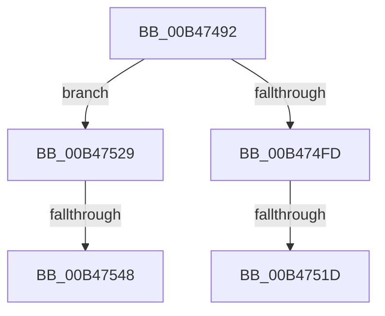

# sub_00B47492

- RVA: `0x00B47492`–`0x00B47551` (길이 `191` bytes)
- VA: `0x0000000140B47492`
- 실행 섹션: `PAGE`
- PDB 이름 있음: `아니요`; PDB Function 태그: `아니요`
- unwind 정보 RVA: `0x000B9628`
- 디코드: `40`개 명령, `191/191` bytes 표시
- 미해석 바이트: `0` (있으면 어셈블리에 `.byte`로 보존)

> 이 문서는 커널 이미지의 기계어와 PDB 기호를 분석해 생성했습니다. 4번과 5번은 함수 원형과 자료형을 바이너리 사용 방식에서 추정한 C 해석이며 원본 소스 복구 결과는 아닙니다.

## 1. Dependencies

- 직접 호출 지점: **4**; 고유 호출 대상: **4**
- 직접 호출자로 확인된 함수: **0**
- RIP 상대 이미지 참조: **4**

### Outgoing calls
- `0x00B4749A` → [RtlpGetBootStatusPath](../../text/5E/RtlpGetBootStatusPath_function_005E7A0C.md) (function, `0x005E7A0C`)
- `0x00B474AA` → [RtlInitUnicodeString](../../text/42/RtlInitUnicodeString_function_0042A780.md) (function, `0x0042A780`)
- `0x00B474F2` → [ZwOpenFile](../../text/6A/ZwOpenFile_function_006AD730.md) (function, `0x006AD730`)
- `0x00B4750F` → [RtlInitializeBootStatDataCache](../../text/5E/RtlInitializeBootStatDataCache_function_005E78F0.md) (function, `0x005E78F0`)

### Direct callers
- 이 함수 시작 RVA로 연결되는 직접 call은 확인되지 않았습니다. 간접 호출은 완전히 역산할 수 없습니다.

### Static image references
- `0x00B47501` → RVA `0x00F05C28` (`.data`; write)
- `0x00B47508` → RVA `0x00F05C20` (`.data`; write)
- `0x00B47529` → RVA `0x00F05C28` (`.data`; read/write)
- `0x00B47531` → RVA `0x00F05C44` (`.data`; read/write)

## 2. Other-region calls and transfers

- 다른 실행 섹션으로 향하는 call: **4**
  - `0x00B4749A` → [RtlpGetBootStatusPath](../../text/5E/RtlpGetBootStatusPath_function_005E7A0C.md) (`PAGE` → `.text`)
  - `0x00B474AA` → [RtlInitUnicodeString](../../text/42/RtlInitUnicodeString_function_0042A780.md) (`PAGE` → `.text`)
  - `0x00B474F2` → [ZwOpenFile](../../text/6A/ZwOpenFile_function_006AD730.md) (`PAGE` → `.text`)
  - `0x00B4750F` → [RtlInitializeBootStatDataCache](../../text/5E/RtlInitializeBootStatDataCache_function_005E78F0.md) (`PAGE` → `.text`)
- call이 아닌 외부 분기/꼬리 이동: **4**
  - `0x00B47517` → [RtlLockBootStatusData + 0x5D](../A9/RtlLockBootStatusData_function_00A94BE0.md) (`tail-transfer`)
  - `0x00B47524` → [RtlLockBootStatusData + 0x64](../A9/RtlLockBootStatusData_function_00A94BE0.md) (`tail-transfer`)
  - `0x00B47542` → [RtlLockBootStatusData + 0x64](../A9/RtlLockBootStatusData_function_00A94BE0.md) (`tail-transfer`)
  - `0x00B4754C` → [RtlLockBootStatusData + 0x64](../A9/RtlLockBootStatusData_function_00A94BE0.md) (`tail-transfer`)

## 3. Assembly (complete function range)

```asm
00B47492  48 8D 55 28                     lea rdx, [rbp + 0x28]
00B47496  48 8D 4D 38                     lea rcx, [rbp + 0x38]
00B4749A  E8 6D 05 AA FF                  call 0x1405e7a0c
00B4749F  48 8B 7D 38                     mov rdi, qword ptr [rbp + 0x38]
00B474A3  48 8D 4D B0                     lea rcx, [rbp - 0x50]
00B474A7  48 8B D7                        mov rdx, rdi
00B474AA  E8 D1 32 8E FF                  call 0x14042a780
00B474AF  48 21 75 D8                     and qword ptr [rbp - 0x28], rsi
00B474B3  48 8D 45 B0                     lea rax, [rbp - 0x50]
00B474B7  0F 57 C0                        xorps xmm0, xmm0
00B474BA  C7 44 24 28 20 00 00 00         mov dword ptr [rsp + 0x28], 0x20
00B474C2  4C 8D 4D C0                     lea r9, [rbp - 0x40]
00B474C6  48 89 45 E0                     mov qword ptr [rbp - 0x20], rax
00B474CA  4C 8D 45 D0                     lea r8, [rbp - 0x30]
00B474CE  C7 45 D0 30 00 00 00            mov dword ptr [rbp - 0x30], 0x30
00B474D5  BA 9F 01 12 00                  mov edx, 0x12019f
00B474DA  C7 45 E8 C0 02 00 00            mov dword ptr [rbp - 0x18], 0x2c0
00B474E1  48 8D 4D 30                     lea rcx, [rbp + 0x30]
00B474E5  C7 44 24 20 01 00 00 00         mov dword ptr [rsp + 0x20], 1
00B474ED  F3 0F 7F 45 F0                  movdqu xmmword ptr [rbp - 0x10], xmm0
00B474F2  E8 39 62 B6 FF                  call 0x1406ad730
00B474F7  8B F0                           mov esi, eax
00B474F9  85 C0                           test eax, eax
00B474FB  78 2C                           js 0x140b47529
00B474FD  48 8B 4D 30                     mov rcx, qword ptr [rbp + 0x30]
00B47501  48 89 0D 20 E7 3B 00            mov qword ptr [rip + 0x3be720], rcx
00B47508  C6 05 11 E7 3B 00 01            mov byte ptr [rip + 0x3be711], 1
00B4750F  E8 DC 03 AA FF                  call 0x1405e78f0
00B47514  48 85 DB                        test rbx, rbx
00B47517  0F 84 20 D7 F4 FF               je 0x140a94c3d
00B4751D  48 8B 4D 30                     mov rcx, qword ptr [rbp + 0x30]
00B47521  48 89 0B                        mov qword ptr [rbx], rcx
00B47524  E9 1B D7 F4 FF                  jmp 0x140a94c44
00B47529  48 83 25 F7 E6 3B 00 00         and qword ptr [rip + 0x3be6f7], 0
00B47531  83 25 0C E7 3B 00 00            and dword ptr [rip + 0x3be70c], 0
00B47538  C6 05 E1 E6 3B 00 00            mov byte ptr [rip + 0x3be6e1], 0
00B4753F  48 85 DB                        test rbx, rbx
00B47542  0F 84 FC D6 F4 FF               je 0x140a94c44
00B47548  48 83 23 00                     and qword ptr [rbx], 0
00B4754C  E9 F3 D6 F4 FF                  jmp 0x140a94c44
```

## 4. C-style interpretation (structured pseudocode)

```c
__int64 __fastcall sub_00B47492(void)
{
    __int64 result;
    unsigned int v_stack_p20;
    unsigned int v_stack_p28;

    result = RtlpGetBootStatusPath(v_rbp + 56, v_rbp + 40, a3, a4);
    result = RtlInitUnicodeString(v_rbp - 80, *(unsigned __int64 *)(v_rbp + 56), a3, a4);
    v_stack_p28 = 32;
    *(unsigned __int64 *)(v_rbp - 32) = v_rbp - 80;
    *(unsigned int *)(v_rbp - 48) = 48;
    *(unsigned int *)(v_rbp - 24) = 704;
    v_stack_p20 = 1;
    *(unsigned __int64 *)(v_rbp - 16) = v_xmm0;
    result = ZwOpenFile(v_rbp + 48, (unsigned int)(0x12019FULL), v_rbp - 48, v_rbp - 64);
    if (sign_flag) goto loc_00B47529;
    *(unsigned __int64 *)(v_rip + 3925792) = *(unsigned __int64 *)(v_rbp + 48);
    *(unsigned __int8 *)(v_rip + 3925777) = 1;
    result = RtlInitializeBootStatDataCache(*(unsigned __int64 *)(v_rbp + 48), (unsigned int)(0x12019FULL), v_rbp - 48, v_rbp - 64);
    *(unsigned __int64 *)(v_rbx) = *(unsigned __int64 *)(v_rbp + 48);
loc_00B47529:
    *(unsigned __int8 *)(v_rip + 3925729) = 0;
}
```

## 5. (Beta) C Style

```c
void sub_00B47492(void)
{
    int64_t result;
    uint32_t v_stack_p20;
    uint32_t v_stack_p28;

    result = RtlpGetBootStatusPath(local_rbp + 56, local_rbp + 40, a3, a4);
    result = RtlInitUnicodeString(local_rbp - 80, *(uint64_t *)(local_rbp + 0x38), a3, a4);
    v_stack_p28 = 32;
    *(uint64_t *)(local_rbp - 0x20) = local_rbp - 80;
    *(uint32_t *)(local_rbp - 0x30) = 48;
    *(uint32_t *)(local_rbp - 0x18) = 704;
    v_stack_p20 = 1;
    *(uint64_t *)(local_rbp - 0x10) = v_xmm0;
    result = ZwOpenFile(local_rbp + 48, (uint32_t)(0x12019FULL), local_rbp - 48, local_rbp - 64);
    if (sign_flag) goto loc_00B47529;
    *(uint64_t *)(v_rip + 0x3BE720) = *(uint64_t *)(local_rbp + 0x30);
    *(uint8_t *)(v_rip + 0x3BE711) = 1;
    result = RtlInitializeBootStatDataCache(*(uint64_t *)(local_rbp + 0x30), (uint32_t)(0x12019FULL), local_rbp - 48, local_rbp - 64);
    *(uint64_t *)(local_rbx) = *(uint64_t *)(local_rbp + 0x30);
loc_00B47529:
    *(uint8_t *)(v_rip + 0x3BE6E1) = 0;
}
```

## 6. Execution-region graph

[열기: 2D/3D 그래프와 함수 탐색 컨트롤 패널](../../../control-panel.html?section=page&rva=0x00B47492&view=graph)

- 2D 그래프는 위에서 아래로 흐르고, 3D 그래프는 빈 공간을 드래그해 회전합니다. Shift+드래그는 이동, 휠은 확대·축소, 함수 노드 선택은 대상 보고서 이동입니다.

### Static fallback


