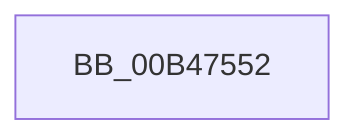

# sub_00B47552

- RVA: `0x00B47552`–`0x00B475B1` (길이 `95` bytes)
- VA: `0x0000000140B47552`
- 실행 섹션: `PAGE`
- PDB 이름 있음: `아니요`; PDB Function 태그: `아니요`
- unwind 정보 RVA: `0x000B9708`
- 디코드: `23`개 명령, `95/95` bytes 표시
- 미해석 바이트: `0` (있으면 어셈블리에 `.byte`로 보존)

> 이 문서는 커널 이미지의 기계어와 PDB 기호를 분석해 생성했습니다. 4번과 5번은 함수 원형과 자료형을 바이너리 사용 방식에서 추정한 C 해석이며 원본 소스 복구 결과는 아닙니다.

## 1. Dependencies

- 직접 호출 지점: **3**; 고유 호출 대상: **3**
- 직접 호출자로 확인된 함수: **0**
- RIP 상대 이미지 참조: **1**

### Outgoing calls
- `0x00B4755D` → [RtlInitUnicodeString](../../text/42/RtlInitUnicodeString_function_0042A780.md) (function, `0x0042A780`)
- `0x00B47591` → [ZwQueryValueKey](../../text/6A/ZwQueryValueKey_function_006AD3B0.md) (function, `0x006AD3B0`)
- `0x00B475A6` → [ZwClose](../../text/6A/ZwClose_function_006AD2B0.md) (function, `0x006AD2B0`)

### Direct callers
- 이 함수 시작 RVA로 연결되는 직접 call은 확인되지 않았습니다. 간접 호출은 완전히 역산할 수 없습니다.

### Static image references
- `0x00B47552` → RVA `0x00029508` (`.rdata`; read)

## 2. Other-region calls and transfers

- 다른 실행 섹션으로 향하는 call: **3**
  - `0x00B4755D` → [RtlInitUnicodeString](../../text/42/RtlInitUnicodeString_function_0042A780.md) (`PAGE` → `.text`)
  - `0x00B47591` → [ZwQueryValueKey](../../text/6A/ZwQueryValueKey_function_006AD3B0.md) (`PAGE` → `.text`)
  - `0x00B475A6` → [ZwClose](../../text/6A/ZwClose_function_006AD2B0.md) (`PAGE` → `.text`)
- call이 아닌 외부 분기/꼬리 이동: **1**
  - `0x00B475AC` → [PopReadHiberbootPolicy + 0x54](../A9/PopReadHiberbootPolicy_function_00A9517C.md) (`tail-transfer`)

## 3. Assembly (complete function range)

```asm
00B47552  48 8D 15 AF 1F 4E FF            lea rdx, [rip - 0xb1e051]
00B47559  48 8D 4D D0                     lea rcx, [rbp - 0x30]
00B4755D  E8 1E 32 8E FF                  call 0x14042a780
00B47562  48 8B 4D C8                     mov rcx, qword ptr [rbp - 0x38]
00B47566  4C 8D 4D E0                     lea r9, [rbp - 0x20]
00B4756A  33 C0                           xor eax, eax
00B4756C  48 8D 55 D0                     lea rdx, [rbp - 0x30]
00B47570  89 45 F0                        mov dword ptr [rbp - 0x10], eax
00B47573  0F 57 C0                        xorps xmm0, xmm0
00B47576  48 8D 45 C4                     lea rax, [rbp - 0x3c]
00B4757A  41 B8 02 00 00 00               mov r8d, 2
00B47580  48 89 44 24 28                  mov qword ptr [rsp + 0x28], rax
00B47585  C7 44 24 20 14 00 00 00         mov dword ptr [rsp + 0x20], 0x14
00B4758D  0F 11 45 E0                     movups xmmword ptr [rbp - 0x20], xmm0
00B47591  E8 1A 5E B6 FF                  call 0x1406ad3b0
00B47596  0F B6 55 EC                     movzx edx, byte ptr [rbp - 0x14]
00B4759A  85 C0                           test eax, eax
00B4759C  48 8B 4D C8                     mov rcx, qword ptr [rbp - 0x38]
00B475A0  0F B6 DB                        movzx ebx, bl
00B475A3  0F 49 DA                        cmovns ebx, edx
00B475A6  E8 05 5D B6 FF                  call 0x1406ad2b0
00B475AB  90                              nop
00B475AC  E9 1F DC F4 FF                  jmp 0x140a951d0
```

## 4. C-style interpretation (structured pseudocode)

```c
__int64 __fastcall sub_00B47552(void)
{
    __int64 result;
    __int64 v_rbx;
    unsigned int v_stack_p20;
    unsigned __int64 v_stack_p28;

    result = RtlInitUnicodeString(v_rbp - 48, v_rip - 11657297, a3, a4);
    result = 0;
    *(unsigned int *)(v_rbp - 16) = 0;
    v_stack_p28 = v_rbp - 60;
    v_stack_p20 = 20;
    *(unsigned __int64 *)(v_rbp - 32) = v_xmm0;
    result = ZwQueryValueKey(*(unsigned __int64 *)(v_rbp - 56), v_rbp - 48, 2, v_rbp - 32);
    v_rbx = (unsigned __int8)(v_rbx);
    if (!sign_flag) { v_rbx = (unsigned int)(*(unsigned __int8 *)(v_rbp - 20)); }
    result = ZwClose(*(unsigned __int64 *)(v_rbp - 56), *(unsigned __int8 *)(v_rbp - 20), 2, v_rbp - 32);
}
```

## 5. (Beta) C Style

```c
void sub_00B47552(void)
{
    int64_t result;
    int64_t local_rbx;
    uint32_t v_stack_p20;
    uint64_t v_stack_p28;

    result = RtlInitUnicodeString(local_rbp - 48, v_rip - 11657297, a3, a4);
    result = 0;
    *(uint32_t *)(local_rbp - 0x10) = 0;
    v_stack_p28 = local_rbp - 60;
    v_stack_p20 = 20;
    *(uint64_t *)(local_rbp - 0x20) = v_xmm0;
    result = ZwQueryValueKey(*(uint64_t *)(local_rbp - 0x38), local_rbp - 48, 2, local_rbp - 32);
    local_rbx = (uint8_t)(local_rbx);
    if (!sign_flag) { local_rbx = (uint32_t)(*(uint8_t *)(local_rbp - 0x14)); }
    result = ZwClose(*(uint64_t *)(local_rbp - 0x38), *(uint8_t *)(local_rbp - 0x14), 2, local_rbp - 32);
}
```

## 6. Execution-region graph

[열기: 2D/3D 그래프와 함수 탐색 컨트롤 패널](../../../control-panel.html?section=page&rva=0x00B47552&view=graph)

- 2D 그래프는 위에서 아래로 흐르고, 3D 그래프는 빈 공간을 드래그해 회전합니다. Shift+드래그는 이동, 휠은 확대·축소, 함수 노드 선택은 대상 보고서 이동입니다.

### Static fallback


