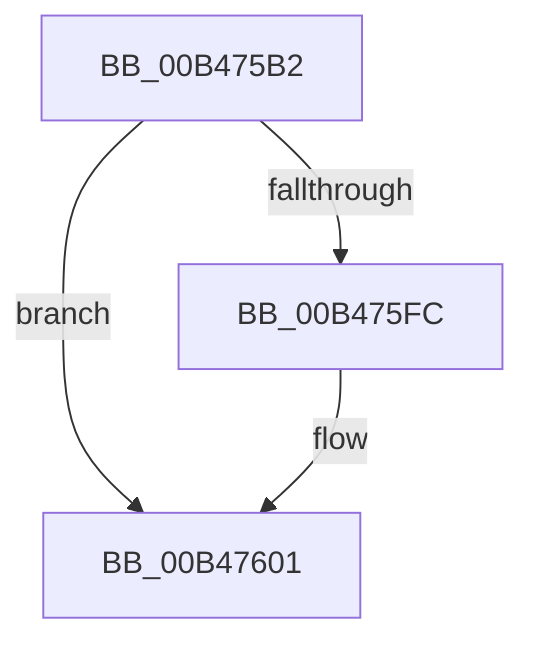

# sub_00B475B2

- RVA: `0x00B475B2`–`0x00B47610` (길이 `94` bytes)
- VA: `0x0000000140B475B2`
- 실행 섹션: `PAGE`
- PDB 이름 있음: `아니요`; PDB Function 태그: `아니요`
- unwind 정보 RVA: `0x000B9738`
- 디코드: `24`개 명령, `94/94` bytes 표시
- 미해석 바이트: `0` (있으면 어셈블리에 `.byte`로 보존)

> 이 문서는 커널 이미지의 기계어와 PDB 기호를 분석해 생성했습니다. 4번과 5번은 함수 원형과 자료형을 바이너리 사용 방식에서 추정한 C 해석이며 원본 소스 복구 결과는 아닙니다.

## 1. Dependencies

- 직접 호출 지점: **3**; 고유 호출 대상: **3**
- 직접 호출자로 확인된 함수: **0**
- RIP 상대 이미지 참조: **1**

### Outgoing calls
- `0x00B475BD` → [RtlInitUnicodeString](../../text/42/RtlInitUnicodeString_function_0042A780.md) (function, `0x0042A780`)
- `0x00B475F1` → [ZwQueryValueKey](../../text/6A/ZwQueryValueKey_function_006AD3B0.md) (function, `0x006AD3B0`)
- `0x00B47605` → [ZwClose](../../text/6A/ZwClose_function_006AD2B0.md) (function, `0x006AD2B0`)

### Direct callers
- 이 함수 시작 RVA로 연결되는 직접 call은 확인되지 않았습니다. 간접 호출은 완전히 역산할 수 없습니다.

### Static image references
- `0x00B475B2` → RVA `0x00029508` (`.rdata`; read)

## 2. Other-region calls and transfers

- 다른 실행 섹션으로 향하는 call: **3**
  - `0x00B475BD` → [RtlInitUnicodeString](../../text/42/RtlInitUnicodeString_function_0042A780.md) (`PAGE` → `.text`)
  - `0x00B475F1` → [ZwQueryValueKey](../../text/6A/ZwQueryValueKey_function_006AD3B0.md) (`PAGE` → `.text`)
  - `0x00B47605` → [ZwClose](../../text/6A/ZwClose_function_006AD2B0.md) (`PAGE` → `.text`)
- call이 아닌 외부 분기/꼬리 이동: **1**
  - `0x00B4760B` → [PopReadHiberbootGroupPolicy + 0x94](../A9/PopReadHiberbootGroupPolicy_function_00A95204.md) (`tail-transfer`)

## 3. Assembly (complete function range)

```asm
00B475B2  48 8D 15 4F 1F 4E FF            lea rdx, [rip - 0xb1e0b1]
00B475B9  48 8D 4D F7                     lea rcx, [rbp - 9]
00B475BD  E8 BE 31 8E FF                  call 0x14042a780
00B475C2  48 8B 4D EF                     mov rcx, qword ptr [rbp - 0x11]
00B475C6  4C 8D 4D 37                     lea r9, [rbp + 0x37]
00B475CA  33 C0                           xor eax, eax
00B475CC  48 8D 55 F7                     lea rdx, [rbp - 9]
00B475D0  89 45 47                        mov dword ptr [rbp + 0x47], eax
00B475D3  0F 57 C0                        xorps xmm0, xmm0
00B475D6  48 8D 45 E7                     lea rax, [rbp - 0x19]
00B475DA  41 B8 02 00 00 00               mov r8d, 2
00B475E0  48 89 44 24 28                  mov qword ptr [rsp + 0x28], rax
00B475E5  C7 44 24 20 14 00 00 00         mov dword ptr [rsp + 0x20], 0x14
00B475ED  0F 11 45 37                     movups xmmword ptr [rbp + 0x37], xmm0
00B475F1  E8 BA 5D B6 FF                  call 0x1406ad3b0
00B475F6  8B D8                           mov ebx, eax
00B475F8  85 C0                           test eax, eax
00B475FA  78 05                           js 0x140b47601
00B475FC  8A 45 43                        mov al, byte ptr [rbp + 0x43]
00B475FF  88 07                           mov byte ptr [rdi], al
00B47601  48 8B 4D EF                     mov rcx, qword ptr [rbp - 0x11]
00B47605  E8 A6 5C B6 FF                  call 0x1406ad2b0
00B4760A  90                              nop
00B4760B  E9 88 DC F4 FF                  jmp 0x140a95298
```

## 4. C-style interpretation (structured pseudocode)

```c
__int64 __fastcall sub_00B475B2(void)
{
    __int64 result;
    unsigned int v_stack_p20;
    unsigned __int64 v_stack_p28;

    result = RtlInitUnicodeString(v_rbp - 9, v_rip - 11657393, a3, a4);
    result = 0;
    *(unsigned int *)(v_rbp + 71) = 0;
    v_stack_p28 = v_rbp - 25;
    v_stack_p20 = 20;
    *(unsigned __int64 *)(v_rbp + 55) = v_xmm0;
    result = ZwQueryValueKey(*(unsigned __int64 *)(v_rbp - 17), v_rbp - 9, 2, v_rbp + 55);
    if (!(sign_flag)) {
        result = *(unsigned __int8 *)(v_rbp + 67);
        *(unsigned __int8 *)(v_rdi) = (unsigned __int8)(result);
    }
    result = ZwClose(*(unsigned __int64 *)(v_rbp - 17), v_rbp - 9, 2, v_rbp + 55);
}
```

## 5. (Beta) C Style

```c
void sub_00B475B2(void)
{
    int64_t result;
    uint32_t v_stack_p20;
    uint64_t v_stack_p28;

    result = RtlInitUnicodeString(local_rbp - 9, v_rip - 11657393, a3, a4);
    result = 0;
    *(uint32_t *)(local_rbp + 0x47) = 0;
    v_stack_p28 = local_rbp - 25;
    v_stack_p20 = 20;
    *(uint64_t *)(local_rbp + 0x37) = v_xmm0;
    result = ZwQueryValueKey(*(uint64_t *)(local_rbp - 0x11), local_rbp - 9, 2, local_rbp + 55);
    if (!(sign_flag)) {
        result = *(uint8_t *)(local_rbp + 0x43);
        *(uint8_t *)(local_rdi) = (uint8_t)(result);
    }
    result = ZwClose(*(uint64_t *)(local_rbp - 0x11), local_rbp - 9, 2, local_rbp + 55);
}
```

## 6. Execution-region graph

[열기: 2D/3D 그래프와 함수 탐색 컨트롤 패널](../../../control-panel.html?section=page&rva=0x00B475B2&view=graph)

- 2D 그래프는 위에서 아래로 흐르고, 3D 그래프는 빈 공간을 드래그해 회전합니다. Shift+드래그는 이동, 휠은 확대·축소, 함수 노드 선택은 대상 보고서 이동입니다.

### Static fallback


