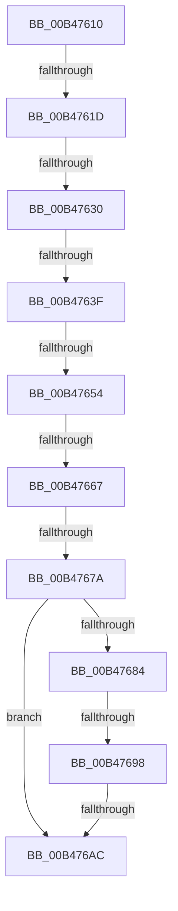

# sub_00B47610

- RVA: `0x00B47610`–`0x00B476B7` (길이 `167` bytes)
- VA: `0x0000000140B47610`
- 실행 섹션: `PAGE`
- PDB 이름 있음: `아니요`; PDB Function 태그: `아니요`
- unwind 정보 RVA: `0x000B97C4`
- 디코드: `31`개 명령, `167/167` bytes 표시
- 미해석 바이트: `0` (있으면 어셈블리에 `.byte`로 보존)

> 이 문서는 커널 이미지의 기계어와 PDB 기호를 분석해 생성했습니다. 4번과 5번은 함수 원형과 자료형을 바이너리 사용 방식에서 추정한 C 해석이며 원본 소스 복구 결과는 아닙니다.

## 1. Dependencies

- 직접 호출 지점: **2**; 고유 호출 대상: **2**
- 직접 호출자로 확인된 함수: **0**
- RIP 상대 이미지 참조: **4**

### Outgoing calls
- `0x00B4768B` → [PopIsHiberbootSupported](../70/PopIsHiberbootSupported_function_00702F8C.md) (function, `0x00702F8C`)
- `0x00B4769F` → [PopIsHibernateSupported](../AA/PopIsHibernateSupported_function_00AA3DFC.md) (function, `0x00AA3DFC`)

### Direct callers
- 이 함수 시작 RVA로 연결되는 직접 call은 확인되지 않았습니다. 간접 호출은 완전히 역산할 수 없습니다.

### Static image references
- `0x00B47610` → RVA `0x00F0CEC4` (`.data`; read)
- `0x00B47623` → RVA `0x00F0CEC3` (`.data`; read)
- `0x00B4766D` → RVA `0x00F0CEC5` (`.data`; read)
- `0x00B47684` → RVA `0x00F0CEC0` (`.data`; read)

## 2. Other-region calls and transfers

- 다른 실행 섹션으로 향하는 call: **0**
- call이 아닌 외부 분기/꼬리 이동: **9**
  - `0x00B47617` → [PopVerifySystemPowerState + 0x3C](../A9/PopVerifySystemPowerState_function_00A9537C.md) (`tail-transfer`)
  - `0x00B4762A` → [PopVerifySystemPowerState + 0x3C](../A9/PopVerifySystemPowerState_function_00A9537C.md) (`tail-transfer`)
  - `0x00B47639` → [PopVerifySystemPowerState + 0x3C](../A9/PopVerifySystemPowerState_function_00A9537C.md) (`tail-transfer`)
  - `0x00B4764E` → [PopVerifySystemPowerState + 0x3C](../A9/PopVerifySystemPowerState_function_00A9537C.md) (`tail-transfer`)
  - `0x00B47661` → [PopVerifySystemPowerState + 0x3C](../A9/PopVerifySystemPowerState_function_00A9537C.md) (`tail-transfer`)
  - `0x00B47674` → [PopVerifySystemPowerState + 0x3C](../A9/PopVerifySystemPowerState_function_00A9537C.md) (`tail-transfer`)
  - `0x00B47692` → [PopVerifySystemPowerState + 0x3C](../A9/PopVerifySystemPowerState_function_00A9537C.md) (`tail-transfer`)
  - `0x00B476A6` → [PopVerifySystemPowerState + 0x3C](../A9/PopVerifySystemPowerState_function_00A9537C.md) (`tail-transfer`)
  - `0x00B476B2` → [PopVerifySystemPowerState + 0x3C](../A9/PopVerifySystemPowerState_function_00A9537C.md) (`tail-transfer`)

## 3. Assembly (complete function range)

```asm
00B47610  80 3D AD 58 3C 00 00            cmp byte ptr [rip + 0x3c58ad], 0
00B47617  0F 85 9B DD F4 FF               jne 0x140a953b8
00B4761D  41 B9 02 00 00 00               mov r9d, 2
00B47623  80 3D 99 58 3C 00 00            cmp byte ptr [rip + 0x3c5899], 0
00B4762A  0F 85 88 DD F4 FF               jne 0x140a953b8
00B47630  41 B9 01 00 00 00               mov r9d, 1
00B47636  45 3B D1                        cmp r10d, r9d
00B47639  0F 85 79 DD F4 FF               jne 0x140a953b8
00B4763F  32 C0                           xor al, al
00B47641  41 B9 02 00 00 00               mov r9d, 2
00B47647  80 3D 75 58 3C 00 00            cmp byte ptr [rip + 0x3c5875], 0
00B4764E  0F 85 64 DD F4 FF               jne 0x140a953b8
00B47654  41 B9 03 00 00 00               mov r9d, 3
00B4765A  80 3D 63 58 3C 00 00            cmp byte ptr [rip + 0x3c5863], 0
00B47661  0F 85 51 DD F4 FF               jne 0x140a953b8
00B47667  41 B9 04 00 00 00               mov r9d, 4
00B4766D  80 3D 51 58 3C 00 00            cmp byte ptr [rip + 0x3c5851], 0
00B47674  0F 85 3E DD F4 FF               jne 0x140a953b8
00B4767A  41 B9 05 00 00 00               mov r9d, 5
00B47680  84 C0                           test al, al
00B47682  74 28                           je 0x140b476ac
00B47684  48 8D 0D 35 58 3C 00            lea rcx, [rip + 0x3c5835]
00B4768B  E8 FC B8 BB FF                  call 0x140702f8c
00B47690  84 C0                           test al, al
00B47692  0F 85 20 DD F4 FF               jne 0x140a953b8
00B47698  48 8D 0D 21 58 3C 00            lea rcx, [rip + 0x3c5821]
00B4769F  E8 58 C7 F5 FF                  call 0x140aa3dfc
00B476A4  84 C0                           test al, al
00B476A6  0F 85 0C DD F4 FF               jne 0x140a953b8
00B476AC  41 B9 01 00 00 00               mov r9d, 1
00B476B2  E9 01 DD F4 FF                  jmp 0x140a953b8
```

## 4. C-style interpretation (structured pseudocode)

```c
__int64 __fastcall sub_00B47610(void)
{
    __int64 result;

    result = 0;
    if (0 == 0) goto loc_00B476AC;
    result = PopIsHiberbootSupported(v_rip + 3954741, a2, a3, 5);
    result = PopIsHibernateSupported(v_rip + 3954721, a2, a3, 5);
loc_00B476AC:
}
```

## 5. (Beta) C Style

```c
void sub_00B47610(void)
{
    int64_t result;

    result = 0;
    if (0 == 0) goto loc_00B476AC;
    result = PopIsHiberbootSupported(v_rip + 3954741, a2, a3, 5);
    result = PopIsHibernateSupported(v_rip + 3954721, a2, a3, 5);
loc_00B476AC:
}
```

## 6. Execution-region graph

[열기: 2D/3D 그래프와 함수 탐색 컨트롤 패널](../../../control-panel.html?section=page&rva=0x00B47610&view=graph)

- 2D 그래프는 위에서 아래로 흐르고, 3D 그래프는 빈 공간을 드래그해 회전합니다. Shift+드래그는 이동, 휠은 확대·축소, 함수 노드 선택은 대상 보고서 이동입니다.

### Static fallback


