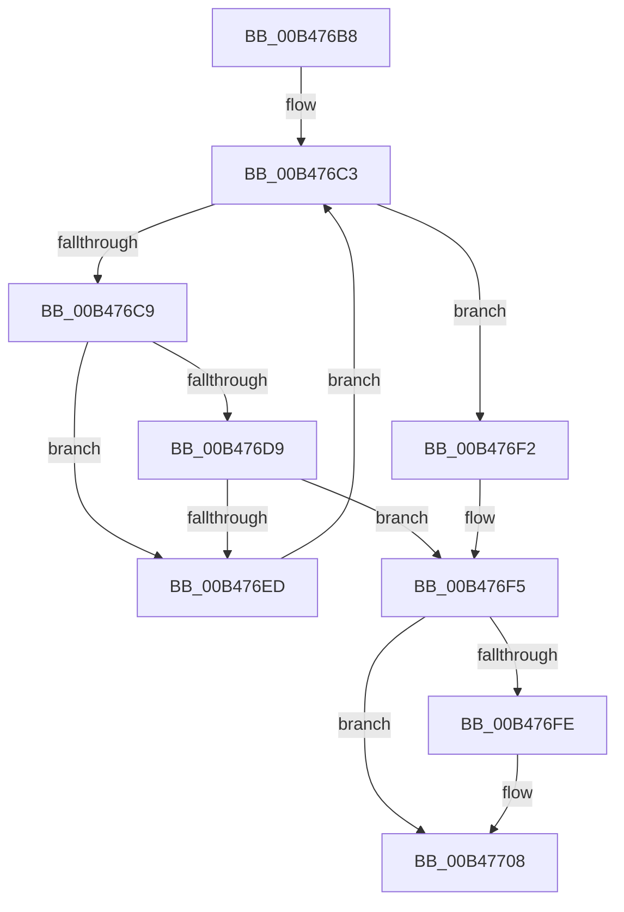

# sub_00B476B8

- RVA: `0x00B476B8`–`0x00B4770F` (길이 `87` bytes)
- VA: `0x0000000140B476B8`
- 실행 섹션: `PAGE`
- PDB 이름 있음: `아니요`; PDB Function 태그: `아니요`
- unwind 정보 RVA: `0x000B97F0`
- 디코드: `25`개 명령, `87/87` bytes 표시
- 미해석 바이트: `0` (있으면 어셈블리에 `.byte`로 보존)

> 이 문서는 커널 이미지의 기계어와 PDB 기호를 분석해 생성했습니다. 4번과 5번은 함수 원형과 자료형을 바이너리 사용 방식에서 추정한 C 해석이며 원본 소스 복구 결과는 아닙니다.

## 1. Dependencies

- 직접 호출 지점: **2**; 고유 호출 대상: **2**
- 직접 호출자로 확인된 함수: **0**
- RIP 상대 이미지 참조: **1**

### Outgoing calls
- `0x00B476E4` → [wcsnicmp](../../text/50/wcsnicmp_function_005001C0.md) (function, `0x005001C0`)
- `0x00B47703` → [RtlFreeAnsiString](../9C/RtlFreeAnsiString_function_009C0800.md) (function, `0x009C0800`)

### Direct callers
- 이 함수 시작 RVA로 연결되는 직접 call은 확인되지 않았습니다. 간접 호출은 완전히 역산할 수 없습니다.

### Static image references
- `0x00B476F5` → RVA `0x00FC6AA8` (`ALMOSTRO`; read)

## 2. Other-region calls and transfers

- 다른 실행 섹션으로 향하는 call: **1**
  - `0x00B476E4` → [wcsnicmp](../../text/50/wcsnicmp_function_005001C0.md) (`PAGE` → `.text`)
- call이 아닌 외부 분기/꼬리 이동: **1**
  - `0x00B4770A` → [EtwpApplyContainerFilter + 0x76](../A9/EtwpApplyContainerFilter_function_00A95454.md) (`tail-transfer`)

## 3. Assembly (complete function range)

```asm
00B476B8  44 0F B7 F0                     movzx r14d, ax
00B476BC  41 0F B7 FC                     movzx edi, r12w
00B476C0  41 D1 EE                        shr r14d, 1
00B476C3  66 3B 7D 00                     cmp di, word ptr [rbp]
00B476C7  73 29                           jae 0x140b476f2
00B476C9  0F B7 CF                        movzx ecx, di
00B476CC  48 03 C9                        add rcx, rcx
00B476CF  0F B7 44 CD 08                  movzx eax, word ptr [rbp + rcx*8 + 8]
00B476D4  41 3B C6                        cmp eax, r14d
00B476D7  75 14                           jne 0x140b476ed
00B476D9  48 8B 4C CD 10                  mov rcx, qword ptr [rbp + rcx*8 + 0x10]
00B476DE  49 8B D7                        mov rdx, r15
00B476E1  45 8B C6                        mov r8d, r14d
00B476E4  E8 D7 8A 9B FF                  call 0x1405001c0
00B476E9  85 C0                           test eax, eax
00B476EB  74 08                           je 0x140b476f5
00B476ED  66 03 FB                        add di, bx
00B476F0  EB D1                           jmp 0x140b476c3
00B476F2  41 8A DC                        mov bl, r12b
00B476F5  48 3B 35 AC F3 47 00            cmp rsi, qword ptr [rip + 0x47f3ac]
00B476FC  74 0A                           je 0x140b47708
00B476FE  48 8D 4C 24 30                  lea rcx, [rsp + 0x30]
00B47703  E8 F8 90 E7 FF                  call 0x1409c0800
00B47708  8A C3                           mov al, bl
00B4770A  E9 BB DD F4 FF                  jmp 0x140a954ca
```

## 4. C-style interpretation (structured pseudocode)

```c
__int64 __fastcall sub_00B476B8(__int64 a1, __int64 a2, __int64 a3, __int64 a4, __int64 a5, __int64 a6)
{
    __int64 result;
    __int64 v_r14;
    __int64 v_rdi;

    v_r14 = (unsigned int)(((unsigned __int16)(result)) >> (1));
loc_00B476C3:
    if (((unsigned __int16)((unsigned __int16)(v_r12))) >= (*(unsigned __int16 *)(v_rbp))) goto loc_00B476F2;
    a1 = ((unsigned __int16)((unsigned __int16)(v_r12))) + ((unsigned __int16)((unsigned __int16)(v_r12)));
    if (((unsigned int)(*(unsigned __int16 *)(v_rbp + a1 * 8 + 8))) != ((unsigned int)(v_r14))) goto loc_00B476ED;
    result = wcsnicmp(*(unsigned __int64 *)(v_rbp + a1 * 8 + 16), v_r15, (unsigned int)((unsigned int)(v_r14)), a4);
    if ((unsigned int)(result) == 0) goto loc_00B476F5;
loc_00B476ED:
    v_rdi = (unsigned __int16)(((unsigned __int16)(v_r12)) + ((unsigned __int16)(v_rbx)));
    goto loc_00B476C3;
loc_00B476F2:
loc_00B476F5:
    if (v_rsi != (*(unsigned __int64 *)(v_rip + 4715436))) {
        a1 = a6;
        result = RtlFreeAnsiString(a1, v_r15, (unsigned int)((unsigned int)(v_r14)), a4);
    }
}
```

## 5. (Beta) C Style

```c
int64_t sub_00B476B8(int64_t Arg1, int64_t Arg2, int64_t Arg3, int64_t Arg4, uint64_t Arg5, int64_t Arg6)
{
    int64_t result;
    int64_t local_r14;
    int64_t local_rdi;

    local_r14 = (uint32_t)(((uint16_t)(result)) >> (1));
loc_00B476C3:
    if (((uint16_t)((uint16_t)(local_r12))) >= (*(uint16_t *)(local_rbp))) goto loc_00B476F2;
    Arg1 = ((uint16_t)((uint16_t)(local_r12))) + ((uint16_t)((uint16_t)(local_r12)));
    if (((uint32_t)(*(uint16_t *)(local_rbp + Arg1 * 8 + 0x8))) != ((uint32_t)(local_r14))) goto loc_00B476ED;
    result = wcsnicmp(*(uint64_t *)(local_rbp + Arg1 * 8 + 0x10), local_r15, (uint32_t)((uint32_t)(local_r14)), Arg4);
    if ((uint32_t)(result) == 0) goto loc_00B476F5;
loc_00B476ED:
    local_rdi = (uint16_t)(((uint16_t)(local_r12)) + ((uint16_t)(local_rbx)));
    goto loc_00B476C3;
loc_00B476F2:
loc_00B476F5:
    if (local_rsi != (*(uint64_t *)(v_rip + 0x47F3AC))) {
        Arg1 = Arg6;
        result = RtlFreeAnsiString(Arg1, local_r15, (uint32_t)((uint32_t)(local_r14)), Arg4);
    }
}
```

## 6. Execution-region graph

[열기: 2D/3D 그래프와 함수 탐색 컨트롤 패널](../../../control-panel.html?section=page&rva=0x00B476B8&view=graph)

- 2D 그래프는 위에서 아래로 흐르고, 3D 그래프는 빈 공간을 드래그해 회전합니다. Shift+드래그는 이동, 휠은 확대·축소, 함수 노드 선택은 대상 보고서 이동입니다.

### Static fallback


