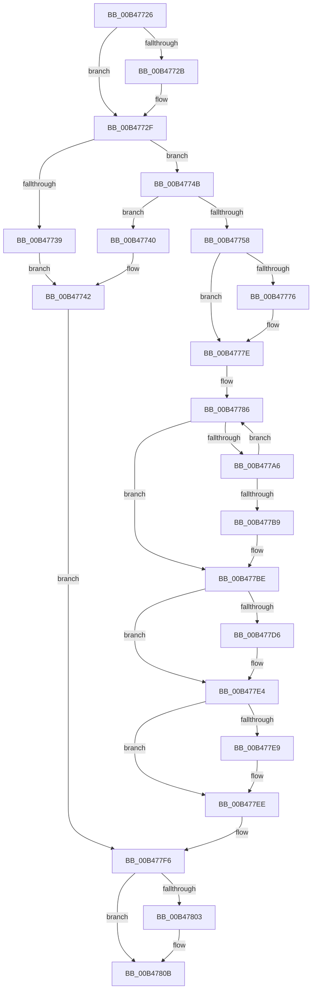

# sub_00B47726

- RVA: `0x00B47726`–`0x00B4781A` (길이 `244` bytes)
- VA: `0x0000000140B47726`
- 실행 섹션: `PAGE`
- PDB 이름 있음: `아니요`; PDB Function 태그: `아니요`
- unwind 정보 RVA: `0x000B9918`
- 디코드: `64`개 명령, `244/244` bytes 표시
- 미해석 바이트: `0` (있으면 어셈블리에 `.byte`로 보존)

> 이 문서는 커널 이미지의 기계어와 PDB 기호를 분석해 생성했습니다. 4번과 5번은 함수 원형과 자료형을 바이너리 사용 방식에서 추정한 C 해석이며 원본 소스 복구 결과는 아닙니다.

## 1. Dependencies

- 직접 호출 지점: **7**; 고유 호출 대상: **5**
- 직접 호출자로 확인된 함수: **0**
- RIP 상대 이미지 참조: **0**

### Outgoing calls
- `0x00B47779` → [ExfTryToWakePushLock](../../text/26/ExfTryToWakePushLock_function_00265DD0.md) (function, `0x00265DD0`)
- `0x00B47781` → [KeAbPostRelease](../../text/2E/KeAbPostRelease_function_002E1600.md) (function, `0x002E1600`)
- `0x00B4779B` → [KeWaitForSingleObject](../../text/20/KeWaitForSingleObject_function_0020E6B0.md) (function, `0x0020E6B0`)
- `0x00B477C6` → [KeAbPreAcquire](../../text/21/KeAbPreAcquire_function_00210230.md) (function, `0x00210230`)
- `0x00B477DF` → [ExfAcquirePushLockExclusiveEx](../../text/20/ExfAcquirePushLockExclusiveEx_function_0020FC90.md) (function, `0x0020FC90`)
- `0x00B47806` → [ExfTryToWakePushLock](../../text/26/ExfTryToWakePushLock_function_00265DD0.md) (function, `0x00265DD0`)
- `0x00B4780E` → [KeAbPostRelease](../../text/2E/KeAbPostRelease_function_002E1600.md) (function, `0x002E1600`)

### Direct callers
- 이 함수 시작 RVA로 연결되는 직접 call은 확인되지 않았습니다. 간접 호출은 완전히 역산할 수 없습니다.

### Static image references
- 디코드된 RIP-relative 메모리 참조가 없습니다.

## 2. Other-region calls and transfers

- 다른 실행 섹션으로 향하는 call: **7**
  - `0x00B47779` → [ExfTryToWakePushLock](../../text/26/ExfTryToWakePushLock_function_00265DD0.md) (`PAGE` → `.text`)
  - `0x00B47781` → [KeAbPostRelease](../../text/2E/KeAbPostRelease_function_002E1600.md) (`PAGE` → `.text`)
  - `0x00B4779B` → [KeWaitForSingleObject](../../text/20/KeWaitForSingleObject_function_0020E6B0.md) (`PAGE` → `.text`)
  - `0x00B477C6` → [KeAbPreAcquire](../../text/21/KeAbPreAcquire_function_00210230.md) (`PAGE` → `.text`)
  - `0x00B477DF` → [ExfAcquirePushLockExclusiveEx](../../text/20/ExfAcquirePushLockExclusiveEx_function_0020FC90.md) (`PAGE` → `.text`)
  - `0x00B47806` → [ExfTryToWakePushLock](../../text/26/ExfTryToWakePushLock_function_00265DD0.md) (`PAGE` → `.text`)
  - `0x00B4780E` → [KeAbPostRelease](../../text/2E/KeAbPostRelease_function_002E1600.md) (`PAGE` → `.text`)
- call이 아닌 외부 분기/꼬리 이동: **1**
  - `0x00B47815` → [AlpcpWaitForPortReferences + 0x72](../A9/AlpcpWaitForPortReferences_function_00A95A9C.md) (`tail-transfer`)

## 3. Assembly (complete function range)

```asm
00B47726  48 85 DB                        test rbx, rbx
00B47729  74 04                           je 0x140b4772f
00B4772B  C6 43 0A 01                     mov byte ptr [rbx + 0xa], 1
00B4772F  49 83 BE 98 01 00 00 00         cmp qword ptr [r14 + 0x198], 0
00B47737  74 12                           je 0x140b4774b
00B47739  BE 0D 00 00 C0                  mov esi, 0xc000000d
00B4773E  EB 02                           jmp 0x140b47742
00B47740  33 F6                           xor esi, esi
00B47742  48 83 CB FF                     or rbx, 0xffffffffffffffff
00B47746  E9 AB 00 00 00                  jmp 0x140b477f6
00B4774B  41 8B 86 94 01 00 00            mov eax, dword ptr [r14 + 0x194]
00B47752  3B 44 24 48                     cmp eax, dword ptr [rsp + 0x48]
00B47756  74 E8                           je 0x140b47740
00B47758  48 8D 44 24 30                  lea rax, [rsp + 0x30]
00B4775D  49 89 86 98 01 00 00            mov qword ptr [r14 + 0x198], rax
00B47764  48 83 CB FF                     or rbx, 0xffffffffffffffff
00B47768  48 8B C3                        mov rax, rbx
00B4776B  F0 48 0F C1 07                  lock xadd qword ptr [rdi], rax
00B47770  24 06                           and al, 6
00B47772  3C 02                           cmp al, 2
00B47774  75 08                           jne 0x140b4777e
00B47776  48 8B CF                        mov rcx, rdi
00B47779  E8 52 E6 71 FF                  call 0x140265dd0
00B4777E  48 8B CF                        mov rcx, rdi
00B47781  E8 7A 9E 79 FF                  call 0x1402e1600
00B47786  48 83 64 24 20 00               and qword ptr [rsp + 0x20], 0
00B4778C  41 B1 01                        mov r9b, 1
00B4778F  45 33 C0                        xor r8d, r8d
00B47792  41 8D 50 0D                     lea edx, [r8 + 0xd]
00B47796  48 8D 4C 24 30                  lea rcx, [rsp + 0x30]
00B4779B  E8 10 6F 6C FF                  call 0x14020e6b0
00B477A0  8B F0                           mov esi, eax
00B477A2  85 C0                           test eax, eax
00B477A4  74 18                           je 0x140b477be
00B477A6  65 48 8B 04 25 88 01 00 00      mov rax, qword ptr gs:[0x188]
00B477AF  8B 80 A0 05 00 00               mov eax, dword ptr [rax + 0x5a0]
00B477B5  A8 01                           test al, 1
00B477B7  74 CD                           je 0x140b47786
00B477B9  BE 4B 00 00 C0                  mov esi, 0xc000004b
00B477BE  45 33 C0                        xor r8d, r8d
00B477C1  33 D2                           xor edx, edx
00B477C3  48 8B CF                        mov rcx, rdi
00B477C6  E8 65 8A 6C FF                  call 0x140210230
00B477CB  4C 8B F8                        mov r15, rax
00B477CE  F0 48 0F BA 2F 00               lock bts qword ptr [rdi], 0
00B477D4  73 0E                           jae 0x140b477e4
00B477D6  4C 8B C7                        mov r8, rdi
00B477D9  48 8B D0                        mov rdx, rax
00B477DC  48 8B CF                        mov rcx, rdi
00B477DF  E8 AC 84 6C FF                  call 0x14020fc90
00B477E4  4D 85 FF                        test r15, r15
00B477E7  74 05                           je 0x140b477ee
00B477E9  41 C6 47 0A 01                  mov byte ptr [r15 + 0xa], 1
00B477EE  49 83 A6 98 01 00 00 00         and qword ptr [r14 + 0x198], 0
00B477F6  F0 48 0F C1 1F                  lock xadd qword ptr [rdi], rbx
00B477FB  80 E3 06                        and bl, 6
00B477FE  80 FB 02                        cmp bl, 2
00B47801  75 08                           jne 0x140b4780b
00B47803  48 8B CF                        mov rcx, rdi
00B47806  E8 C5 E5 71 FF                  call 0x140265dd0
00B4780B  48 8B CF                        mov rcx, rdi
00B4780E  E8 ED 9D 79 FF                  call 0x1402e1600
00B47813  8B C6                           mov eax, esi
00B47815  E9 F4 E2 F4 FF                  jmp 0x140a95b0e
```

## 4. C-style interpretation (structured pseudocode)

```c
__int64 __fastcall sub_00B47726(__int64 a1, __int64 a2, int a3, __int64 a4, __int64 a5, __int64 a6, __int64 a7, __int64 a8, unsigned int a9)
{
    __int64 result;
    __int64 v_rbx;
    __int64 v_rsi;
    unsigned __int64 v_stack_p20;

    if (v_rbx != 0) {
        *(unsigned __int8 *)(v_rbx + 10) = 1;
    }
    if ((*(unsigned __int64 *)(v_r14 + 408)) == 0) goto loc_00B4774B;
    goto loc_00B47742;
loc_00B47740:
    v_rsi = 0;
loc_00B47742:
    v_rbx = (v_rbx) | (-1);
    goto loc_00B477F6;
loc_00B4774B:
    if (((unsigned int)((unsigned int)(*(unsigned int *)(v_r14 + 404)))) == a9) goto loc_00B47740;
    *(unsigned __int64 *)(v_r14 + 408) = a6;
    v_rbx = (v_rbx) | (-1);
    result = (unsigned __int8)((v_rbx) & (6));
    if (((unsigned __int8)(result)) == 2) {
        a1 = v_rdi;
        result = ExfTryToWakePushLock(a1, a2, a3, a4);
    }
    result = KeAbPostRelease(v_rdi, a2, a3, a4);
loc_00B47786:
    a3 = 0;
    result = KeWaitForSingleObject(a6, a3 + 13, a3, 1);
    if ((unsigned int)(result) == 0) goto loc_00B477BE;
    if ((((unsigned __int8)((unsigned int)(*(unsigned int *)(*(unsigned __int64 *)(gs_base + (0 + 392)) + 1440)))) & (1)) == 0) goto loc_00B47786;
loc_00B477BE:
    a3 = 0;
    a2 = 0;
    result = KeAbPreAcquire(v_rdi, a2, a3, 1);
    if (!(condition_is_above_or_equal)) {
        a3 = v_rdi;
        a2 = result;
        a1 = v_rdi;
        result = ExfAcquirePushLockExclusiveEx(a1, a2, a3, 1);
    }
    if (result != 0) {
        *(unsigned __int8 *)(result + 10) = 1;
    }
loc_00B477F6:
    v_rbx = (unsigned __int8)((v_rbx) & (6));
    if (((unsigned __int8)(v_rbx)) == 2) {
        a1 = v_rdi;
        result = ExfTryToWakePushLock(a1, a2, a3, 1);
    }
    result = KeAbPostRelease(v_rdi, a2, a3, 1);
}
```

## 5. (Beta) C Style

```c
int64_t sub_00B47726(int64_t Arg1, int64_t Arg2, int32_t Arg3, int64_t Arg4, uint64_t Arg5, int64_t Arg6, uint64_t Arg7, uint64_t Arg8, uint32_t Arg9)
{
    int64_t result;
    int64_t local_rbx;
    int64_t local_rsi;
    uint64_t v_stack_p20;

    if (local_rbx != 0) {
        *(uint8_t *)(local_rbx + 0xA) = 1;
    }
    if ((*(uint64_t *)(local_r14 + 0x198)) == 0) goto loc_00B4774B;
    goto loc_00B47742;
loc_00B47740:
    local_rsi = 0;
loc_00B47742:
    local_rbx = (local_rbx) | (-1);
    goto loc_00B477F6;
loc_00B4774B:
    if (((uint32_t)((uint32_t)(*(uint32_t *)(local_r14 + 0x194)))) == Arg9) goto loc_00B47740;
    *(uint64_t *)(local_r14 + 0x198) = Arg6;
    local_rbx = (local_rbx) | (-1);
    result = (uint8_t)((local_rbx) & (6));
    if (((uint8_t)(result)) == 2) {
        Arg1 = local_rdi;
        result = ExfTryToWakePushLock(Arg1, Arg2, Arg3, Arg4);
    }
    result = KeAbPostRelease(local_rdi, Arg2, Arg3, Arg4);
loc_00B47786:
    Arg3 = 0;
    result = KeWaitForSingleObject(Arg6, Arg3 + 13, Arg3, 1);
    if ((uint32_t)(result) == 0) goto loc_00B477BE;
    if ((((uint8_t)((uint32_t)(*(uint32_t *)(*(uint64_t *)(gs_base + (0 + 0x188)) + 0x5A0)))) & (1)) == 0) goto loc_00B47786;
loc_00B477BE:
    Arg3 = 0;
    Arg2 = 0;
    result = KeAbPreAcquire(local_rdi, Arg2, Arg3, 1);
    if (!(condition_is_above_or_equal)) {
        Arg3 = local_rdi;
        Arg2 = result;
        Arg1 = local_rdi;
        result = ExfAcquirePushLockExclusiveEx(Arg1, Arg2, Arg3, 1);
    }
    if (result != 0) {
        *(uint8_t *)(result + 0xA) = 1;
    }
loc_00B477F6:
    local_rbx = (uint8_t)((local_rbx) & (6));
    if (((uint8_t)(local_rbx)) == 2) {
        Arg1 = local_rdi;
        result = ExfTryToWakePushLock(Arg1, Arg2, Arg3, 1);
    }
    result = KeAbPostRelease(local_rdi, Arg2, Arg3, 1);
}
```

## 6. Execution-region graph

[열기: 2D/3D 그래프와 함수 탐색 컨트롤 패널](../../../control-panel.html?section=page&rva=0x00B47726&view=graph)

- 2D 그래프는 위에서 아래로 흐르고, 3D 그래프는 빈 공간을 드래그해 회전합니다. Shift+드래그는 이동, 휠은 확대·축소, 함수 노드 선택은 대상 보고서 이동입니다.

### Static fallback


