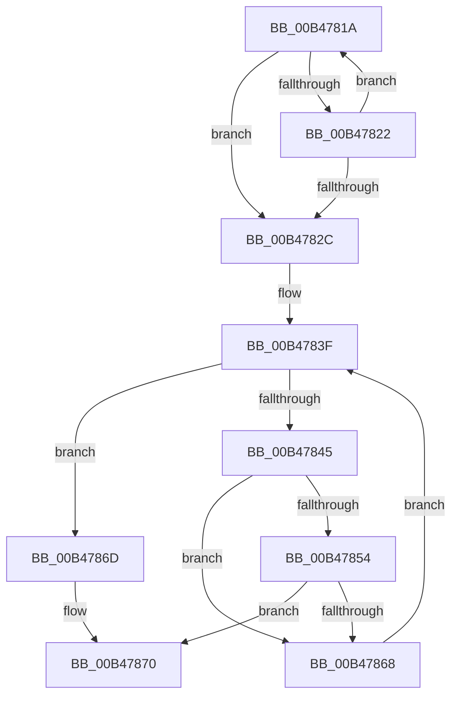

# sub_00B4781A

- RVA: `0x00B4781A`–`0x00B47877` (길이 `93` bytes)
- VA: `0x0000000140B4781A`
- 실행 섹션: `PAGE`
- PDB 이름 있음: `아니요`; PDB Function 태그: `아니요`
- unwind 정보 RVA: `0x000B9954`
- 디코드: `30`개 명령, `93/93` bytes 표시
- 미해석 바이트: `0` (있으면 어셈블리에 `.byte`로 보존)

> 이 문서는 커널 이미지의 기계어와 PDB 기호를 분석해 생성했습니다. 4번과 5번은 함수 원형과 자료형을 바이너리 사용 방식에서 추정한 C 해석이며 원본 소스 복구 결과는 아닙니다.

## 1. Dependencies

- 직접 호출 지점: **1**; 고유 호출 대상: **1**
- 직접 호출자로 확인된 함수: **0**
- RIP 상대 이미지 참조: **0**

### Outgoing calls
- `0x00B4785F` → [wcsnicmp](../../text/50/wcsnicmp_function_005001C0.md) (function, `0x005001C0`)

### Direct callers
- 이 함수 시작 RVA로 연결되는 직접 call은 확인되지 않았습니다. 간접 호출은 완전히 역산할 수 없습니다.

### Static image references
- 디코드된 RIP-relative 메모리 참조가 없습니다.

## 2. Other-region calls and transfers

- 다른 실행 섹션으로 향하는 call: **1**
  - `0x00B4785F` → [wcsnicmp](../../text/50/wcsnicmp_function_005001C0.md) (`PAGE` → `.text`)
- call이 아닌 외부 분기/꼬리 이동: **1**
  - `0x00B47872` → [EtwpApplyExeFilter + 0x37](../A9/EtwpApplyExeFilter_function_00A95D8C.md) (`tail-transfer`)

## 3. Assembly (complete function range)

```asm
00B4781A  4C 8B F1                        mov r14, rcx
00B4781D  48 3B CA                        cmp rcx, rdx
00B47820  74 0A                           je 0x140b4782c
00B47822  48 83 E9 02                     sub rcx, 2
00B47826  66 83 39 5C                     cmp word ptr [rcx], 0x5c
00B4782A  75 EE                           jne 0x140b4781a
00B4782C  49 8B C6                        mov rax, r14
00B4782F  41 0F B7 F7                     movzx esi, r15w
00B47833  48 2B C2                        sub rax, rdx
00B47836  66 BB 01 00                     mov bx, 1
00B4783A  48 D1 F8                        sar rax, 1
00B4783D  2B F8                           sub edi, eax
00B4783F  66 3B 75 00                     cmp si, word ptr [rbp]
00B47843  73 28                           jae 0x140b4786d
00B47845  0F B7 CE                        movzx ecx, si
00B47848  48 03 C9                        add rcx, rcx
00B4784B  0F B7 44 CD 08                  movzx eax, word ptr [rbp + rcx*8 + 8]
00B47850  3B C7                           cmp eax, edi
00B47852  75 14                           jne 0x140b47868
00B47854  48 8B 4C CD 10                  mov rcx, qword ptr [rbp + rcx*8 + 0x10]
00B47859  49 8B D6                        mov rdx, r14
00B4785C  44 8B C7                        mov r8d, edi
00B4785F  E8 5C 89 9B FF                  call 0x1405001c0
00B47864  85 C0                           test eax, eax
00B47866  74 08                           je 0x140b47870
00B47868  66 03 F3                        add si, bx
00B4786B  EB D2                           jmp 0x140b4783f
00B4786D  41 8A DF                        mov bl, r15b
00B47870  8A C3                           mov al, bl
00B47872  E9 4C E5 F4 FF                  jmp 0x140a95dc3
```

## 4. C-style interpretation (structured pseudocode)

```c
__int64 __fastcall sub_00B4781A(__int64 a1, __int64 a2)
{
    __int64 result;
    __int64 v_rdi;
    __int64 v_rsi;

    if (a1 == a2) goto loc_00B4782C;
    a1 = (a1) - (2);
    if ((*(unsigned __int16 *)(a1)) != 92) goto loc_00B4781A;
loc_00B4782C:
    result = (a1) - (a2);
    result = (result) >> (1);
    v_rdi = (unsigned int)((v_rdi) - ((unsigned int)(result)));
loc_00B4783F:
    if (((unsigned __int16)((unsigned __int16)(v_r15))) >= (*(unsigned __int16 *)(v_rbp))) goto loc_00B4786D;
    a1 = ((unsigned __int16)((unsigned __int16)(v_r15))) + ((unsigned __int16)((unsigned __int16)(v_r15)));
    if (((unsigned int)(*(unsigned __int16 *)(v_rbp + a1 * 8 + 8))) != ((unsigned int)(v_rdi))) goto loc_00B47868;
    result = wcsnicmp(*(unsigned __int64 *)(v_rbp + a1 * 8 + 16), a1, (unsigned int)((unsigned int)(v_rdi)), a4);
    if ((unsigned int)(result) == 0) goto loc_00B47870;
loc_00B47868:
    v_rsi = (unsigned __int16)(((unsigned __int16)(v_r15)) + (1));
    goto loc_00B4783F;
loc_00B4786D:
loc_00B47870:
}
```

## 5. (Beta) C Style

```c
int64_t sub_00B4781A(int64_t Arg1, int64_t Arg2)
{
    int64_t result;
    int64_t local_rdi;
    int64_t local_rsi;

    if (Arg1 == Arg2) goto loc_00B4782C;
    Arg1 = (Arg1) - (2);
    if ((*(uint16_t *)(Arg1)) != 92) goto loc_00B4781A;
loc_00B4782C:
    result = (Arg1) - (Arg2);
    result = (result) >> (1);
    local_rdi = (uint32_t)((local_rdi) - ((uint32_t)(result)));
loc_00B4783F:
    if (((uint16_t)((uint16_t)(local_r15))) >= (*(uint16_t *)(local_rbp))) goto loc_00B4786D;
    Arg1 = ((uint16_t)((uint16_t)(local_r15))) + ((uint16_t)((uint16_t)(local_r15)));
    if (((uint32_t)(*(uint16_t *)(local_rbp + Arg1 * 8 + 0x8))) != ((uint32_t)(local_rdi))) goto loc_00B47868;
    result = wcsnicmp(*(uint64_t *)(local_rbp + Arg1 * 8 + 0x10), Arg1, (uint32_t)((uint32_t)(local_rdi)), a4);
    if ((uint32_t)(result) == 0) goto loc_00B47870;
loc_00B47868:
    local_rsi = (uint16_t)(((uint16_t)(local_r15)) + (1));
    goto loc_00B4783F;
loc_00B4786D:
loc_00B47870:
}
```

## 6. Execution-region graph

[열기: 2D/3D 그래프와 함수 탐색 컨트롤 패널](../../../control-panel.html?section=page&rva=0x00B4781A&view=graph)

- 2D 그래프는 위에서 아래로 흐르고, 3D 그래프는 빈 공간을 드래그해 회전합니다. Shift+드래그는 이동, 휠은 확대·축소, 함수 노드 선택은 대상 보고서 이동입니다.

### Static fallback


