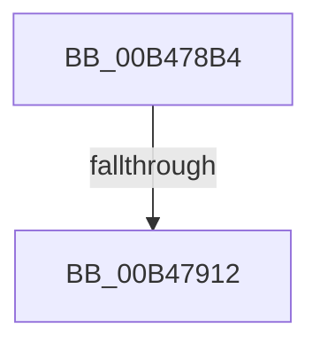

# sub_00B478B4

- RVA: `0x00B478B4`–`0x00B47917` (길이 `99` bytes)
- VA: `0x0000000140B478B4`
- 실행 섹션: `PAGE`
- PDB 이름 있음: `아니요`; PDB Function 태그: `아니요`
- unwind 정보 RVA: `0x000B9A24`
- 디코드: `24`개 명령, `99/99` bytes 표시
- 미해석 바이트: `0` (있으면 어셈블리에 `.byte`로 보존)

> 이 문서는 커널 이미지의 기계어와 PDB 기호를 분석해 생성했습니다. 4번과 5번은 함수 원형과 자료형을 바이너리 사용 방식에서 추정한 C 해석이며 원본 소스 복구 결과는 아닙니다.

## 1. Dependencies

- 직접 호출 지점: **2**; 고유 호출 대상: **2**
- 직접 호출자로 확인된 함수: **0**
- RIP 상대 이미지 참조: **0**

### Outgoing calls
- `0x00B478BB` → [guard_dispatch_icall](../../text/6B/guard_dispatch_icall_function_006BAAD0.md) (function, `0x006BAAD0`)
- `0x00B47905` → [ZwNotifyChangeKey](../../text/6A/ZwNotifyChangeKey_function_006AF550.md) (function, `0x006AF550`)

### Direct callers
- 이 함수 시작 RVA로 연결되는 직접 call은 확인되지 않았습니다. 간접 호출은 완전히 역산할 수 없습니다.

### Static image references
- 디코드된 RIP-relative 메모리 참조가 없습니다.

## 2. Other-region calls and transfers

- 다른 실행 섹션으로 향하는 call: **2**
  - `0x00B478BB` → [guard_dispatch_icall](../../text/6B/guard_dispatch_icall_function_006BAAD0.md) (`PAGE` → `.text`)
  - `0x00B47905` → [ZwNotifyChangeKey](../../text/6A/ZwNotifyChangeKey_function_006AF550.md) (`PAGE` → `.text`)
- call이 아닌 외부 분기/꼬리 이동: **2**
  - `0x00B4790C` → [IopRegistryCallback + 0x100](../A9/IopRegistryCallback_function_00A95FD0.md) (`tail-transfer`)
  - `0x00B47912` → [IopRegistryCallback + 0x88](../A9/IopRegistryCallback_function_00A95FD0.md) (`tail-transfer`)

## 3. Assembly (complete function range)

```asm
00B478B4  49 8B 07                        mov rax, qword ptr [r15]
00B478B7  48 8B 4D 00                     mov rcx, qword ptr [rbp]
00B478BB  E8 10 32 B7 FF                  call 0x1406baad0
00B478C0  C6 44 24 48 01                  mov byte ptr [rsp + 0x48], 1
00B478C5  4D 8D 75 08                     lea r14, [r13 + 8]
00B478C9  83 64 24 40 00                  and dword ptr [rsp + 0x40], 0
00B478CE  49 8D 5D 20                     lea rbx, [r13 + 0x20]
00B478D2  48 83 64 24 38 00               and qword ptr [rsp + 0x38], 0
00B478D8  4D 8D 65 60                     lea r12, [r13 + 0x60]
00B478DC  C6 44 24 30 01                  mov byte ptr [rsp + 0x30], 1
00B478E1  4C 8D 46 40                     lea r8, [rsi + 0x40]
00B478E5  4C 03 F7                        add r14, rdi
00B478E8  48 03 DF                        add rbx, rdi
00B478EB  4C 03 E7                        add r12, rdi
00B478EE  41 B9 01 00 00 00               mov r9d, 1
00B478F4  33 D2                           xor edx, edx
00B478F6  41 8B 06                        mov eax, dword ptr [r14]
00B478F9  48 8B 0B                        mov rcx, qword ptr [rbx]
00B478FC  89 44 24 28                     mov dword ptr [rsp + 0x28], eax
00B47900  4C 89 64 24 20                  mov qword ptr [rsp + 0x20], r12
00B47905  E8 46 7C B6 FF                  call 0x1406af550
00B4790A  85 C0                           test eax, eax
00B4790C  0F 89 BE E7 F4 FF               jns 0x140a960d0
00B47912  E9 41 E7 F4 FF                  jmp 0x140a96058
```

## 4. C-style interpretation (structured pseudocode)

```c
__int64 __fastcall sub_00B478B4(__int64 a1, int a2, __int64 a3, __int64 a4, __int64 a5, __int64 a6, __int64 a7, unsigned int a8)
{
    __int64 result;
    __int64 v_r12;
    __int64 v_r14;
    __int64 v_rbx;
    unsigned __int64 v_stack_p20;
    unsigned int v_stack_p28;
    unsigned __int8 v_stack_p30;
    unsigned __int8 v_stack_p48;

    result = guard_dispatch_icall(*(unsigned __int64 *)(v_rbp), a2, a3, a4);
    v_stack_p48 = 1;
    v_stack_p30 = 1;
    v_r14 = (v_r13 + 8) + (v_rdi);
    v_rbx = (v_r13 + 32) + (v_rdi);
    v_r12 = (v_r13 + 96) + (v_rdi);
    a2 = 0;
    v_stack_p28 = (unsigned int)((unsigned int)(*(unsigned int *)(v_r14)));
    v_stack_p20 = v_r12;
    result = ZwNotifyChangeKey(*(unsigned __int64 *)(v_rbx), a2, v_rsi + 64, 1);
}
```

## 5. (Beta) C Style

```c
int64_t sub_00B478B4(int64_t Arg1, int32_t Arg2, int64_t Arg3, int64_t Arg4, uint64_t Arg5, uint64_t Arg6, int64_t Arg7, uint32_t Arg8)
{
    int64_t result;
    int64_t local_r12;
    int64_t local_r14;
    int64_t local_rbx;
    uint64_t v_stack_p20;
    uint32_t v_stack_p28;
    uint8_t v_stack_p30;
    uint8_t v_stack_p48;

    result = guard_dispatch_icall(*(uint64_t *)(local_rbp), Arg2, Arg3, Arg4);
    v_stack_p48 = 1;
    v_stack_p30 = 1;
    local_r14 = (local_r13 + 8) + (local_rdi);
    local_rbx = (local_r13 + 32) + (local_rdi);
    local_r12 = (local_r13 + 96) + (local_rdi);
    Arg2 = 0;
    v_stack_p28 = (uint32_t)((uint32_t)(*(uint32_t *)(local_r14)));
    v_stack_p20 = local_r12;
    result = ZwNotifyChangeKey(*(uint64_t *)(local_rbx), Arg2, local_rsi + 64, 1);
}
```

## 6. Execution-region graph

[열기: 2D/3D 그래프와 함수 탐색 컨트롤 패널](../../../control-panel.html?section=page&rva=0x00B478B4&view=graph)

- 2D 그래프는 위에서 아래로 흐르고, 3D 그래프는 빈 공간을 드래그해 회전합니다. Shift+드래그는 이동, 휠은 확대·축소, 함수 노드 선택은 대상 보고서 이동입니다.

### Static fallback


