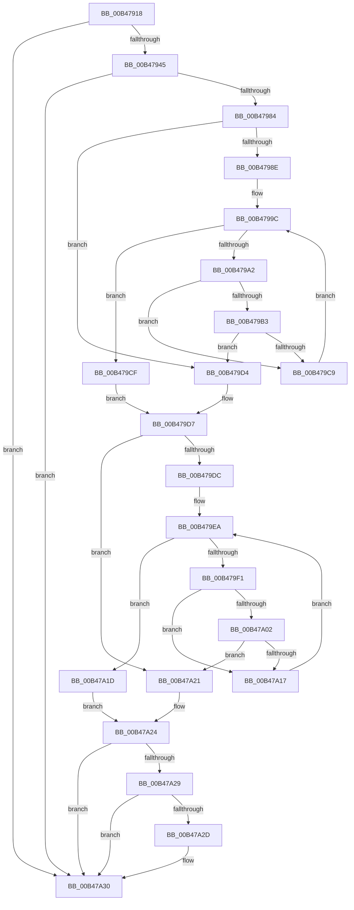

# sub_00B47918

- RVA: `0x00B47918`–`0x00B47A55` (길이 `317` bytes)
- VA: `0x0000000140B47918`
- 실행 섹션: `PAGE`
- PDB 이름 있음: `아니요`; PDB Function 태그: `아니요`
- unwind 정보 RVA: `0x000B9AC0`
- 디코드: `84`개 명령, `317/317` bytes 표시
- 미해석 바이트: `0` (있으면 어셈블리에 `.byte`로 보존)

> 이 문서는 커널 이미지의 기계어와 PDB 기호를 분석해 생성했습니다. 4번과 5번은 함수 원형과 자료형을 바이너리 사용 방식에서 추정한 C 해석이며 원본 소스 복구 결과는 아닙니다.

## 1. Dependencies

- 직접 호출 지점: **6**; 고유 호출 대상: **5**
- 직접 호출자로 확인된 함수: **0**
- RIP 상대 이미지 참조: **0**

### Outgoing calls
- `0x00B47921` → [PsReferencePrimaryTokenWithTag](../../text/20/PsReferencePrimaryTokenWithTag_function_0020FF80.md) (function, `0x0020FF80`)
- `0x00B47936` → [PsQueryProcessAttributesByToken](../9C/PsQueryProcessAttributesByToken_function_009C6350.md) (function, `0x009C6350`)
- `0x00B47977` → [RtlQueryPackageIdentity](../../text/45/RtlQueryPackageIdentity_function_0045C390.md) (function, `0x0045C390`)
- `0x00B479C0` → [wcsnicmp](../../text/50/wcsnicmp_function_005001C0.md) (function, `0x005001C0`)
- `0x00B47A0E` → [wcsnicmp](../../text/50/wcsnicmp_function_005001C0.md) (function, `0x005001C0`)
- `0x00B47A49` → [ObFastDereferenceObject](../../text/3E/ObFastDereferenceObject_function_003ED5F0.md) (function, `0x003ED5F0`)

### Direct callers
- 이 함수 시작 RVA로 연결되는 직접 call은 확인되지 않았습니다. 간접 호출은 완전히 역산할 수 없습니다.

### Static image references
- 디코드된 RIP-relative 메모리 참조가 없습니다.

## 2. Other-region calls and transfers

- 다른 실행 섹션으로 향하는 call: **5**
  - `0x00B47921` → [PsReferencePrimaryTokenWithTag](../../text/20/PsReferencePrimaryTokenWithTag_function_0020FF80.md) (`PAGE` → `.text`)
  - `0x00B47977` → [RtlQueryPackageIdentity](../../text/45/RtlQueryPackageIdentity_function_0045C390.md) (`PAGE` → `.text`)
  - `0x00B479C0` → [wcsnicmp](../../text/50/wcsnicmp_function_005001C0.md) (`PAGE` → `.text`)
  - `0x00B47A0E` → [wcsnicmp](../../text/50/wcsnicmp_function_005001C0.md) (`PAGE` → `.text`)
  - `0x00B47A49` → [ObFastDereferenceObject](../../text/3E/ObFastDereferenceObject_function_003ED5F0.md) (`PAGE` → `.text`)
- call이 아닌 외부 분기/꼬리 이동: **1**
  - `0x00B47A50` → [EtwpApplyPackageIdFilter + 0x6B](../A9/EtwpApplyPackageIdFilter_function_00A961F4.md) (`tail-transfer`)

## 3. Assembly (complete function range)

```asm
00B47918  49 8B 4D 50                     mov rcx, qword ptr [r13 + 0x50]
00B4791C  BA 44 66 6C 74                  mov edx, 0x746c6644
00B47921  E8 5A 86 6C FF                  call 0x14020ff80
00B47926  4C 8D 44 24 31                  lea r8, [rsp + 0x31]
00B4792B  48 8B C8                        mov rcx, rax
00B4792E  48 8D 54 24 30                  lea rdx, [rsp + 0x30]
00B47933  4C 8B E8                        mov r13, rax
00B47936  E8 15 EA E7 FF                  call 0x1409c6350
00B4793B  38 5C 24 30                     cmp byte ptr [rsp + 0x30], bl
00B4793F  0F 84 EB 00 00 00               je 0x140b47a30
00B47945  48 8D 44 24 48                  lea rax, [rsp + 0x48]
00B4794A  48 89 5C 24 28                  mov qword ptr [rsp + 0x28], rbx
00B4794F  4C 8D 4D 58                     lea r9, [rbp + 0x58]
00B47953  48 89 44 24 20                  mov qword ptr [rsp + 0x20], rax
00B47958  4C 8D 44 24 40                  lea r8, [rsp + 0x40]
00B4795D  48 C7 44 24 40 00 01 00 00      mov qword ptr [rsp + 0x40], 0x100
00B47966  48 8D 54 24 58                  lea rdx, [rsp + 0x58]
00B4796B  48 C7 44 24 48 82 00 00 00      mov qword ptr [rsp + 0x48], 0x82
00B47974  49 8B CD                        mov rcx, r13
00B47977  E8 14 4A 91 FF                  call 0x14045c390
00B4797C  85 C0                           test eax, eax
00B4797E  0F 88 AC 00 00 00               js 0x140b47a30
00B47984  BF 01 00 00 00                  mov edi, 1
00B47989  4D 85 FF                        test r15, r15
00B4798C  74 46                           je 0x140b479d4
00B4798E  48 8B 74 24 40                  mov rsi, qword ptr [rsp + 0x40]
00B47993  44 0F B7 F3                     movzx r14d, bx
00B47997  48 D1 EE                        shr rsi, 1
00B4799A  2B F7                           sub esi, edi
00B4799C  66 45 3B 37                     cmp r14w, word ptr [r15]
00B479A0  73 2D                           jae 0x140b479cf
00B479A2  41 0F B7 CE                     movzx ecx, r14w
00B479A6  48 03 C9                        add rcx, rcx
00B479A9  41 0F B7 44 CF 08               movzx eax, word ptr [r15 + rcx*8 + 8]
00B479AF  3B C6                           cmp eax, esi
00B479B1  75 16                           jne 0x140b479c9
00B479B3  49 8B 4C CF 10                  mov rcx, qword ptr [r15 + rcx*8 + 0x10]
00B479B8  48 8D 54 24 58                  lea rdx, [rsp + 0x58]
00B479BD  44 8B C6                        mov r8d, esi
00B479C0  E8 FB 87 9B FF                  call 0x1405001c0
00B479C5  85 C0                           test eax, eax
00B479C7  74 0B                           je 0x140b479d4
00B479C9  66 44 03 F7                     add r14w, di
00B479CD  EB CD                           jmp 0x140b4799c
00B479CF  44 8A FB                        mov r15b, bl
00B479D2  EB 03                           jmp 0x140b479d7
00B479D4  44 8A FF                        mov r15b, dil
00B479D7  4D 85 E4                        test r12, r12
00B479DA  74 45                           je 0x140b47a21
00B479DC  48 8B 74 24 48                  mov rsi, qword ptr [rsp + 0x48]
00B479E1  44 0F B7 F3                     movzx r14d, bx
00B479E5  48 D1 EE                        shr rsi, 1
00B479E8  2B F7                           sub esi, edi
00B479EA  66 45 3B 34 24                  cmp r14w, word ptr [r12]
00B479EF  73 2C                           jae 0x140b47a1d
00B479F1  41 0F B7 CE                     movzx ecx, r14w
00B479F5  48 03 C9                        add rcx, rcx
00B479F8  41 0F B7 44 CC 08               movzx eax, word ptr [r12 + rcx*8 + 8]
00B479FE  3B C6                           cmp eax, esi
00B47A00  75 15                           jne 0x140b47a17
00B47A02  49 8B 4C CC 10                  mov rcx, qword ptr [r12 + rcx*8 + 0x10]
00B47A07  48 8D 55 58                     lea rdx, [rbp + 0x58]
00B47A0B  44 8B C6                        mov r8d, esi
00B47A0E  E8 AD 87 9B FF                  call 0x1405001c0
00B47A13  85 C0                           test eax, eax
00B47A15  74 0A                           je 0x140b47a21
00B47A17  66 44 03 F7                     add r14w, di
00B47A1B  EB CD                           jmp 0x140b479ea
00B47A1D  8A C3                           mov al, bl
00B47A1F  EB 03                           jmp 0x140b47a24
00B47A21  40 8A C7                        mov al, dil
00B47A24  45 84 FF                        test r15b, r15b
00B47A27  74 07                           je 0x140b47a30
00B47A29  84 C0                           test al, al
00B47A2B  74 03                           je 0x140b47a30
00B47A2D  40 8A DF                        mov bl, dil
00B47A30  48 8B 4C 24 38                  mov rcx, qword ptr [rsp + 0x38]
00B47A35  41 B8 44 66 6C 74               mov r8d, 0x746c6644
00B47A3B  49 8B D5                        mov rdx, r13
00B47A3E  48 8B 49 50                     mov rcx, qword ptr [rcx + 0x50]
00B47A42  48 81 C1 48 02 00 00            add rcx, 0x248
00B47A49  E8 A2 5B 8A FF                  call 0x1403ed5f0
00B47A4E  8A C3                           mov al, bl
00B47A50  E9 0A E8 F4 FF                  jmp 0x140a9625f
```

## 4. C-style interpretation (structured pseudocode)

```c
__int64 __fastcall sub_00B47918(__int64 a1, __int64 a2, __int64 a3, __int64 a4, __int64 a5, unsigned __int8 a6, __int64 a7, __int64 a8, __int64 a9, __int64 a10, __int64 a11)
{
    __int64 result;
    __int64 v_r14;
    __int64 v_rbx;
    __int64 v_rsi;
    unsigned __int64 v_stack_p20;
    unsigned __int64 v_stack_p28;
    unsigned __int64 v_stack_p31;
    unsigned __int64 v_stack_p40;
    unsigned __int64 v_stack_p48;

    result = PsReferencePrimaryTokenWithTag(*(unsigned __int64 *)(v_r13 + 80), (unsigned int)(0x746C6644ULL), a3, a4);
    result = PsQueryProcessAttributesByToken(result, a6, v_stack_p31, a4);
    if (a6 == ((unsigned __int8)(v_rbx))) goto loc_00B47A30;
    v_stack_p28 = v_rbx;
    v_stack_p20 = a9;
    v_stack_p40 = 256;
    v_stack_p48 = 130;
    result = RtlQueryPackageIdentity(result, a11, a8, v_rbp + 88);
    if (sign_flag) goto loc_00B47A30;
    if (v_r15 == 0) goto loc_00B479D4;
    v_rsi = (a8) >> (1);
    v_rsi = (unsigned int)((v_rsi) - (1));
loc_00B4799C:
    if (((unsigned __int16)((unsigned __int16)(v_rbx))) >= (*(unsigned __int16 *)(v_r15))) goto loc_00B479CF;
    a1 = ((unsigned __int16)((unsigned __int16)(v_rbx))) + ((unsigned __int16)((unsigned __int16)(v_rbx)));
    if (((unsigned int)(*(unsigned __int16 *)(v_r15 + a1 * 8 + 8))) != ((unsigned int)(v_rsi))) goto loc_00B479C9;
    result = wcsnicmp(*(unsigned __int64 *)(v_r15 + a1 * 8 + 16), a11, (unsigned int)((unsigned int)(v_rsi)), v_rbp + 88);
    if ((unsigned int)(result) == 0) goto loc_00B479D4;
loc_00B479C9:
    v_r14 = (unsigned __int16)(((unsigned __int16)(v_rbx)) + (1));
    goto loc_00B4799C;
loc_00B479CF:
    goto loc_00B479D7;
loc_00B479D4:
loc_00B479D7:
    if (v_r12 == 0) goto loc_00B47A21;
    v_rsi = (a9) >> (1);
    v_rsi = (unsigned int)((v_rsi) - (1));
loc_00B479EA:
    if (((unsigned __int16)((unsigned __int16)(v_rbx))) >= (*(unsigned __int16 *)(v_r12))) goto loc_00B47A1D;
    a1 = ((unsigned __int16)((unsigned __int16)(v_rbx))) + ((unsigned __int16)((unsigned __int16)(v_rbx)));
    if (((unsigned int)(*(unsigned __int16 *)(v_r12 + a1 * 8 + 8))) != ((unsigned int)(v_rsi))) goto loc_00B47A17;
    result = wcsnicmp(*(unsigned __int64 *)(v_r12 + a1 * 8 + 16), v_rbp + 88, (unsigned int)((unsigned int)(v_rsi)), v_rbp + 88);
    if ((unsigned int)(result) == 0) goto loc_00B47A21;
loc_00B47A17:
    v_r14 = (unsigned __int16)(((unsigned __int16)(v_rbx)) + (1));
    goto loc_00B479EA;
loc_00B47A1D:
    goto loc_00B47A24;
loc_00B47A21:
loc_00B47A24:
    if (1 == 0) goto loc_00B47A30;
    if (1 != 0) {
        v_rbx = 1;
    }
    a1 = (*(unsigned __int64 *)(a7 + 80)) + (584);
    result = ObFastDereferenceObject(a1, result, (unsigned int)(0x746C6644ULL), v_rbp + 88);
}
```

## 5. (Beta) C Style

```c
int64_t sub_00B47918(int64_t Arg1, int64_t Arg2, int64_t Arg3, int64_t Arg4, uint64_t Arg5, uint8_t Arg6, void *Arg7, int64_t Arg8, int64_t Arg9, uint64_t Arg10, int64_t Arg11)
{
    uint8_t *arg7 = (uint8_t *)Arg7;

    int64_t result;
    int64_t local_r14;
    int64_t local_rbx;
    int64_t local_rsi;
    uint64_t v_stack_p20;
    uint64_t v_stack_p28;
    uint64_t v_stack_p31;
    uint64_t v_stack_p40;
    uint64_t v_stack_p48;

    result = PsReferencePrimaryTokenWithTag(*(uint64_t *)(local_r13 + 0x50), (uint32_t)(0x746C6644ULL), Arg3, Arg4);
    result = PsQueryProcessAttributesByToken(result, Arg6, v_stack_p31, Arg4);
    if (Arg6 == ((uint8_t)(local_rbx))) goto loc_00B47A30;
    v_stack_p28 = local_rbx;
    v_stack_p20 = Arg9;
    v_stack_p40 = 256;
    v_stack_p48 = 130;
    result = RtlQueryPackageIdentity(result, Arg11, Arg8, local_rbp + 88);
    if (sign_flag) goto loc_00B47A30;
    if (local_r15 == 0) goto loc_00B479D4;
    local_rsi = (Arg8) >> (1);
    local_rsi = (uint32_t)((local_rsi) - (1));
loc_00B4799C:
    if (((uint16_t)((uint16_t)(local_rbx))) >= (*(uint16_t *)(local_r15))) goto loc_00B479CF;
    Arg1 = ((uint16_t)((uint16_t)(local_rbx))) + ((uint16_t)((uint16_t)(local_rbx)));
    if (((uint32_t)(*(uint16_t *)(local_r15 + Arg1 * 8 + 0x8))) != ((uint32_t)(local_rsi))) goto loc_00B479C9;
    result = wcsnicmp(*(uint64_t *)(local_r15 + Arg1 * 8 + 0x10), Arg11, (uint32_t)((uint32_t)(local_rsi)), local_rbp + 88);
    if ((uint32_t)(result) == 0) goto loc_00B479D4;
loc_00B479C9:
    local_r14 = (uint16_t)(((uint16_t)(local_rbx)) + (1));
    goto loc_00B4799C;
loc_00B479CF:
    goto loc_00B479D7;
loc_00B479D4:
loc_00B479D7:
    if (local_r12 == 0) goto loc_00B47A21;
    local_rsi = (Arg9) >> (1);
    local_rsi = (uint32_t)((local_rsi) - (1));
loc_00B479EA:
    if (((uint16_t)((uint16_t)(local_rbx))) >= (*(uint16_t *)(local_r12))) goto loc_00B47A1D;
    Arg1 = ((uint16_t)((uint16_t)(local_rbx))) + ((uint16_t)((uint16_t)(local_rbx)));
    if (((uint32_t)(*(uint16_t *)(local_r12 + Arg1 * 8 + 0x8))) != ((uint32_t)(local_rsi))) goto loc_00B47A17;
    result = wcsnicmp(*(uint64_t *)(local_r12 + Arg1 * 8 + 0x10), local_rbp + 88, (uint32_t)((uint32_t)(local_rsi)), local_rbp + 88);
    if ((uint32_t)(result) == 0) goto loc_00B47A21;
loc_00B47A17:
    local_r14 = (uint16_t)(((uint16_t)(local_rbx)) + (1));
    goto loc_00B479EA;
loc_00B47A1D:
    goto loc_00B47A24;
loc_00B47A21:
loc_00B47A24:
    if (1 == 0) goto loc_00B47A30;
    if (1 != 0) {
        local_rbx = 1;
    }
    Arg1 = (*(uint64_t *)(arg7 + 0x50)) + (584);
    result = ObFastDereferenceObject(Arg1, result, (uint32_t)(0x746C6644ULL), local_rbp + 88);
}
```

### 관측된 메모리 오프셋

구조체 형식이 확인되지 않은 접근은 인자 기준의 오프셋으로만 기록했습니다.

| 기준 인자 | 오프셋 표현 | 폭 (bit) | 접근 |
|---|---:|---:|---|
| `Arg7` | `+ 0x50` | `64` | `R` |

## 6. Execution-region graph

[열기: 2D/3D 그래프와 함수 탐색 컨트롤 패널](../../../control-panel.html?section=page&rva=0x00B47918&view=graph)

- 2D 그래프는 위에서 아래로 흐르고, 3D 그래프는 빈 공간을 드래그해 회전합니다. Shift+드래그는 이동, 휠은 확대·축소, 함수 노드 선택은 대상 보고서 이동입니다.

### Static fallback


