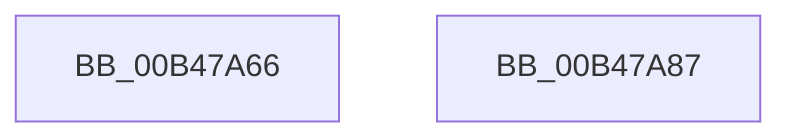

# sub_00B47A66

- RVA: `0x00B47A66`–`0x00B47AE6` (길이 `128` bytes)
- VA: `0x0000000140B47A66`
- 실행 섹션: `PAGE`
- PDB 이름 있음: `아니요`; PDB Function 태그: `아니요`
- unwind 정보 RVA: `0x000B9B84`
- 디코드: `32`개 명령, `128/128` bytes 표시
- 미해석 바이트: `0` (있으면 어셈블리에 `.byte`로 보존)

> 이 문서는 커널 이미지의 기계어와 PDB 기호를 분석해 생성했습니다. 4번과 5번은 함수 원형과 자료형을 바이너리 사용 방식에서 추정한 C 해석이며 원본 소스 복구 결과는 아닙니다.

## 1. Dependencies

- 직접 호출 지점: **0**; 고유 호출 대상: **0**
- 직접 호출자로 확인된 함수: **0**
- RIP 상대 이미지 참조: **5**

### Outgoing calls
- 직접 디코드된 call 명령이 없습니다.

### Direct callers
- 이 함수 시작 RVA로 연결되는 직접 call은 확인되지 않았습니다. 간접 호출은 완전히 역산할 수 없습니다.

### Static image references
- `0x00B47A66` → RVA `0x00FD8078` (`PAGEDATA`; read)
- `0x00B47A6E` → RVA `0x00FD8078` (`PAGEDATA`; write)
- `0x00B47A74` → RVA `0x00FD803C` (`PAGEDATA`; write)
- `0x00B47A7B` → RVA `0x00FD8014` (`PAGEDATA`; write)
- `0x00B47A9D` → RVA `0x00FD80AC` (`PAGEDATA`; write)

## 2. Other-region calls and transfers

- 다른 실행 섹션으로 향하는 call: **0**
- call이 아닌 외부 분기/꼬리 이동: **2**
  - `0x00B47A82` → [ExpAllocateUuids + 0x2A](../A9/ExpAllocateUuids_function_00A965F4.md) (`tail-transfer`)
  - `0x00B47AE1` → [ExpAllocateUuids + 0xB3](../A9/ExpAllocateUuids_function_00A965F4.md) (`tail-transfer`)

## 3. Assembly (complete function range)

```asm
00B47A66  8B 0D 0C 06 49 00               mov ecx, dword ptr [rip + 0x49060c]
00B47A6C  FF C1                           inc ecx
00B47A6E  89 0D 04 06 49 00               mov dword ptr [rip + 0x490604], ecx
00B47A74  C6 05 C1 05 49 00 01            mov byte ptr [rip + 0x4905c1], 1
00B47A7B  C6 05 92 05 49 00 01            mov byte ptr [rip + 0x490592], 1
00B47A82  E9 97 EB F4 FF                  jmp 0x140a9661e
00B47A87  48 81 C1 F0 D8 FF FF            add rcx, -0x2710
00B47A8E  C7 03 10 27 00 00               mov dword ptr [rbx], 0x2710
00B47A94  41 FF C0                        inc r8d
00B47A97  48 89 0E                        mov qword ptr [rsi], rcx
00B47A9A  41 8B C8                        mov ecx, r8d
00B47A9D  44 89 05 08 06 49 00            mov dword ptr [rip + 0x490608], r8d
00B47AA4  83 E1 01                        and ecx, 1
00B47AA7  C1 E1 1B                        shl ecx, 0x1b
00B47AAA  8B D1                           mov edx, ecx
00B47AAC  0F BA EA 1A                     bts edx, 0x1a
00B47AB0  41 F6 C0 02                     test r8b, 2
00B47AB4  0F 44 D1                        cmove edx, ecx
00B47AB7  8B CA                           mov ecx, edx
00B47AB9  0F BA E9 19                     bts ecx, 0x19
00B47ABD  41 F6 C0 04                     test r8b, 4
00B47AC1  0F 44 CA                        cmove ecx, edx
00B47AC4  8B D1                           mov edx, ecx
00B47AC6  0F BA EA 18                     bts edx, 0x18
00B47ACA  41 F6 C0 08                     test r8b, 8
00B47ACE  0F 44 D1                        cmove edx, ecx
00B47AD1  8B C2                           mov eax, edx
00B47AD3  0F BA E8 17                     bts eax, 0x17
00B47AD7  41 F6 C0 10                     test r8b, 0x10
00B47ADB  0F 44 C2                        cmove eax, edx
00B47ADE  09 46 04                        or dword ptr [rsi + 4], eax
00B47AE1  E9 C1 EB F4 FF                  jmp 0x140a966a7
```

## 4. C-style interpretation (structured pseudocode)

```c
__int64 __fastcall sub_00B47A66(__int64 a1, __int64 a2, int a3)
{
    a1 = (unsigned int)(((unsigned int)(*(unsigned int *)(v_rip + 4785676))) + 1);
    *(unsigned int *)(v_rip + 4785668) = (unsigned int)(a1);
    *(unsigned __int8 *)(v_rip + 4785601) = 1;
    *(unsigned __int8 *)(v_rip + 4785554) = 1;
}
```

## 5. (Beta) C Style

```c
int64_t sub_00B47A66(int64_t Arg1, int64_t Arg2, int32_t Arg3)
{
    Arg1 = (uint32_t)(((uint32_t)(*(uint32_t *)(v_rip + 0x49060C))) + 1);
    *(uint32_t *)(v_rip + 0x490604) = (uint32_t)(Arg1);
    *(uint8_t *)(v_rip + 0x4905C1) = 1;
    *(uint8_t *)(v_rip + 0x490592) = 1;
}
```

## 6. Execution-region graph

[열기: 2D/3D 그래프와 함수 탐색 컨트롤 패널](../../../control-panel.html?section=page&rva=0x00B47A66&view=graph)

- 2D 그래프는 위에서 아래로 흐르고, 3D 그래프는 빈 공간을 드래그해 회전합니다. Shift+드래그는 이동, 휠은 확대·축소, 함수 노드 선택은 대상 보고서 이동입니다.

### Static fallback


