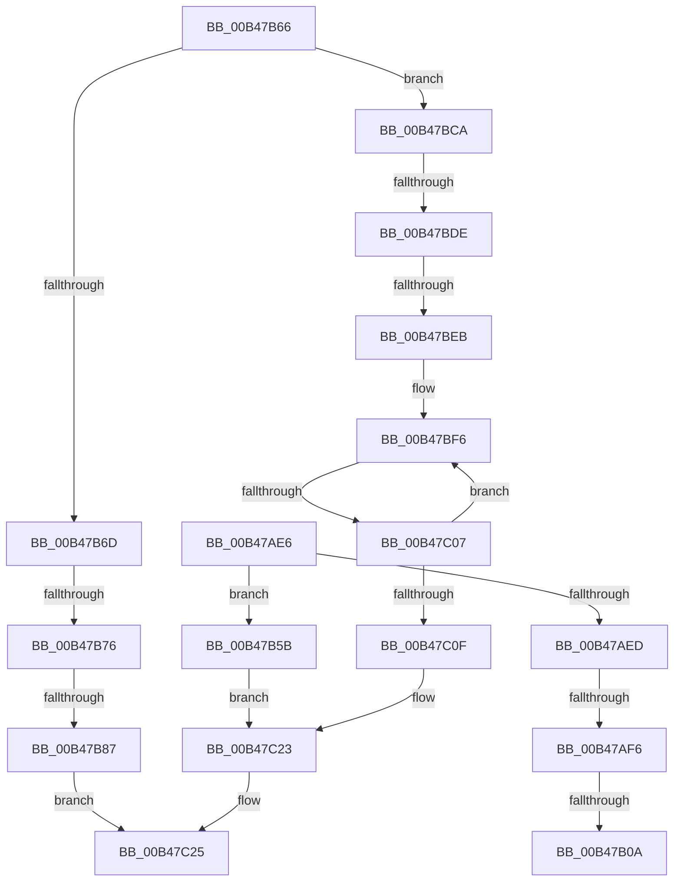

# sub_00B47AE6

- RVA: `0x00B47AE6`–`0x00B47C37` (길이 `337` bytes)
- VA: `0x0000000140B47AE6`
- 실행 섹션: `PAGE`
- PDB 이름 있음: `아니요`; PDB Function 태그: `아니요`
- unwind 정보 RVA: `0x000B9CA8`
- 디코드: `84`개 명령, `337/337` bytes 표시
- 미해석 바이트: `0` (있으면 어셈블리에 `.byte`로 보존)

> 이 문서는 커널 이미지의 기계어와 PDB 기호를 분석해 생성했습니다. 4번과 5번은 함수 원형과 자료형을 바이너리 사용 방식에서 추정한 C 해석이며 원본 소스 복구 결과는 아닙니다.

## 1. Dependencies

- 직접 호출 지점: **12**; 고유 호출 대상: **8**
- 직접 호출자로 확인된 함수: **0**
- RIP 상대 이미지 참조: **4**

### Outgoing calls
- `0x00B47AF6` → [RtlGetActiveConsoleId](../../text/43/RtlGetActiveConsoleId_function_00436230.md) (function, `0x00436230`)
- `0x00B47AFD` → [PsGetCurrentProcessSessionId](../../text/23/PsGetCurrentProcessSessionId_function_002303D0.md) (function, `0x002303D0`)
- `0x00B47B1A` → [PfpScenCtxScenarioSet](../../pagelk/B7/PfpScenCtxScenarioSet_function_00B7CFF0.md) (function, `0x00B7CFF0`)
- `0x00B47B50` → [PfpPartitionIterate](../../text/34/PfpPartitionIterate_function_00341D00.md) (function, `0x00341D00`)
- `0x00B47B96` → [PfpScenCtxPrefetchWait](../../pagelk/B6/PfpScenCtxPrefetchWait_function_00B6B5B0.md) (function, `0x00B6B5B0`)
- `0x00B47BBB` → [PfpPartitionIterate](../../text/34/PfpPartitionIterate_function_00341D00.md) (function, `0x00341D00`)
- `0x00B47BCA` → [RtlGetActiveConsoleId](../../text/43/RtlGetActiveConsoleId_function_00436230.md) (function, `0x00436230`)
- `0x00B47BD1` → [PsGetCurrentProcessSessionId](../../text/23/PsGetCurrentProcessSessionId_function_002303D0.md) (function, `0x002303D0`)
- `0x00B47BDE` → [PfpPartitionIterateAndCheckCanAnyDoAccessLogging](../../text/5C/PfpPartitionIterateAndCheckCanAnyDoAccessLogging_function_005CE0EC.md) (function, `0x005CE0EC`)
- `0x00B47BF9` → [PsGetNextSession](../91/PsGetNextSession_function_009128C0.md) (function, `0x009128C0`)
- `0x00B47C17` → [ObfDereferenceObjectWithTag](../../text/2F/ObfDereferenceObjectWithTag_function_002F78E0.md) (function, `0x002F78E0`)
- `0x00B47C2C` → [PfpScenCtxScenarioSet](../../pagelk/B7/PfpScenCtxScenarioSet_function_00B7CFF0.md) (function, `0x00B7CFF0`)

### Direct callers
- 이 함수 시작 RVA로 연결되는 직접 call은 확인되지 않았습니다. 간접 호출은 완전히 역산할 수 없습니다.

### Static image references
- `0x00B47B0D` → RVA `0x00E670D0` (`.data`; read)
- `0x00B47B1F` → RVA `0x00E67104` (`.data`; read)
- `0x00B47B37` → RVA `0x007507B0` (`PfpLogScenarioEventCallback`; read)
- `0x00B47B7B` → RVA `0x00E67100` (`.data`; read)

## 2. Other-region calls and transfers

- 다른 실행 섹션으로 향하는 call: **11**
  - `0x00B47AF6` → [RtlGetActiveConsoleId](../../text/43/RtlGetActiveConsoleId_function_00436230.md) (`PAGE` → `.text`)
  - `0x00B47AFD` → [PsGetCurrentProcessSessionId](../../text/23/PsGetCurrentProcessSessionId_function_002303D0.md) (`PAGE` → `.text`)
  - `0x00B47B1A` → [PfpScenCtxScenarioSet](../../pagelk/B7/PfpScenCtxScenarioSet_function_00B7CFF0.md) (`PAGE` → `PAGELK`)
  - `0x00B47B50` → [PfpPartitionIterate](../../text/34/PfpPartitionIterate_function_00341D00.md) (`PAGE` → `.text`)
  - `0x00B47B96` → [PfpScenCtxPrefetchWait](../../pagelk/B6/PfpScenCtxPrefetchWait_function_00B6B5B0.md) (`PAGE` → `PAGELK`)
  - `0x00B47BBB` → [PfpPartitionIterate](../../text/34/PfpPartitionIterate_function_00341D00.md) (`PAGE` → `.text`)
  - `0x00B47BCA` → [RtlGetActiveConsoleId](../../text/43/RtlGetActiveConsoleId_function_00436230.md) (`PAGE` → `.text`)
  - `0x00B47BD1` → [PsGetCurrentProcessSessionId](../../text/23/PsGetCurrentProcessSessionId_function_002303D0.md) (`PAGE` → `.text`)
  - `0x00B47BDE` → [PfpPartitionIterateAndCheckCanAnyDoAccessLogging](../../text/5C/PfpPartitionIterateAndCheckCanAnyDoAccessLogging_function_005CE0EC.md) (`PAGE` → `.text`)
  - `0x00B47C17` → [ObfDereferenceObjectWithTag](../../text/2F/ObfDereferenceObjectWithTag_function_002F78E0.md) (`PAGE` → `.text`)
  - `0x00B47C2C` → [PfpScenCtxScenarioSet](../../pagelk/B7/PfpScenCtxScenarioSet_function_00B7CFF0.md) (`PAGE` → `PAGELK`)
- call이 아닌 외부 분기/꼬리 이동: **9**
  - `0x00B47AF0` → [PfpProcessScenarioPhase + 0xA7](../A9/PfpProcessScenarioPhase_function_00A96D44.md) (`tail-transfer`)
  - `0x00B47B04` → [PfpProcessScenarioPhase + 0xA7](../A9/PfpProcessScenarioPhase_function_00A96D44.md) (`tail-transfer`)
  - `0x00B47B56` → [PfpProcessScenarioPhase + 0xA7](../A9/PfpProcessScenarioPhase_function_00A96D44.md) (`tail-transfer`)
  - `0x00B47B70` → [PfpProcessScenarioPhase + 0xA7](../A9/PfpProcessScenarioPhase_function_00A96D44.md) (`tail-transfer`)
  - `0x00B47B81` → [PfpProcessScenarioPhase + 0xA7](../A9/PfpProcessScenarioPhase_function_00A96D44.md) (`tail-transfer`)
  - `0x00B47BD8` → [PfpProcessScenarioPhase + 0xA7](../A9/PfpProcessScenarioPhase_function_00A96D44.md) (`tail-transfer`)
  - `0x00B47BE5` → [PfpProcessScenarioPhase + 0xA7](../A9/PfpProcessScenarioPhase_function_00A96D44.md) (`tail-transfer`)
  - `0x00B47C01` → [PfpProcessScenarioPhase + 0xA7](../A9/PfpProcessScenarioPhase_function_00A96D44.md) (`tail-transfer`)
  - `0x00B47C32` → [PfpProcessScenarioPhase + 0xA7](../A9/PfpProcessScenarioPhase_function_00A96D44.md) (`tail-transfer`)

## 3. Assembly (complete function range)

```asm
00B47AE6  8B 4E 08                        mov ecx, dword ptr [rsi + 8]
00B47AE9  85 C9                           test ecx, ecx
00B47AEB  74 6E                           je 0x140b47b5b
00B47AED  41 3B CF                        cmp ecx, r15d
00B47AF0  0F 85 F5 F2 F4 FF               jne 0x140a96deb
00B47AF6  E8 35 E7 8E FF                  call 0x140436230
00B47AFB  8B D8                           mov ebx, eax
00B47AFD  E8 CE 88 6E FF                  call 0x1402303d0
00B47B02  3B C3                           cmp eax, ebx
00B47B04  0F 85 E1 F2 F4 FF               jne 0x140a96deb
00B47B0A  45 33 C9                        xor r9d, r9d
00B47B0D  48 8D 0D BC F5 31 00            lea rcx, [rip + 0x31f5bc]
00B47B14  45 33 C0                        xor r8d, r8d
00B47B17  41 8B D6                        mov edx, r14d
00B47B1A  E8 D1 54 03 00                  call 0x140b7cff0
00B47B1F  8B 05 DF F5 31 00               mov eax, dword ptr [rip + 0x31f5df]
00B47B25  4C 8D 45 E0                     lea r8, [rbp - 0x20]
00B47B29  BB 03 00 00 00                  mov ebx, 3
00B47B2E  89 45 EC                        mov dword ptr [rbp - 0x14], eax
00B47B31  41 8B D7                        mov edx, r15d
00B47B34  89 5D E8                        mov dword ptr [rbp - 0x18], ebx
00B47B37  48 8D 0D 72 8C C0 FF            lea rcx, [rip - 0x3f738e]
00B47B3E  C7 45 E0 05 00 00 00            mov dword ptr [rbp - 0x20], 5
00B47B45  C7 45 E4 02 00 00 00            mov dword ptr [rbp - 0x1c], 2
00B47B4C  44 89 7D F0                     mov dword ptr [rbp - 0x10], r15d
00B47B50  E8 AB A1 7F FF                  call 0x140341d00
00B47B55  90                              nop
00B47B56  E9 90 F2 F4 FF                  jmp 0x140a96deb
00B47B5B  45 33 C9                        xor r9d, r9d
00B47B5E  45 8B C6                        mov r8d, r14d
00B47B61  E9 BD 00 00 00                  jmp 0x140b47c23
00B47B66  8B 4E 08                        mov ecx, dword ptr [rsi + 8]
00B47B69  85 C9                           test ecx, ecx
00B47B6B  74 5D                           je 0x140b47bca
00B47B6D  41 3B CF                        cmp ecx, r15d
00B47B70  0F 85 75 F2 F4 FF               jne 0x140a96deb
00B47B76  BB 03 00 00 00                  mov ebx, 3
00B47B7B  39 1D 7F F5 31 00               cmp dword ptr [rip + 0x31f57f], ebx
00B47B81  0F 85 64 F2 F4 FF               jne 0x140a96deb
00B47B87  41 B8 88 13 00 00               mov r8d, 0x1388
00B47B8D  48 8D 0D 3C F5 31 00            lea rcx, [rip + 0x31f53c]
00B47B94  8B D3                           mov edx, ebx
00B47B96  E8 15 3A 02 00                  call 0x140b6b5b0
00B47B9B  8B 05 63 F5 31 00               mov eax, dword ptr [rip + 0x31f563]
00B47BA1  4C 8D 45 E0                     lea r8, [rbp - 0x20]
00B47BA5  33 D2                           xor edx, edx
00B47BA7  89 45 EC                        mov dword ptr [rbp - 0x14], eax
00B47BAA  48 8D 0D FF 8B C0 FF            lea rcx, [rip - 0x3f7401]
00B47BB1  48 89 5D E0                     mov qword ptr [rbp - 0x20], rbx
00B47BB5  89 7D E8                        mov dword ptr [rbp - 0x18], edi
00B47BB8  89 7D F0                        mov dword ptr [rbp - 0x10], edi
00B47BBB  E8 40 A1 7F FF                  call 0x140341d00
00B47BC0  45 33 C9                        xor r9d, r9d
00B47BC3  8B D3                           mov edx, ebx
00B47BC5  45 33 C0                        xor r8d, r8d
00B47BC8  EB 5B                           jmp 0x140b47c25
00B47BCA  E8 61 E6 8E FF                  call 0x140436230
00B47BCF  8B D8                           mov ebx, eax
00B47BD1  E8 FA 87 6E FF                  call 0x1402303d0
00B47BD6  3B C3                           cmp eax, ebx
00B47BD8  0F 85 0D F2 F4 FF               jne 0x140a96deb
00B47BDE  E8 09 65 A8 FF                  call 0x1405ce0ec
00B47BE3  85 C0                           test eax, eax
00B47BE5  0F 84 00 F2 F4 FF               je 0x140a96deb
00B47BEB  44 8B F7                        mov r14d, edi
00B47BEE  48 8B C7                        mov rax, rdi
00B47BF1  BB 03 00 00 00                  mov ebx, 3
00B47BF6  48 8B C8                        mov rcx, rax
00B47BF9  E8 C2 AC DC FF                  call 0x1409128c0
00B47BFE  48 85 C0                        test rax, rax
00B47C01  0F 84 E4 F1 F4 FF               je 0x140a96deb
00B47C07  45 03 F7                        add r14d, r15d
00B47C0A  44 3B F3                        cmp r14d, ebx
00B47C0D  72 E7                           jb 0x140b47bf6
00B47C0F  BA 50 73 51 79                  mov edx, 0x79517350
00B47C14  48 8B C8                        mov rcx, rax
00B47C17  E8 C4 FC 7A FF                  call 0x1402f78e0
00B47C1C  4C 8B 4E 18                     mov r9, qword ptr [rsi + 0x18]
00B47C20  44 8B C3                        mov r8d, ebx
00B47C23  33 D2                           xor edx, edx
00B47C25  48 8D 0D A4 F4 31 00            lea rcx, [rip + 0x31f4a4]
00B47C2C  E8 BF 53 03 00                  call 0x140b7cff0
00B47C31  90                              nop
00B47C32  E9 B4 F1 F4 FF                  jmp 0x140a96deb
```

## 4. C-style interpretation (structured pseudocode)

```c
__int64 __fastcall sub_00B47AE6(__int64 a1, __int64 a2, int a3, int a4)
{
    __int64 result;

    if ((unsigned int)((unsigned int)(*(unsigned int *)(v_rsi + 8))) == 0) goto loc_00B47B5B;
    result = RtlGetActiveConsoleId((unsigned int)(*(unsigned int *)(v_rsi + 8)), a2, a3, a4);
    result = PsGetCurrentProcessSessionId((unsigned int)(*(unsigned int *)(v_rsi + 8)), a2, a3, a4);
    a4 = 0;
    a3 = 0;
    result = PfpScenCtxScenarioSet(v_rip + 3274172, (unsigned int)((unsigned int)(v_r14)), a3, a4);
    *(unsigned int *)(v_rbp - 20) = (unsigned int)((unsigned int)(*(unsigned int *)(v_rip + 3274207)));
    *(unsigned int *)(v_rbp - 24) = 3;
    *(unsigned int *)(v_rbp - 32) = 5;
    *(unsigned int *)(v_rbp - 28) = 2;
    *(unsigned int *)(v_rbp - 16) = (unsigned int)(v_r15);
    result = PfpPartitionIterate(v_rip - 4158350, (unsigned int)((unsigned int)(v_r15)), v_rbp - 32, a4);
loc_00B47B5B:
    a4 = 0;
    goto loc_00B47C23;
loc_00B47C23:
    a2 = 0;
loc_00B47C25:
    result = PfpScenCtxScenarioSet(v_rip + 3273892, a2, (unsigned int)((unsigned int)(v_r14)), a4);
}
```

## 5. (Beta) C Style

```c
int64_t sub_00B47AE6(int64_t Arg1, int64_t Arg2, int32_t Arg3, int32_t Arg4)
{
    int64_t result;

    if ((uint32_t)((uint32_t)(*(uint32_t *)(local_rsi + 0x8))) == 0) goto loc_00B47B5B;
    result = RtlGetActiveConsoleId((uint32_t)(*(uint32_t *)(local_rsi + 0x8)), Arg2, Arg3, Arg4);
    result = PsGetCurrentProcessSessionId((uint32_t)(*(uint32_t *)(local_rsi + 0x8)), Arg2, Arg3, Arg4);
    Arg4 = 0;
    Arg3 = 0;
    result = PfpScenCtxScenarioSet(v_rip + 3274172, (uint32_t)((uint32_t)(local_r14)), Arg3, Arg4);
    *(uint32_t *)(local_rbp - 0x14) = (uint32_t)((uint32_t)(*(uint32_t *)(v_rip + 0x31F5DF)));
    *(uint32_t *)(local_rbp - 0x18) = 3;
    *(uint32_t *)(local_rbp - 0x20) = 5;
    *(uint32_t *)(local_rbp - 0x1C) = 2;
    *(uint32_t *)(local_rbp - 0x10) = (uint32_t)(local_r15);
    result = PfpPartitionIterate(v_rip - 4158350, (uint32_t)((uint32_t)(local_r15)), local_rbp - 32, Arg4);
loc_00B47B5B:
    Arg4 = 0;
    goto loc_00B47C23;
loc_00B47C23:
    Arg2 = 0;
loc_00B47C25:
    result = PfpScenCtxScenarioSet(v_rip + 3273892, Arg2, (uint32_t)((uint32_t)(local_r14)), Arg4);
}
```

## 6. Execution-region graph

[열기: 2D/3D 그래프와 함수 탐색 컨트롤 패널](../../../control-panel.html?section=page&rva=0x00B47AE6&view=graph)

- 2D 그래프는 위에서 아래로 흐르고, 3D 그래프는 빈 공간을 드래그해 회전합니다. Shift+드래그는 이동, 휠은 확대·축소, 함수 노드 선택은 대상 보고서 이동입니다.

### Static fallback


