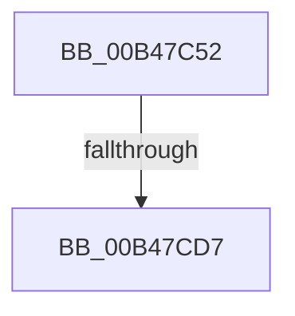

# sub_00B47C52

- RVA: `0x00B47C52`–`0x00B47D18` (길이 `198` bytes)
- VA: `0x0000000140B47C52`
- 실행 섹션: `PAGE`
- PDB 이름 있음: `아니요`; PDB Function 태그: `아니요`
- unwind 정보 RVA: `0x000B9D3C`
- 디코드: `40`개 명령, `198/198` bytes 표시
- 미해석 바이트: `0` (있으면 어셈블리에 `.byte`로 보존)

> 이 문서는 커널 이미지의 기계어와 PDB 기호를 분석해 생성했습니다. 4번과 5번은 함수 원형과 자료형을 바이너리 사용 방식에서 추정한 C 해석이며 원본 소스 복구 결과는 아닙니다.

## 1. Dependencies

- 직접 호출 지점: **3**; 고유 호출 대상: **2**
- 직접 호출자로 확인된 함수: **0**
- RIP 상대 이미지 참조: **2**

### Outgoing calls
- `0x00B47C5C` → [memset](../../text/6C/memset_function_006C6C40.md) (function, `0x006C6C40`)
- `0x00B47CCA` → [ZwAlpcAcceptConnectPort](../../text/6A/ZwAlpcAcceptConnectPort_function_006ADFF0.md) (function, `0x006ADFF0`)
- `0x00B47D0D` → [ZwAlpcAcceptConnectPort](../../text/6A/ZwAlpcAcceptConnectPort_function_006ADFF0.md) (function, `0x006ADFF0`)

### Direct callers
- 이 함수 시작 RVA로 연결되는 직접 call은 확인되지 않았습니다. 간접 호출은 완전히 역산할 수 없습니다.

### Static image references
- `0x00B47C61` → RVA `0x00F084A8` (`.data`; read)
- `0x00B47C7B` → RVA `0x00F084B0` (`.data`; read)

## 2. Other-region calls and transfers

- 다른 실행 섹션으로 향하는 call: **3**
  - `0x00B47C5C` → [memset](../../text/6C/memset_function_006C6C40.md) (`PAGE` → `.text`)
  - `0x00B47CCA` → [ZwAlpcAcceptConnectPort](../../text/6A/ZwAlpcAcceptConnectPort_function_006ADFF0.md) (`PAGE` → `.text`)
  - `0x00B47D0D` → [ZwAlpcAcceptConnectPort](../../text/6A/ZwAlpcAcceptConnectPort_function_006ADFF0.md) (`PAGE` → `.text`)
- call이 아닌 외부 분기/꼬리 이동: **2**
  - `0x00B47CD1` → [PopMonitorProcessLoop + 0x70](../A9/PopMonitorProcessLoop_function_00A97228.md) (`tail-transfer`)
  - `0x00B47D13` → [PopMonitorProcessLoop + 0x70](../A9/PopMonitorProcessLoop_function_00A97228.md) (`tail-transfer`)

## 3. Assembly (complete function range)

```asm
00B47C52  33 D2                           xor edx, edx
00B47C54  48 8D 4D 90                     lea rcx, [rbp - 0x70]
00B47C58  44 8D 42 48                     lea r8d, [rdx + 0x48]
00B47C5C  E8 DF EF B7 FF                  call 0x1406c6c40
00B47C61  48 8B 15 40 08 3C 00            mov rdx, qword ptr [rip + 0x3c0840]
00B47C68  48 8D 45 E0                     lea rax, [rbp - 0x20]
00B47C6C  C6 44 24 40 01                  mov byte ptr [rsp + 0x40], 1
00B47C71  4C 8D 4C 24 58                  lea r9, [rsp + 0x58]
00B47C76  48 89 5C 24 38                  mov qword ptr [rsp + 0x38], rbx
00B47C7B  48 8D 0D 2E 08 3C 00            lea rcx, [rip + 0x3c082e]
00B47C82  48 89 44 24 30                  mov qword ptr [rsp + 0x30], rax
00B47C87  0F 57 C0                        xorps xmm0, xmm0
00B47C8A  48 8D 45 90                     lea rax, [rbp - 0x70]
00B47C8E  48 89 5C 24 28                  mov qword ptr [rsp + 0x28], rbx
00B47C93  45 33 C0                        xor r8d, r8d
00B47C96  48 89 44 24 20                  mov qword ptr [rsp + 0x20], rax
00B47C9B  C7 45 90 00 00 10 00            mov dword ptr [rbp - 0x70], 0x100000
00B47CA2  48 C7 45 A0 00 01 00 00         mov qword ptr [rbp - 0x60], 0x100
00B47CAA  C7 44 24 58 30 00 00 00         mov dword ptr [rsp + 0x58], 0x30
00B47CB2  48 89 5C 24 60                  mov qword ptr [rsp + 0x60], rbx
00B47CB7  C7 44 24 70 00 02 00 00         mov dword ptr [rsp + 0x70], 0x200
00B47CBF  48 89 5C 24 68                  mov qword ptr [rsp + 0x68], rbx
00B47CC4  F3 0F 7F 44 24 78               movdqu xmmword ptr [rsp + 0x78], xmm0
00B47CCA  E8 21 63 B6 FF                  call 0x1406adff0
00B47CCF  85 C0                           test eax, eax
00B47CD1  0F 89 C1 F5 F4 FF               jns 0x140a97298
00B47CD7  48 8B 15 CA 07 3C 00            mov rdx, qword ptr [rip + 0x3c07ca]
00B47CDE  48 8D 45 E0                     lea rax, [rbp - 0x20]
00B47CE2  88 5C 24 40                     mov byte ptr [rsp + 0x40], bl
00B47CE6  4C 8D 4C 24 58                  lea r9, [rsp + 0x58]
00B47CEB  48 89 5C 24 38                  mov qword ptr [rsp + 0x38], rbx
00B47CF0  48 8D 0D B9 07 3C 00            lea rcx, [rip + 0x3c07b9]
00B47CF7  48 89 44 24 30                  mov qword ptr [rsp + 0x30], rax
00B47CFC  45 33 C0                        xor r8d, r8d
00B47CFF  48 8D 45 90                     lea rax, [rbp - 0x70]
00B47D03  48 89 5C 24 28                  mov qword ptr [rsp + 0x28], rbx
00B47D08  48 89 44 24 20                  mov qword ptr [rsp + 0x20], rax
00B47D0D  E8 DE 62 B6 FF                  call 0x1406adff0
00B47D12  90                              nop
00B47D13  E9 80 F5 F4 FF                  jmp 0x140a97298
```

## 4. C-style interpretation (structured pseudocode)

```c
__int64 __fastcall sub_00B47C52(__int64 a1, int a2, __int64 a3, __int64 a4, __int64 a5, __int64 a6, __int64 a7, __int64 a8, __int64 a9, __int64 a10, __int64 a11)
{
    __int64 result;
    unsigned __int64 v_stack_p20;
    unsigned __int64 v_stack_p28;
    unsigned __int64 v_stack_p30;
    unsigned __int64 v_stack_p38;
    unsigned __int8 v_stack_p40;
    unsigned int v_stack_p58;
    unsigned __int64 v_stack_p60;
    unsigned __int64 v_stack_p68;
    unsigned int v_stack_p70;
    unsigned __int64 v_stack_p78;

    a2 = 0;
    result = memset(v_rbp - 112, a2, a2 + 72, a4);
    v_stack_p40 = 1;
    v_stack_p38 = v_rbx;
    v_stack_p30 = v_rbp - 32;
    v_stack_p28 = v_rbx;
    a3 = 0;
    v_stack_p20 = v_rbp - 112;
    *(unsigned int *)(v_rbp - 112) = 0x100000ULL;
    *(unsigned __int64 *)(v_rbp - 96) = 256;
    v_stack_p58 = 48;
    v_stack_p60 = v_rbx;
    v_stack_p70 = 512;
    v_stack_p68 = v_rbx;
    v_stack_p78 = v_xmm0;
    result = ZwAlpcAcceptConnectPort(v_rip + 3934254, *(unsigned __int64 *)(v_rip + 3934272), a3, a11);
    v_stack_p40 = (unsigned __int8)(v_rbx);
    v_stack_p38 = v_rbx;
    v_stack_p30 = v_rbp - 32;
    a3 = 0;
    v_stack_p28 = v_rbx;
    v_stack_p20 = v_rbp - 112;
    result = ZwAlpcAcceptConnectPort(v_rip + 3934137, *(unsigned __int64 *)(v_rip + 3934154), a3, a11);
}
```

## 5. (Beta) C Style

```c
int64_t sub_00B47C52(int64_t Arg1, int32_t Arg2, int64_t Arg3, int64_t Arg4, uint64_t Arg5, uint64_t Arg6, uint64_t Arg7, uint64_t Arg8, uint64_t Arg9, uint64_t Arg10, int64_t Arg11)
{
    int64_t result;
    uint64_t v_stack_p20;
    uint64_t v_stack_p28;
    uint64_t v_stack_p30;
    uint64_t v_stack_p38;
    uint8_t v_stack_p40;
    uint32_t v_stack_p58;
    uint64_t v_stack_p60;
    uint64_t v_stack_p68;
    uint32_t v_stack_p70;
    uint64_t v_stack_p78;

    Arg2 = 0;
    result = memset(local_rbp - 112, Arg2, Arg2 + 72, Arg4);
    v_stack_p40 = 1;
    v_stack_p38 = local_rbx;
    v_stack_p30 = local_rbp - 32;
    v_stack_p28 = local_rbx;
    Arg3 = 0;
    v_stack_p20 = local_rbp - 112;
    *(uint32_t *)(local_rbp - 0x70) = 0x100000ULL;
    *(uint64_t *)(local_rbp - 0x60) = 256;
    v_stack_p58 = 48;
    v_stack_p60 = local_rbx;
    v_stack_p70 = 512;
    v_stack_p68 = local_rbx;
    v_stack_p78 = v_xmm0;
    result = ZwAlpcAcceptConnectPort(v_rip + 3934254, *(uint64_t *)(v_rip + 0x3C0840), Arg3, Arg11);
    v_stack_p40 = (uint8_t)(local_rbx);
    v_stack_p38 = local_rbx;
    v_stack_p30 = local_rbp - 32;
    Arg3 = 0;
    v_stack_p28 = local_rbx;
    v_stack_p20 = local_rbp - 112;
    result = ZwAlpcAcceptConnectPort(v_rip + 3934137, *(uint64_t *)(v_rip + 0x3C07CA), Arg3, Arg11);
}
```

## 6. Execution-region graph

[열기: 2D/3D 그래프와 함수 탐색 컨트롤 패널](../../../control-panel.html?section=page&rva=0x00B47C52&view=graph)

- 2D 그래프는 위에서 아래로 흐르고, 3D 그래프는 빈 공간을 드래그해 회전합니다. Shift+드래그는 이동, 휠은 확대·축소, 함수 노드 선택은 대상 보고서 이동입니다.

### Static fallback


