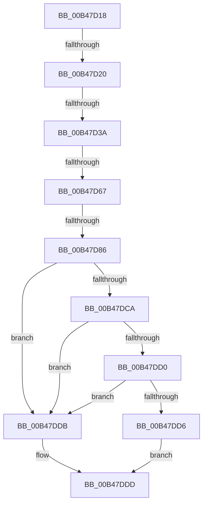

# sub_00B47D18

- RVA: `0x00B47D18`–`0x00B47E0D` (길이 `245` bytes)
- VA: `0x0000000140B47D18`
- 실행 섹션: `PAGE`
- PDB 이름 있음: `아니요`; PDB Function 태그: `아니요`
- unwind 정보 RVA: `0x000B9F24`
- 디코드: `60`개 명령, `245/245` bytes 표시
- 미해석 바이트: `0` (있으면 어셈블리에 `.byte`로 보존)

> 이 문서는 커널 이미지의 기계어와 PDB 기호를 분석해 생성했습니다. 4번과 5번은 함수 원형과 자료형을 바이너리 사용 방식에서 추정한 C 해석이며 원본 소스 복구 결과는 아닙니다.

## 1. Dependencies

- 직접 호출 지점: **5**; 고유 호출 대상: **5**
- 직접 호출자로 확인된 함수: **0**
- RIP 상대 이미지 참조: **1**

### Outgoing calls
- `0x00B47D2B` → [PiDevCfgInitDeviceContext](../97/PiDevCfgInitDeviceContext_function_00977518.md) (function, `0x00977518`)
- `0x00B47D58` → [PiDevCfgConfigureDeviceKeys](../96/PiDevCfgConfigureDeviceKeys_function_00964BA8.md) (function, `0x00964BA8`)
- `0x00B47D74` → [PnpCtxRegDeleteTree](../96/PnpCtxRegDeleteTree_function_00965CC8.md) (function, `0x00965CC8`)
- `0x00B47DC1` → [CmGetDeviceRegProp](../8E/CmGetDeviceRegProp_function_008ED870.md) (function, `0x008ED870`)
- `0x00B47E02` → [PiDevCfgSetDeviceRegProp](../96/PiDevCfgSetDeviceRegProp_function_009635C0.md) (function, `0x009635C0`)

### Direct callers
- 이 함수 시작 RVA로 연결되는 직접 call은 확인되지 않았습니다. 간접 호출은 완전히 역산할 수 없습니다.

### Static image references
- `0x00B47D67` → RVA `0x00E66398` (`.data`; read)

## 2. Other-region calls and transfers

- 다른 실행 섹션으로 향하는 call: **0**
- call이 아닌 외부 분기/꼬리 이동: **5**
  - `0x00B47D1A` → [PpDevCfgProcessDeviceOperations + 0xAD](../A9/PpDevCfgProcessDeviceOperations_function_00A97CFC.md) (`tail-transfer`)
  - `0x00B47D34` → [PpDevCfgProcessDeviceOperations + 0xAD](../A9/PpDevCfgProcessDeviceOperations_function_00A97CFC.md) (`tail-transfer`)
  - `0x00B47D61` → [PpDevCfgProcessDeviceOperations + 0xAD](../A9/PpDevCfgProcessDeviceOperations_function_00A97CFC.md) (`tail-transfer`)
  - `0x00B47D80` → [PpDevCfgProcessDeviceOperations + 0xAD](../A9/PpDevCfgProcessDeviceOperations_function_00A97CFC.md) (`tail-transfer`)
  - `0x00B47E08` → [PpDevCfgProcessDeviceOperations + 0xAD](../A9/PpDevCfgProcessDeviceOperations_function_00A97CFC.md) (`tail-transfer`)

## 3. Assembly (complete function range)

```asm
00B47D18  85 C0                           test eax, eax
00B47D1A  0F 88 89 00 F5 FF               js 0x140a97da9
00B47D20  48 8B 4F 30                     mov rcx, qword ptr [rdi + 0x30]
00B47D24  4C 8D 45 D7                     lea r8, [rbp - 0x29]
00B47D28  48 8B D6                        mov rdx, rsi
00B47D2B  E8 E8 F7 E2 FF                  call 0x140977518
00B47D30  8B D8                           mov ebx, eax
00B47D32  85 C0                           test eax, eax
00B47D34  0F 88 6F 00 F5 FF               js 0x140a97da9
00B47D3A  48 83 64 24 28 00               and qword ptr [rsp + 0x28], 0
00B47D40  48 8D 45 7F                     lea rax, [rbp + 0x7f]
00B47D44  4C 8B 45 8F                     mov r8, qword ptr [rbp - 0x71]
00B47D48  48 8D 55 D7                     lea rdx, [rbp - 0x29]
00B47D4C  41 83 C9 FF                     or r9d, 0xffffffff
00B47D50  48 89 44 24 20                  mov qword ptr [rsp + 0x20], rax
00B47D55  48 8B CF                        mov rcx, rdi
00B47D58  E8 4B CE E1 FF                  call 0x140964ba8
00B47D5D  8B D8                           mov ebx, eax
00B47D5F  85 C0                           test eax, eax
00B47D61  0F 88 42 00 F5 FF               js 0x140a97da9
00B47D67  48 8B 0D 2A E6 31 00            mov rcx, qword ptr [rip + 0x31e62a]
00B47D6E  4D 8B C6                        mov r8, r14
00B47D71  48 8B D6                        mov rdx, rsi
00B47D74  E8 4F DF E1 FF                  call 0x140965cc8
00B47D79  44 8B 75 7F                     mov r14d, dword ptr [rbp + 0x7f]
00B47D7D  45 85 F6                        test r14d, r14d
00B47D80  0F 84 23 00 F5 FF               je 0x140a97da9
00B47D86  83 64 24 38 00                  and dword ptr [rsp + 0x38], 0
00B47D8B  48 8D 45 77                     lea rax, [rbp + 0x77]
00B47D8F  48 8B 57 30                     mov rdx, qword ptr [rdi + 0x30]
00B47D93  41 B9 0B 00 00 00               mov r9d, 0xb
00B47D99  48 8B 0D F8 E5 31 00            mov rcx, qword ptr [rip + 0x31e5f8]
00B47DA0  4C 8B C6                        mov r8, rsi
00B47DA3  48 89 44 24 30                  mov qword ptr [rsp + 0x30], rax
00B47DA8  48 8D 45 67                     lea rax, [rbp + 0x67]
00B47DAC  48 89 44 24 28                  mov qword ptr [rsp + 0x28], rax
00B47DB1  48 8D 45 87                     lea rax, [rbp - 0x79]
00B47DB5  48 89 44 24 20                  mov qword ptr [rsp + 0x20], rax
00B47DBA  C7 45 77 04 00 00 00            mov dword ptr [rbp + 0x77], 4
00B47DC1  E8 AA 5A DA FF                  call 0x1408ed870
00B47DC6  85 C0                           test eax, eax
00B47DC8  78 11                           js 0x140b47ddb
00B47DCA  83 7D 87 04                     cmp dword ptr [rbp - 0x79], 4
00B47DCE  75 0B                           jne 0x140b47ddb
00B47DD0  83 7D 77 04                     cmp dword ptr [rbp + 0x77], 4
00B47DD4  75 05                           jne 0x140b47ddb
00B47DD6  8B 45 67                        mov eax, dword ptr [rbp + 0x67]
00B47DD9  EB 02                           jmp 0x140b47ddd
00B47DDB  33 C0                           xor eax, eax
00B47DDD  41 0B C6                        or eax, r14d
00B47DE0  C7 44 24 28 04 00 00 00         mov dword ptr [rsp + 0x28], 4
00B47DE8  41 B9 04 00 00 00               mov r9d, 4
00B47DEE  89 45 67                        mov dword ptr [rbp + 0x67], eax
00B47DF1  48 8D 45 67                     lea rax, [rbp + 0x67]
00B47DF5  48 8D 55 D7                     lea rdx, [rbp - 0x29]
00B47DF9  48 89 44 24 20                  mov qword ptr [rsp + 0x20], rax
00B47DFE  45 8D 41 07                     lea r8d, [r9 + 7]
00B47E02  E8 B9 B7 E1 FF                  call 0x1409635c0
00B47E07  90                              nop
00B47E08  E9 9C FF F4 FF                  jmp 0x140a97da9
```

## 4. C-style interpretation (structured pseudocode)

```c
__int64 __fastcall sub_00B47D18(__int64 a1, __int64 a2, __int64 a3, int a4, __int64 a5, __int64 a6, unsigned int a7)
{
    __int64 result;
    unsigned __int64 v_stack_p20;
    unsigned __int64 v_stack_p28;
    unsigned __int64 v_stack_p30;

    result = PiDevCfgInitDeviceContext(*(unsigned __int64 *)(v_rdi + 48), v_rsi, v_rbp - 41, a4);
    a4 = (unsigned int)((a4) | (0xFFFFFFFFULL));
    v_stack_p20 = v_rbp + 127;
    result = PiDevCfgConfigureDeviceKeys(v_rdi, v_rbp - 41, *(unsigned __int64 *)(v_rbp - 113), a4);
    result = PnpCtxRegDeleteTree(*(unsigned __int64 *)(v_rip + 3270186), v_rsi, v_r14, a4);
    v_stack_p30 = v_rbp + 119;
    v_stack_p28 = v_rbp + 103;
    v_stack_p20 = v_rbp - 121;
    *(unsigned int *)(v_rbp + 119) = 4;
    result = CmGetDeviceRegProp(*(unsigned __int64 *)(v_rip + 3270136), *(unsigned __int64 *)(v_rdi + 48), v_rsi, 11);
    if (sign_flag) goto loc_00B47DDB;
    if ((*(unsigned int *)(v_rbp - 121)) != 4) goto loc_00B47DDB;
    if ((*(unsigned int *)(v_rbp + 119)) != 4) goto loc_00B47DDB;
    goto loc_00B47DDD;
loc_00B47DDB:
    result = 0;
loc_00B47DDD:
    result = (unsigned int)((result) | ((unsigned int)((unsigned int)(*(unsigned int *)(v_rbp + 127)))));
    v_stack_p28 = 4;
    *(unsigned int *)(v_rbp + 103) = (unsigned int)(result);
    v_stack_p20 = v_rbp + 103;
    result = PiDevCfgSetDeviceRegProp(*(unsigned __int64 *)(v_rip + 3270136), v_rbp - 41, 4 + 7, 4);
}
```

## 5. (Beta) C Style

```c
int64_t sub_00B47D18(int64_t Arg1, int64_t Arg2, int64_t Arg3, int32_t Arg4, int64_t Arg5, uint64_t Arg6, uint32_t Arg7)
{
    int64_t result;
    uint64_t v_stack_p20;
    uint64_t v_stack_p28;
    uint64_t v_stack_p30;

    result = PiDevCfgInitDeviceContext(*(uint64_t *)(local_rdi + 0x30), local_rsi, local_rbp - 41, Arg4);
    Arg4 = (uint32_t)((Arg4) | (0xFFFFFFFFULL));
    v_stack_p20 = local_rbp + 127;
    result = PiDevCfgConfigureDeviceKeys(local_rdi, local_rbp - 41, *(uint64_t *)(local_rbp - 0x71), Arg4);
    result = PnpCtxRegDeleteTree(*(uint64_t *)(v_rip + 0x31E62A), local_rsi, local_r14, Arg4);
    v_stack_p30 = local_rbp + 119;
    v_stack_p28 = local_rbp + 103;
    v_stack_p20 = local_rbp - 121;
    *(uint32_t *)(local_rbp + 0x77) = 4;
    result = CmGetDeviceRegProp(*(uint64_t *)(v_rip + 0x31E5F8), *(uint64_t *)(local_rdi + 0x30), local_rsi, 11);
    if (sign_flag) goto loc_00B47DDB;
    if ((*(uint32_t *)(local_rbp - 0x79)) != 4) goto loc_00B47DDB;
    if ((*(uint32_t *)(local_rbp + 0x77)) != 4) goto loc_00B47DDB;
    goto loc_00B47DDD;
loc_00B47DDB:
    result = 0;
loc_00B47DDD:
    result = (uint32_t)((result) | ((uint32_t)((uint32_t)(*(uint32_t *)(local_rbp + 0x7F)))));
    v_stack_p28 = 4;
    *(uint32_t *)(local_rbp + 0x67) = (uint32_t)(result);
    v_stack_p20 = local_rbp + 103;
    result = PiDevCfgSetDeviceRegProp(*(uint64_t *)(v_rip + 0x31E5F8), local_rbp - 41, 4 + 7, 4);
}
```

## 6. Execution-region graph

[열기: 2D/3D 그래프와 함수 탐색 컨트롤 패널](../../../control-panel.html?section=page&rva=0x00B47D18&view=graph)

- 2D 그래프는 위에서 아래로 흐르고, 3D 그래프는 빈 공간을 드래그해 회전합니다. Shift+드래그는 이동, 휠은 확대·축소, 함수 노드 선택은 대상 보고서 이동입니다.

### Static fallback


