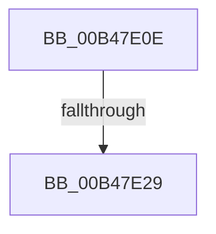

# sub_00B47E0E

- RVA: `0x00B47E0E`–`0x00B47E85` (길이 `119` bytes)
- VA: `0x0000000140B47E0E`
- 실행 섹션: `PAGE`
- PDB 이름 있음: `아니요`; PDB Function 태그: `아니요`
- unwind 정보 RVA: `0x000B9F4C`
- 디코드: `22`개 명령, `119/119` bytes 표시
- 미해석 바이트: `0` (있으면 어셈블리에 `.byte`로 보존)

> 이 문서는 커널 이미지의 기계어와 PDB 기호를 분석해 생성했습니다. 4번과 5번은 함수 원형과 자료형을 바이너리 사용 방식에서 추정한 C 해석이며 원본 소스 복구 결과는 아닙니다.

## 1. Dependencies

- 직접 호출 지점: **2**; 고유 호출 대상: **2**
- 직접 호출자로 확인된 함수: **0**
- RIP 상대 이미지 참조: **3**

### Outgoing calls
- `0x00B47E1C` → [EtwEventEnabled](../../text/39/EtwEventEnabled_function_00392450.md) (function, `0x00392450`)
- `0x00B47E7A` → [EtwWrite](../../text/41/EtwWrite_function_0041C720.md) (function, `0x0041C720`)

### Direct callers
- 이 함수 시작 RVA로 연결되는 직접 call은 확인되지 않았습니다. 간접 호출은 완전히 역산할 수 없습니다.

### Static image references
- `0x00B47E0E` → RVA `0x00F0B408` (`.data`; read)
- `0x00B47E15` → RVA `0x00023358` (`.rdata`; read)
- `0x00B47E2E` → RVA `0x00F0B6B0` (`.data`; read)

## 2. Other-region calls and transfers

- 다른 실행 섹션으로 향하는 call: **2**
  - `0x00B47E1C` → [EtwEventEnabled](../../text/39/EtwEventEnabled_function_00392450.md) (`PAGE` → `.text`)
  - `0x00B47E7A` → [EtwWrite](../../text/41/EtwWrite_function_0041C720.md) (`PAGE` → `.text`)
- call이 아닌 외부 분기/꼬리 이동: **2**
  - `0x00B47E23` → [PopDirectedDripsDiagTraceMarkDevice + 0x70](../A9/PopDirectedDripsDiagTraceMarkDevice_function_00A97DE0.md) (`tail-transfer`)
  - `0x00B47E80` → [PopDirectedDripsDiagTraceMarkDevice + 0x70](../A9/PopDirectedDripsDiagTraceMarkDevice_function_00A97DE0.md) (`tail-transfer`)

## 3. Assembly (complete function range)

```asm
00B47E0E  48 8B 0D F3 35 3C 00            mov rcx, qword ptr [rip + 0x3c35f3]
00B47E15  48 8D 15 3C B5 4D FF            lea rdx, [rip - 0xb24ac4]
00B47E1C  E8 2F A6 84 FF                  call 0x140392450
00B47E21  84 C0                           test al, al
00B47E23  0F 84 27 00 F5 FF               je 0x140a97e50
00B47E29  83 64 24 44 00                  and dword ptr [rsp + 0x44], 0
00B47E2E  48 8D 05 7B 38 3C 00            lea rax, [rip + 0x3c387b]
00B47E35  83 64 24 54 00                  and dword ptr [rsp + 0x54], 0
00B47E3A  48 8D 15 17 B5 4D FF            lea rdx, [rip - 0xb24ae9]
00B47E41  48 8B 0D C0 35 3C 00            mov rcx, qword ptr [rip + 0x3c35c0]
00B47E48  41 B9 02 00 00 00               mov r9d, 2
00B47E4E  48 89 44 24 38                  mov qword ptr [rsp + 0x38], rax
00B47E53  45 33 C0                        xor r8d, r8d
00B47E56  48 8D 44 24 30                  lea rax, [rsp + 0x30]
00B47E5B  C7 44 24 40 01 00 00 00         mov dword ptr [rsp + 0x40], 1
00B47E63  48 89 44 24 48                  mov qword ptr [rsp + 0x48], rax
00B47E68  48 8D 44 24 38                  lea rax, [rsp + 0x38]
00B47E6D  48 89 44 24 20                  mov qword ptr [rsp + 0x20], rax
00B47E72  C7 44 24 50 08 00 00 00         mov dword ptr [rsp + 0x50], 8
00B47E7A  E8 A1 48 8D FF                  call 0x14041c720
00B47E7F  90                              nop
00B47E80  E9 CB FF F4 FF                  jmp 0x140a97e50
```

## 4. C-style interpretation (structured pseudocode)

```c
__int64 __fastcall sub_00B47E0E(__int64 a1, __int64 a2, int a3, __int64 a4, __int64 a5, __int64 a6, __int64 a7)
{
    __int64 result;
    unsigned __int64 v_stack_p20;
    unsigned __int64 v_stack_p38;
    unsigned int v_stack_p40;
    unsigned int v_stack_p44;
    unsigned __int64 v_stack_p48;
    unsigned int v_stack_p50;
    unsigned int v_stack_p54;

    result = EtwEventEnabled(*(unsigned __int64 *)(v_rip + 3945971), v_rip - 11684548, a3, a4);
    v_stack_p38 = v_rip + 3946619;
    a3 = 0;
    v_stack_p40 = 1;
    v_stack_p48 = a6;
    v_stack_p20 = a7;
    v_stack_p50 = 8;
    result = EtwWrite(*(unsigned __int64 *)(v_rip + 3945920), v_rip - 11684585, a3, 2);
}
```

## 5. (Beta) C Style

```c
int64_t sub_00B47E0E(int64_t Arg1, int64_t Arg2, int32_t Arg3, int64_t Arg4, uint64_t Arg5, int64_t Arg6, int64_t Arg7)
{
    int64_t result;
    uint64_t v_stack_p20;
    uint64_t v_stack_p38;
    uint32_t v_stack_p40;
    uint32_t v_stack_p44;
    uint64_t v_stack_p48;
    uint32_t v_stack_p50;
    uint32_t v_stack_p54;

    result = EtwEventEnabled(*(uint64_t *)(v_rip + 0x3C35F3), v_rip - 11684548, Arg3, Arg4);
    v_stack_p38 = v_rip + 3946619;
    Arg3 = 0;
    v_stack_p40 = 1;
    v_stack_p48 = Arg6;
    v_stack_p20 = Arg7;
    v_stack_p50 = 8;
    result = EtwWrite(*(uint64_t *)(v_rip + 0x3C35C0), v_rip - 11684585, Arg3, 2);
}
```

## 6. Execution-region graph

[열기: 2D/3D 그래프와 함수 탐색 컨트롤 패널](../../../control-panel.html?section=page&rva=0x00B47E0E&view=graph)

- 2D 그래프는 위에서 아래로 흐르고, 3D 그래프는 빈 공간을 드래그해 회전합니다. Shift+드래그는 이동, 휠은 확대·축소, 함수 노드 선택은 대상 보고서 이동입니다.

### Static fallback


