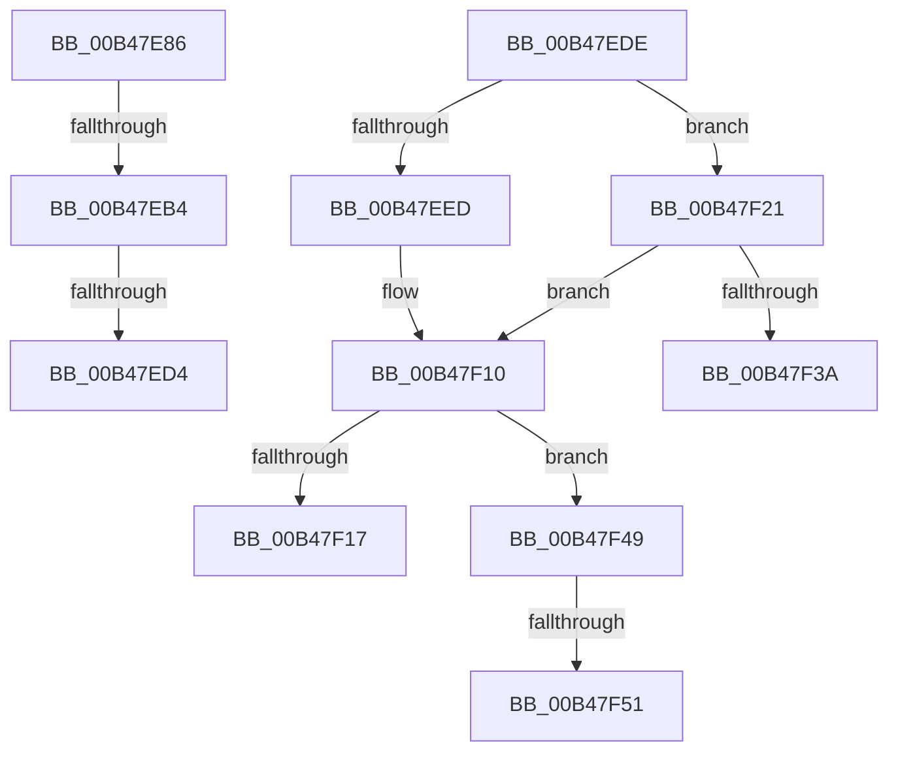

# sub_00B47E86

- RVA: `0x00B47E86`–`0x00B47F58` (길이 `210` bytes)
- VA: `0x0000000140B47E86`
- 실행 섹션: `PAGE`
- PDB 이름 있음: `아니요`; PDB Function 태그: `아니요`
- unwind 정보 RVA: `0x000BA028`
- 디코드: `54`개 명령, `210/210` bytes 표시
- 미해석 바이트: `0` (있으면 어셈블리에 `.byte`로 보존)

> 이 문서는 커널 이미지의 기계어와 PDB 기호를 분석해 생성했습니다. 4번과 5번은 함수 원형과 자료형을 바이너리 사용 방식에서 추정한 C 해석이며 원본 소스 복구 결과는 아닙니다.

## 1. Dependencies

- 직접 호출 지점: **4**; 고유 호출 대상: **4**
- 직접 호출자로 확인된 함수: **0**
- RIP 상대 이미지 참조: **0**

### Outgoing calls
- `0x00B47EA2` → [CmGetDevicePanelRegKeyPath](../82/CmGetDevicePanelRegKeyPath_function_0082EE7C.md) (function, `0x0082EE7C`)
- `0x00B47EB9` → [ExFreePoolWithTag](../../poolcode/B8/ExFreePoolWithTag_function_00B82870.md) (function, `0x00B82870`)
- `0x00B47F0B` → [PnpCtxRegCreateTree](../93/PnpCtxRegCreateTree_function_00931CA0.md) (function, `0x00931CA0`)
- `0x00B47F31` → [PnpCtxRegOpenKey](../8E/PnpCtxRegOpenKey_function_008EF7B8.md) (function, `0x008EF7B8`)

### Direct callers
- 이 함수 시작 RVA로 연결되는 직접 call은 확인되지 않았습니다. 간접 호출은 완전히 역산할 수 없습니다.

### Static image references
- 디코드된 RIP-relative 메모리 참조가 없습니다.

## 2. Other-region calls and transfers

- 다른 실행 섹션으로 향하는 call: **1**
  - `0x00B47EB9` → [ExFreePoolWithTag](../../poolcode/B8/ExFreePoolWithTag_function_00B82870.md) (`PAGE` → `POOLCODE`)
- call이 아닌 외부 분기/꼬리 이동: **7**
  - `0x00B47EAE` → [_CmOpenDevicePanelRegKeyWorker + 0xAB](../A9/_CmOpenDevicePanelRegKeyWorker_function_00A98434.md) (`tail-transfer`)
  - `0x00B47ECE` → [_CmOpenDevicePanelRegKeyWorker + 0x56](../A9/_CmOpenDevicePanelRegKeyWorker_function_00A98434.md) (`tail-transfer`)
  - `0x00B47ED9` → [_CmOpenDevicePanelRegKeyWorker + 0x79](../A9/_CmOpenDevicePanelRegKeyWorker_function_00A98434.md) (`tail-transfer`)
  - `0x00B47F1C` → [_CmOpenDevicePanelRegKeyWorker + 0x79](../A9/_CmOpenDevicePanelRegKeyWorker_function_00A98434.md) (`tail-transfer`)
  - `0x00B47F44` → [_CmOpenDevicePanelRegKeyWorker + 0x79](../A9/_CmOpenDevicePanelRegKeyWorker_function_00A98434.md) (`tail-transfer`)
  - `0x00B47F4B` → [_CmOpenDevicePanelRegKeyWorker + 0x79](../A9/_CmOpenDevicePanelRegKeyWorker_function_00A98434.md) (`tail-transfer`)
  - `0x00B47F53` → [_CmOpenDevicePanelRegKeyWorker + 0x79](../A9/_CmOpenDevicePanelRegKeyWorker_function_00A98434.md) (`tail-transfer`)

## 3. Assembly (complete function range)

```asm
00B47E86  8B CE                           mov ecx, esi
00B47E88  48 8D 45 48                     lea rax, [rbp + 0x48]
00B47E8C  48 89 44 24 38                  mov qword ptr [rsp + 0x38], rax
00B47E91  45 8B C6                        mov r8d, r14d
00B47E94  D1 E9                           shr ecx, 1
00B47E96  49 8B D4                        mov rdx, r12
00B47E99  89 4C 24 30                     mov dword ptr [rsp + 0x30], ecx
00B47E9D  48 89 7C 24 28                  mov qword ptr [rsp + 0x28], rdi
00B47EA2  E8 D5 6F CE FF                  call 0x14082ee7c
00B47EA7  8B D8                           mov ebx, eax
00B47EA9  3D 23 00 00 C0                  cmp eax, 0xc0000023
00B47EAE  0F 85 2B 06 F5 FF               jne 0x140a984df
00B47EB4  33 D2                           xor edx, edx
00B47EB6  48 8B CF                        mov rcx, rdi
00B47EB9  E8 B2 A9 03 00                  call 0x140b82870
00B47EBE  8B 75 48                        mov esi, dword ptr [rbp + 0x48]
00B47EC1  33 FF                           xor edi, edi
00B47EC3  48 03 F6                        add rsi, rsi
00B47EC6  B8 FF FF FF FF                  mov eax, 0xffffffff
00B47ECB  48 3B F0                        cmp rsi, rax
00B47ECE  0F 86 B6 05 F5 FF               jbe 0x140a9848a
00B47ED4  BB 95 00 00 C0                  mov ebx, 0xc0000095
00B47ED9  E9 CF 05 F5 FF                  jmp 0x140a984ad
00B47EDE  45 33 C9                        xor r9d, r9d
00B47EE1  4C 8B C6                        mov r8, rsi
00B47EE4  49 8B CF                        mov rcx, r15
00B47EE7  44 38 4D 58                     cmp byte ptr [rbp + 0x58], r9b
00B47EEB  74 34                           je 0x140b47f21
00B47EED  48 8B 45 68                     mov rax, qword ptr [rbp + 0x68]
00B47EF1  48 89 44 24 38                  mov qword ptr [rsp + 0x38], rax
00B47EF6  48 8B 45 60                     mov rax, qword ptr [rbp + 0x60]
00B47EFA  48 89 44 24 30                  mov qword ptr [rsp + 0x30], rax
00B47EFF  4C 21 4C 24 28                  and qword ptr [rsp + 0x28], r9
00B47F04  8B 45 50                        mov eax, dword ptr [rbp + 0x50]
00B47F07  89 44 24 20                     mov dword ptr [rsp + 0x20], eax
00B47F0B  E8 90 9D DE FF                  call 0x140931ca0
00B47F10  3D 7C 01 00 C0                  cmp eax, 0xc000017c
00B47F15  75 32                           jne 0x140b47f49
00B47F17  BB E5 00 00 C0                  mov ebx, 0xc00000e5
00B47F1C  E9 8C 05 F5 FF                  jmp 0x140a984ad
00B47F21  48 8B 45 60                     mov rax, qword ptr [rbp + 0x60]
00B47F25  48 89 44 24 28                  mov qword ptr [rsp + 0x28], rax
00B47F2A  8B 45 50                        mov eax, dword ptr [rbp + 0x50]
00B47F2D  89 44 24 20                     mov dword ptr [rsp + 0x20], eax
00B47F31  E8 82 78 DA FF                  call 0x1408ef7b8
00B47F36  85 C0                           test eax, eax
00B47F38  78 D6                           js 0x140b47f10
00B47F3A  48 8B 45 68                     mov rax, qword ptr [rbp + 0x68]
00B47F3E  C7 00 02 00 00 00               mov dword ptr [rax], 2
00B47F44  E9 64 05 F5 FF                  jmp 0x140a984ad
00B47F49  85 C0                           test eax, eax
00B47F4B  0F 89 5C 05 F5 FF               jns 0x140a984ad
00B47F51  8B D8                           mov ebx, eax
00B47F53  E9 55 05 F5 FF                  jmp 0x140a984ad
```

## 4. C-style interpretation (structured pseudocode)

```c
__int64 __fastcall sub_00B47E86(__int64 a1, __int64 a2, __int64 a3, int a4)
{
    __int64 result;
    __int64 v_rdi;
    __int64 v_rsi;
    unsigned int v_stack_p20;
    unsigned __int64 v_stack_p28;
    unsigned int v_stack_p30;
    unsigned __int64 v_stack_p38;

    v_stack_p38 = v_rbp + 72;
    a1 = (unsigned int)(((unsigned int)((unsigned int)(v_rsi))) >> (1));
    v_stack_p30 = (unsigned int)(a1);
    v_stack_p28 = v_rdi;
    result = CmGetDevicePanelRegKeyPath(a1, v_r12, (unsigned int)((unsigned int)(v_r14)), a4);
    a2 = 0;
    result = ExFreePoolWithTag(v_rdi, a2, (unsigned int)((unsigned int)(v_r14)), a4);
    v_rdi = 0;
    v_rsi = ((unsigned int)(*(unsigned int *)(v_rbp + 72))) + ((unsigned int)(*(unsigned int *)(v_rbp + 72)));
}
```

## 5. (Beta) C Style

```c
int64_t sub_00B47E86(int64_t Arg1, int64_t Arg2, int64_t Arg3, int32_t Arg4)
{
    int64_t result;
    int64_t local_rdi;
    int64_t local_rsi;
    uint32_t v_stack_p20;
    uint64_t v_stack_p28;
    uint32_t v_stack_p30;
    uint64_t v_stack_p38;

    v_stack_p38 = local_rbp + 72;
    Arg1 = (uint32_t)(((uint32_t)((uint32_t)(local_rsi))) >> (1));
    v_stack_p30 = (uint32_t)(Arg1);
    v_stack_p28 = local_rdi;
    result = CmGetDevicePanelRegKeyPath(Arg1, local_r12, (uint32_t)((uint32_t)(local_r14)), Arg4);
    Arg2 = 0;
    result = ExFreePoolWithTag(local_rdi, Arg2, (uint32_t)((uint32_t)(local_r14)), Arg4);
    local_rdi = 0;
    local_rsi = ((uint32_t)(*(uint32_t *)(local_rbp + 0x48))) + ((uint32_t)(*(uint32_t *)(local_rbp + 0x48)));
}
```

## 6. Execution-region graph

[열기: 2D/3D 그래프와 함수 탐색 컨트롤 패널](../../../control-panel.html?section=page&rva=0x00B47E86&view=graph)

- 2D 그래프는 위에서 아래로 흐르고, 3D 그래프는 빈 공간을 드래그해 회전합니다. Shift+드래그는 이동, 휠은 확대·축소, 함수 노드 선택은 대상 보고서 이동입니다.

### Static fallback


