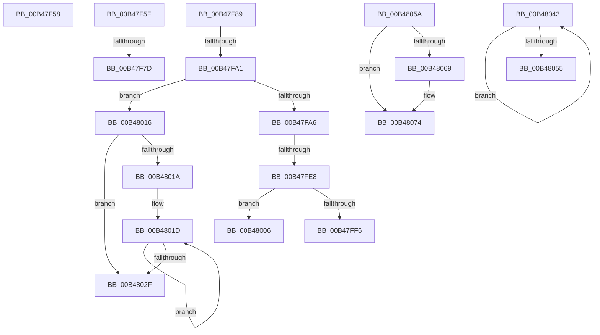

# sub_00B47F58

- RVA: `0x00B47F58`–`0x00B4807E` (길이 `294` bytes)
- VA: `0x0000000140B47F58`
- 실행 섹션: `PAGE`
- PDB 이름 있음: `아니요`; PDB Function 태그: `아니요`
- unwind 정보 RVA: `0x000BA140`
- 디코드: `73`개 명령, `294/294` bytes 표시
- 미해석 바이트: `0` (있으면 어셈블리에 `.byte`로 보존)

> 이 문서는 커널 이미지의 기계어와 PDB 기호를 분석해 생성했습니다. 4번과 5번은 함수 원형과 자료형을 바이너리 사용 방식에서 추정한 C 해석이며 원본 소스 복구 결과는 아닙니다.

## 1. Dependencies

- 직접 호출 지점: **10**; 고유 호출 대상: **8**
- 직접 호출자로 확인된 함수: **0**
- RIP 상대 이미지 참조: **1**

### Outgoing calls
- `0x00B47F6C` → [ExAllocatePool2](../../poolcode/B8/ExAllocatePool2_function_00B820F0.md) (function, `0x00B820F0`)
- `0x00B47F94` → [wcscmp](../../text/50/wcscmp_function_00501AF0.md) (function, `0x00501AF0`)
- `0x00B47FDB` → [ZwOpenSymbolicLinkObject](../../text/6A/ZwOpenSymbolicLinkObject_function_006AF7F0.md) (function, `0x006AF7F0`)
- `0x00B47FED` → [ZwMakeTemporaryObject](../../text/6A/ZwMakeTemporaryObject_function_006AF3F0.md) (function, `0x006AF3F0`)
- `0x00B4800B` → [ZwClose](../../text/6A/ZwClose_function_006AD2B0.md) (function, `0x006AD2B0`)
- `0x00B48020` → [ZwClose](../../text/6A/ZwClose_function_006AD2B0.md) (function, `0x006AD2B0`)
- `0x00B48038` → [ExFreePoolWithTag](../../poolcode/B8/ExFreePoolWithTag_function_00B82870.md) (function, `0x00B82870`)
- `0x00B48046` → [ZwClose](../../text/6A/ZwClose_function_006AD2B0.md) (function, `0x006AD2B0`)
- `0x00B4805F` → [PsDetachSiloFromCurrentThread](../../text/44/PsDetachSiloFromCurrentThread_function_00449AC0.md) (function, `0x00449AC0`)
- `0x00B4806F` → [KiUnstackDetachProcess](../../text/21/KiUnstackDetachProcess_function_00217D30.md) (function, `0x00217D30`)

### Direct callers
- 이 함수 시작 RVA로 연결되는 직접 call은 확인되지 않았습니다. 간접 호출은 완전히 역산할 수 없습니다.

### Static image references
- `0x00B47F8D` → RVA `0x00B06100` (` ?? ::NNGAKEGL::`string'`; read)

## 2. Other-region calls and transfers

- 다른 실행 섹션으로 향하는 call: **10**
  - `0x00B47F6C` → [ExAllocatePool2](../../poolcode/B8/ExAllocatePool2_function_00B820F0.md) (`PAGE` → `POOLCODE`)
  - `0x00B47F94` → [wcscmp](../../text/50/wcscmp_function_00501AF0.md) (`PAGE` → `.text`)
  - `0x00B47FDB` → [ZwOpenSymbolicLinkObject](../../text/6A/ZwOpenSymbolicLinkObject_function_006AF7F0.md) (`PAGE` → `.text`)
  - `0x00B47FED` → [ZwMakeTemporaryObject](../../text/6A/ZwMakeTemporaryObject_function_006AF3F0.md) (`PAGE` → `.text`)
  - `0x00B4800B` → [ZwClose](../../text/6A/ZwClose_function_006AD2B0.md) (`PAGE` → `.text`)
  - `0x00B48020` → [ZwClose](../../text/6A/ZwClose_function_006AD2B0.md) (`PAGE` → `.text`)
  - `0x00B48038` → [ExFreePoolWithTag](../../poolcode/B8/ExFreePoolWithTag_function_00B82870.md) (`PAGE` → `POOLCODE`)
  - `0x00B48046` → [ZwClose](../../text/6A/ZwClose_function_006AD2B0.md) (`PAGE` → `.text`)
  - `0x00B4805F` → [PsDetachSiloFromCurrentThread](../../text/44/PsDetachSiloFromCurrentThread_function_00449AC0.md) (`PAGE` → `.text`)
  - `0x00B4806F` → [KiUnstackDetachProcess](../../text/21/KiUnstackDetachProcess_function_00217D30.md) (`PAGE` → `.text`)
- call이 아닌 외부 분기/꼬리 이동: **10**
  - `0x00B47F5A` → [SepCleanupLUIDDeviceMapDirectory + 0x1FE](../A9/SepCleanupLUIDDeviceMapDirectory_function_00A98F24.md) (`tail-transfer`)
  - `0x00B47F77` → [SepCleanupLUIDDeviceMapDirectory + 0x19D](../A9/SepCleanupLUIDDeviceMapDirectory_function_00A98F24.md) (`tail-transfer`)
  - `0x00B47F84` → [SepCleanupLUIDDeviceMapDirectory + 0x1A7](../A9/SepCleanupLUIDDeviceMapDirectory_function_00A98F24.md) (`tail-transfer`)
  - `0x00B47F9B` → [SepCleanupLUIDDeviceMapDirectory + 0x162](../A9/SepCleanupLUIDDeviceMapDirectory_function_00A98F24.md) (`tail-transfer`)
  - `0x00B47FE2` → [SepCleanupLUIDDeviceMapDirectory + 0x162](../A9/SepCleanupLUIDDeviceMapDirectory_function_00A98F24.md) (`tail-transfer`)
  - `0x00B48001` → [SepCleanupLUIDDeviceMapDirectory + 0x162](../A9/SepCleanupLUIDDeviceMapDirectory_function_00A98F24.md) (`tail-transfer`)
  - `0x00B48011` → [SepCleanupLUIDDeviceMapDirectory + 0x162](../A9/SepCleanupLUIDDeviceMapDirectory_function_00A98F24.md) (`tail-transfer`)
  - `0x00B4803E` → [SepCleanupLUIDDeviceMapDirectory + 0x13A](../A9/SepCleanupLUIDDeviceMapDirectory_function_00A98F24.md) (`tail-transfer`)
  - `0x00B48055` → [SepCleanupLUIDDeviceMapDirectory + 0x1C7](../A9/SepCleanupLUIDDeviceMapDirectory_function_00A98F24.md) (`tail-transfer`)
  - `0x00B48079` → [SepCleanupLUIDDeviceMapDirectory + 0x1FE](../A9/SepCleanupLUIDDeviceMapDirectory_function_00A98F24.md) (`tail-transfer`)

## 3. Assembly (complete function range)

```asm
00B47F58  8B C7                           mov eax, edi
00B47F5A  E9 C3 11 F5 FF                  jmp 0x140a99122
00B47F5F  8B D0                           mov edx, eax
00B47F61  B9 00 01 00 00                  mov ecx, 0x100
00B47F66  41 B8 53 65 44 62               mov r8d, 0x62446553
00B47F6C  E8 7F A1 03 00                  call 0x140b820f0
00B47F71  48 8B D8                        mov rbx, rax
00B47F74  48 85 C0                        test rax, rax
00B47F77  0F 85 44 11 F5 FF               jne 0x140a990c1
00B47F7D  B8 9A 00 00 C0                  mov eax, 0xc000009a
00B47F82  8B F0                           mov esi, eax
00B47F84  E9 42 11 F5 FF                  jmp 0x140a990cb
00B47F89  48 8B 4B 18                     mov rcx, qword ptr [rbx + 0x18]
00B47F8D  48 8D 15 6C E1 FB FF            lea rdx, [rip - 0x41e94]
00B47F94  E8 57 9B 9B FF                  call 0x140501af0
00B47F99  85 C0                           test eax, eax
00B47F9B  0F 85 E5 10 F5 FF               jne 0x140a99086
00B47FA1  41 3B FE                        cmp edi, r14d
00B47FA4  73 70                           jae 0x140b48016
00B47FA6  48 8B 44 24 48                  mov rax, qword ptr [rsp + 0x48]
00B47FAB  4C 8D 44 24 68                  lea r8, [rsp + 0x68]
00B47FB0  0F 57 C0                        xorps xmm0, xmm0
00B47FB3  48 89 44 24 70                  mov qword ptr [rsp + 0x70], rax
00B47FB8  BA 01 00 0F 00                  mov edx, 0xf0001
00B47FBD  C7 44 24 68 30 00 00 00         mov dword ptr [rsp + 0x68], 0x30
00B47FC5  48 8D 4C 24 50                  lea rcx, [rsp + 0x50]
00B47FCA  C7 45 80 40 02 00 00            mov dword ptr [rbp - 0x80], 0x240
00B47FD1  F3 0F 7F 45 88                  movdqu xmmword ptr [rbp - 0x78], xmm0
00B47FD6  48 89 5C 24 78                  mov qword ptr [rsp + 0x78], rbx
00B47FDB  E8 10 78 B6 FF                  call 0x1406af7f0
00B47FE0  85 C0                           test eax, eax
00B47FE2  0F 88 9E 10 F5 FF               js 0x140a99086
00B47FE8  48 8B 4C 24 50                  mov rcx, qword ptr [rsp + 0x50]
00B47FED  E8 FE 73 B6 FF                  call 0x1406af3f0
00B47FF2  85 C0                           test eax, eax
00B47FF4  78 10                           js 0x140b48006
00B47FF6  48 8B 44 24 50                  mov rax, qword ptr [rsp + 0x50]
00B47FFB  49 89 04 FF                     mov qword ptr [r15 + rdi*8], rax
00B47FFF  FF C7                           inc edi
00B48001  E9 80 10 F5 FF                  jmp 0x140a99086
00B48006  48 8B 4C 24 50                  mov rcx, qword ptr [rsp + 0x50]
00B4800B  E8 A0 52 B6 FF                  call 0x1406ad2b0
00B48010  90                              nop
00B48011  E9 70 10 F5 FF                  jmp 0x140a99086
00B48016  85 FF                           test edi, edi
00B48018  74 15                           je 0x140b4802f
00B4801A  49 8B F7                        mov rsi, r15
00B4801D  48 8B 0E                        mov rcx, qword ptr [rsi]
00B48020  E8 8B 52 B6 FF                  call 0x1406ad2b0
00B48025  48 8D 76 08                     lea rsi, [rsi + 8]
00B48029  48 83 EF 01                     sub rdi, 1
00B4802D  75 EE                           jne 0x140b4801d
00B4802F  41 83 C6 14                     add r14d, 0x14
00B48033  33 D2                           xor edx, edx
00B48035  49 8B CF                        mov rcx, r15
00B48038  E8 33 A8 03 00                  call 0x140b82870
00B4803D  90                              nop
00B4803E  E9 1B 10 F5 FF                  jmp 0x140a9905e
00B48043  48 8B 0E                        mov rcx, qword ptr [rsi]
00B48046  E8 65 52 B6 FF                  call 0x1406ad2b0
00B4804B  48 8D 76 08                     lea rsi, [rsi + 8]
00B4804F  48 83 EF 01                     sub rdi, 1
00B48053  75 EE                           jne 0x140b48043
00B48055  E9 91 10 F5 FF                  jmp 0x140a990eb
00B4805A  48 8B 4C 24 60                  mov rcx, qword ptr [rsp + 0x60]
00B4805F  E8 5C 1A 90 FF                  call 0x140449ac0
00B48064  45 84 E4                        test r12b, r12b
00B48067  75 0B                           jne 0x140b48074
00B48069  33 D2                           xor edx, edx
00B4806B  48 8D 4D A8                     lea rcx, [rbp - 0x58]
00B4806F  E8 BC FC 6C FF                  call 0x140217d30
00B48074  B8 17 00 00 C0                  mov eax, 0xc0000017
00B48079  E9 A4 10 F5 FF                  jmp 0x140a99122
```

## 4. C-style interpretation (structured pseudocode)

```c
__int64 __fastcall sub_00B47F58(void)
{
    unsigned __int64 v_stack_p48;
    unsigned __int64 v_stack_p50;
    unsigned __int64 v_stack_p60;
    unsigned __int64 v_stack_p68;
    unsigned __int64 v_stack_p70;
    unsigned __int64 v_stack_p78;
}
```

## 5. (Beta) C Style

```c
void sub_00B47F58(void)
{
    uint64_t v_stack_p48;
    uint64_t v_stack_p50;
    uint64_t v_stack_p60;
    uint64_t v_stack_p68;
    uint64_t v_stack_p70;
    uint64_t v_stack_p78;
}
```

## 6. Execution-region graph

[열기: 2D/3D 그래프와 함수 탐색 컨트롤 패널](../../../control-panel.html?section=page&rva=0x00B47F58&view=graph)

- 2D 그래프는 위에서 아래로 흐르고, 3D 그래프는 빈 공간을 드래그해 회전합니다. Shift+드래그는 이동, 휠은 확대·축소, 함수 노드 선택은 대상 보고서 이동입니다.

### Static fallback


