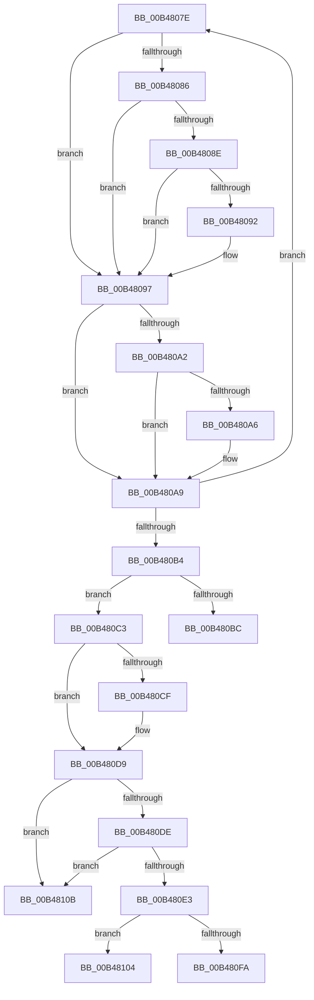

# sub_00B4807E

- RVA: `0x00B4807E`–`0x00B48112` (길이 `148` bytes)
- VA: `0x0000000140B4807E`
- 실행 섹션: `PAGE`
- PDB 이름 있음: `아니요`; PDB Function 태그: `아니요`
- unwind 정보 RVA: `0x000BA17C`
- 디코드: `47`개 명령, `148/148` bytes 표시
- 미해석 바이트: `0` (있으면 어셈블리에 `.byte`로 보존)

> 이 문서는 커널 이미지의 기계어와 PDB 기호를 분석해 생성했습니다. 4번과 5번은 함수 원형과 자료형을 바이너리 사용 방식에서 추정한 C 해석이며 원본 소스 복구 결과는 아닙니다.

## 1. Dependencies

- 직접 호출 지점: **0**; 고유 호출 대상: **0**
- 직접 호출자로 확인된 함수: **0**
- RIP 상대 이미지 참조: **2**

### Outgoing calls
- 직접 디코드된 call 명령이 없습니다.

### Direct callers
- 이 함수 시작 RVA로 연결되는 직접 call은 확인되지 않았습니다. 간접 호출은 완전히 역산할 수 없습니다.

### Static image references
- `0x00B480C3` → RVA `0x00E678B8` (`.data`; read)
- `0x00B480D2` → RVA `0x00E678B8` (`.data`; write)

## 2. Other-region calls and transfers

- 다른 실행 섹션으로 향하는 call: **0**
- call이 아닌 외부 분기/꼬리 이동: **4**
  - `0x00B480BE` → [PopEstimateChargeTime + 0x4E](../A9/PopEstimateChargeTime_function_00A99264.md) (`tail-transfer`)
  - `0x00B480FF` → [PopEstimateChargeTime + 0x4E](../A9/PopEstimateChargeTime_function_00A99264.md) (`tail-transfer`)
  - `0x00B48106` → [PopEstimateChargeTime + 0x4E](../A9/PopEstimateChargeTime_function_00A99264.md) (`tail-transfer`)
  - `0x00B4810D` → [PopEstimateChargeTime + 0x4E](../A9/PopEstimateChargeTime_function_00A99264.md) (`tail-transfer`)

## 3. Assembly (complete function range)

```asm
00B4807E  8B 41 40                        mov eax, dword ptr [rcx + 0x40]
00B48081  41 3B C0                        cmp eax, r8d
00B48084  74 11                           je 0x140b48097
00B48086  8B 51 68                        mov edx, dword ptr [rcx + 0x68]
00B48089  41 3B D0                        cmp edx, r8d
00B4808C  74 09                           je 0x140b48097
00B4808E  3B D0                           cmp edx, eax
00B48090  73 05                           jae 0x140b48097
00B48092  2B C2                           sub eax, edx
00B48094  4C 03 F0                        add r14, rax
00B48097  48 63 41 70                     movsxd rax, dword ptr [rcx + 0x70]
00B4809B  3D 00 00 00 80                  cmp eax, 0x80000000
00B480A0  74 07                           je 0x140b480a9
00B480A2  85 C0                           test eax, eax
00B480A4  7E 03                           jle 0x140b480a9
00B480A6  48 03 F0                        add rsi, rax
00B480A9  0B 79 64                        or edi, dword ptr [rcx + 0x64]
00B480AC  48 8B 09                        mov rcx, qword ptr [rcx]
00B480AF  49 3B C9                        cmp rcx, r9
00B480B2  75 CA                           jne 0x140b4807e
00B480B4  83 E7 07                        and edi, 7
00B480B7  83 FF 05                        cmp edi, 5
00B480BA  74 07                           je 0x140b480c3
00B480BC  B3 50                           mov bl, 0x50
00B480BE  E9 EF 11 F5 FF                  jmp 0x140a992b2
00B480C3  48 8B 0D EE F7 31 00            mov rcx, qword ptr [rip + 0x31f7ee]
00B480CA  48 3B CE                        cmp rcx, rsi
00B480CD  73 0A                           jae 0x140b480d9
00B480CF  48 8B CE                        mov rcx, rsi
00B480D2  48 89 0D DF F7 31 00            mov qword ptr [rip + 0x31f7df], rcx
00B480D9  4D 85 F6                        test r14, r14
00B480DC  74 2D                           je 0x140b4810b
00B480DE  48 85 C9                        test rcx, rcx
00B480E1  74 28                           je 0x140b4810b
00B480E3  49 69 C6 A0 0F 00 00            imul rax, r14, 0xfa0
00B480EA  33 D2                           xor edx, edx
00B480EC  48 F7 F1                        div rcx
00B480EF  4C 8B E0                        mov r12, rax
00B480F2  48 3D 60 54 00 00               cmp rax, 0x5460
00B480F8  77 0A                           ja 0x140b48104
00B480FA  4C 8B F8                        mov r15, rax
00B480FD  B3 4F                           mov bl, 0x4f
00B480FF  E9 AE 11 F5 FF                  jmp 0x140a992b2
00B48104  B3 4C                           mov bl, 0x4c
00B48106  E9 A7 11 F5 FF                  jmp 0x140a992b2
00B4810B  B3 5A                           mov bl, 0x5a
00B4810D  E9 A0 11 F5 FF                  jmp 0x140a992b2
```

## 4. C-style interpretation (structured pseudocode)

```c
__int64 __fastcall sub_00B4807E(__int64 a1, __int64 a2, int a3, __int64 a4)
{
    __int64 result;
    __int64 v_r14;
    __int64 v_rdi;
    __int64 v_rsi;

    if (((unsigned int)((unsigned int)(*(unsigned int *)(a1 + 64)))) == a3) goto loc_00B48097;
    if (((unsigned int)((unsigned int)(*(unsigned int *)(a1 + 104)))) == a3) goto loc_00B48097;
    result = (unsigned int)(*(unsigned int *)(a1 + 64));
    if (((unsigned int)((unsigned int)(*(unsigned int *)(a1 + 104)))) < ((unsigned int)((unsigned int)(*(unsigned int *)(a1 + 64))))) {
        result = (unsigned int)(((unsigned int)(*(unsigned int *)(a1 + 64))) - ((unsigned int)((unsigned int)(*(unsigned int *)(a1 + 104)))));
        v_r14 = (v_r14) + (result);
    }
    if (((unsigned int)((int)(*(unsigned int *)(a1 + 112)))) == 0x80000000ULL) goto loc_00B480A9;
    if (!(condition_is_less_or_equal)) {
        v_rsi = (v_rsi) + ((int)(*(unsigned int *)(a1 + 112)));
    }
    v_rdi = (unsigned int)((v_rdi) | (*(unsigned int *)(a1 + 100)));
    if ((*(unsigned __int64 *)(a1)) != a4) goto loc_00B4807E;
    v_rdi = (unsigned int)((v_rdi) & (7));
    if (((unsigned int)(v_rdi)) == 5) goto loc_00B480C3;
loc_00B480C3:
    if ((*(unsigned __int64 *)(v_rip + 3274734)) < v_rsi) {
        a1 = v_rsi;
        *(unsigned __int64 *)(v_rip + 3274719) = a1;
    }
    if (v_r14 == 0) goto loc_00B4810B;
    if (a1 == 0) goto loc_00B4810B;
    result = ((int)(*(unsigned int *)(a1 + 112))) * (v_r14);
    a2 = 0;
    if (result > 0x5460ULL) goto loc_00B48104;
loc_00B48104:
loc_00B4810B:
}
```

## 5. (Beta) C Style

```c
int64_t sub_00B4807E(int64_t Arg1, int64_t Arg2, int32_t Arg3, int64_t Arg4)
{
    int64_t result;
    int64_t local_r14;
    int64_t local_rdi;
    int64_t local_rsi;

    if (((uint32_t)((uint32_t)(*(uint32_t *)(Arg1 + 0x40)))) == Arg3) goto loc_00B48097;
    if (((uint32_t)((uint32_t)(*(uint32_t *)(Arg1 + 0x68)))) == Arg3) goto loc_00B48097;
    result = (uint32_t)(*(uint32_t *)(Arg1 + 0x40));
    if (((uint32_t)((uint32_t)(*(uint32_t *)(Arg1 + 0x68)))) < ((uint32_t)((uint32_t)(*(uint32_t *)(Arg1 + 0x40))))) {
        result = (uint32_t)(((uint32_t)(*(uint32_t *)(Arg1 + 0x40))) - ((uint32_t)((uint32_t)(*(uint32_t *)(Arg1 + 0x68)))));
        local_r14 = (local_r14) + (result);
    }
    if (((uint32_t)((int32_t)(*(uint32_t *)(Arg1 + 0x70)))) == 0x80000000ULL) goto loc_00B480A9;
    if (!(condition_is_less_or_equal)) {
        local_rsi = (local_rsi) + ((int32_t)(*(uint32_t *)(Arg1 + 0x70)));
    }
    local_rdi = (uint32_t)((local_rdi) | (*(uint32_t *)(Arg1 + 0x64)));
    if ((*(uint64_t *)(Arg1)) != Arg4) goto loc_00B4807E;
    local_rdi = (uint32_t)((local_rdi) & (7));
    if (((uint32_t)(local_rdi)) == 5) goto loc_00B480C3;
loc_00B480C3:
    if ((*(uint64_t *)(v_rip + 0x31F7EE)) < local_rsi) {
        Arg1 = local_rsi;
        *(uint64_t *)(v_rip + 0x31F7DF) = Arg1;
    }
    if (local_r14 == 0) goto loc_00B4810B;
    if (Arg1 == 0) goto loc_00B4810B;
    result = ((int32_t)(*(uint32_t *)(Arg1 + 0x70))) * (local_r14);
    Arg2 = 0;
    if (result > 0x5460ULL) goto loc_00B48104;
loc_00B48104:
loc_00B4810B:
}
```

## 6. Execution-region graph

[열기: 2D/3D 그래프와 함수 탐색 컨트롤 패널](../../../control-panel.html?section=page&rva=0x00B4807E&view=graph)

- 2D 그래프는 위에서 아래로 흐르고, 3D 그래프는 빈 공간을 드래그해 회전합니다. Shift+드래그는 이동, 휠은 확대·축소, 함수 노드 선택은 대상 보고서 이동입니다.

### Static fallback


