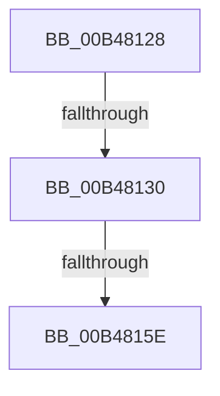

# sub_00B48128

- RVA: `0x00B48128`–`0x00B4816A` (길이 `66` bytes)
- VA: `0x0000000140B48128`
- 실행 섹션: `PAGE`
- PDB 이름 있음: `아니요`; PDB Function 태그: `아니요`
- unwind 정보 RVA: `0x000BA280`
- 디코드: `16`개 명령, `66/66` bytes 표시
- 미해석 바이트: `0` (있으면 어셈블리에 `.byte`로 보존)

> 이 문서는 커널 이미지의 기계어와 PDB 기호를 분석해 생성했습니다. 4번과 5번은 함수 원형과 자료형을 바이너리 사용 방식에서 추정한 C 해석이며 원본 소스 복구 결과는 아닙니다.

## 1. Dependencies

- 직접 호출 지점: **1**; 고유 호출 대상: **1**
- 직접 호출자로 확인된 함수: **0**
- RIP 상대 이미지 참조: **0**

### Outgoing calls
- `0x00B4814B` → [IopCreateRegistryKeyEx](../A8/IopCreateRegistryKeyEx_function_00A89038.md) (function, `0x00A89038`)

### Direct callers
- 이 함수 시작 RVA로 연결되는 직접 call은 확인되지 않았습니다. 간접 호출은 완전히 역산할 수 없습니다.

### Static image references
- 디코드된 RIP-relative 메모리 참조가 없습니다.

## 2. Other-region calls and transfers

- 다른 실행 섹션으로 향하는 call: **0**
- call이 아닌 외부 분기/꼬리 이동: **3**
  - `0x00B4812A` → [PiDevCfgConfigureDeviceKeyCallback + 0x73](../A9/PiDevCfgConfigureDeviceKeyCallback_function_00A99890.md) (`tail-transfer`)
  - `0x00B48158` → [PiDevCfgConfigureDeviceKeyCallback + 0x73](../A9/PiDevCfgConfigureDeviceKeyCallback_function_00A99890.md) (`tail-transfer`)
  - `0x00B48165` → [PiDevCfgConfigureDeviceKeyCallback + 0xB5](../A9/PiDevCfgConfigureDeviceKeyCallback_function_00A99890.md) (`tail-transfer`)

## 3. Assembly (complete function range)

```asm
00B48128  85 C0                           test eax, eax
00B4812A  0F 88 D3 17 F5 FF               js 0x140a99903
00B48130  48 21 7C 24 28                  and qword ptr [rsp + 0x28], rdi
00B48135  4C 8D 45 E8                     lea r8, [rbp - 0x18]
00B48139  48 8B 55 48                     mov rdx, qword ptr [rbp + 0x48]
00B4813D  48 8D 4D 30                     lea rcx, [rbp + 0x30]
00B48141  21 7C 24 20                     and dword ptr [rsp + 0x20], edi
00B48145  41 B9 1F 00 02 00               mov r9d, 0x2001f
00B4814B  E8 E8 0E F4 FF                  call 0x140a89038
00B48150  48 8B 7D 30                     mov rdi, qword ptr [rbp + 0x30]
00B48154  8B D8                           mov ebx, eax
00B48156  85 C0                           test eax, eax
00B48158  0F 88 A5 17 F5 FF               js 0x140a99903
00B4815E  48 8B 4D E0                     mov rcx, qword ptr [rbp - 0x20]
00B48162  48 8B D7                        mov rdx, rdi
00B48165  E9 DB 17 F5 FF                  jmp 0x140a99945
```

## 4. C-style interpretation (structured pseudocode)

```c
__int64 __fastcall sub_00B48128(__int64 a1, __int64 a2, __int64 a3, __int64 a4, __int64 a5)
{
    __int64 result;
    unsigned int v_stack_p20;

    result = IopCreateRegistryKeyEx(v_rbp + 48, *(unsigned __int64 *)(v_rbp + 72), v_rbp - 24, (unsigned int)(0x2001FULL));
}
```

## 5. (Beta) C Style

```c
int64_t sub_00B48128(int64_t Arg1, int64_t Arg2, int64_t Arg3, int64_t Arg4, int64_t Arg5)
{
    int64_t result;
    uint32_t v_stack_p20;

    result = IopCreateRegistryKeyEx(local_rbp + 48, *(uint64_t *)(local_rbp + 0x48), local_rbp - 24, (uint32_t)(0x2001FULL));
}
```

## 6. Execution-region graph

[열기: 2D/3D 그래프와 함수 탐색 컨트롤 패널](../../../control-panel.html?section=page&rva=0x00B48128&view=graph)

- 2D 그래프는 위에서 아래로 흐르고, 3D 그래프는 빈 공간을 드래그해 회전합니다. Shift+드래그는 이동, 휠은 확대·축소, 함수 노드 선택은 대상 보고서 이동입니다.

### Static fallback


