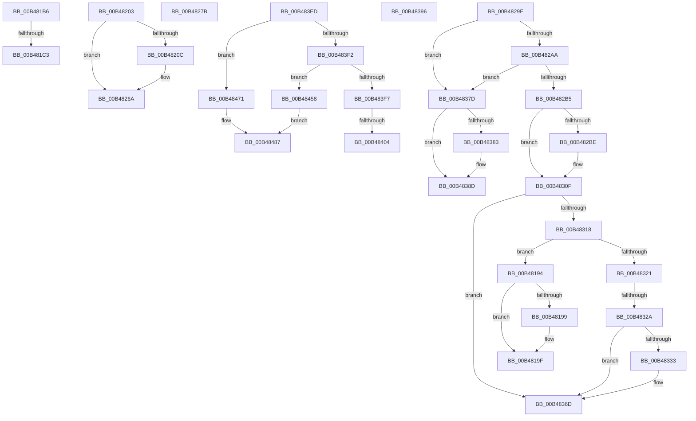

# sub_00B48194

- RVA: `0x00B48194`–`0x00B48499` (길이 `773` bytes)
- VA: `0x0000000140B48194`
- 실행 섹션: `PAGE`
- PDB 이름 있음: `아니요`; PDB Function 태그: `아니요`
- unwind 정보 RVA: `0x000BA394`
- 디코드: `183`개 명령, `773/773` bytes 표시
- 미해석 바이트: `0` (있으면 어셈블리에 `.byte`로 보존)

> 이 문서는 커널 이미지의 기계어와 PDB 기호를 분석해 생성했습니다. 4번과 5번은 함수 원형과 자료형을 바이너리 사용 방식에서 추정한 C 해석이며 원본 소스 복구 결과는 아닙니다.

## 1. Dependencies

- 직접 호출 지점: **11**; 고유 호출 대상: **5**
- 직접 호출자로 확인된 함수: **0**
- RIP 상대 이미지 참조: **7**

### Outgoing calls
- `0x00B481AB` → [KeSetEvent](../../text/33/KeSetEvent_function_0033F310.md) (function, `0x0033F310`)
- `0x00B481F8` → [tlgWriteTransfer_EtwWriteTransfer](../../text/42/tlgWriteTransfer_EtwWriteTransfer_function_004260E0.md) (function, `0x004260E0`)
- `0x00B48265` → [tlgWriteTransfer_EtwWriteTransfer](../../text/42/tlgWriteTransfer_EtwWriteTransfer_function_004260E0.md) (function, `0x004260E0`)
- `0x00B4828A` → [PopFanUpdateSpeed](../AA/PopFanUpdateSpeed_function_00AABF40.md) (function, `0x00AABF40`)
- `0x00B48303` → [tlgWriteTransfer_EtwWriteTransfer](../../text/42/tlgWriteTransfer_EtwWriteTransfer_function_004260E0.md) (function, `0x004260E0`)
- `0x00B48368` → [tlgWriteTransfer_EtwWriteTransfer](../../text/42/tlgWriteTransfer_EtwWriteTransfer_function_004260E0.md) (function, `0x004260E0`)
- `0x00B48372` → [PopFanSetNoiseImpact](../76/PopFanSetNoiseImpact_function_0076921C.md) (function, `0x0076921C`)
- `0x00B48388` → [PopFanSetNoiseImpact](../76/PopFanSetNoiseImpact_function_0076921C.md) (function, `0x0076921C`)
- `0x00B483E2` → [tlgWriteTransfer_EtwWriteTransfer](../../text/42/tlgWriteTransfer_EtwWriteTransfer_function_004260E0.md) (function, `0x004260E0`)
- `0x00B4844D` → [tlgWriteTransfer_EtwWriteTransfer](../../text/42/tlgWriteTransfer_EtwWriteTransfer_function_004260E0.md) (function, `0x004260E0`)
- `0x00B4848E` → [PopPrepareIoctl](../A7/PopPrepareIoctl_function_00A74A98.md) (function, `0x00A74A98`)

### Direct callers
- 이 함수 시작 RVA로 연결되는 직접 call은 확인되지 않았습니다. 간접 호출은 완전히 역산할 수 없습니다.

### Static image references
- `0x00B481B6` → RVA `0x00E07748` (`.data`; read)
- `0x00B481CB` → RVA `0x0004E829` (`.rdata`; read)
- `0x00B48218` → RVA `0x0004E88C` (`.rdata`; read)
- `0x00B482CA` → RVA `0x0004E65D` (`.rdata`; read)
- `0x00B4833F` → RVA `0x0004E5C5` (`.rdata`; read)
- `0x00B483A2` → RVA `0x0004E5F8` (`.rdata`; read)
- `0x00B48410` → RVA `0x0004E737` (`.rdata`; read)

## 2. Other-region calls and transfers

- 다른 실행 섹션으로 향하는 call: **7**
  - `0x00B481AB` → [KeSetEvent](../../text/33/KeSetEvent_function_0033F310.md) (`PAGE` → `.text`)
  - `0x00B481F8` → [tlgWriteTransfer_EtwWriteTransfer](../../text/42/tlgWriteTransfer_EtwWriteTransfer_function_004260E0.md) (`PAGE` → `.text`)
  - `0x00B48265` → [tlgWriteTransfer_EtwWriteTransfer](../../text/42/tlgWriteTransfer_EtwWriteTransfer_function_004260E0.md) (`PAGE` → `.text`)
  - `0x00B48303` → [tlgWriteTransfer_EtwWriteTransfer](../../text/42/tlgWriteTransfer_EtwWriteTransfer_function_004260E0.md) (`PAGE` → `.text`)
  - `0x00B48368` → [tlgWriteTransfer_EtwWriteTransfer](../../text/42/tlgWriteTransfer_EtwWriteTransfer_function_004260E0.md) (`PAGE` → `.text`)
  - `0x00B483E2` → [tlgWriteTransfer_EtwWriteTransfer](../../text/42/tlgWriteTransfer_EtwWriteTransfer_function_004260E0.md) (`PAGE` → `.text`)
  - `0x00B4844D` → [tlgWriteTransfer_EtwWriteTransfer](../../text/42/tlgWriteTransfer_EtwWriteTransfer_function_004260E0.md) (`PAGE` → `.text`)
- call이 아닌 외부 분기/꼬리 이동: **12**
  - `0x00B481B1` → [PopFanWorker + 0x203](../A9/PopFanWorker_function_00A9B050.md) (`tail-transfer`)
  - `0x00B481BD` → [PopFanWorker + 0x189](../A9/PopFanWorker_function_00A9B050.md) (`tail-transfer`)
  - `0x00B481FE` → [PopFanWorker + 0x189](../A9/PopFanWorker_function_00A9B050.md) (`tail-transfer`)
  - `0x00B48276` → [PopFanWorker + 0x186](../A9/PopFanWorker_function_00A9B050.md) (`tail-transfer`)
  - `0x00B4829A` → [PopFanWorker + 0x189](../A9/PopFanWorker_function_00A9B050.md) (`tail-transfer`)
  - `0x00B48324` → [PopFanWorker + 0x189](../A9/PopFanWorker_function_00A9B050.md) (`tail-transfer`)
  - `0x00B48378` → [PopFanWorker + 0x186](../A9/PopFanWorker_function_00A9B050.md) (`tail-transfer`)
  - `0x00B48391` → [PopFanWorker + 0x189](../A9/PopFanWorker_function_00A9B050.md) (`tail-transfer`)
  - `0x00B483E8` → [PopFanWorker + 0x19A](../A9/PopFanWorker_function_00A9B050.md) (`tail-transfer`)
  - `0x00B483FE` → [PopFanWorker + 0x203](../A9/PopFanWorker_function_00A9B050.md) (`tail-transfer`)
  - `0x00B48453` → [PopFanWorker + 0x203](../A9/PopFanWorker_function_00A9B050.md) (`tail-transfer`)
  - `0x00B48494` → [PopFanWorker + 0x1D9](../A9/PopFanWorker_function_00A9B050.md) (`tail-transfer`)

## 3. Assembly (complete function range)

```asm
00B48194  38 5F 50                        cmp byte ptr [rdi + 0x50], bl
00B48197  74 06                           je 0x140b4819f
00B48199  41 B4 01                        mov r12b, 1
00B4819C  88 5F 50                        mov byte ptr [rdi + 0x50], bl
00B4819F  48 8D 8F A0 01 00 00            lea rcx, [rdi + 0x1a0]
00B481A6  45 33 C0                        xor r8d, r8d
00B481A9  33 D2                           xor edx, edx
00B481AB  E8 60 71 7F FF                  call 0x14033f310
00B481B0  90                              nop
00B481B1  E9 9D 30 F5 FF                  jmp 0x140a9b253
00B481B6  83 3D 8B F5 2B 00 02            cmp dword ptr [rip + 0x2bf58b], 2
00B481BD  0F 86 16 30 F5 FF               jbe 0x140a9b1d9
00B481C3  48 89 7D B7                     mov qword ptr [rbp - 0x49], rdi
00B481C7  48 8D 45 B7                     lea rax, [rbp - 0x49]
00B481CB  48 8D 15 57 66 50 FF            lea rdx, [rip - 0xaf99a9]
00B481D2  48 89 45 F7                     mov qword ptr [rbp - 9], rax
00B481D6  45 33 C9                        xor r9d, r9d
00B481D9  48 8D 45 D7                     lea rax, [rbp - 0x29]
00B481DD  48 C7 45 FF 08 00 00 00         mov qword ptr [rbp - 1], 8
00B481E5  48 89 44 24 28                  mov qword ptr [rsp + 0x28], rax
00B481EA  45 33 C0                        xor r8d, r8d
00B481ED  49 8B CA                        mov rcx, r10
00B481F0  C7 44 24 20 03 00 00 00         mov dword ptr [rsp + 0x20], 3
00B481F8  E8 E3 DE 8D FF                  call 0x1404260e0
00B481FD  90                              nop
00B481FE  E9 D6 2F F5 FF                  jmp 0x140a9b1d9
00B48203  83 3D 3E F5 2B 00 05            cmp dword ptr [rip + 0x2bf53e], 5
00B4820A  76 5E                           jbe 0x140b4826a
00B4820C  48 8D 45 BF                     lea rax, [rbp - 0x41]
00B48210  48 89 7D BF                     mov qword ptr [rbp - 0x41], rdi
00B48214  48 89 45 F7                     mov qword ptr [rbp - 9], rax
00B48218  48 8D 15 6D 66 50 FF            lea rdx, [rip - 0xaf9993]
00B4821F  8B 47 5C                        mov eax, dword ptr [rdi + 0x5c]
00B48222  45 33 C9                        xor r9d, r9d
00B48225  89 45 C7                        mov dword ptr [rbp - 0x39], eax
00B48228  45 33 C0                        xor r8d, r8d
00B4822B  48 8D 45 C7                     lea rax, [rbp - 0x39]
00B4822F  48 C7 45 FF 08 00 00 00         mov qword ptr [rbp - 1], 8
00B48237  48 89 45 07                     mov qword ptr [rbp + 7], rax
00B4823B  49 8B CA                        mov rcx, r10
00B4823E  8B 47 60                        mov eax, dword ptr [rdi + 0x60]
00B48241  89 45 B7                        mov dword ptr [rbp - 0x49], eax
00B48244  48 8D 45 B7                     lea rax, [rbp - 0x49]
00B48248  48 89 45 17                     mov qword ptr [rbp + 0x17], rax
00B4824C  48 8D 45 D7                     lea rax, [rbp - 0x29]
00B48250  48 89 44 24 28                  mov qword ptr [rsp + 0x28], rax
00B48255  C7 44 24 20 05 00 00 00         mov dword ptr [rsp + 0x20], 5
00B4825D  4C 89 75 0F                     mov qword ptr [rbp + 0xf], r14
00B48261  4C 89 75 1F                     mov qword ptr [rbp + 0x1f], r14
00B48265  E8 76 DE 8D FF                  call 0x1404260e0
00B4826A  8B 47 5C                        mov eax, dword ptr [rdi + 0x5c]
00B4826D  89 47 64                        mov dword ptr [rdi + 0x64], eax
00B48270  8B 47 60                        mov eax, dword ptr [rdi + 0x60]
00B48273  89 47 68                        mov dword ptr [rdi + 0x68], eax
00B48276  E9 5B 2F F5 FF                  jmp 0x140a9b1d6
00B4827B  41 B4 01                        mov r12b, 1
00B4827E  88 4F 50                        mov byte ptr [rdi + 0x50], cl
00B48281  44 8A F9                        mov r15b, cl
00B48284  8B 57 4C                        mov edx, dword ptr [rdi + 0x4c]
00B48287  48 8B CF                        mov rcx, rdi
00B4828A  E8 B1 3C F6 FF                  call 0x140aabf40
00B4828F  38 5F 58                        cmp byte ptr [rdi + 0x58], bl
00B48292  40 0F 95 C6                     setne sil
00B48296  40 80 C6 02                     add sil, 2
00B4829A  E9 3A 2F F5 FF                  jmp 0x140a9b1d9
00B4829F  3D 9D 00 00 C0                  cmp eax, 0xc000009d
00B482A4  0F 84 D3 00 00 00               je 0x140b4837d
00B482AA  3D 20 01 00 C0                  cmp eax, 0xc0000120
00B482AF  0F 84 C8 00 00 00               je 0x140b4837d
00B482B5  83 3D 8C F4 2B 00 05            cmp dword ptr [rip + 0x2bf48c], 5
00B482BC  76 51                           jbe 0x140b4830f
00B482BE  48 8D 45 BF                     lea rax, [rbp - 0x41]
00B482C2  48 89 7D BF                     mov qword ptr [rbp - 0x41], rdi
00B482C6  48 89 45 F7                     mov qword ptr [rbp - 9], rax
00B482CA  48 8D 15 8C 63 50 FF            lea rdx, [rip - 0xaf9c74]
00B482D1  0F B6 47 40                     movzx eax, byte ptr [rdi + 0x40]
00B482D5  45 33 C9                        xor r9d, r9d
00B482D8  89 45 B7                        mov dword ptr [rbp - 0x49], eax
00B482DB  45 33 C0                        xor r8d, r8d
00B482DE  48 8D 45 B7                     lea rax, [rbp - 0x49]
00B482E2  48 C7 45 FF 08 00 00 00         mov qword ptr [rbp - 1], 8
00B482EA  48 89 45 07                     mov qword ptr [rbp + 7], rax
00B482EE  49 8B CA                        mov rcx, r10
00B482F1  48 8D 45 D7                     lea rax, [rbp - 0x29]
00B482F5  4C 89 75 0F                     mov qword ptr [rbp + 0xf], r14
00B482F9  48 89 44 24 28                  mov qword ptr [rsp + 0x28], rax
00B482FE  44 89 74 24 20                  mov dword ptr [rsp + 0x20], r14d
00B48303  E8 D8 DD 8D FF                  call 0x1404260e0
00B48308  4C 8D 15 39 F4 2B 00            lea r10, [rip + 0x2bf439]
00B4830F  0F B6 4F 40                     movzx ecx, byte ptr [rdi + 0x40]
00B48313  83 E9 01                        sub ecx, 1
00B48316  74 55                           je 0x140b4836d
00B48318  83 E9 01                        sub ecx, 1
00B4831B  0F 84 73 FE FF FF               je 0x140b48194
00B48321  83 F9 01                        cmp ecx, 1
00B48324  0F 85 AF 2E F5 FF               jne 0x140a9b1d9
00B4832A  83 3D 17 F4 2B 00 02            cmp dword ptr [rip + 0x2bf417], 2
00B48331  76 3A                           jbe 0x140b4836d
00B48333  48 8D 45 BF                     lea rax, [rbp - 0x41]
00B48337  48 89 7D BF                     mov qword ptr [rbp - 0x41], rdi
00B4833B  48 89 45 F7                     mov qword ptr [rbp - 9], rax
00B4833F  48 8D 15 7F 62 50 FF            lea rdx, [rip - 0xaf9d81]
00B48346  48 8D 45 D7                     lea rax, [rbp - 0x29]
00B4834A  48 C7 45 FF 08 00 00 00         mov qword ptr [rbp - 1], 8
00B48352  48 89 44 24 28                  mov qword ptr [rsp + 0x28], rax
00B48357  45 33 C9                        xor r9d, r9d
00B4835A  45 33 C0                        xor r8d, r8d
00B4835D  C7 44 24 20 03 00 00 00         mov dword ptr [rsp + 0x20], 3
00B48365  49 8B CA                        mov rcx, r10
00B48368  E8 73 DD 8D FF                  call 0x1404260e0
00B4836D  33 D2                           xor edx, edx
00B4836F  48 8B CF                        mov rcx, rdi
00B48372  E8 A5 0E C2 FF                  call 0x14076921c
00B48377  90                              nop
00B48378  E9 59 2E F5 FF                  jmp 0x140a9b1d6
00B4837D  80 7F 40 01                     cmp byte ptr [rdi + 0x40], 1
00B48381  75 0A                           jne 0x140b4838d
00B48383  33 D2                           xor edx, edx
00B48385  48 8B CF                        mov rcx, rdi
00B48388  E8 8F 0E C2 FF                  call 0x14076921c
00B4838D  40 8A 77 40                     mov sil, byte ptr [rdi + 0x40]
00B48391  E9 43 2E F5 FF                  jmp 0x140a9b1d9
00B48396  83 65 03 00                     and dword ptr [rbp + 3], 0
00B4839A  48 8D 45 BF                     lea rax, [rbp - 0x41]
00B4839E  83 65 13 00                     and dword ptr [rbp + 0x13], 0
00B483A2  48 8D 15 4F 62 50 FF            lea rdx, [rip - 0xaf9db1]
00B483A9  48 89 45 F7                     mov qword ptr [rbp - 9], rax
00B483AD  48 8D 0D 94 F3 2B 00            lea rcx, [rip + 0x2bf394]
00B483B4  48 8D 45 B7                     lea rax, [rbp - 0x49]
00B483B8  48 89 7D BF                     mov qword ptr [rbp - 0x41], rdi
00B483BC  48 89 45 07                     mov qword ptr [rbp + 7], rax
00B483C0  45 33 C9                        xor r9d, r9d
00B483C3  48 8D 45 D7                     lea rax, [rbp - 0x29]
00B483C7  C7 45 FF 08 00 00 00            mov dword ptr [rbp - 1], 8
00B483CE  48 89 44 24 28                  mov qword ptr [rsp + 0x28], rax
00B483D3  45 33 C0                        xor r8d, r8d
00B483D6  44 89 74 24 20                  mov dword ptr [rsp + 0x20], r14d
00B483DB  89 5D B7                        mov dword ptr [rbp - 0x49], ebx
00B483DE  44 89 75 0F                     mov dword ptr [rbp + 0xf], r14d
00B483E2  E8 F9 DC 8D FF                  call 0x1404260e0
00B483E7  90                              nop
00B483E8  E9 FD 2D F5 FF                  jmp 0x140a9b1ea
00B483ED  83 EB 01                        sub ebx, 1
00B483F0  74 7F                           je 0x140b48471
00B483F2  83 FB 01                        cmp ebx, 1
00B483F5  74 61                           je 0x140b48458
00B483F7  83 3D 4A F3 2B 00 02            cmp dword ptr [rip + 0x2bf34a], 2
00B483FE  0F 86 4F 2E F5 FF               jbe 0x140a9b253
00B48404  48 8D 45 BF                     lea rax, [rbp - 0x41]
00B48408  48 89 7D BF                     mov qword ptr [rbp - 0x41], rdi
00B4840C  48 89 45 F7                     mov qword ptr [rbp - 9], rax
00B48410  48 8D 15 20 63 50 FF            lea rdx, [rip - 0xaf9ce0]
00B48417  0F B6 47 40                     movzx eax, byte ptr [rdi + 0x40]
00B4841B  48 8D 0D 26 F3 2B 00            lea rcx, [rip + 0x2bf326]
00B48422  89 45 B7                        mov dword ptr [rbp - 0x49], eax
00B48425  45 33 C9                        xor r9d, r9d
00B48428  48 8D 45 B7                     lea rax, [rbp - 0x49]
00B4842C  48 C7 45 FF 08 00 00 00         mov qword ptr [rbp - 1], 8
00B48434  48 89 45 07                     mov qword ptr [rbp + 7], rax
00B48438  45 33 C0                        xor r8d, r8d
00B4843B  48 8D 45 D7                     lea rax, [rbp - 0x29]
00B4843F  4C 89 75 0F                     mov qword ptr [rbp + 0xf], r14
00B48443  48 89 44 24 28                  mov qword ptr [rsp + 0x28], rax
00B48448  44 89 74 24 20                  mov dword ptr [rsp + 0x20], r14d
00B4844D  E8 8E DC 8D FF                  call 0x1404260e0
00B48452  90                              nop
00B48453  E9 FB 2D F5 FF                  jmp 0x140a9b253
00B48458  33 DB                           xor ebx, ebx
00B4845A  4C 8D 4F 5C                     lea r9, [rdi + 0x5c]
00B4845E  89 5C 24 28                     mov dword ptr [rsp + 0x28], ebx
00B48462  BA 48 82 29 00                  mov edx, 0x298248
00B48467  C7 44 24 20 08 00 00 00         mov dword ptr [rsp + 0x20], 8
00B4846F  EB 16                           jmp 0x140b48487
00B48471  B8 0C 00 00 00                  mov eax, 0xc
00B48476  4C 8D 4F 44                     lea r9, [rdi + 0x44]
00B4847A  89 44 24 28                     mov dword ptr [rsp + 0x28], eax
00B4847E  BA 40 42 29 00                  mov edx, 0x294240
00B48483  89 44 24 20                     mov dword ptr [rsp + 0x20], eax
00B48487  48 8B 4F 38                     mov rcx, qword ptr [rdi + 0x38]
00B4848B  41 B0 01                        mov r8b, 1
00B4848E  E8 05 C6 F2 FF                  call 0x140a74a98
00B48493  90                              nop
00B48494  E9 90 2D F5 FF                  jmp 0x140a9b229
```

## 4. C-style interpretation (structured pseudocode)

```c
__int64 __fastcall sub_00B48194(__int64 a1, int a2, int a3, int a4)
{
    __int64 result;
    __int64 v_r12;
    unsigned int v_stack_p20;
    unsigned __int64 v_stack_p28;

    if ((*(unsigned __int8 *)(v_rdi + 80)) != ((unsigned __int8)(v_rbx))) {
        v_r12 = 1;
        *(unsigned __int8 *)(v_rdi + 80) = (unsigned __int8)(v_rbx);
    }
    a3 = 0;
    a2 = 0;
    result = KeSetEvent(v_rdi + 416, a2, a3, a4);
}
```

## 5. (Beta) C Style

```c
int64_t sub_00B48194(int64_t Arg1, int32_t Arg2, int32_t Arg3, int32_t Arg4)
{
    int64_t result;
    int64_t local_r12;
    uint32_t v_stack_p20;
    uint64_t v_stack_p28;

    if ((*(uint8_t *)(local_rdi + 0x50)) != ((uint8_t)(local_rbx))) {
        local_r12 = 1;
        *(uint8_t *)(local_rdi + 0x50) = (uint8_t)(local_rbx);
    }
    Arg3 = 0;
    Arg2 = 0;
    result = KeSetEvent(local_rdi + 416, Arg2, Arg3, Arg4);
}
```

## 6. Execution-region graph

[열기: 2D/3D 그래프와 함수 탐색 컨트롤 패널](../../../control-panel.html?section=page&rva=0x00B48194&view=graph)

- 2D 그래프는 위에서 아래로 흐르고, 3D 그래프는 빈 공간을 드래그해 회전합니다. Shift+드래그는 이동, 휠은 확대·축소, 함수 노드 선택은 대상 보고서 이동입니다.

### Static fallback


