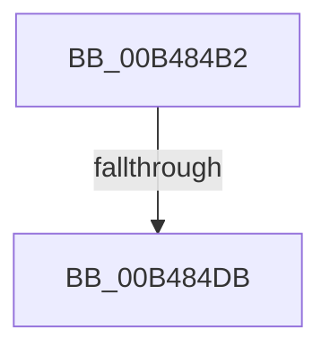

# sub_00B484B2

- RVA: `0x00B484B2`–`0x00B484E5` (길이 `51` bytes)
- VA: `0x0000000140B484B2`
- 실행 섹션: `PAGE`
- PDB 이름 있음: `아니요`; PDB Function 태그: `아니요`
- unwind 정보 RVA: `0x000BA4AC`
- 디코드: `12`개 명령, `51/51` bytes 표시
- 미해석 바이트: `0` (있으면 어셈블리에 `.byte`로 보존)

> 이 문서는 커널 이미지의 기계어와 PDB 기호를 분석해 생성했습니다. 4번과 5번은 함수 원형과 자료형을 바이너리 사용 방식에서 추정한 C 해석이며 원본 소스 복구 결과는 아닙니다.

## 1. Dependencies

- 직접 호출 지점: **1**; 고유 호출 대상: **1**
- 직접 호출자로 확인된 함수: **0**
- RIP 상대 이미지 참조: **0**

### Outgoing calls
- `0x00B484C9` → [ExAllocatePool2](../../poolcode/B8/ExAllocatePool2_function_00B820F0.md) (function, `0x00B820F0`)

### Direct callers
- 이 함수 시작 RVA로 연결되는 직접 call은 확인되지 않았습니다. 간접 호출은 완전히 역산할 수 없습니다.

### Static image references
- 디코드된 RIP-relative 메모리 참조가 없습니다.

## 2. Other-region calls and transfers

- 다른 실행 섹션으로 향하는 call: **1**
  - `0x00B484C9` → [ExAllocatePool2](../../poolcode/B8/ExAllocatePool2_function_00B820F0.md) (`PAGE` → `POOLCODE`)
- call이 아닌 외부 분기/꼬리 이동: **2**
  - `0x00B484D5` → [BiTranslateSymbolicLink + 0x8F](../A9/BiTranslateSymbolicLink_function_00A9BA0C.md) (`tail-transfer`)
  - `0x00B484E0` → [BiTranslateSymbolicLink + 0x118](../A9/BiTranslateSymbolicLink_function_00A9BA0C.md) (`tail-transfer`)

## 3. Assembly (complete function range)

```asm
00B484B2  8B 45 30                        mov eax, dword ptr [rbp + 0x30]
00B484B5  B9 02 01 00 00                  mov ecx, 0x102
00B484BA  41 B8 42 43 44 4B               mov r8d, 0x4b444342
00B484C0  66 89 45 B2                     mov word ptr [rbp - 0x4e], ax
00B484C4  8D 78 02                        lea edi, [rax + 2]
00B484C7  8B D7                           mov edx, edi
00B484C9  E8 22 9C 03 00                  call 0x140b820f0
00B484CE  48 89 45 B8                     mov qword ptr [rbp - 0x48], rax
00B484D2  48 85 C0                        test rax, rax
00B484D5  0F 85 C0 35 F5 FF               jne 0x140a9ba9b
00B484DB  BB 9A 00 00 C0                  mov ebx, 0xc000009a
00B484E0  E9 3F 36 F5 FF                  jmp 0x140a9bb24
```

## 4. C-style interpretation (structured pseudocode)

```c
__int64 __fastcall sub_00B484B2(void)
{
    __int64 result;

    *(unsigned __int16 *)(v_rbp - 78) = (unsigned __int16)((unsigned int)(*(unsigned int *)(v_rbp + 48)));
    result = ExAllocatePool2(258, (unsigned int)((unsigned int)((unsigned int)(*(unsigned int *)(v_rbp + 48)) + 2)), (unsigned int)(0x4B444342ULL), a4);
    *(unsigned __int64 *)(v_rbp - 72) = result;
}
```

## 5. (Beta) C Style

```c
void sub_00B484B2(void)
{
    int64_t result;

    *(uint16_t *)(local_rbp - 0x4E) = (uint16_t)((uint32_t)(*(uint32_t *)(local_rbp + 0x30)));
    result = ExAllocatePool2(258, (uint32_t)((uint32_t)((uint32_t)(*(uint32_t *)(local_rbp + 0x30)) + 2)), (uint32_t)(0x4B444342ULL), a4);
    *(uint64_t *)(local_rbp - 0x48) = result;
}
```

## 6. Execution-region graph

[열기: 2D/3D 그래프와 함수 탐색 컨트롤 패널](../../../control-panel.html?section=page&rva=0x00B484B2&view=graph)

- 2D 그래프는 위에서 아래로 흐르고, 3D 그래프는 빈 공간을 드래그해 회전합니다. Shift+드래그는 이동, 휠은 확대·축소, 함수 노드 선택은 대상 보고서 이동입니다.

### Static fallback


