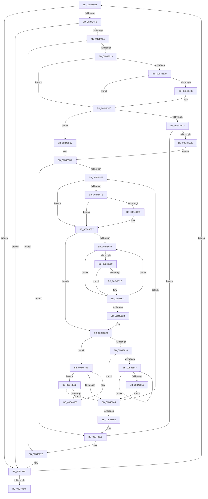

# sub_00B484E6

- RVA: `0x00B484E6`–`0x00B488AA` (길이 `964` bytes)
- VA: `0x0000000140B484E6`
- 실행 섹션: `PAGE`
- PDB 이름 있음: `아니요`; PDB Function 태그: `아니요`
- unwind 정보 RVA: `0x000BA4E8`
- 디코드: `213`개 명령, `964/964` bytes 표시
- 미해석 바이트: `0` (있으면 어셈블리에 `.byte`로 보존)

> 이 문서는 커널 이미지의 기계어와 PDB 기호를 분석해 생성했습니다. 4번과 5번은 함수 원형과 자료형을 바이너리 사용 방식에서 추정한 C 해석이며 원본 소스 복구 결과는 아닙니다.

## 1. Dependencies

- 직접 호출 지점: **17**; 고유 호출 대상: **11**
- 직접 호출자로 확인된 함수: **0**
- RIP 상대 이미지 참조: **4**

### Outgoing calls
- `0x00B484FD` → [ExAcquireRundownProtection](../../text/21/ExAcquireRundownProtection_function_00216620.md) (function, `0x00216620`)
- `0x00B48513` → [KiStackAttachProcess](../../text/21/KiStackAttachProcess_function_00216820.md) (function, `0x00216820`)
- `0x00B4852C` → [FsRtlAcquirePushLockShared](../../text/48/FsRtlAcquirePushLockShared_function_0048B034.md) (function, `0x0048B034`)
- `0x00B48545` → [tlgKeywordOn](../../text/42/tlgKeywordOn_function_0042EAA0.md) (function, `0x0042EAA0`)
- `0x00B48551` → [PsGetProcessId](../../text/43/PsGetProcessId_function_0043D910.md) (function, `0x0043D910`)
- `0x00B48576` → [tlgCreate1Sz_char](../../text/42/tlgCreate1Sz_char_function_00427304.md) (function, `0x00427304`)
- `0x00B485B3` → [tlgWriteEx_EtwWriteEx](../../text/4A/tlgWriteEx_EtwWriteEx_function_004AA348.md) (function, `0x004AA348`)
- `0x00B485FB` → [tlgKeywordOn](../../text/42/tlgKeywordOn_function_0042EAA0.md) (function, `0x0042EAA0`)
- `0x00B4860B` → [PsGetProcessId](../../text/43/PsGetProcessId_function_0043D910.md) (function, `0x0043D910`)
- `0x00B486E2` → [tlgWriteEx_EtwWriteEx](../../text/4A/tlgWriteEx_EtwWriteEx_function_004AA348.md) (function, `0x004AA348`)
- `0x00B48711` → [tlgKeywordOn](../../text/42/tlgKeywordOn_function_0042EAA0.md) (function, `0x0042EAA0`)
- `0x00B48721` → [PsGetProcessId](../../text/43/PsGetProcessId_function_0043D910.md) (function, `0x0043D910`)
- `0x00B48812` → [tlgWriteEx_EtwWriteEx](../../text/4A/tlgWriteEx_EtwWriteEx_function_004AA348.md) (function, `0x004AA348`)
- `0x00B48879` → [PfLockSharedRelease](../../text/48/PfLockSharedRelease_function_0048DF24.md) (function, `0x0048DF24`)
- `0x00B48884` → [KiUnstackDetachProcess](../../text/21/KiUnstackDetachProcess_function_00217D30.md) (function, `0x00217D30`)
- `0x00B4888C` → [ExReleaseRundownProtection](../../text/34/ExReleaseRundownProtection_function_00349E80.md) (function, `0x00349E80`)
- `0x00B48894` → [PsGetNextProcess](../91/PsGetNextProcess_function_0091C900.md) (function, `0x0091C900`)

### Direct callers
- 이 함수 시작 RVA로 연결되는 직접 call은 확인되지 않았습니다. 간접 호출은 완전히 역산할 수 없습니다.

### Static image references
- `0x00B48531` → RVA `0x00F02458` (`.data`; read)
- `0x00B48588` → RVA `0x000536DD` (`.rdata`; read)
- `0x00B4864F` → RVA `0x0005392D` (`.rdata`; read)
- `0x00B487A5` → RVA `0x000538B3` (`.rdata`; read)

## 2. Other-region calls and transfers

- 다른 실행 섹션으로 향하는 call: **16**
  - `0x00B484FD` → [ExAcquireRundownProtection](../../text/21/ExAcquireRundownProtection_function_00216620.md) (`PAGE` → `.text`)
  - `0x00B48513` → [KiStackAttachProcess](../../text/21/KiStackAttachProcess_function_00216820.md) (`PAGE` → `.text`)
  - `0x00B4852C` → [FsRtlAcquirePushLockShared](../../text/48/FsRtlAcquirePushLockShared_function_0048B034.md) (`PAGE` → `.text`)
  - `0x00B48545` → [tlgKeywordOn](../../text/42/tlgKeywordOn_function_0042EAA0.md) (`PAGE` → `.text`)
  - `0x00B48551` → [PsGetProcessId](../../text/43/PsGetProcessId_function_0043D910.md) (`PAGE` → `.text`)
  - `0x00B48576` → [tlgCreate1Sz_char](../../text/42/tlgCreate1Sz_char_function_00427304.md) (`PAGE` → `.text`)
  - `0x00B485B3` → [tlgWriteEx_EtwWriteEx](../../text/4A/tlgWriteEx_EtwWriteEx_function_004AA348.md) (`PAGE` → `.text`)
  - `0x00B485FB` → [tlgKeywordOn](../../text/42/tlgKeywordOn_function_0042EAA0.md) (`PAGE` → `.text`)
  - `0x00B4860B` → [PsGetProcessId](../../text/43/PsGetProcessId_function_0043D910.md) (`PAGE` → `.text`)
  - `0x00B486E2` → [tlgWriteEx_EtwWriteEx](../../text/4A/tlgWriteEx_EtwWriteEx_function_004AA348.md) (`PAGE` → `.text`)
  - `0x00B48711` → [tlgKeywordOn](../../text/42/tlgKeywordOn_function_0042EAA0.md) (`PAGE` → `.text`)
  - `0x00B48721` → [PsGetProcessId](../../text/43/PsGetProcessId_function_0043D910.md) (`PAGE` → `.text`)
  - `0x00B48812` → [tlgWriteEx_EtwWriteEx](../../text/4A/tlgWriteEx_EtwWriteEx_function_004AA348.md) (`PAGE` → `.text`)
  - `0x00B48879` → [PfLockSharedRelease](../../text/48/PfLockSharedRelease_function_0048DF24.md) (`PAGE` → `.text`)
  - `0x00B48884` → [KiUnstackDetachProcess](../../text/21/KiUnstackDetachProcess_function_00217D30.md) (`PAGE` → `.text`)
  - `0x00B4888C` → [ExReleaseRundownProtection](../../text/34/ExReleaseRundownProtection_function_00349E80.md) (`PAGE` → `.text`)
- call이 아닌 외부 분기/꼬리 이동: **1**
  - `0x00B488A5` → [VmpTracingEnabledCallback + 0x49](../A9/VmpTracingEnabledCallback_function_00A9BB90.md) (`tail-transfer`)

## 3. Assembly (complete function range)

```asm
00B484E6  4C 39 B7 70 06 00 00            cmp qword ptr [rdi + 0x670], r14
00B484ED  0F 84 9E 03 00 00               je 0x140b48891
00B484F3  48 8D B7 E8 01 00 00            lea rsi, [rdi + 0x1e8]
00B484FA  48 8B CE                        mov rcx, rsi
00B484FD  E8 1E E1 6C FF                  call 0x140216620
00B48502  84 C0                           test al, al
00B48504  0F 84 87 03 00 00               je 0x140b48891
00B4850A  4C 8D 45 80                     lea r8, [rbp - 0x80]
00B4850E  33 D2                           xor edx, edx
00B48510  48 8B CF                        mov rcx, rdi
00B48513  E8 08 E3 6C FF                  call 0x140216820
00B48518  4C 8B BF 70 06 00 00            mov r15, qword ptr [rdi + 0x670]
00B4851F  4D 85 FF                        test r15, r15
00B48522  0F 84 56 03 00 00               je 0x140b4887e
00B48528  49 8D 4F 78                     lea rcx, [r15 + 0x78]
00B4852C  E8 03 2B 94 FF                  call 0x14048b034
00B48531  48 8B 1D 20 9F 3B 00            mov rbx, qword ptr [rip + 0x3b9f20]
00B48538  83 3B 05                        cmp dword ptr [rbx], 5
00B4853B  76 7B                           jbe 0x140b485b8
00B4853D  BA 80 00 00 00                  mov edx, 0x80
00B48542  48 8B CB                        mov rcx, rbx
00B48545  E8 56 65 8E FF                  call 0x14042eaa0
00B4854A  84 C0                           test al, al
00B4854C  74 6A                           je 0x140b485b8
00B4854E  48 8B CF                        mov rcx, rdi
00B48551  E8 BA 53 8F FF                  call 0x14043d910
00B48556  89 44 24 40                     mov dword ptr [rsp + 0x40], eax
00B4855A  48 8D 97 38 03 00 00            lea rdx, [rdi + 0x338]
00B48561  48 8D 44 24 40                  lea rax, [rsp + 0x40]
00B48566  48 C7 45 D8 04 00 00 00         mov qword ptr [rbp - 0x28], 4
00B4856E  48 8D 4D E0                     lea rcx, [rbp - 0x20]
00B48572  48 89 45 D0                     mov qword ptr [rbp - 0x30], rax
00B48576  E8 89 ED 8D FF                  call 0x140427304
00B4857B  49 8B 4F 68                     mov rcx, qword ptr [r15 + 0x68]
00B4857F  48 8D 44 24 48                  lea rax, [rsp + 0x48]
00B48584  48 89 45 F0                     mov qword ptr [rbp - 0x10], rax
00B48588  48 8D 15 4E B1 50 FF            lea rdx, [rip - 0xaf4eb2]
00B4858F  48 8D 45 B0                     lea rax, [rbp - 0x50]
00B48593  48 89 4C 24 48                  mov qword ptr [rsp + 0x48], rcx
00B48598  48 89 44 24 38                  mov qword ptr [rsp + 0x38], rax
00B4859D  45 33 C9                        xor r9d, r9d
00B485A0  48 8B CB                        mov rcx, rbx
00B485A3  C7 44 24 30 05 00 00 00         mov dword ptr [rsp + 0x30], 5
00B485AB  48 C7 45 F8 08 00 00 00         mov qword ptr [rbp - 8], 8
00B485B3  E8 90 1D 96 FF                  call 0x1404aa348
00B485B8  49 8D 5F 18                     lea rbx, [r15 + 0x18]
00B485BC  48 8B 43 08                     mov rax, qword ptr [rbx + 8]
00B485C0  A8 01                           test al, 1
00B485C2  74 13                           je 0x140b485d7
00B485C4  48 83 F8 01                     cmp rax, 1
00B485C8  0F 84 A7 02 00 00               je 0x140b48875
00B485CE  48 83 CB 01                     or rbx, 1
00B485D2  48 33 D8                        xor rbx, rax
00B485D5  EB 03                           jmp 0x140b485da
00B485D7  48 8B D8                        mov rbx, rax
00B485DA  48 85 DB                        test rbx, rbx
00B485DD  0F 84 92 02 00 00               je 0x140b48875
00B485E3  48 8B 35 6E 9E 3B 00            mov rsi, qword ptr [rip + 0x3b9e6e]
00B485EA  83 3E 05                        cmp dword ptr [rsi], 5
00B485ED  0F 86 F4 00 00 00               jbe 0x140b486e7
00B485F3  BA 80 00 00 00                  mov edx, 0x80
00B485F8  48 8B CE                        mov rcx, rsi
00B485FB  E8 A0 64 8E FF                  call 0x14042eaa0
00B48600  84 C0                           test al, al
00B48602  0F 84 DF 00 00 00               je 0x140b486e7
00B48608  48 8B CF                        mov rcx, rdi
00B4860B  E8 00 53 8F FF                  call 0x14043d910
00B48610  48 8B 4B 18                     mov rcx, qword ptr [rbx + 0x18]
00B48614  48 8D 54 24 58                  lea rdx, [rsp + 0x58]
00B48619  89 44 24 40                     mov dword ptr [rsp + 0x40], eax
00B4861D  45 33 C9                        xor r9d, r9d
00B48620  48 8D 44 24 40                  lea rax, [rsp + 0x40]
00B48625  48 89 4C 24 50                  mov qword ptr [rsp + 0x50], rcx
00B4862A  48 89 45 D0                     mov qword ptr [rbp - 0x30], rax
00B4862E  48 8D 44 24 50                  lea rax, [rsp + 0x50]
00B48633  48 89 45 E0                     mov qword ptr [rbp - 0x20], rax
00B48637  48 8B 43 20                     mov rax, qword ptr [rbx + 0x20]
00B4863B  48 89 44 24 58                  mov qword ptr [rsp + 0x58], rax
00B48640  48 2B C1                        sub rax, rcx
00B48643  48 FF C0                        inc rax
00B48646  48 89 55 F0                     mov qword ptr [rbp - 0x10], rdx
00B4864A  48 89 44 24 60                  mov qword ptr [rsp + 0x60], rax
00B4864F  48 8D 15 D7 B2 50 FF            lea rdx, [rip - 0xaf4d29]
00B48656  48 8D 44 24 60                  lea rax, [rsp + 0x60]
00B4865B  48 C7 45 D8 04 00 00 00         mov qword ptr [rbp - 0x28], 4
00B48663  48 89 45 00                     mov qword ptr [rbp], rax
00B48667  48 8B CE                        mov rcx, rsi
00B4866A  48 8B 43 38                     mov rax, qword ptr [rbx + 0x38]
00B4866E  48 89 44 24 68                  mov qword ptr [rsp + 0x68], rax
00B48673  48 8D 44 24 68                  lea rax, [rsp + 0x68]
00B48678  48 89 45 10                     mov qword ptr [rbp + 0x10], rax
00B4867C  8B 43 48                        mov eax, dword ptr [rbx + 0x48]
00B4867F  83 E0 01                        and eax, 1
00B48682  48 C7 45 E8 08 00 00 00         mov qword ptr [rbp - 0x18], 8
00B4868A  89 44 24 48                     mov dword ptr [rsp + 0x48], eax
00B4868E  48 8D 44 24 48                  lea rax, [rsp + 0x48]
00B48693  48 89 45 20                     mov qword ptr [rbp + 0x20], rax
00B48697  49 8B 47 68                     mov rax, qword ptr [r15 + 0x68]
00B4869B  48 89 44 24 70                  mov qword ptr [rsp + 0x70], rax
00B486A0  48 8D 44 24 70                  lea rax, [rsp + 0x70]
00B486A5  48 89 45 30                     mov qword ptr [rbp + 0x30], rax
00B486A9  48 8D 45 B0                     lea rax, [rbp - 0x50]
00B486AD  48 89 44 24 38                  mov qword ptr [rsp + 0x38], rax
00B486B2  C7 44 24 30 09 00 00 00         mov dword ptr [rsp + 0x30], 9
00B486BA  48 C7 45 F8 08 00 00 00         mov qword ptr [rbp - 8], 8
00B486C2  48 C7 45 08 08 00 00 00         mov qword ptr [rbp + 8], 8
00B486CA  48 C7 45 18 08 00 00 00         mov qword ptr [rbp + 0x18], 8
00B486D2  48 C7 45 28 04 00 00 00         mov qword ptr [rbp + 0x28], 4
00B486DA  48 C7 45 38 08 00 00 00         mov qword ptr [rbp + 0x38], 8
00B486E2  E8 61 1C 96 FF                  call 0x1404aa348
00B486E7  4C 8D 73 28                     lea r14, [rbx + 0x28]
00B486EB  49 8B 36                        mov rsi, qword ptr [r14]
00B486EE  49 3B F6                        cmp rsi, r14
00B486F1  0F 84 32 01 00 00               je 0x140b48829
00B486F7  4C 8B 25 5A 9D 3B 00            mov r12, qword ptr [rip + 0x3b9d5a]
00B486FE  41 83 3C 24 05                  cmp dword ptr [r12], 5
00B48703  0F 86 0E 01 00 00               jbe 0x140b48817
00B48709  BA 80 00 00 00                  mov edx, 0x80
00B4870E  49 8B CC                        mov rcx, r12
00B48711  E8 8A 63 8E FF                  call 0x14042eaa0
00B48716  84 C0                           test al, al
00B48718  0F 84 F9 00 00 00               je 0x140b48817
00B4871E  48 8B CF                        mov rcx, rdi
00B48721  E8 EA 51 8F FF                  call 0x14043d910
00B48726  48 8B 56 30                     mov rdx, qword ptr [rsi + 0x30]
00B4872A  45 33 C9                        xor r9d, r9d
00B4872D  48 8B 4E 38                     mov rcx, qword ptr [rsi + 0x38]
00B48731  89 44 24 48                     mov dword ptr [rsp + 0x48], eax
00B48735  48 8D 44 24 48                  lea rax, [rsp + 0x48]
00B4873A  48 89 45 D0                     mov qword ptr [rbp - 0x30], rax
00B4873E  48 8D 44 24 70                  lea rax, [rsp + 0x70]
00B48743  48 89 45 E0                     mov qword ptr [rbp - 0x20], rax
00B48747  48 8D 44 24 68                  lea rax, [rsp + 0x68]
00B4874C  48 89 45 F0                     mov qword ptr [rbp - 0x10], rax
00B48750  48 8B 43 18                     mov rax, qword ptr [rbx + 0x18]
00B48754  48 89 44 24 60                  mov qword ptr [rsp + 0x60], rax
00B48759  48 8D 44 24 60                  lea rax, [rsp + 0x60]
00B4875E  48 89 45 00                     mov qword ptr [rbp], rax
00B48762  48 8B 43 20                     mov rax, qword ptr [rbx + 0x20]
00B48766  48 89 44 24 58                  mov qword ptr [rsp + 0x58], rax
00B4876B  48 8D 44 24 58                  lea rax, [rsp + 0x58]
00B48770  48 89 45 10                     mov qword ptr [rbp + 0x10], rax
00B48774  48 8D 44 24 50                  lea rax, [rsp + 0x50]
00B48779  48 89 45 20                     mov qword ptr [rbp + 0x20], rax
00B4877D  8B 46 40                        mov eax, dword ptr [rsi + 0x40]
00B48780  83 E0 01                        and eax, 1
00B48783  48 89 4C 24 68                  mov qword ptr [rsp + 0x68], rcx
00B48788  89 44 24 40                     mov dword ptr [rsp + 0x40], eax
00B4878C  48 2B CA                        sub rcx, rdx
00B4878F  48 FF C1                        inc rcx
00B48792  48 89 54 24 70                  mov qword ptr [rsp + 0x70], rdx
00B48797  48 8D 44 24 40                  lea rax, [rsp + 0x40]
00B4879C  48 89 4C 24 50                  mov qword ptr [rsp + 0x50], rcx
00B487A1  48 89 45 30                     mov qword ptr [rbp + 0x30], rax
00B487A5  48 8D 15 07 B1 50 FF            lea rdx, [rip - 0xaf4ef9]
00B487AC  49 8B 47 68                     mov rax, qword ptr [r15 + 0x68]
00B487B0  49 8B CC                        mov rcx, r12
00B487B3  48 89 44 24 78                  mov qword ptr [rsp + 0x78], rax
00B487B8  48 8D 44 24 78                  lea rax, [rsp + 0x78]
00B487BD  48 89 45 40                     mov qword ptr [rbp + 0x40], rax
00B487C1  48 8D 45 B0                     lea rax, [rbp - 0x50]
00B487C5  48 89 44 24 38                  mov qword ptr [rsp + 0x38], rax
00B487CA  C7 44 24 30 0A 00 00 00         mov dword ptr [rsp + 0x30], 0xa
00B487D2  48 C7 45 D8 04 00 00 00         mov qword ptr [rbp - 0x28], 4
00B487DA  48 C7 45 E8 08 00 00 00         mov qword ptr [rbp - 0x18], 8
00B487E2  48 C7 45 F8 08 00 00 00         mov qword ptr [rbp - 8], 8
00B487EA  48 C7 45 08 08 00 00 00         mov qword ptr [rbp + 8], 8
00B487F2  48 C7 45 18 08 00 00 00         mov qword ptr [rbp + 0x18], 8
00B487FA  48 C7 45 28 08 00 00 00         mov qword ptr [rbp + 0x28], 8
00B48802  48 C7 45 38 04 00 00 00         mov qword ptr [rbp + 0x38], 4
00B4880A  48 C7 45 48 08 00 00 00         mov qword ptr [rbp + 0x48], 8
00B48812  E8 31 1B 96 FF                  call 0x1404aa348
00B48817  48 8B 36                        mov rsi, qword ptr [rsi]
00B4881A  49 3B F6                        cmp rsi, r14
00B4881D  0F 85 D4 FE FF FF               jne 0x140b486f7
00B48823  41 BC 08 00 00 00               mov r12d, 8
00B48829  48 8B 43 08                     mov rax, qword ptr [rbx + 8]
00B4882D  45 33 F6                        xor r14d, r14d
00B48830  48 8B CB                        mov rcx, rbx
00B48833  48 85 C0                        test rax, rax
00B48836  74 23                           je 0x140b4885b
00B48838  48 8B 08                        mov rcx, qword ptr [rax]
00B4883B  48 8B D8                        mov rbx, rax
00B4883E  48 85 C9                        test rcx, rcx
00B48841  74 22                           je 0x140b48865
00B48843  48 8B 01                        mov rax, qword ptr [rcx]
00B48846  48 8B D9                        mov rbx, rcx
00B48849  48 8B C8                        mov rcx, rax
00B4884C  48 85 C0                        test rax, rax
00B4884F  75 F2                           jne 0x140b48843
00B48851  EB 12                           jmp 0x140b48865
00B48853  48 39 0B                        cmp qword ptr [rbx], rcx
00B48856  74 0D                           je 0x140b48865
00B48858  48 8B CB                        mov rcx, rbx
00B4885B  48 8B 5B 10                     mov rbx, qword ptr [rbx + 0x10]
00B4885F  48 83 E3 FC                     and rbx, 0xfffffffffffffffc
00B48863  75 EE                           jne 0x140b48853
00B48865  48 85 DB                        test rbx, rbx
00B48868  0F 85 75 FD FF FF               jne 0x140b485e3
00B4886E  48 8D B7 E8 01 00 00            lea rsi, [rdi + 0x1e8]
00B48875  49 8D 4F 78                     lea rcx, [r15 + 0x78]
00B48879  E8 A6 56 94 FF                  call 0x14048df24
00B4887E  33 D2                           xor edx, edx
00B48880  48 8D 4D 80                     lea rcx, [rbp - 0x80]
00B48884  E8 A7 F4 6C FF                  call 0x140217d30
00B48889  48 8B CE                        mov rcx, rsi
00B4888C  E8 EF 15 80 FF                  call 0x140349e80
00B48891  48 8B CF                        mov rcx, rdi
00B48894  E8 67 40 DD FF                  call 0x14091c900
00B48899  48 8B F8                        mov rdi, rax
00B4889C  48 85 C0                        test rax, rax
00B4889F  0F 85 41 FC FF FF               jne 0x140b484e6
00B488A5  E9 2F 33 F5 FF                  jmp 0x140a9bbd9
```

## 4. C-style interpretation (structured pseudocode)

```c
__int64 __fastcall sub_00B484E6(__int64 a1, int a2, __int64 a3, int a4, __int64 a5, __int64 a6, __int64 a7, __int64 a8, __int64 a9, __int64 a10, __int64 a11, __int64 a12, __int64 a13, __int64 a14, __int64 a15)
{
    __int64 result;
    __int64 v_r14;
    __int64 v_rbx;
    unsigned int v_stack_p30;
    unsigned __int64 v_stack_p38;
    unsigned int v_stack_p40;
    unsigned __int64 v_stack_p48;
    unsigned __int64 v_stack_p50;
    unsigned __int64 v_stack_p58;
    unsigned __int64 v_stack_p60;
    unsigned __int64 v_stack_p68;
    unsigned __int64 v_stack_p70;
    unsigned __int64 v_stack_p78;

    if ((*(unsigned __int64 *)(v_rdi + 1648)) == v_r14) goto loc_00B48891;
    result = ExAcquireRundownProtection(v_rdi + 488, a2, a3, a4);
    if ((unsigned __int8)(result) == 0) goto loc_00B48891;
    a2 = 0;
    result = KiStackAttachProcess(v_rdi, a2, v_rbp - 128, a4);
    if (*(unsigned __int64 *)(v_rdi + 1648) == 0) goto loc_00B4887E;
    result = FsRtlAcquirePushLockShared(*(unsigned __int64 *)(v_rdi + 1648) + 120, a2, v_rbp - 128, a4);
    if ((*(unsigned int *)(*(unsigned __int64 *)(v_rip + 3907360))) <= 5) goto loc_00B485B8;
    result = tlgKeywordOn(*(unsigned __int64 *)(v_rip + 3907360), 128, v_rbp - 128, a4);
    if ((unsigned __int8)(result) != 0) {
        a1 = v_rdi;
        result = PsGetProcessId(a1, 128, v_rbp - 128, a4);
        v_stack_p40 = (unsigned int)(result);
        a2 = v_rdi + 824;
        result = a8;
        *(unsigned __int64 *)(v_rbp - 40) = 4;
        a1 = v_rbp - 32;
        *(unsigned __int64 *)(v_rbp - 48) = result;
        result = tlgCreate1Sz_char(a1, a2, v_rbp - 128, a4);
        a1 = *(unsigned __int64 *)(*(unsigned __int64 *)(v_rdi + 1648) + 104);
        result = a9;
        *(unsigned __int64 *)(v_rbp - 16) = result;
        a2 = v_rip - 11488946;
        result = v_rbp - 80;
        v_stack_p48 = a1;
        v_stack_p38 = result;
        a4 = 0;
        a1 = *(unsigned __int64 *)(v_rip + 3907360);
        v_stack_p30 = 5;
        *(unsigned __int64 *)(v_rbp - 8) = 8;
        result = tlgWriteEx_EtwWriteEx(a1, a2, v_rbp - 128, a4);
    }
    if ((((unsigned __int8)(*(unsigned __int64 *)(*(unsigned __int64 *)(v_rdi + 1648) + 24 + 8))) & (1)) == 0) goto loc_00B485D7;
    if ((*(unsigned __int64 *)(*(unsigned __int64 *)(v_rdi + 1648) + 24 + 8)) == 1) goto loc_00B48875;
    v_rbx = (*(unsigned __int64 *)(v_rdi + 1648) + 24) | (1);
    v_rbx = (v_rbx) ^ (*(unsigned __int64 *)(*(unsigned __int64 *)(v_rdi + 1648) + 24 + 8));
    goto loc_00B485DA;
loc_00B485D7:
loc_00B485DA:
    if (*(unsigned __int64 *)(*(unsigned __int64 *)(v_rdi + 1648) + 24 + 8) == 0) goto loc_00B48875;
loc_00B485E3:
    if ((*(unsigned int *)(*(unsigned __int64 *)(v_rip + 3907182))) <= 5) goto loc_00B486E7;
    result = tlgKeywordOn(*(unsigned __int64 *)(v_rip + 3907182), 128, v_rbp - 128, a4);
    if ((unsigned __int8)(result) != 0) {
        a1 = v_rdi;
        result = PsGetProcessId(a1, 128, v_rbp - 128, a4);
        a1 = *(unsigned __int64 *)(*(unsigned __int64 *)(*(unsigned __int64 *)(v_rdi + 1648) + 24 + 8) + 24);
        a2 = a11;
        v_stack_p40 = (unsigned int)(result);
        a4 = 0;
        result = a8;
        v_stack_p50 = a1;
        *(unsigned __int64 *)(v_rbp - 48) = result;
        result = a10;
        *(unsigned __int64 *)(v_rbp - 32) = result;
        result = *(unsigned __int64 *)(*(unsigned __int64 *)(*(unsigned __int64 *)(v_rdi + 1648) + 24 + 8) + 32);
        v_stack_p58 = result;
        result = (result) - (a1);
        result = (result) + 1;
        *(unsigned __int64 *)(v_rbp - 16) = a2;
        v_stack_p60 = result;
        a2 = v_rip - 11488553;
        result = a12;
        *(unsigned __int64 *)(v_rbp - 40) = 4;
        *(unsigned __int64 *)(v_rbp) = result;
        a1 = *(unsigned __int64 *)(v_rip + 3907182);
        result = *(unsigned __int64 *)(*(unsigned __int64 *)(*(unsigned __int64 *)(v_rdi + 1648) + 24 + 8) + 56);
        v_stack_p68 = result;
        result = a13;
        *(unsigned __int64 *)(v_rbp + 16) = result;
        result = *(unsigned int *)(*(unsigned __int64 *)(*(unsigned __int64 *)(v_rdi + 1648) + 24 + 8) + 72);
        result = (unsigned int)((result) & (1));
        *(unsigned __int64 *)(v_rbp - 24) = 8;
        v_stack_p48 = (unsigned int)(result);
        result = a9;
        *(unsigned __int64 *)(v_rbp + 32) = result;
        result = *(unsigned __int64 *)(*(unsigned __int64 *)(v_rdi + 1648) + 104);
        v_stack_p70 = result;
        result = a14;
        *(unsigned __int64 *)(v_rbp + 48) = result;
        result = v_rbp - 80;
        v_stack_p38 = result;
        v_stack_p30 = 9;
        *(unsigned __int64 *)(v_rbp - 8) = 8;
        *(unsigned __int64 *)(v_rbp + 8) = 8;
        *(unsigned __int64 *)(v_rbp + 24) = 8;
        *(unsigned __int64 *)(v_rbp + 40) = 4;
        *(unsigned __int64 *)(v_rbp + 56) = 8;
        result = tlgWriteEx_EtwWriteEx(a1, a2, v_rbp - 128, a4);
    }
    if ((*(unsigned __int64 *)(*(unsigned __int64 *)(*(unsigned __int64 *)(v_rdi + 1648) + 24 + 8) + 40)) == (*(unsigned __int64 *)(*(unsigned __int64 *)(v_rdi + 1648) + 24 + 8) + 40)) goto loc_00B48829;
loc_00B486F7:
    if ((*(unsigned int *)(*(unsigned __int64 *)(v_rip + 3906906))) <= 5) goto loc_00B48817;
    result = tlgKeywordOn(*(unsigned __int64 *)(v_rip + 3906906), 128, v_rbp - 128, a4);
    if ((unsigned __int8)(result) != 0) {
        a1 = v_rdi;
        result = PsGetProcessId(a1, 128, v_rbp - 128, a4);
        a2 = *(unsigned __int64 *)(*(unsigned __int64 *)(*(unsigned __int64 *)(*(unsigned __int64 *)(v_rdi + 1648) + 24 + 8) + 40) + 48);
        a4 = 0;
        a1 = *(unsigned __int64 *)(*(unsigned __int64 *)(*(unsigned __int64 *)(*(unsigned __int64 *)(v_rdi + 1648) + 24 + 8) + 40) + 56);
        v_stack_p48 = (unsigned int)(result);
        result = a9;
        *(unsigned __int64 *)(v_rbp - 48) = result;
        result = a14;
        *(unsigned __int64 *)(v_rbp - 32) = result;
        result = a13;
        *(unsigned __int64 *)(v_rbp - 16) = result;
        result = *(unsigned __int64 *)(*(unsigned __int64 *)(*(unsigned __int64 *)(v_rdi + 1648) + 24 + 8) + 24);
        v_stack_p60 = result;
        result = a12;
        *(unsigned __int64 *)(v_rbp) = result;
        result = *(unsigned __int64 *)(*(unsigned __int64 *)(*(unsigned __int64 *)(v_rdi + 1648) + 24 + 8) + 32);
        v_stack_p58 = result;
        result = a11;
        *(unsigned __int64 *)(v_rbp + 16) = result;
        result = a10;
        *(unsigned __int64 *)(v_rbp + 32) = result;
        result = *(unsigned int *)(*(unsigned __int64 *)(*(unsigned __int64 *)(*(unsigned __int64 *)(v_rdi + 1648) + 24 + 8) + 40) + 64);
        result = (unsigned int)((result) & (1));
        v_stack_p68 = a1;
        v_stack_p40 = (unsigned int)(result);
        a1 = (a1) - (a2);
        a1 = (a1) + 1;
        v_stack_p70 = a2;
        result = a8;
        v_stack_p50 = a1;
        *(unsigned __int64 *)(v_rbp + 48) = result;
        a2 = v_rip - 11489017;
        result = *(unsigned __int64 *)(*(unsigned __int64 *)(v_rdi + 1648) + 104);
        a1 = *(unsigned __int64 *)(v_rip + 3906906);
        v_stack_p78 = result;
        result = a15;
        *(unsigned __int64 *)(v_rbp + 64) = result;
        result = v_rbp - 80;
        v_stack_p38 = result;
        v_stack_p30 = 10;
        *(unsigned __int64 *)(v_rbp - 40) = 4;
        *(unsigned __int64 *)(v_rbp - 24) = 8;
        *(unsigned __int64 *)(v_rbp - 8) = 8;
        *(unsigned __int64 *)(v_rbp + 8) = 8;
        *(unsigned __int64 *)(v_rbp + 24) = 8;
        *(unsigned __int64 *)(v_rbp + 40) = 8;
        *(unsigned __int64 *)(v_rbp + 56) = 4;
        *(unsigned __int64 *)(v_rbp + 72) = 8;
        result = tlgWriteEx_EtwWriteEx(a1, a2, v_rbp - 128, a4);
    }
    if ((*(unsigned __int64 *)(*(unsigned __int64 *)(*(unsigned __int64 *)(*(unsigned __int64 *)(v_rdi + 1648) + 24 + 8) + 40))) != (*(unsigned __int64 *)(*(unsigned __int64 *)(v_rdi + 1648) + 24 + 8) + 40)) goto loc_00B486F7;
loc_00B48829:
    v_r14 = 0;
    if (*(unsigned __int64 *)(*(unsigned __int64 *)(*(unsigned __int64 *)(v_rdi + 1648) + 24 + 8) + 8) == 0) goto loc_00B4885B;
    if (*(unsigned __int64 *)(*(unsigned __int64 *)(*(unsigned __int64 *)(*(unsigned __int64 *)(v_rdi + 1648) + 24 + 8) + 8)) == 0) goto loc_00B48865;
loc_00B48843:
    if (*(unsigned __int64 *)(*(unsigned __int64 *)(*(unsigned __int64 *)(*(unsigned __int64 *)(*(unsigned __int64 *)(v_rdi + 1648) + 24 + 8) + 8))) != 0) goto loc_00B48843;
    goto loc_00B48865;
loc_00B48853:
    if ((*(unsigned __int64 *)(*(unsigned __int64 *)(*(unsigned __int64 *)(*(unsigned __int64 *)(*(unsigned __int64 *)(v_rdi + 1648) + 24 + 8) + 8)))) == (*(unsigned __int64 *)(*(unsigned __int64 *)(*(unsigned __int64 *)(*(unsigned __int64 *)(*(unsigned __int64 *)(v_rdi + 1648) + 24 + 8) + 8))))) goto loc_00B48865;
loc_00B4885B:
    v_rbx = (*(unsigned __int64 *)(*(unsigned __int64 *)(*(unsigned __int64 *)(*(unsigned __int64 *)(*(unsigned __int64 *)(v_rdi + 1648) + 24 + 8) + 8)) + 16)) & (-4);
    if (condition_is_not_equal) goto loc_00B48853;
loc_00B48865:
    if (v_rbx != 0) goto loc_00B485E3;
loc_00B48875:
    result = PfLockSharedRelease(*(unsigned __int64 *)(v_rdi + 1648) + 120, a2, v_rbp - 128, a4);
loc_00B4887E:
    a2 = 0;
    result = KiUnstackDetachProcess(v_rbp - 128, a2, v_rbp - 128, a4);
    result = ExReleaseRundownProtection(v_rdi + 488, a2, v_rbp - 128, a4);
loc_00B48891:
    result = PsGetNextProcess(v_rdi, a2, v_rbp - 128, a4);
    if (result != 0) goto loc_00B484E6;
}
```

## 5. (Beta) C Style

```c
int64_t sub_00B484E6(int64_t Arg1, int32_t Arg2, int64_t Arg3, int32_t Arg4, uint64_t Arg5, uint64_t Arg6, uint64_t Arg7, int64_t Arg8, int64_t Arg9, int64_t Arg10, int64_t Arg11, int64_t Arg12, int64_t Arg13, int64_t Arg14, int64_t Arg15)
{
    int64_t result;
    int64_t local_r14;
    int64_t local_rbx;
    uint32_t v_stack_p30;
    uint64_t v_stack_p38;
    uint32_t v_stack_p40;
    uint64_t v_stack_p48;
    uint64_t v_stack_p50;
    uint64_t v_stack_p58;
    uint64_t v_stack_p60;
    uint64_t v_stack_p68;
    uint64_t v_stack_p70;
    uint64_t v_stack_p78;

    if ((*(uint64_t *)(local_rdi + 0x670)) == local_r14) goto loc_00B48891;
    result = ExAcquireRundownProtection(local_rdi + 488, Arg2, Arg3, Arg4);
    if ((uint8_t)(result) == 0) goto loc_00B48891;
    Arg2 = 0;
    result = KiStackAttachProcess(local_rdi, Arg2, local_rbp - 128, Arg4);
    if (*(uint64_t *)(local_rdi + 0x670) == 0) goto loc_00B4887E;
    result = FsRtlAcquirePushLockShared(*(uint64_t *)(local_rdi + 0x670) + 120, Arg2, local_rbp - 128, Arg4);
    if ((*(uint32_t *)(*(uint64_t *)(v_rip + 0x3B9F20))) <= 5) goto loc_00B485B8;
    result = tlgKeywordOn(*(uint64_t *)(v_rip + 0x3B9F20), 128, local_rbp - 128, Arg4);
    if ((uint8_t)(result) != 0) {
        Arg1 = local_rdi;
        result = PsGetProcessId(Arg1, 128, local_rbp - 128, Arg4);
        v_stack_p40 = (uint32_t)(result);
        Arg2 = local_rdi + 824;
        result = Arg8;
        *(uint64_t *)(local_rbp - 0x28) = 4;
        Arg1 = local_rbp - 32;
        *(uint64_t *)(local_rbp - 0x30) = result;
        result = tlgCreate1Sz_char(Arg1, Arg2, local_rbp - 128, Arg4);
        Arg1 = *(uint64_t *)(*(uint64_t *)(local_rdi + 0x670) + 0x68);
        result = Arg9;
        *(uint64_t *)(local_rbp - 0x10) = result;
        Arg2 = v_rip - 11488946;
        result = local_rbp - 80;
        v_stack_p48 = Arg1;
        v_stack_p38 = result;
        Arg4 = 0;
        Arg1 = *(uint64_t *)(v_rip + 0x3B9F20);
        v_stack_p30 = 5;
        *(uint64_t *)(local_rbp - 0x8) = 8;
        result = tlgWriteEx_EtwWriteEx(Arg1, Arg2, local_rbp - 128, Arg4);
    }
    if ((((uint8_t)(*(uint64_t *)(*(uint64_t *)(local_rdi + 0x670) + 0x18 + 0x8))) & (1)) == 0) goto loc_00B485D7;
    if ((*(uint64_t *)(*(uint64_t *)(local_rdi + 0x670) + 0x18 + 0x8)) == 1) goto loc_00B48875;
    local_rbx = (*(uint64_t *)(local_rdi + 0x670) + 24) | (1);
    local_rbx = (local_rbx) ^ (*(uint64_t *)(*(uint64_t *)(local_rdi + 0x670) + 0x18 + 0x8));
    goto loc_00B485DA;
loc_00B485D7:
loc_00B485DA:
    if (*(uint64_t *)(*(uint64_t *)(local_rdi + 0x670) + 0x18 + 0x8) == 0) goto loc_00B48875;
loc_00B485E3:
    if ((*(uint32_t *)(*(uint64_t *)(v_rip + 0x3B9E6E))) <= 5) goto loc_00B486E7;
    result = tlgKeywordOn(*(uint64_t *)(v_rip + 0x3B9E6E), 128, local_rbp - 128, Arg4);
    if ((uint8_t)(result) != 0) {
        Arg1 = local_rdi;
        result = PsGetProcessId(Arg1, 128, local_rbp - 128, Arg4);
        Arg1 = *(uint64_t *)(*(uint64_t *)(*(uint64_t *)(local_rdi + 0x670) + 0x18 + 0x8) + 0x18);
        Arg2 = Arg11;
        v_stack_p40 = (uint32_t)(result);
        Arg4 = 0;
        result = Arg8;
        v_stack_p50 = Arg1;
        *(uint64_t *)(local_rbp - 0x30) = result;
        result = Arg10;
        *(uint64_t *)(local_rbp - 0x20) = result;
        result = *(uint64_t *)(*(uint64_t *)(*(uint64_t *)(local_rdi + 0x670) + 0x18 + 0x8) + 0x20);
        v_stack_p58 = result;
        result = (result) - (Arg1);
        result = (result) + 1;
        *(uint64_t *)(local_rbp - 0x10) = Arg2;
        v_stack_p60 = result;
        Arg2 = v_rip - 11488553;
        result = Arg12;
        *(uint64_t *)(local_rbp - 0x28) = 4;
        *(uint64_t *)(local_rbp) = result;
        Arg1 = *(uint64_t *)(v_rip + 0x3B9E6E);
        result = *(uint64_t *)(*(uint64_t *)(*(uint64_t *)(local_rdi + 0x670) + 0x18 + 0x8) + 0x38);
        v_stack_p68 = result;
        result = Arg13;
        *(uint64_t *)(local_rbp + 0x10) = result;
        result = *(uint32_t *)(*(uint64_t *)(*(uint64_t *)(local_rdi + 0x670) + 0x18 + 0x8) + 0x48);
        result = (uint32_t)((result) & (1));
        *(uint64_t *)(local_rbp - 0x18) = 8;
        v_stack_p48 = (uint32_t)(result);
        result = Arg9;
        *(uint64_t *)(local_rbp + 0x20) = result;
        result = *(uint64_t *)(*(uint64_t *)(local_rdi + 0x670) + 0x68);
        v_stack_p70 = result;
        result = Arg14;
        *(uint64_t *)(local_rbp + 0x30) = result;
        result = local_rbp - 80;
        v_stack_p38 = result;
        v_stack_p30 = 9;
        *(uint64_t *)(local_rbp - 0x8) = 8;
        *(uint64_t *)(local_rbp + 0x8) = 8;
        *(uint64_t *)(local_rbp + 0x18) = 8;
        *(uint64_t *)(local_rbp + 0x28) = 4;
        *(uint64_t *)(local_rbp + 0x38) = 8;
        result = tlgWriteEx_EtwWriteEx(Arg1, Arg2, local_rbp - 128, Arg4);
    }
    if ((*(uint64_t *)(*(uint64_t *)(*(uint64_t *)(local_rdi + 0x670) + 0x18 + 0x8) + 0x28)) == (*(uint64_t *)(*(uint64_t *)(local_rdi + 0x670) + 0x18 + 0x8) + 40)) goto loc_00B48829;
loc_00B486F7:
    if ((*(uint32_t *)(*(uint64_t *)(v_rip + 0x3B9D5A))) <= 5) goto loc_00B48817;
    result = tlgKeywordOn(*(uint64_t *)(v_rip + 0x3B9D5A), 128, local_rbp - 128, Arg4);
    if ((uint8_t)(result) != 0) {
        Arg1 = local_rdi;
        result = PsGetProcessId(Arg1, 128, local_rbp - 128, Arg4);
        Arg2 = *(uint64_t *)(*(uint64_t *)(*(uint64_t *)(*(uint64_t *)(local_rdi + 0x670) + 0x18 + 0x8) + 0x28) + 0x30);
        Arg4 = 0;
        Arg1 = *(uint64_t *)(*(uint64_t *)(*(uint64_t *)(*(uint64_t *)(local_rdi + 0x670) + 0x18 + 0x8) + 0x28) + 0x38);
        v_stack_p48 = (uint32_t)(result);
        result = Arg9;
        *(uint64_t *)(local_rbp - 0x30) = result;
        result = Arg14;
        *(uint64_t *)(local_rbp - 0x20) = result;
        result = Arg13;
        *(uint64_t *)(local_rbp - 0x10) = result;
        result = *(uint64_t *)(*(uint64_t *)(*(uint64_t *)(local_rdi + 0x670) + 0x18 + 0x8) + 0x18);
        v_stack_p60 = result;
        result = Arg12;
        *(uint64_t *)(local_rbp) = result;
        result = *(uint64_t *)(*(uint64_t *)(*(uint64_t *)(local_rdi + 0x670) + 0x18 + 0x8) + 0x20);
        v_stack_p58 = result;
        result = Arg11;
        *(uint64_t *)(local_rbp + 0x10) = result;
        result = Arg10;
        *(uint64_t *)(local_rbp + 0x20) = result;
        result = *(uint32_t *)(*(uint64_t *)(*(uint64_t *)(*(uint64_t *)(local_rdi + 0x670) + 0x18 + 0x8) + 0x28) + 0x40);
        result = (uint32_t)((result) & (1));
        v_stack_p68 = Arg1;
        v_stack_p40 = (uint32_t)(result);
        Arg1 = (Arg1) - (Arg2);
        Arg1 = (Arg1) + 1;
        v_stack_p70 = Arg2;
        result = Arg8;
        v_stack_p50 = Arg1;
        *(uint64_t *)(local_rbp + 0x30) = result;
        Arg2 = v_rip - 11489017;
        result = *(uint64_t *)(*(uint64_t *)(local_rdi + 0x670) + 0x68);
        Arg1 = *(uint64_t *)(v_rip + 0x3B9D5A);
        v_stack_p78 = result;
        result = Arg15;
        *(uint64_t *)(local_rbp + 0x40) = result;
        result = local_rbp - 80;
        v_stack_p38 = result;
        v_stack_p30 = 10;
        *(uint64_t *)(local_rbp - 0x28) = 4;
        *(uint64_t *)(local_rbp - 0x18) = 8;
        *(uint64_t *)(local_rbp - 0x8) = 8;
        *(uint64_t *)(local_rbp + 0x8) = 8;
        *(uint64_t *)(local_rbp + 0x18) = 8;
        *(uint64_t *)(local_rbp + 0x28) = 8;
        *(uint64_t *)(local_rbp + 0x38) = 4;
        *(uint64_t *)(local_rbp + 0x48) = 8;
        result = tlgWriteEx_EtwWriteEx(Arg1, Arg2, local_rbp - 128, Arg4);
    }
    if ((*(uint64_t *)(*(uint64_t *)(*(uint64_t *)(*(uint64_t *)(local_rdi + 0x670) + 0x18 + 0x8) + 0x28))) != (*(uint64_t *)(*(uint64_t *)(local_rdi + 0x670) + 0x18 + 0x8) + 40)) goto loc_00B486F7;
loc_00B48829:
    local_r14 = 0;
    if (*(uint64_t *)(*(uint64_t *)(*(uint64_t *)(local_rdi + 0x670) + 0x18 + 0x8) + 0x8) == 0) goto loc_00B4885B;
    if (*(uint64_t *)(*(uint64_t *)(*(uint64_t *)(*(uint64_t *)(local_rdi + 0x670) + 0x18 + 0x8) + 0x8)) == 0) goto loc_00B48865;
loc_00B48843:
    if (*(uint64_t *)(*(uint64_t *)(*(uint64_t *)(*(uint64_t *)(*(uint64_t *)(local_rdi + 0x670) + 0x18 + 0x8) + 0x8))) != 0) goto loc_00B48843;
    goto loc_00B48865;
loc_00B48853:
    if ((*(uint64_t *)(*(uint64_t *)(*(uint64_t *)(*(uint64_t *)(*(uint64_t *)(local_rdi + 0x670) + 0x18 + 0x8) + 0x8)))) == (*(uint64_t *)(*(uint64_t *)(*(uint64_t *)(*(uint64_t *)(*(uint64_t *)(local_rdi + 0x670) + 0x18 + 0x8) + 0x8))))) goto loc_00B48865;
loc_00B4885B:
    local_rbx = (*(uint64_t *)(*(uint64_t *)(*(uint64_t *)(*(uint64_t *)(*(uint64_t *)(local_rdi + 0x670) + 0x18 + 0x8) + 0x8)) + 0x10)) & (-4);
    if (condition_is_not_equal) goto loc_00B48853;
loc_00B48865:
    if (local_rbx != 0) goto loc_00B485E3;
loc_00B48875:
    result = PfLockSharedRelease(*(uint64_t *)(local_rdi + 0x670) + 120, Arg2, local_rbp - 128, Arg4);
loc_00B4887E:
    Arg2 = 0;
    result = KiUnstackDetachProcess(local_rbp - 128, Arg2, local_rbp - 128, Arg4);
    result = ExReleaseRundownProtection(local_rdi + 488, Arg2, local_rbp - 128, Arg4);
loc_00B48891:
    result = PsGetNextProcess(local_rdi, Arg2, local_rbp - 128, Arg4);
    if (result != 0) goto loc_00B484E6;
}
```

## 6. Execution-region graph

[열기: 2D/3D 그래프와 함수 탐색 컨트롤 패널](../../../control-panel.html?section=page&rva=0x00B484E6&view=graph)

- 2D 그래프는 위에서 아래로 흐르고, 3D 그래프는 빈 공간을 드래그해 회전합니다. Shift+드래그는 이동, 휠은 확대·축소, 함수 노드 선택은 대상 보고서 이동입니다.

### Static fallback


