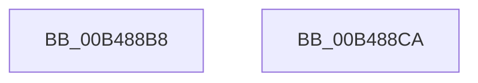

# sub_00B488B8

- RVA: `0x00B488B8`–`0x00B488F0` (길이 `56` bytes)
- VA: `0x0000000140B488B8`
- 실행 섹션: `PAGE`
- PDB 이름 있음: `아니요`; PDB Function 태그: `아니요`
- unwind 정보 RVA: `0x000BA638`
- 디코드: `12`개 명령, `56/56` bytes 표시
- 미해석 바이트: `0` (있으면 어셈블리에 `.byte`로 보존)

> 이 문서는 커널 이미지의 기계어와 PDB 기호를 분석해 생성했습니다. 4번과 5번은 함수 원형과 자료형을 바이너리 사용 방식에서 추정한 C 해석이며 원본 소스 복구 결과는 아닙니다.

## 1. Dependencies

- 직접 호출 지점: **1**; 고유 호출 대상: **1**
- 직접 호출자로 확인된 함수: **0**
- RIP 상대 이미지 참조: **2**

### Outgoing calls
- `0x00B488BF` → [EtwTelemetryCoverageReport](../../text/46/EtwTelemetryCoverageReport_function_00460430.md) (function, `0x00460430`)

### Direct callers
- 이 함수 시작 RVA로 연결되는 직접 call은 확인되지 않았습니다. 간접 호출은 완전히 역산할 수 없습니다.

### Static image references
- `0x00B488B8` → RVA `0x00E09228` (`.data`; read)
- `0x00B488D1` → RVA `0x00FC5008` (`ALMOSTRO`; read)

## 2. Other-region calls and transfers

- 다른 실행 섹션으로 향하는 call: **1**
  - `0x00B488BF` → [EtwTelemetryCoverageReport](../../text/46/EtwTelemetryCoverageReport_function_00460430.md) (`PAGE` → `.text`)
- call이 아닌 외부 분기/꼬리 이동: **2**
  - `0x00B488C5` → [EtwpCoverageProvEnableCallback + 0x2F](../A9/EtwpCoverageProvEnableCallback_function_00A9C6F0.md) (`tail-transfer`)
  - `0x00B488EB` → [EtwpCoverageProvEnableCallback + 0x96](../A9/EtwpCoverageProvEnableCallback_function_00A9C6F0.md) (`tail-transfer`)

## 3. Assembly (complete function range)

```asm
00B488B8  48 8D 0D 69 09 2C 00            lea rcx, [rip + 0x2c0969]
00B488BF  E8 6C 7B 91 FF                  call 0x140460430
00B488C4  90                              nop
00B488C5  E9 55 3E F5 FF                  jmp 0x140a9c71f
00B488CA  48 8B 42 10                     mov rax, qword ptr [rdx + 0x10]
00B488CE  8B 48 18                        mov ecx, dword ptr [rax + 0x18]
00B488D1  48 8B 05 30 C7 47 00            mov rax, qword ptr [rip + 0x47c730]
00B488D8  89 88 7C 03 00 00               mov dword ptr [rax + 0x37c], ecx
00B488DE  B9 FE FF 00 00                  mov ecx, 0xfffe
00B488E3  48 8B 42 10                     mov rax, qword ptr [rdx + 0x10]
00B488E7  66 21 48 02                     and word ptr [rax + 2], cx
00B488EB  E9 96 3E F5 FF                  jmp 0x140a9c786
```

## 4. C-style interpretation (structured pseudocode)

```c
__int64 __fastcall sub_00B488B8(__int64 a1, __int64 a2)
{
    __int64 result;

    result = EtwTelemetryCoverageReport(v_rip + 2885993, a2, a3, a4);
}
```

## 5. (Beta) C Style

```c
int64_t sub_00B488B8(int64_t Arg1, int64_t Arg2)
{
    int64_t result;

    result = EtwTelemetryCoverageReport(v_rip + 2885993, Arg2, a3, a4);
}
```

## 6. Execution-region graph

[열기: 2D/3D 그래프와 함수 탐색 컨트롤 패널](../../../control-panel.html?section=page&rva=0x00B488B8&view=graph)

- 2D 그래프는 위에서 아래로 흐르고, 3D 그래프는 빈 공간을 드래그해 회전합니다. Shift+드래그는 이동, 휠은 확대·축소, 함수 노드 선택은 대상 보고서 이동입니다.

### Static fallback


