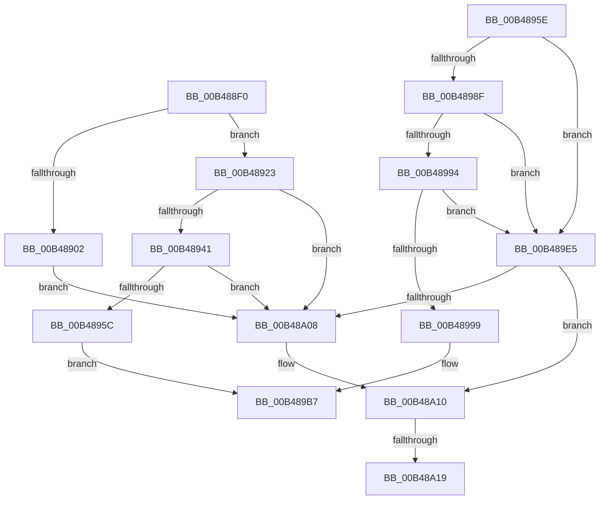

# sub_00B488F0

- RVA: `0x00B488F0`–`0x00B48A27` (길이 `311` bytes)
- VA: `0x0000000140B488F0`
- 실행 섹션: `PAGE`
- PDB 이름 있음: `아니요`; PDB Function 태그: `아니요`
- unwind 정보 RVA: `0x000BA718`
- 디코드: `75`개 명령, `311/311` bytes 표시
- 미해석 바이트: `0` (있으면 어셈블리에 `.byte`로 보존)

> 이 문서는 커널 이미지의 기계어와 PDB 기호를 분석해 생성했습니다. 4번과 5번은 함수 원형과 자료형을 바이너리 사용 방식에서 추정한 C 해석이며 원본 소스 복구 결과는 아닙니다.

## 1. Dependencies

- 직접 호출 지점: **11**; 고유 호출 대상: **5**
- 직접 호출자로 확인된 함수: **0**
- RIP 상대 이미지 참조: **4**

### Outgoing calls
- `0x00B488F5` → [AslAlloc](../95/AslAlloc_function_0095BD34.md) (function, `0x0095BD34`)
- `0x00B48919` → [AslLogCallPrintf](../95/AslLogCallPrintf_function_0095E4EC.md) (function, `0x0095E4EC`)
- `0x00B48934` → [RtlStringCchCopyW](../../text/26/RtlStringCchCopyW_function_0026E9A4.md) (function, `0x0026E9A4`)
- `0x00B4894F` → [RtlStringCchCatW](../../text/4C/RtlStringCchCatW_function_004C7500.md) (function, `0x004C7500`)
- `0x00B48963` → [AslAlloc](../95/AslAlloc_function_0095BD34.md) (function, `0x0095BD34`)
- `0x00B48977` → [AslAlloc](../95/AslAlloc_function_0095BD34.md) (function, `0x0095BD34`)
- `0x00B48982` → [AslAlloc](../95/AslAlloc_function_0095BD34.md) (function, `0x0095BD34`)
- `0x00B489A6` → [RtlStringCchCopyW](../../text/26/RtlStringCchCopyW_function_0026E9A4.md) (function, `0x0026E9A4`)
- `0x00B489FE` → [AslLogCallPrintf](../95/AslLogCallPrintf_function_0095E4EC.md) (function, `0x0095E4EC`)
- `0x00B48A0B` → [AslFree](../95/AslFree_function_0095B674.md) (function, `0x0095B674`)
- `0x00B48A1C` → [AslFree](../95/AslFree_function_0095B674.md) (function, `0x0095B674`)

### Direct callers
- 이 함수 시작 RVA로 연결되는 직접 call은 확인되지 않았습니다. 간접 호출은 완전히 역산할 수 없습니다.

### Static image references
- `0x00B48902` → RVA `0x0003C1D8` (`.rdata`; read)
- `0x00B4890F` → RVA `0x0001C660` (`.rdata`; read)
- `0x00B48999` → RVA `0x0003C1B4` (`.rdata`; read)
- `0x00B489E5` → RVA `0x0003C1B8` (`.rdata`; read)

## 2. Other-region calls and transfers

- 다른 실행 섹션으로 향하는 call: **3**
  - `0x00B48934` → [RtlStringCchCopyW](../../text/26/RtlStringCchCopyW_function_0026E9A4.md) (`PAGE` → `.text`)
  - `0x00B4894F` → [RtlStringCchCatW](../../text/4C/RtlStringCchCatW_function_004C7500.md) (`PAGE` → `.text`)
  - `0x00B489A6` → [RtlStringCchCopyW](../../text/26/RtlStringCchCopyW_function_0026E9A4.md) (`PAGE` → `.text`)
- call이 아닌 외부 분기/꼬리 이동: **3**
  - `0x00B489E0` → [SdbpCreateSearchDBContext + 0xAC](../A9/SdbpCreateSearchDBContext_function_00A9D544.md) (`tail-transfer`)
  - `0x00B48A13` → [SdbpCreateSearchDBContext + 0xAC](../A9/SdbpCreateSearchDBContext_function_00A9D544.md) (`tail-transfer`)
  - `0x00B48A22` → [SdbpCreateSearchDBContext + 0xAC](../A9/SdbpCreateSearchDBContext_function_00A9D544.md) (`tail-transfer`)

## 3. Assembly (complete function range)

```asm
00B488F0  BA 08 02 00 00                  mov edx, 0x208
00B488F5  E8 3A 34 E1 FF                  call 0x14095bd34
00B488FA  48 8B D8                        mov rbx, rax
00B488FD  48 85 C0                        test rax, rax
00B48900  75 21                           jne 0x140b48923
00B48902  4C 8D 0D CF 38 4F FF            lea r9, [rip - 0xb0c731]
00B48909  41 B8 C7 01 00 00               mov r8d, 0x1c7
00B4890F  48 8D 15 4A 3D 4D FF            lea rdx, [rip - 0xb2c2b6]
00B48916  8D 48 01                        lea ecx, [rax + 1]
00B48919  E8 CE 5B E1 FF                  call 0x14095e4ec
00B4891E  E9 E5 00 00 00                  jmp 0x140b48a08
00B48923  41 BB 04 01 00 00               mov r11d, 0x104
00B48929  4C 8D 44 24 50                  lea r8, [rsp + 0x50]
00B4892E  41 8B D3                        mov edx, r11d
00B48931  48 8B CB                        mov rcx, rbx
00B48934  E8 6B 60 72 FF                  call 0x14026e9a4
00B48939  85 C0                           test eax, eax
00B4893B  0F 88 C7 00 00 00               js 0x140b48a08
00B48941  4C 8D 84 24 60 02 00 00         lea r8, [rsp + 0x260]
00B48949  41 8B D3                        mov edx, r11d
00B4894C  48 8B CB                        mov rcx, rbx
00B4894F  E8 AC EB 97 FF                  call 0x1404c7500
00B48954  85 C0                           test eax, eax
00B48956  0F 88 AC 00 00 00               js 0x140b48a08
00B4895C  EB 59                           jmp 0x140b489b7
00B4895E  BA 04 00 00 00                  mov edx, 4
00B48963  E8 CC 33 E1 FF                  call 0x14095bd34
00B48968  41 BF 02 00 00 00               mov r15d, 2
00B4896E  48 8B F0                        mov rsi, rax
00B48971  41 8B D7                        mov edx, r15d
00B48974  4C 8B F0                        mov r14, rax
00B48977  E8 B8 33 E1 FF                  call 0x14095bd34
00B4897C  41 8B D7                        mov edx, r15d
00B4897F  48 8B D8                        mov rbx, rax
00B48982  E8 AD 33 E1 FF                  call 0x14095bd34
00B48987  4C 8B D8                        mov r11, rax
00B4898A  4D 85 F6                        test r14, r14
00B4898D  74 56                           je 0x140b489e5
00B4898F  48 85 DB                        test rbx, rbx
00B48992  74 51                           je 0x140b489e5
00B48994  48 85 C0                        test rax, rax
00B48997  74 4C                           je 0x140b489e5
00B48999  4C 8D 05 14 38 4F FF            lea r8, [rip - 0xb0c7ec]
00B489A0  41 8B D7                        mov edx, r15d
00B489A3  49 8B CE                        mov rcx, r14
00B489A6  E8 F9 5F 72 FF                  call 0x14026e9a4
00B489AB  66 44 89 2B                     mov word ptr [rbx], r13w
00B489AF  66 45 89 2B                     mov word ptr [r11], r13w
00B489B3  4C 89 5F 18                     mov qword ptr [rdi + 0x18], r11
00B489B7  4C 89 67 08                     mov qword ptr [rdi + 8], r12
00B489BB  BD 01 00 00 00                  mov ebp, 1
00B489C0  4C 89 6F 38                     mov qword ptr [rdi + 0x38], r13
00B489C4  48 89 77 20                     mov qword ptr [rdi + 0x20], rsi
00B489C8  48 89 5F 28                     mov qword ptr [rdi + 0x28], rbx
00B489CC  4C 89 6F 30                     mov qword ptr [rdi + 0x30], r13
00B489D0  4C 89 6F 48                     mov qword ptr [rdi + 0x48], r13
00B489D4  4C 89 6F 40                     mov qword ptr [rdi + 0x40], r13
00B489D8  4C 89 6F 58                     mov qword ptr [rdi + 0x58], r13
00B489DC  4C 89 6F 60                     mov qword ptr [rdi + 0x60], r13
00B489E0  E9 0B 4C F5 FF                  jmp 0x140a9d5f0
00B489E5  4C 8D 0D CC 37 4F FF            lea r9, [rip - 0xb0c834]
00B489EC  41 B8 D6 01 00 00               mov r8d, 0x1d6
00B489F2  48 8D 15 67 3C 4D FF            lea rdx, [rip - 0xb2c399]
00B489F9  B9 01 00 00 00                  mov ecx, 1
00B489FE  E8 E9 5A E1 FF                  call 0x14095e4ec
00B48A03  4D 85 F6                        test r14, r14
00B48A06  74 08                           je 0x140b48a10
00B48A08  48 8B D6                        mov rdx, rsi
00B48A0B  E8 64 2C E1 FF                  call 0x14095b674
00B48A10  48 85 DB                        test rbx, rbx
00B48A13  0F 84 D7 4B F5 FF               je 0x140a9d5f0
00B48A19  48 8B D3                        mov rdx, rbx
00B48A1C  E8 53 2C E1 FF                  call 0x14095b674
00B48A21  90                              nop
00B48A22  E9 C9 4B F5 FF                  jmp 0x140a9d5f0
```

## 4. C-style interpretation (structured pseudocode)

```c
__int64 __fastcall sub_00B488F0(__int64 a1, __int64 a2, __int64 a3, __int64 a4, __int64 a5, __int64 a6, __int64 a7, __int64 a8, __int64 a9, __int64 a10, __int64 a11, __int64 a12, __int64 a13, __int64 a14, __int64 a15, __int64 a16, __int64 a17, __int64 a18, __int64 a19, __int64 a20, __int64 a21, __int64 a22, __int64 a23, __int64 a24, __int64 a25, __int64 a26, __int64 a27, __int64 a28, __int64 a29, __int64 a30, __int64 a31, __int64 a32, __int64 a33, __int64 a34, __int64 a35, __int64 a36, __int64 a37, __int64 a38, __int64 a39, __int64 a40, __int64 a41, __int64 a42, __int64 a43, __int64 a44, __int64 a45, __int64 a46, __int64 a47, __int64 a48, __int64 a49, __int64 a50, __int64 a51, __int64 a52, __int64 a53, __int64 a54, __int64 a55, __int64 a56, __int64 a57, __int64 a58, __int64 a59, __int64 a60, __int64 a61, __int64 a62, __int64 a63, __int64 a64, __int64 a65, __int64 a66, __int64 a67, __int64 a68, __int64 a69, __int64 a70, __int64 a71, __int64 a72, __int64 a73, __int64 a74, __int64 a75, __int64 a76)
{
    __int64 result;

    result = AslAlloc(a1, 520, a3, a4);
    if (result != 0) goto loc_00B48923;
    result = AslLogCallPrintf(result + 1, v_rip - 11715254, 455, v_rip - 11585329);
    goto loc_00B48A08;
loc_00B48923:
    result = RtlStringCchCopyW(result, 260, a10, v_rip - 11585329);
    if (sign_flag) goto loc_00B48A08;
    result = RtlStringCchCatW(result, 260, a76, v_rip - 11585329);
    if (sign_flag) goto loc_00B48A08;
    goto loc_00B489B7;
loc_00B489B7:
    *(unsigned __int64 *)(v_rdi + 8) = v_r12;
    *(unsigned __int64 *)(v_rdi + 56) = v_r13;
    *(unsigned __int64 *)(v_rdi + 32) = v_rsi;
    *(unsigned __int64 *)(v_rdi + 40) = result;
    *(unsigned __int64 *)(v_rdi + 48) = v_r13;
    *(unsigned __int64 *)(v_rdi + 72) = v_r13;
    *(unsigned __int64 *)(v_rdi + 64) = v_r13;
    *(unsigned __int64 *)(v_rdi + 88) = v_r13;
    *(unsigned __int64 *)(v_rdi + 96) = v_r13;
loc_00B48A08:
    result = AslFree(result, v_rsi, a76, v_rip - 11585329);
loc_00B48A10:
    result = AslFree(result, result, a76, v_rip - 11585329);
}
```

## 5. (Beta) C Style

```c
int64_t sub_00B488F0(int64_t Arg1, int64_t Arg2, int64_t Arg3, int64_t Arg4, uint64_t Arg5, uint64_t Arg6, uint64_t Arg7, uint64_t Arg8, uint64_t Arg9, int64_t Arg10, uint64_t Arg11, uint64_t Arg12, uint64_t Arg13, uint64_t Arg14, uint64_t Arg15, uint64_t Arg16, uint64_t Arg17, uint64_t Arg18, uint64_t Arg19, uint64_t Arg20, uint64_t Arg21, uint64_t Arg22, uint64_t Arg23, uint64_t Arg24, uint64_t Arg25, uint64_t Arg26, uint64_t Arg27, uint64_t Arg28, uint64_t Arg29, uint64_t Arg30, uint64_t Arg31, uint64_t Arg32, uint64_t Arg33, uint64_t Arg34, uint64_t Arg35, uint64_t Arg36, uint64_t Arg37, uint64_t Arg38, uint64_t Arg39, uint64_t Arg40, uint64_t Arg41, uint64_t Arg42, uint64_t Arg43, uint64_t Arg44, uint64_t Arg45, uint64_t Arg46, uint64_t Arg47, uint64_t Arg48, uint64_t Arg49, uint64_t Arg50, uint64_t Arg51, uint64_t Arg52, uint64_t Arg53, uint64_t Arg54, uint64_t Arg55, uint64_t Arg56, uint64_t Arg57, uint64_t Arg58, uint64_t Arg59, uint64_t Arg60, uint64_t Arg61, uint64_t Arg62, uint64_t Arg63, uint64_t Arg64, uint64_t Arg65, uint64_t Arg66, uint64_t Arg67, uint64_t Arg68, uint64_t Arg69, uint64_t Arg70, uint64_t Arg71, uint64_t Arg72, uint64_t Arg73, uint64_t Arg74, uint64_t Arg75, int64_t Arg76)
{
    int64_t result;

    result = AslAlloc(Arg1, 520, Arg3, Arg4);
    if (result != 0) goto loc_00B48923;
    result = AslLogCallPrintf(result + 1, v_rip - 11715254, 455, v_rip - 11585329);
    goto loc_00B48A08;
loc_00B48923:
    result = RtlStringCchCopyW(result, 260, Arg10, v_rip - 11585329);
    if (sign_flag) goto loc_00B48A08;
    result = RtlStringCchCatW(result, 260, Arg76, v_rip - 11585329);
    if (sign_flag) goto loc_00B48A08;
    goto loc_00B489B7;
loc_00B489B7:
    *(uint64_t *)(local_rdi + 0x8) = local_r12;
    *(uint64_t *)(local_rdi + 0x38) = local_r13;
    *(uint64_t *)(local_rdi + 0x20) = local_rsi;
    *(uint64_t *)(local_rdi + 0x28) = result;
    *(uint64_t *)(local_rdi + 0x30) = local_r13;
    *(uint64_t *)(local_rdi + 0x48) = local_r13;
    *(uint64_t *)(local_rdi + 0x40) = local_r13;
    *(uint64_t *)(local_rdi + 0x58) = local_r13;
    *(uint64_t *)(local_rdi + 0x60) = local_r13;
loc_00B48A08:
    result = AslFree(result, local_rsi, Arg76, v_rip - 11585329);
loc_00B48A10:
    result = AslFree(result, result, Arg76, v_rip - 11585329);
}
```

## 6. Execution-region graph

[열기: 2D/3D 그래프와 함수 탐색 컨트롤 패널](../../../control-panel.html?section=page&rva=0x00B488F0&view=graph)

- 2D 그래프는 위에서 아래로 흐르고, 3D 그래프는 빈 공간을 드래그해 회전합니다. Shift+드래그는 이동, 휠은 확대·축소, 함수 노드 선택은 대상 보고서 이동입니다.

### Static fallback


