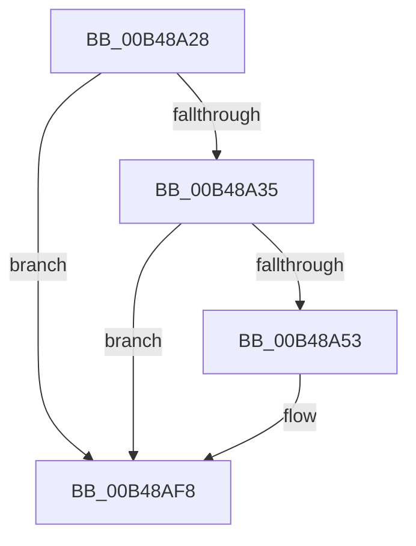

# sub_00B48A28

- RVA: `0x00B48A28`–`0x00B48B09` (길이 `225` bytes)
- VA: `0x0000000140B48A28`
- 실행 섹션: `PAGE`
- PDB 이름 있음: `아니요`; PDB Function 태그: `아니요`
- unwind 정보 RVA: `0x000BA750`
- 디코드: `44`개 명령, `225/225` bytes 표시
- 미해석 바이트: `0` (있으면 어셈블리에 `.byte`로 보존)

> 이 문서는 커널 이미지의 기계어와 PDB 기호를 분석해 생성했습니다. 4번과 5번은 함수 원형과 자료형을 바이너리 사용 방식에서 추정한 C 해석이며 원본 소스 복구 결과는 아닙니다.

## 1. Dependencies

- 직접 호출 지점: **2**; 고유 호출 대상: **2**
- 직접 호출자로 확인된 함수: **0**
- RIP 상대 이미지 참조: **4**

### Outgoing calls
- `0x00B48A46` → [tlgKeywordOn](../../text/42/tlgKeywordOn_function_0042EAA0.md) (function, `0x0042EAA0`)
- `0x00B48AF3` → [tlgWriteTransfer_EtwWriteTransfer](../../text/42/tlgWriteTransfer_EtwWriteTransfer_function_004260E0.md) (function, `0x004260E0`)

### Direct callers
- 이 함수 시작 RVA로 연결되는 직접 call은 확인되지 않았습니다. 간접 호출은 완전히 역산할 수 없습니다.

### Static image references
- `0x00B48A28` → RVA `0x00E08820` (`.data`; read)
- `0x00B48A78` → RVA `0x00E67B50` (`.data`; read)
- `0x00B48A7F` → RVA `0x00052D2A` (`.rdata`; read)
- `0x00B48AFD` → RVA `0x00E0CCA0` (`.data`; read/write)

## 2. Other-region calls and transfers

- 다른 실행 섹션으로 향하는 call: **2**
  - `0x00B48A46` → [tlgKeywordOn](../../text/42/tlgKeywordOn_function_0042EAA0.md) (`PAGE` → `.text`)
  - `0x00B48AF3` → [tlgWriteTransfer_EtwWriteTransfer](../../text/42/tlgWriteTransfer_EtwWriteTransfer_function_004260E0.md) (`PAGE` → `.text`)
- call이 아닌 외부 분기/꼬리 이동: **1**
  - `0x00B48B04` → [RtlpLogCapabilityCheckLatency + 0x89](../A9/RtlpLogCapabilityCheckLatency_function_00A9D678.md) (`tail-transfer`)

## 3. Assembly (complete function range)

```asm
00B48A28  83 3D F1 FD 2B 00 05            cmp dword ptr [rip + 0x2bfdf1], 5
00B48A2F  0F 86 C3 00 00 00               jbe 0x140b48af8
00B48A35  48 BA 00 00 00 00 00 20 00 00   movabs rdx, 0x200000000000
00B48A3F  48 8D 0D DA FD 2B 00            lea rcx, [rip + 0x2bfdda]
00B48A46  E8 55 60 8E FF                  call 0x14042eaa0
00B48A4B  84 C0                           test al, al
00B48A4D  0F 84 A5 00 00 00               je 0x140b48af8
00B48A53  48 8B 0B                        mov rcx, qword ptr [rbx]
00B48A56  45 33 C9                        xor r9d, r9d
00B48A59  48 2B 0F                        sub rcx, qword ptr [rdi]
00B48A5C  48 69 C1 40 42 0F 00            imul rax, rcx, 0xf4240
00B48A63  48 8D 0D B6 FD 2B 00            lea rcx, [rip + 0x2bfdb6]
00B48A6A  48 C7 45 EF 08 00 00 00         mov qword ptr [rbp - 0x11], 8
00B48A72  48 99                           cqo
00B48A74  44 88 75 B7                     mov byte ptr [rbp - 0x49], r14b
00B48A78  48 F7 3D D1 F0 31 00            idiv qword ptr [rip + 0x31f0d1]
00B48A7F  48 8D 15 A4 A2 50 FF            lea rdx, [rip - 0xaf5d5c]
00B48A86  48 C7 45 FF 01 00 00 00         mov qword ptr [rbp - 1], 1
00B48A8E  48 89 45 BF                     mov qword ptr [rbp - 0x41], rax
00B48A92  48 8D 45 BF                     lea rax, [rbp - 0x41]
00B48A96  48 89 45 E7                     mov qword ptr [rbp - 0x19], rax
00B48A9A  48 8D 45 B7                     lea rax, [rbp - 0x49]
00B48A9E  48 89 45 F7                     mov qword ptr [rbp - 9], rax
00B48AA2  48 8D 45 B8                     lea rax, [rbp - 0x48]
00B48AA6  48 89 45 07                     mov qword ptr [rbp + 7], rax
00B48AAA  8A 45 77                        mov al, byte ptr [rbp + 0x77]
00B48AAD  88 45 B9                        mov byte ptr [rbp - 0x47], al
00B48AB0  48 8D 45 B9                     lea rax, [rbp - 0x47]
00B48AB4  48 89 45 17                     mov qword ptr [rbp + 0x17], rax
00B48AB8  8A 45 7F                        mov al, byte ptr [rbp + 0x7f]
00B48ABB  88 45 BA                        mov byte ptr [rbp - 0x46], al
00B48ABE  48 8D 45 BA                     lea rax, [rbp - 0x46]
00B48AC2  48 89 45 27                     mov qword ptr [rbp + 0x27], rax
00B48AC6  48 8D 45 C7                     lea rax, [rbp - 0x39]
00B48ACA  48 89 44 24 28                  mov qword ptr [rsp + 0x28], rax
00B48ACF  C7 44 24 20 07 00 00 00         mov dword ptr [rsp + 0x20], 7
00B48AD7  40 88 75 B8                     mov byte ptr [rbp - 0x48], sil
00B48ADB  48 C7 45 0F 01 00 00 00         mov qword ptr [rbp + 0xf], 1
00B48AE3  48 C7 45 1F 01 00 00 00         mov qword ptr [rbp + 0x1f], 1
00B48AEB  48 C7 45 2F 01 00 00 00         mov qword ptr [rbp + 0x2f], 1
00B48AF3  E8 E8 D5 8D FF                  call 0x1404260e0
00B48AF8  B8 64 00 00 00                  mov eax, 0x64
00B48AFD  66 87 05 9C 41 2C 00            xchg word ptr [rip + 0x2c419c], ax
00B48B04  E9 F8 4B F5 FF                  jmp 0x140a9d701
```

## 4. C-style interpretation (structured pseudocode)

```c
__int64 __fastcall sub_00B48A28(__int64 a1, __int64 a2, __int64 a3, int a4)
{
    __int64 result;
    unsigned int v_stack_p20;
    unsigned __int64 v_stack_p28;

    if ((*(unsigned int *)(v_rip + 2883057)) <= 5) goto loc_00B48AF8;
    result = tlgKeywordOn(v_rip + 2883034, a2, a3, a4);
    if ((unsigned __int8)(result) != 0) {
        a1 = *(unsigned __int64 *)(v_rbx);
        a4 = 0;
        a1 = (a1) - (*(unsigned __int64 *)(v_rdi));
        result = (result) * (a1);
        a1 = v_rip + 2882998;
        *(unsigned __int64 *)(v_rbp - 17) = 8;
        *(unsigned __int8 *)(v_rbp - 73) = (unsigned __int8)(v_r14);
        a2 = v_rip - 11492700;
        *(unsigned __int64 *)(v_rbp - 1) = 1;
        *(unsigned __int64 *)(v_rbp - 65) = result;
        result = v_rbp - 65;
        *(unsigned __int64 *)(v_rbp - 25) = result;
        result = v_rbp - 73;
        *(unsigned __int64 *)(v_rbp - 9) = result;
        result = v_rbp - 72;
        *(unsigned __int64 *)(v_rbp + 7) = result;
        result = *(unsigned __int8 *)(v_rbp + 119);
        *(unsigned __int8 *)(v_rbp - 71) = (unsigned __int8)(result);
        result = v_rbp - 71;
        *(unsigned __int64 *)(v_rbp + 23) = result;
        result = *(unsigned __int8 *)(v_rbp + 127);
        *(unsigned __int8 *)(v_rbp - 70) = (unsigned __int8)(result);
        result = v_rbp - 70;
        *(unsigned __int64 *)(v_rbp + 39) = result;
        result = v_rbp - 57;
        v_stack_p28 = result;
        v_stack_p20 = 7;
        *(unsigned __int8 *)(v_rbp - 72) = (unsigned __int8)(v_rsi);
        *(unsigned __int64 *)(v_rbp + 15) = 1;
        *(unsigned __int64 *)(v_rbp + 31) = 1;
        *(unsigned __int64 *)(v_rbp + 47) = 1;
        result = tlgWriteTransfer_EtwWriteTransfer(a1, a2, a3, a4);
    }
}
```

## 5. (Beta) C Style

```c
int64_t sub_00B48A28(int64_t Arg1, int64_t Arg2, int64_t Arg3, int32_t Arg4)
{
    int64_t result;
    uint32_t v_stack_p20;
    uint64_t v_stack_p28;

    if ((*(uint32_t *)(v_rip + 0x2BFDF1)) <= 5) goto loc_00B48AF8;
    result = tlgKeywordOn(v_rip + 2883034, Arg2, Arg3, Arg4);
    if ((uint8_t)(result) != 0) {
        Arg1 = *(uint64_t *)(local_rbx);
        Arg4 = 0;
        Arg1 = (Arg1) - (*(uint64_t *)(local_rdi));
        result = (result) * (Arg1);
        Arg1 = v_rip + 2882998;
        *(uint64_t *)(local_rbp - 0x11) = 8;
        *(uint8_t *)(local_rbp - 0x49) = (uint8_t)(local_r14);
        Arg2 = v_rip - 11492700;
        *(uint64_t *)(local_rbp - 0x1) = 1;
        *(uint64_t *)(local_rbp - 0x41) = result;
        result = local_rbp - 65;
        *(uint64_t *)(local_rbp - 0x19) = result;
        result = local_rbp - 73;
        *(uint64_t *)(local_rbp - 0x9) = result;
        result = local_rbp - 72;
        *(uint64_t *)(local_rbp + 0x7) = result;
        result = *(uint8_t *)(local_rbp + 0x77);
        *(uint8_t *)(local_rbp - 0x47) = (uint8_t)(result);
        result = local_rbp - 71;
        *(uint64_t *)(local_rbp + 0x17) = result;
        result = *(uint8_t *)(local_rbp + 0x7F);
        *(uint8_t *)(local_rbp - 0x46) = (uint8_t)(result);
        result = local_rbp - 70;
        *(uint64_t *)(local_rbp + 0x27) = result;
        result = local_rbp - 57;
        v_stack_p28 = result;
        v_stack_p20 = 7;
        *(uint8_t *)(local_rbp - 0x48) = (uint8_t)(local_rsi);
        *(uint64_t *)(local_rbp + 0xF) = 1;
        *(uint64_t *)(local_rbp + 0x1F) = 1;
        *(uint64_t *)(local_rbp + 0x2F) = 1;
        result = tlgWriteTransfer_EtwWriteTransfer(Arg1, Arg2, Arg3, Arg4);
    }
}
```

## 6. Execution-region graph

[열기: 2D/3D 그래프와 함수 탐색 컨트롤 패널](../../../control-panel.html?section=page&rva=0x00B48A28&view=graph)

- 2D 그래프는 위에서 아래로 흐르고, 3D 그래프는 빈 공간을 드래그해 회전합니다. Shift+드래그는 이동, 휠은 확대·축소, 함수 노드 선택은 대상 보고서 이동입니다.

### Static fallback


