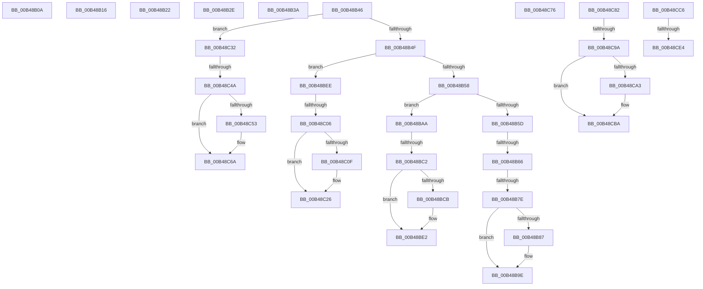

# sub_00B48B0A

- RVA: `0x00B48B0A`–`0x00B48F35` (길이 `1,067` bytes)
- VA: `0x0000000140B48B0A`
- 실행 섹션: `PAGE`
- PDB 이름 있음: `아니요`; PDB Function 태그: `아니요`
- unwind 정보 RVA: `0x000BA848`
- 디코드: `185`개 명령, `1,067/1,067` bytes 표시
- 미해석 바이트: `0` (있으면 어셈블리에 `.byte`로 보존)

> 이 문서는 커널 이미지의 기계어와 PDB 기호를 분석해 생성했습니다. 4번과 5번은 함수 원형과 자료형을 바이너리 사용 방식에서 추정한 C 해석이며 원본 소스 복구 결과는 아닙니다.

## 1. Dependencies

- 직접 호출 지점: **7**; 고유 호출 대상: **3**
- 직접 호출자로 확인된 함수: **0**
- RIP 상대 이미지 참조: **28**

### Outgoing calls
- `0x00B48B93` → [TelemetryCoverageStringHashInternal](../../text/4D/TelemetryCoverageStringHashInternal_function_004D51A0.md) (function, `0x004D51A0`)
- `0x00B48BD7` → [TelemetryCoverageStringHashInternal](../../text/4D/TelemetryCoverageStringHashInternal_function_004D51A0.md) (function, `0x004D51A0`)
- `0x00B48C1B` → [TelemetryCoverageStringHashInternal](../../text/4D/TelemetryCoverageStringHashInternal_function_004D51A0.md) (function, `0x004D51A0`)
- `0x00B48C5F` → [TelemetryCoverageStringHashInternal](../../text/4D/TelemetryCoverageStringHashInternal_function_004D51A0.md) (function, `0x004D51A0`)
- `0x00B48CAF` → [TelemetryCoverageStringHashInternal](../../text/4D/TelemetryCoverageStringHashInternal_function_004D51A0.md) (function, `0x004D51A0`)
- `0x00B48CD7` → [tlgKeywordOn](../../text/42/tlgKeywordOn_function_0042EAA0.md) (function, `0x0042EAA0`)
- `0x00B48F2A` → [tlgWriteTransfer_EtwWriteTransfer](../../text/42/tlgWriteTransfer_EtwWriteTransfer_function_004260E0.md) (function, `0x004260E0`)

### Direct callers
- 이 함수 시작 RVA로 연결되는 직접 call은 확인되지 않았습니다. 간접 호출은 완전히 역산할 수 없습니다.

### Static image references
- `0x00B48B0A` → RVA `0x00E07580` (`.data`; read)
- `0x00B48B16` → RVA `0x00E075B0` (`.data`; read)
- `0x00B48B22` → RVA `0x00E07598` (`.data`; read)
- `0x00B48B2E` → RVA `0x00E075E0` (`.data`; read)
- `0x00B48B3A` → RVA `0x00E075C8` (`.data`; read)
- `0x00B48B72` → RVA `0x00E0761C` (`.data`; read)
- `0x00B48B7E` → RVA `0x00E07618` (`.data`; read)
- `0x00B48B87` → RVA `0x00E07610` (`.data`; read)
- `0x00B48B98` → RVA `0x00E07618` (`.data`; write)
- `0x00B48BB6` → RVA `0x00E07604` (`.data`; read)
- `0x00B48BC2` → RVA `0x00E07600` (`.data`; read)
- `0x00B48BCB` → RVA `0x00E075F8` (`.data`; read)
- `0x00B48BDC` → RVA `0x00E07600` (`.data`; write)
- `0x00B48BFA` → RVA `0x00E0764C` (`.data`; read)
- `0x00B48C06` → RVA `0x00E07648` (`.data`; read)
- `0x00B48C0F` → RVA `0x00E07640` (`.data`; read)
- `0x00B48C20` → RVA `0x00E07648` (`.data`; write)
- `0x00B48C3E` → RVA `0x00E07634` (`.data`; read)
- `0x00B48C4A` → RVA `0x00E07630` (`.data`; read)
- `0x00B48C53` → RVA `0x00E07628` (`.data`; read)
- `0x00B48C64` → RVA `0x00E07630` (`.data`; write)
- `0x00B48C76` → RVA `0x00E07688` (`.data`; read)
- `0x00B48C8E` → RVA `0x00E07664` (`.data`; read)
- `0x00B48C9A` → RVA `0x00E07660` (`.data`; read)
- `0x00B48CA3` → RVA `0x00E07658` (`.data`; read)
- `0x00B48CB4` → RVA `0x00E07660` (`.data`; write)
- `0x00B48CD0` → RVA `0x00E07748` (`.data`; read)
- `0x00B48EF0` → RVA `0x0004AA5F` (`.rdata`; read)

## 2. Other-region calls and transfers

- 다른 실행 섹션으로 향하는 call: **7**
  - `0x00B48B93` → [TelemetryCoverageStringHashInternal](../../text/4D/TelemetryCoverageStringHashInternal_function_004D51A0.md) (`PAGE` → `.text`)
  - `0x00B48BD7` → [TelemetryCoverageStringHashInternal](../../text/4D/TelemetryCoverageStringHashInternal_function_004D51A0.md) (`PAGE` → `.text`)
  - `0x00B48C1B` → [TelemetryCoverageStringHashInternal](../../text/4D/TelemetryCoverageStringHashInternal_function_004D51A0.md) (`PAGE` → `.text`)
  - `0x00B48C5F` → [TelemetryCoverageStringHashInternal](../../text/4D/TelemetryCoverageStringHashInternal_function_004D51A0.md) (`PAGE` → `.text`)
  - `0x00B48CAF` → [TelemetryCoverageStringHashInternal](../../text/4D/TelemetryCoverageStringHashInternal_function_004D51A0.md) (`PAGE` → `.text`)
  - `0x00B48CD7` → [tlgKeywordOn](../../text/42/tlgKeywordOn_function_0042EAA0.md) (`PAGE` → `.text`)
  - `0x00B48F2A` → [tlgWriteTransfer_EtwWriteTransfer](../../text/42/tlgWriteTransfer_EtwWriteTransfer_function_004260E0.md) (`PAGE` → `.text`)
- call이 아닌 외부 분기/꼬리 이동: **19**
  - `0x00B48B11` → [PopTransitionTelemetryOsState + 0x315](../A9/PopTransitionTelemetryOsState_function_00A9DD40.md) (`tail-transfer`)
  - `0x00B48B1D` → [PopTransitionTelemetryOsState + 0x315](../A9/PopTransitionTelemetryOsState_function_00A9DD40.md) (`tail-transfer`)
  - `0x00B48B29` → [PopTransitionTelemetryOsState + 0x315](../A9/PopTransitionTelemetryOsState_function_00A9DD40.md) (`tail-transfer`)
  - `0x00B48B35` → [PopTransitionTelemetryOsState + 0x315](../A9/PopTransitionTelemetryOsState_function_00A9DD40.md) (`tail-transfer`)
  - `0x00B48B41` → [PopTransitionTelemetryOsState + 0x315](../A9/PopTransitionTelemetryOsState_function_00A9DD40.md) (`tail-transfer`)
  - `0x00B48B60` → [PopTransitionTelemetryOsState + 0xFC](../A9/PopTransitionTelemetryOsState_function_00A9DD40.md) (`tail-transfer`)
  - `0x00B48B78` → [PopTransitionTelemetryOsState + 0xFC](../A9/PopTransitionTelemetryOsState_function_00A9DD40.md) (`tail-transfer`)
  - `0x00B48BA5` → [PopTransitionTelemetryOsState + 0x315](../A9/PopTransitionTelemetryOsState_function_00A9DD40.md) (`tail-transfer`)
  - `0x00B48BBC` → [PopTransitionTelemetryOsState + 0xFC](../A9/PopTransitionTelemetryOsState_function_00A9DD40.md) (`tail-transfer`)
  - `0x00B48BE9` → [PopTransitionTelemetryOsState + 0x315](../A9/PopTransitionTelemetryOsState_function_00A9DD40.md) (`tail-transfer`)
  - `0x00B48C00` → [PopTransitionTelemetryOsState + 0xFC](../A9/PopTransitionTelemetryOsState_function_00A9DD40.md) (`tail-transfer`)
  - `0x00B48C2D` → [PopTransitionTelemetryOsState + 0x315](../A9/PopTransitionTelemetryOsState_function_00A9DD40.md) (`tail-transfer`)
  - `0x00B48C44` → [PopTransitionTelemetryOsState + 0xFC](../A9/PopTransitionTelemetryOsState_function_00A9DD40.md) (`tail-transfer`)
  - `0x00B48C71` → [PopTransitionTelemetryOsState + 0x315](../A9/PopTransitionTelemetryOsState_function_00A9DD40.md) (`tail-transfer`)
  - `0x00B48C7D` → [PopTransitionTelemetryOsState + 0x315](../A9/PopTransitionTelemetryOsState_function_00A9DD40.md) (`tail-transfer`)
  - `0x00B48C94` → [PopTransitionTelemetryOsState + 0xFC](../A9/PopTransitionTelemetryOsState_function_00A9DD40.md) (`tail-transfer`)
  - `0x00B48CC1` → [PopTransitionTelemetryOsState + 0x315](../A9/PopTransitionTelemetryOsState_function_00A9DD40.md) (`tail-transfer`)
  - `0x00B48CDE` → [PopTransitionTelemetryOsState + 0x54](../A9/PopTransitionTelemetryOsState_function_00A9DD40.md) (`tail-transfer`)
  - `0x00B48F30` → [PopTransitionTelemetryOsState + 0x54](../A9/PopTransitionTelemetryOsState_function_00A9DD40.md) (`tail-transfer`)

## 3. Assembly (complete function range)

```asm
00B48B0A  48 8D 0D 6F EA 2B 00            lea rcx, [rip + 0x2bea6f]
00B48B11  E9 3F 55 F5 FF                  jmp 0x140a9e055
00B48B16  48 8D 0D 93 EA 2B 00            lea rcx, [rip + 0x2bea93]
00B48B1D  E9 33 55 F5 FF                  jmp 0x140a9e055
00B48B22  48 8D 0D 6F EA 2B 00            lea rcx, [rip + 0x2bea6f]
00B48B29  E9 27 55 F5 FF                  jmp 0x140a9e055
00B48B2E  48 8D 0D AB EA 2B 00            lea rcx, [rip + 0x2beaab]
00B48B35  E9 1B 55 F5 FF                  jmp 0x140a9e055
00B48B3A  48 8D 0D 87 EA 2B 00            lea rcx, [rip + 0x2bea87]
00B48B41  E9 0F 55 F5 FF                  jmp 0x140a9e055
00B48B46  83 E9 01                        sub ecx, 1
00B48B49  0F 84 E3 00 00 00               je 0x140b48c32
00B48B4F  83 E9 01                        sub ecx, 1
00B48B52  0F 84 96 00 00 00               je 0x140b48bee
00B48B58  83 E9 01                        sub ecx, 1
00B48B5B  74 4D                           je 0x140b48baa
00B48B5D  83 F9 02                        cmp ecx, 2
00B48B60  0F 85 D6 52 F5 FF               jne 0x140a9de3c
00B48B66  48 B8 7C 03 00 00 80 F7 FF FF   movabs rax, 0xfffff7800000037c
00B48B70  8B 00                           mov eax, dword ptr [rax]
00B48B72  39 05 A4 EA 2B 00               cmp dword ptr [rip + 0x2beaa4], eax
00B48B78  0F 83 BE 52 F5 FF               jae 0x140a9de3c
00B48B7E  44 39 35 93 EA 2B 00            cmp dword ptr [rip + 0x2bea93], r14d
00B48B85  75 17                           jne 0x140b48b9e
00B48B87  48 8B 0D 82 EA 2B 00            mov rcx, qword ptr [rip + 0x2bea82]
00B48B8E  48 8D 54 24 30                  lea rdx, [rsp + 0x30]
00B48B93  E8 08 C6 98 FF                  call 0x1404d51a0
00B48B98  89 05 7A EA 2B 00               mov dword ptr [rip + 0x2bea7a], eax
00B48B9E  48 8D 0D 6B EA 2B 00            lea rcx, [rip + 0x2bea6b]
00B48BA5  E9 AB 54 F5 FF                  jmp 0x140a9e055
00B48BAA  48 B8 7C 03 00 00 80 F7 FF FF   movabs rax, 0xfffff7800000037c
00B48BB4  8B 00                           mov eax, dword ptr [rax]
00B48BB6  39 05 48 EA 2B 00               cmp dword ptr [rip + 0x2bea48], eax
00B48BBC  0F 83 7A 52 F5 FF               jae 0x140a9de3c
00B48BC2  44 39 35 37 EA 2B 00            cmp dword ptr [rip + 0x2bea37], r14d
00B48BC9  75 17                           jne 0x140b48be2
00B48BCB  48 8B 0D 26 EA 2B 00            mov rcx, qword ptr [rip + 0x2bea26]
00B48BD2  48 8D 54 24 30                  lea rdx, [rsp + 0x30]
00B48BD7  E8 C4 C5 98 FF                  call 0x1404d51a0
00B48BDC  89 05 1E EA 2B 00               mov dword ptr [rip + 0x2bea1e], eax
00B48BE2  48 8D 0D 0F EA 2B 00            lea rcx, [rip + 0x2bea0f]
00B48BE9  E9 67 54 F5 FF                  jmp 0x140a9e055
00B48BEE  48 B8 7C 03 00 00 80 F7 FF FF   movabs rax, 0xfffff7800000037c
00B48BF8  8B 00                           mov eax, dword ptr [rax]
00B48BFA  39 05 4C EA 2B 00               cmp dword ptr [rip + 0x2bea4c], eax
00B48C00  0F 83 36 52 F5 FF               jae 0x140a9de3c
00B48C06  44 39 35 3B EA 2B 00            cmp dword ptr [rip + 0x2bea3b], r14d
00B48C0D  75 17                           jne 0x140b48c26
00B48C0F  48 8B 0D 2A EA 2B 00            mov rcx, qword ptr [rip + 0x2bea2a]
00B48C16  48 8D 54 24 30                  lea rdx, [rsp + 0x30]
00B48C1B  E8 80 C5 98 FF                  call 0x1404d51a0
00B48C20  89 05 22 EA 2B 00               mov dword ptr [rip + 0x2bea22], eax
00B48C26  48 8D 0D 13 EA 2B 00            lea rcx, [rip + 0x2bea13]
00B48C2D  E9 23 54 F5 FF                  jmp 0x140a9e055
00B48C32  48 B8 7C 03 00 00 80 F7 FF FF   movabs rax, 0xfffff7800000037c
00B48C3C  8B 00                           mov eax, dword ptr [rax]
00B48C3E  39 05 F0 E9 2B 00               cmp dword ptr [rip + 0x2be9f0], eax
00B48C44  0F 83 F2 51 F5 FF               jae 0x140a9de3c
00B48C4A  44 39 35 DF E9 2B 00            cmp dword ptr [rip + 0x2be9df], r14d
00B48C51  75 17                           jne 0x140b48c6a
00B48C53  48 8B 0D CE E9 2B 00            mov rcx, qword ptr [rip + 0x2be9ce]
00B48C5A  48 8D 54 24 30                  lea rdx, [rsp + 0x30]
00B48C5F  E8 3C C5 98 FF                  call 0x1404d51a0
00B48C64  89 05 C6 E9 2B 00               mov dword ptr [rip + 0x2be9c6], eax
00B48C6A  48 8D 0D B7 E9 2B 00            lea rcx, [rip + 0x2be9b7]
00B48C71  E9 DF 53 F5 FF                  jmp 0x140a9e055
00B48C76  48 8D 0D 0B EA 2B 00            lea rcx, [rip + 0x2bea0b]
00B48C7D  E9 D3 53 F5 FF                  jmp 0x140a9e055
00B48C82  48 B8 7C 03 00 00 80 F7 FF FF   movabs rax, 0xfffff7800000037c
00B48C8C  8B 00                           mov eax, dword ptr [rax]
00B48C8E  39 05 D0 E9 2B 00               cmp dword ptr [rip + 0x2be9d0], eax
00B48C94  0F 83 A2 51 F5 FF               jae 0x140a9de3c
00B48C9A  44 39 35 BF E9 2B 00            cmp dword ptr [rip + 0x2be9bf], r14d
00B48CA1  75 17                           jne 0x140b48cba
00B48CA3  48 8B 0D AE E9 2B 00            mov rcx, qword ptr [rip + 0x2be9ae]
00B48CAA  48 8D 54 24 30                  lea rdx, [rsp + 0x30]
00B48CAF  E8 EC C4 98 FF                  call 0x1404d51a0
00B48CB4  89 05 A6 E9 2B 00               mov dword ptr [rip + 0x2be9a6], eax
00B48CBA  48 8D 0D 97 E9 2B 00            lea rcx, [rip + 0x2be997]
00B48CC1  E9 8F 53 F5 FF                  jmp 0x140a9e055
00B48CC6  48 BA 00 00 00 00 00 80 00 00   movabs rdx, 0x800000000000
00B48CD0  48 8D 0D 71 EA 2B 00            lea rcx, [rip + 0x2bea71]
00B48CD7  E8 C4 5D 8E FF                  call 0x14042eaa0
00B48CDC  84 C0                           test al, al
00B48CDE  0F 84 B0 50 F5 FF               je 0x140a9dd94
00B48CE4  48 8D 44 24 34                  lea rax, [rsp + 0x34]
00B48CE9  66 89 5C 24 34                  mov word ptr [rsp + 0x34], bx
00B48CEE  48 89 45 10                     mov qword ptr [rbp + 0x10], rax
00B48CF2  48 8D 44 24 38                  lea rax, [rsp + 0x38]
00B48CF7  48 89 45 20                     mov qword ptr [rbp + 0x20], rax
00B48CFB  48 8D 45 90                     lea rax, [rbp - 0x70]
00B48CFF  48 89 45 30                     mov qword ptr [rbp + 0x30], rax
00B48D03  48 C7 45 18 02 00 00 00         mov qword ptr [rbp + 0x18], 2
00B48D0B  66 89 7C 24 38                  mov word ptr [rsp + 0x38], di
00B48D10  48 C7 45 28 02 00 00 00         mov qword ptr [rbp + 0x28], 2
00B48D18  4C 89 6D 90                     mov qword ptr [rbp - 0x70], r13
00B48D1C  48 C7 45 38 08 00 00 00         mov qword ptr [rbp + 0x38], 8
00B48D24  A1 C4 02 00 00 80 F7 FF FF      movabs eax, dword ptr [0xfffff780000002c4]
00B48D2D  89 44 24 48                     mov dword ptr [rsp + 0x48], eax
00B48D31  48 8D 44 24 48                  lea rax, [rsp + 0x48]
00B48D36  48 89 45 40                     mov qword ptr [rbp + 0x40], rax
00B48D3A  48 8D 44 24 78                  lea rax, [rsp + 0x78]
00B48D3F  48 89 45 50                     mov qword ptr [rbp + 0x50], rax
00B48D43  48 8B 45 A0                     mov rax, qword ptr [rbp - 0x60]
00B48D47  48 89 45 A8                     mov qword ptr [rbp - 0x58], rax
00B48D4B  48 8D 45 A8                     lea rax, [rbp - 0x58]
00B48D4F  48 89 45 60                     mov qword ptr [rbp + 0x60], rax
00B48D53  48 8D 45 B0                     lea rax, [rbp - 0x50]
00B48D57  48 89 45 70                     mov qword ptr [rbp + 0x70], rax
00B48D5B  48 8D 45 B8                     lea rax, [rbp - 0x48]
00B48D5F  48 89 85 80 00 00 00            mov qword ptr [rbp + 0x80], rax
00B48D66  8B 44 24 4C                     mov eax, dword ptr [rsp + 0x4c]
00B48D6A  66 89 44 24 3C                  mov word ptr [rsp + 0x3c], ax
00B48D6F  48 8D 44 24 3C                  lea rax, [rsp + 0x3c]
00B48D74  48 89 85 90 00 00 00            mov qword ptr [rbp + 0x90], rax
00B48D7B  8B 44 24 50                     mov eax, dword ptr [rsp + 0x50]
00B48D7F  66 89 44 24 40                  mov word ptr [rsp + 0x40], ax
00B48D84  48 8D 44 24 40                  lea rax, [rsp + 0x40]
00B48D89  48 89 85 A0 00 00 00            mov qword ptr [rbp + 0xa0], rax
00B48D90  8B 44 24 54                     mov eax, dword ptr [rsp + 0x54]
00B48D94  89 44 24 58                     mov dword ptr [rsp + 0x58], eax
00B48D98  48 8D 44 24 58                  lea rax, [rsp + 0x58]
00B48D9D  48 89 85 B0 00 00 00            mov qword ptr [rbp + 0xb0], rax
00B48DA4  8B 44 24 5C                     mov eax, dword ptr [rsp + 0x5c]
00B48DA8  89 44 24 60                     mov dword ptr [rsp + 0x60], eax
00B48DAC  48 8D 44 24 60                  lea rax, [rsp + 0x60]
00B48DB1  48 89 85 C0 00 00 00            mov qword ptr [rbp + 0xc0], rax
00B48DB8  48 8D 44 24 64                  lea rax, [rsp + 0x64]
00B48DBD  48 89 85 D0 00 00 00            mov qword ptr [rbp + 0xd0], rax
00B48DC4  48 8D 44 24 68                  lea rax, [rsp + 0x68]
00B48DC9  48 89 85 E0 00 00 00            mov qword ptr [rbp + 0xe0], rax
00B48DD0  8B 44 24 44                     mov eax, dword ptr [rsp + 0x44]
00B48DD4  89 44 24 6C                     mov dword ptr [rsp + 0x6c], eax
00B48DD8  48 8D 44 24 6C                  lea rax, [rsp + 0x6c]
00B48DDD  48 89 85 F0 00 00 00            mov qword ptr [rbp + 0xf0], rax
00B48DE4  48 8B 45 88                     mov rax, qword ptr [rbp - 0x78]
00B48DE8  48 89 45 C0                     mov qword ptr [rbp - 0x40], rax
00B48DEC  48 8D 45 C0                     lea rax, [rbp - 0x40]
00B48DF0  48 89 85 00 01 00 00            mov qword ptr [rbp + 0x100], rax
00B48DF7  8B 45 80                        mov eax, dword ptr [rbp - 0x80]
00B48DFA  89 44 24 70                     mov dword ptr [rsp + 0x70], eax
00B48DFE  48 8D 44 24 70                  lea rax, [rsp + 0x70]
00B48E03  48 89 85 10 01 00 00            mov qword ptr [rbp + 0x110], rax
00B48E0A  0F B6 45 D0                     movzx eax, byte ptr [rbp - 0x30]
00B48E0E  89 44 24 74                     mov dword ptr [rsp + 0x74], eax
00B48E12  48 8D 44 24 74                  lea rax, [rsp + 0x74]
00B48E17  48 89 85 20 01 00 00            mov qword ptr [rbp + 0x120], rax
00B48E1E  48 C7 45 48 04 00 00 00         mov qword ptr [rbp + 0x48], 4
00B48E26  48 C7 45 58 08 00 00 00         mov qword ptr [rbp + 0x58], 8
00B48E2E  48 C7 45 68 08 00 00 00         mov qword ptr [rbp + 0x68], 8
00B48E36  4C 89 65 B0                     mov qword ptr [rbp - 0x50], r12
00B48E3A  48 C7 45 78 08 00 00 00         mov qword ptr [rbp + 0x78], 8
00B48E42  4C 89 7D B8                     mov qword ptr [rbp - 0x48], r15
00B48E46  48 C7 85 88 00 00 00 08 00 00 00  mov qword ptr [rbp + 0x88], 8
00B48E51  48 C7 85 98 00 00 00 02 00 00 00  mov qword ptr [rbp + 0x98], 2
00B48E5C  48 C7 85 A8 00 00 00 02 00 00 00  mov qword ptr [rbp + 0xa8], 2
00B48E67  48 C7 85 B8 00 00 00 04 00 00 00  mov qword ptr [rbp + 0xb8], 4
00B48E72  48 C7 85 C8 00 00 00 04 00 00 00  mov qword ptr [rbp + 0xc8], 4
00B48E7D  89 74 24 64                     mov dword ptr [rsp + 0x64], esi
00B48E81  48 C7 85 D8 00 00 00 04 00 00 00  mov qword ptr [rbp + 0xd8], 4
00B48E8C  44 89 74 24 68                  mov dword ptr [rsp + 0x68], r14d
00B48E91  48 C7 85 E8 00 00 00 04 00 00 00  mov qword ptr [rbp + 0xe8], 4
00B48E9C  48 C7 85 F8 00 00 00 04 00 00 00  mov qword ptr [rbp + 0xf8], 4
00B48EA7  48 C7 85 08 01 00 00 08 00 00 00  mov qword ptr [rbp + 0x108], 8
00B48EB2  48 C7 85 18 01 00 00 04 00 00 00  mov qword ptr [rbp + 0x118], 4
00B48EBD  48 C7 85 28 01 00 00 04 00 00 00  mov qword ptr [rbp + 0x128], 4
00B48EC8  0F B6 45 D3                     movzx eax, byte ptr [rbp - 0x2d]
00B48ECC  48 8D 55 C8                     lea rdx, [rbp - 0x38]
00B48ED0  48 89 95 40 01 00 00            mov qword ptr [rbp + 0x140], rdx
00B48ED7  48 8D 0D 6A E8 2B 00            lea rcx, [rip + 0x2be86a]
00B48EDE  48 8D 55 F0                     lea rdx, [rbp - 0x10]
00B48EE2  89 44 24 30                     mov dword ptr [rsp + 0x30], eax
00B48EE6  48 89 54 24 28                  mov qword ptr [rsp + 0x28], rdx
00B48EEB  48 8D 44 24 30                  lea rax, [rsp + 0x30]
00B48EF0  48 8D 15 68 1B 50 FF            lea rdx, [rip - 0xafe498]
00B48EF7  48 89 85 30 01 00 00            mov qword ptr [rbp + 0x130], rax
00B48EFE  45 33 C9                        xor r9d, r9d
00B48F01  48 C7 85 38 01 00 00 04 00 00 00  mov qword ptr [rbp + 0x138], 4
00B48F0C  45 33 C0                        xor r8d, r8d
00B48F0F  48 C7 45 C8 00 00 00 01         mov qword ptr [rbp - 0x38], 0x1000000
00B48F17  48 C7 85 48 01 00 00 08 00 00 00  mov qword ptr [rbp + 0x148], 8
00B48F22  C7 44 24 20 16 00 00 00         mov dword ptr [rsp + 0x20], 0x16
00B48F2A  E8 B1 D1 8D FF                  call 0x1404260e0
00B48F2F  90                              nop
00B48F30  E9 5F 4E F5 FF                  jmp 0x140a9dd94
```

## 4. C-style interpretation (structured pseudocode)

```c
__int64 __fastcall sub_00B48B0A(__int64 a1, __int64 a2, int a3, int a4)
{
    unsigned int v_stack_p20;
    unsigned __int64 v_stack_p28;
    unsigned __int64 v_stack_p30;
    unsigned __int64 v_stack_p34;
    unsigned __int64 v_stack_p38;
    unsigned __int16 v_stack_p3C;
    unsigned __int16 v_stack_p40;
    unsigned int v_stack_p44;
    unsigned int v_stack_p48;
    unsigned int v_stack_p4C;
    unsigned int v_stack_p50;
    unsigned int v_stack_p54;
    unsigned int v_stack_p58;
    unsigned int v_stack_p5C;
    unsigned int v_stack_p60;
    unsigned __int64 v_stack_p64;
    unsigned __int64 v_stack_p68;
    unsigned int v_stack_p6C;
    unsigned int v_stack_p70;
    unsigned int v_stack_p74;
    unsigned __int64 v_stack_p78;
}
```

## 5. (Beta) C Style

```c
int64_t sub_00B48B0A(int64_t Arg1, int64_t Arg2, int32_t Arg3, int32_t Arg4)
{
    uint32_t v_stack_p20;
    uint64_t v_stack_p28;
    uint64_t v_stack_p30;
    uint64_t v_stack_p34;
    uint64_t v_stack_p38;
    uint16_t v_stack_p3C;
    uint16_t v_stack_p40;
    uint32_t v_stack_p44;
    uint32_t v_stack_p48;
    uint32_t v_stack_p4C;
    uint32_t v_stack_p50;
    uint32_t v_stack_p54;
    uint32_t v_stack_p58;
    uint32_t v_stack_p5C;
    uint32_t v_stack_p60;
    uint64_t v_stack_p64;
    uint64_t v_stack_p68;
    uint32_t v_stack_p6C;
    uint32_t v_stack_p70;
    uint32_t v_stack_p74;
    uint64_t v_stack_p78;
}
```

## 6. Execution-region graph

[열기: 2D/3D 그래프와 함수 탐색 컨트롤 패널](../../../control-panel.html?section=page&rva=0x00B48B0A&view=graph)

- 2D 그래프는 위에서 아래로 흐르고, 3D 그래프는 빈 공간을 드래그해 회전합니다. Shift+드래그는 이동, 휠은 확대·축소, 함수 노드 선택은 대상 보고서 이동입니다.

### Static fallback


