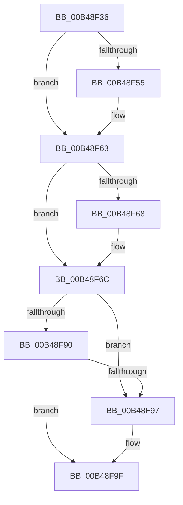

# sub_00B48F36

- RVA: `0x00B48F36`–`0x00B48FD3` (길이 `157` bytes)
- VA: `0x0000000140B48F36`
- 실행 섹션: `PAGE`
- PDB 이름 있음: `아니요`; PDB Function 태그: `아니요`
- unwind 정보 RVA: `0x000BA878`
- 디코드: `43`개 명령, `157/157` bytes 표시
- 미해석 바이트: `0` (있으면 어셈블리에 `.byte`로 보존)

> 이 문서는 커널 이미지의 기계어와 PDB 기호를 분석해 생성했습니다. 4번과 5번은 함수 원형과 자료형을 바이너리 사용 방식에서 추정한 C 해석이며 원본 소스 복구 결과는 아닙니다.

## 1. Dependencies

- 직접 호출 지점: **7**; 고유 호출 대상: **6**
- 직접 호출자로 확인된 함수: **0**
- RIP 상대 이미지 참조: **0**

### Outgoing calls
- `0x00B48F45` → [KeAbPreAcquire](../../text/21/KeAbPreAcquire_function_00210230.md) (function, `0x00210230`)
- `0x00B48F5E` → [ExfAcquirePushLockExclusiveEx](../../text/20/ExfAcquirePushLockExclusiveEx_function_0020FC90.md) (function, `0x0020FC90`)
- `0x00B48F9A` → [ExfReleasePushLock](../../text/26/ExfReleasePushLock_function_002638D0.md) (function, `0x002638D0`)
- `0x00B48FA2` → [KeAbPostRelease](../../text/2E/KeAbPostRelease_function_002E1600.md) (function, `0x002E1600`)
- `0x00B48FAF` → [EtwpSynchronizeWithLogger](../A6/EtwpSynchronizeWithLogger_function_00A66250.md) (function, `0x00A66250`)
- `0x00B48FBE` → [EtwpSynchronizeWithLogger](../A6/EtwpSynchronizeWithLogger_function_00A66250.md) (function, `0x00A66250`)
- `0x00B48FC8` → [EtwpReleaseLoggerContext](../A0/EtwpReleaseLoggerContext_function_00A04160.md) (function, `0x00A04160`)

### Direct callers
- 이 함수 시작 RVA로 연결되는 직접 call은 확인되지 않았습니다. 간접 호출은 완전히 역산할 수 없습니다.

### Static image references
- 디코드된 RIP-relative 메모리 참조가 없습니다.

## 2. Other-region calls and transfers

- 다른 실행 섹션으로 향하는 call: **4**
  - `0x00B48F45` → [KeAbPreAcquire](../../text/21/KeAbPreAcquire_function_00210230.md) (`PAGE` → `.text`)
  - `0x00B48F5E` → [ExfAcquirePushLockExclusiveEx](../../text/20/ExfAcquirePushLockExclusiveEx_function_0020FC90.md) (`PAGE` → `.text`)
  - `0x00B48F9A` → [ExfReleasePushLock](../../text/26/ExfReleasePushLock_function_002638D0.md) (`PAGE` → `.text`)
  - `0x00B48FA2` → [KeAbPostRelease](../../text/2E/KeAbPostRelease_function_002E1600.md) (`PAGE` → `.text`)
- call이 아닌 외부 분기/꼬리 이동: **1**
  - `0x00B48FCE` → [EtwpRealtimeDisconnectConsumer + 0x27](../A9/EtwpRealtimeDisconnectConsumer_function_00A9E3D0.md) (`tail-transfer`)

## 3. Assembly (complete function range)

```asm
00B48F36  48 8D 98 B0 02 00 00            lea rbx, [rax + 0x2b0]
00B48F3D  45 33 C0                        xor r8d, r8d
00B48F40  48 8B CB                        mov rcx, rbx
00B48F43  33 D2                           xor edx, edx
00B48F45  E8 E6 72 6C FF                  call 0x140210230
00B48F4A  F0 48 0F BA 2B 00               lock bts qword ptr [rbx], 0
00B48F50  48 8B E8                        mov rbp, rax
00B48F53  73 0E                           jae 0x140b48f63
00B48F55  4C 8B C3                        mov r8, rbx
00B48F58  48 8B D0                        mov rdx, rax
00B48F5B  48 8B CB                        mov rcx, rbx
00B48F5E  E8 2D 6D 6C FF                  call 0x14020fc90
00B48F63  48 85 ED                        test rbp, rbp
00B48F66  74 04                           je 0x140b48f6c
00B48F68  C6 45 0A 01                     mov byte ptr [rbp + 0xa], 1
00B48F6C  48 89 BE 60 01 00 00            mov qword ptr [rsi + 0x160], rdi
00B48F73  0F 0D 0B                        prefetchw byte ptr [rbx]
00B48F76  48 8B 03                        mov rax, qword ptr [rbx]
00B48F79  48 8B C8                        mov rcx, rax
00B48F7C  48 83 E1 F0                     and rcx, 0xfffffffffffffff0
00B48F80  48 83 F9 10                     cmp rcx, 0x10
00B48F84  48 8D 50 F0                     lea rdx, [rax - 0x10]
00B48F88  49 0F 46 D6                     cmovbe rdx, r14
00B48F8C  A8 02                           test al, 2
00B48F8E  75 07                           jne 0x140b48f97
00B48F90  F0 48 0F B1 13                  lock cmpxchg qword ptr [rbx], rdx
00B48F95  74 08                           je 0x140b48f9f
00B48F97  48 8B CB                        mov rcx, rbx
00B48F9A  E8 31 A9 71 FF                  call 0x1402638d0
00B48F9F  48 8B CB                        mov rcx, rbx
00B48FA2  E8 59 86 79 FF                  call 0x1402e1600
00B48FA7  BA 10 00 00 00                  mov edx, 0x10
00B48FAC  48 8B CE                        mov rcx, rsi
00B48FAF  E8 9C D2 F1 FF                  call 0x140a66250
00B48FB4  BA 04 00 00 00                  mov edx, 4
00B48FB9  48 8B CE                        mov rcx, rsi
00B48FBC  8B D8                           mov ebx, eax
00B48FBE  E8 8D D2 F1 FF                  call 0x140a66250
00B48FC3  B2 01                           mov dl, 1
00B48FC5  48 8B CE                        mov rcx, rsi
00B48FC8  E8 93 B1 EB FF                  call 0x140a04160
00B48FCD  90                              nop
00B48FCE  E9 24 54 F5 FF                  jmp 0x140a9e3f7
```

## 4. C-style interpretation (structured pseudocode)

```c
__int64 __fastcall sub_00B48F36(__int64 a1, int a2, int a3)
{
    __int64 result;

    a3 = 0;
    a2 = 0;
    result = KeAbPreAcquire(result + 688, a2, a3, a4);
    if (!(condition_is_above_or_equal)) {
        a3 = result + 688;
        a2 = result;
        a1 = result + 688;
        result = ExfAcquirePushLockExclusiveEx(a1, a2, a3, a4);
    }
    if (result != 0) {
        *(unsigned __int8 *)(result + 10) = 1;
    }
    *(unsigned __int64 *)(v_rsi + 352) = v_rdi;
    a1 = (*(unsigned __int64 *)(result + 688)) & (-16);
    a2 = *(unsigned __int64 *)(result + 688) - 16;
    if (a1 <= 16) { a2 = v_r14; }
    if ((((unsigned __int8)(*(unsigned __int64 *)(result + 688))) & (2)) != 0) goto loc_00B48F97;
    result = *(unsigned __int64 *)(result + 688);
    if ((((unsigned __int8)(*(unsigned __int64 *)(result + 688))) & (2)) != 0) {
        a1 = result + 688;
        result = ExfReleasePushLock(a1, a2, a3, a4);
    }
    result = KeAbPostRelease(result + 688, a2, a3, a4);
    result = EtwpSynchronizeWithLogger(v_rsi, 16, a3, a4);
    result = EtwpSynchronizeWithLogger(v_rsi, 4, a3, a4);
    result = EtwpReleaseLoggerContext(v_rsi, 1, a3, a4);
}
```

## 5. (Beta) C Style

```c
int64_t sub_00B48F36(int64_t Arg1, int32_t Arg2, int32_t Arg3)
{
    int64_t result;

    Arg3 = 0;
    Arg2 = 0;
    result = KeAbPreAcquire(result + 688, Arg2, Arg3, a4);
    if (!(condition_is_above_or_equal)) {
        Arg3 = result + 688;
        Arg2 = result;
        Arg1 = result + 688;
        result = ExfAcquirePushLockExclusiveEx(Arg1, Arg2, Arg3, a4);
    }
    if (result != 0) {
        *(uint8_t *)(result + 0xA) = 1;
    }
    *(uint64_t *)(local_rsi + 0x160) = local_rdi;
    Arg1 = (*(uint64_t *)(result + 0x2B0)) & (-16);
    Arg2 = *(uint64_t *)(result + 0x2B0) - 16;
    if (Arg1 <= 16) { Arg2 = local_r14; }
    if ((((uint8_t)(*(uint64_t *)(result + 0x2B0))) & (2)) != 0) goto loc_00B48F97;
    result = *(uint64_t *)(result + 0x2B0);
    if ((((uint8_t)(*(uint64_t *)(result + 0x2B0))) & (2)) != 0) {
        Arg1 = result + 688;
        result = ExfReleasePushLock(Arg1, Arg2, Arg3, a4);
    }
    result = KeAbPostRelease(result + 688, Arg2, Arg3, a4);
    result = EtwpSynchronizeWithLogger(local_rsi, 16, Arg3, a4);
    result = EtwpSynchronizeWithLogger(local_rsi, 4, Arg3, a4);
    result = EtwpReleaseLoggerContext(local_rsi, 1, Arg3, a4);
}
```

## 6. Execution-region graph

[열기: 2D/3D 그래프와 함수 탐색 컨트롤 패널](../../../control-panel.html?section=page&rva=0x00B48F36&view=graph)

- 2D 그래프는 위에서 아래로 흐르고, 3D 그래프는 빈 공간을 드래그해 회전합니다. Shift+드래그는 이동, 휠은 확대·축소, 함수 노드 선택은 대상 보고서 이동입니다.

### Static fallback


