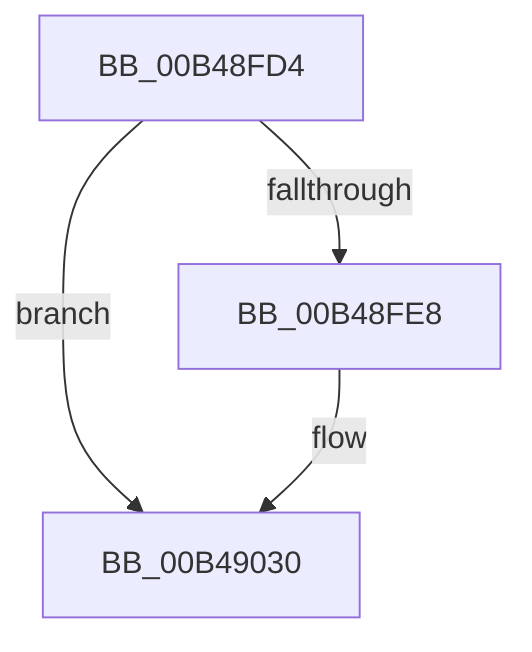

# sub_00B48FD4

- RVA: `0x00B48FD4`–`0x00B49047` (길이 `115` bytes)
- VA: `0x0000000140B48FD4`
- 실행 섹션: `PAGE`
- PDB 이름 있음: `아니요`; PDB Function 태그: `아니요`
- unwind 정보 RVA: `0x000BA888`
- 디코드: `24`개 명령, `115/115` bytes 표시
- 미해석 바이트: `0` (있으면 어셈블리에 `.byte`로 보존)

> 이 문서는 커널 이미지의 기계어와 PDB 기호를 분석해 생성했습니다. 4번과 5번은 함수 원형과 자료형을 바이너리 사용 방식에서 추정한 C 해석이며 원본 소스 복구 결과는 아닙니다.

## 1. Dependencies

- 직접 호출 지점: **4**; 고유 호출 대상: **4**
- 직접 호출자로 확인된 함수: **0**
- RIP 상대 이미지 참조: **1**

### Outgoing calls
- `0x00B48FD4` → [PspUnlinkSessionId](../78/PspUnlinkSessionId_function_007895D8.md) (function, `0x007895D8`)
- `0x00B4902B` → [EtwTraceKernelEvent](../../text/23/EtwTraceKernelEvent_function_00235350.md) (function, `0x00235350`)
- `0x00B49032` → [PspFreeSessionId](../78/PspFreeSessionId_function_007890B8.md) (function, `0x007890B8`)
- `0x00B4903C` → [ExFreePoolWithTag](../../poolcode/B8/ExFreePoolWithTag_function_00B82870.md) (function, `0x00B82870`)

### Direct callers
- 이 함수 시작 RVA로 연결되는 직접 call은 확인되지 않았습니다. 간접 호출은 완전히 역산할 수 없습니다.

### Static image references
- `0x00B48FD9` → RVA `0x00FC6B04` (`ALMOSTRO`; read)

## 2. Other-region calls and transfers

- 다른 실행 섹션으로 향하는 call: **2**
  - `0x00B4902B` → [EtwTraceKernelEvent](../../text/23/EtwTraceKernelEvent_function_00235350.md) (`PAGE` → `.text`)
  - `0x00B4903C` → [ExFreePoolWithTag](../../poolcode/B8/ExFreePoolWithTag_function_00B82870.md) (`PAGE` → `POOLCODE`)
- call이 아닌 외부 분기/꼬리 이동: **1**
  - `0x00B49042` → [PspReleaseReferenceToSession + 0x2D](../A9/PspReleaseReferenceToSession_function_00A9E444.md) (`tail-transfer`)

## 3. Assembly (complete function range)

```asm
00B48FD4  E8 FF 05 C4 FF                  call 0x1407895d8
00B48FD9  F7 05 21 DB 47 00 00 00 40 00   test dword ptr [rip + 0x47db21], 0x400000
00B48FE3  8B 7B 08                        mov edi, dword ptr [rbx + 8]
00B48FE6  74 48                           je 0x140b49030
00B48FE8  83 64 24 3C 00                  and dword ptr [rsp + 0x3c], 0
00B48FED  48 8D 44 24 30                  lea rax, [rsp + 0x30]
00B48FF2  83 64 24 4C 00                  and dword ptr [rsp + 0x4c], 0
00B48FF7  48 8D 4C 24 40                  lea rcx, [rsp + 0x40]
00B48FFC  41 B9 4E 02 00 00               mov r9d, 0x24e
00B49002  48 89 44 24 40                  mov qword ptr [rsp + 0x40], rax
00B49007  BA 01 00 00 00                  mov edx, 1
00B4900C  89 7C 24 38                     mov dword ptr [rsp + 0x38], edi
00B49010  41 B8 00 00 40 20               mov r8d, 0x20400000
00B49016  48 89 5C 24 30                  mov qword ptr [rsp + 0x30], rbx
00B4901B  C7 44 24 48 0C 00 00 00         mov dword ptr [rsp + 0x48], 0xc
00B49023  C7 44 24 20 02 18 50 00         mov dword ptr [rsp + 0x20], 0x501802
00B4902B  E8 20 C3 6E FF                  call 0x140235350
00B49030  8B CF                           mov ecx, edi
00B49032  E8 81 00 C4 FF                  call 0x1407890b8
00B49037  33 D2                           xor edx, edx
00B49039  48 8B CB                        mov rcx, rbx
00B4903C  E8 2F 98 03 00                  call 0x140b82870
00B49041  90                              nop
00B49042  E9 2A 54 F5 FF                  jmp 0x140a9e471
```

## 4. C-style interpretation (structured pseudocode)

```c
__int64 __fastcall sub_00B48FD4(__int64 a1, __int64 a2, __int64 a3, __int64 a4, __int64 a5, __int64 a6, __int64 a7, __int64 a8)
{
    __int64 result;
    unsigned int v_stack_p20;
    unsigned __int64 v_stack_p30;
    unsigned int v_stack_p38;
    unsigned int v_stack_p3C;
    unsigned __int64 v_stack_p40;
    unsigned int v_stack_p48;
    unsigned int v_stack_p4C;

    result = PspUnlinkSessionId(a1, a2, a3, a4);
    if (((*(unsigned int *)(v_rip + 4709153)) & (0x400000ULL)) != 0) {
        result = a6;
        a1 = a8;
        a4 = 590;
        v_stack_p40 = result;
        a2 = 1;
        v_stack_p38 = (unsigned int)((unsigned int)(*(unsigned int *)(v_rbx + 8)));
        a3 = 0x20400000ULL;
        v_stack_p30 = v_rbx;
        v_stack_p48 = 12;
        v_stack_p20 = 0x501802ULL;
        result = EtwTraceKernelEvent(a1, a2, a3, a4);
    }
    result = PspFreeSessionId((unsigned int)((unsigned int)((unsigned int)(*(unsigned int *)(v_rbx + 8)))), a2, a3, a4);
    a2 = 0;
    result = ExFreePoolWithTag(v_rbx, a2, a3, a4);
}
```

## 5. (Beta) C Style

```c
int64_t sub_00B48FD4(int64_t Arg1, int64_t Arg2, int64_t Arg3, int64_t Arg4, uint64_t Arg5, int64_t Arg6, uint64_t Arg7, int64_t Arg8)
{
    int64_t result;
    uint32_t v_stack_p20;
    uint64_t v_stack_p30;
    uint32_t v_stack_p38;
    uint32_t v_stack_p3C;
    uint64_t v_stack_p40;
    uint32_t v_stack_p48;
    uint32_t v_stack_p4C;

    result = PspUnlinkSessionId(Arg1, Arg2, Arg3, Arg4);
    if (((*(uint32_t *)(v_rip + 0x47DB21)) & (0x400000ULL)) != 0) {
        result = Arg6;
        Arg1 = Arg8;
        Arg4 = 590;
        v_stack_p40 = result;
        Arg2 = 1;
        v_stack_p38 = (uint32_t)((uint32_t)(*(uint32_t *)(local_rbx + 0x8)));
        Arg3 = 0x20400000ULL;
        v_stack_p30 = local_rbx;
        v_stack_p48 = 12;
        v_stack_p20 = 0x501802ULL;
        result = EtwTraceKernelEvent(Arg1, Arg2, Arg3, Arg4);
    }
    result = PspFreeSessionId((uint32_t)((uint32_t)((uint32_t)(*(uint32_t *)(local_rbx + 0x8)))), Arg2, Arg3, Arg4);
    Arg2 = 0;
    result = ExFreePoolWithTag(local_rbx, Arg2, Arg3, Arg4);
}
```

## 6. Execution-region graph

[열기: 2D/3D 그래프와 함수 탐색 컨트롤 패널](../../../control-panel.html?section=page&rva=0x00B48FD4&view=graph)

- 2D 그래프는 위에서 아래로 흐르고, 3D 그래프는 빈 공간을 드래그해 회전합니다. Shift+드래그는 이동, 휠은 확대·축소, 함수 노드 선택은 대상 보고서 이동입니다.

### Static fallback


