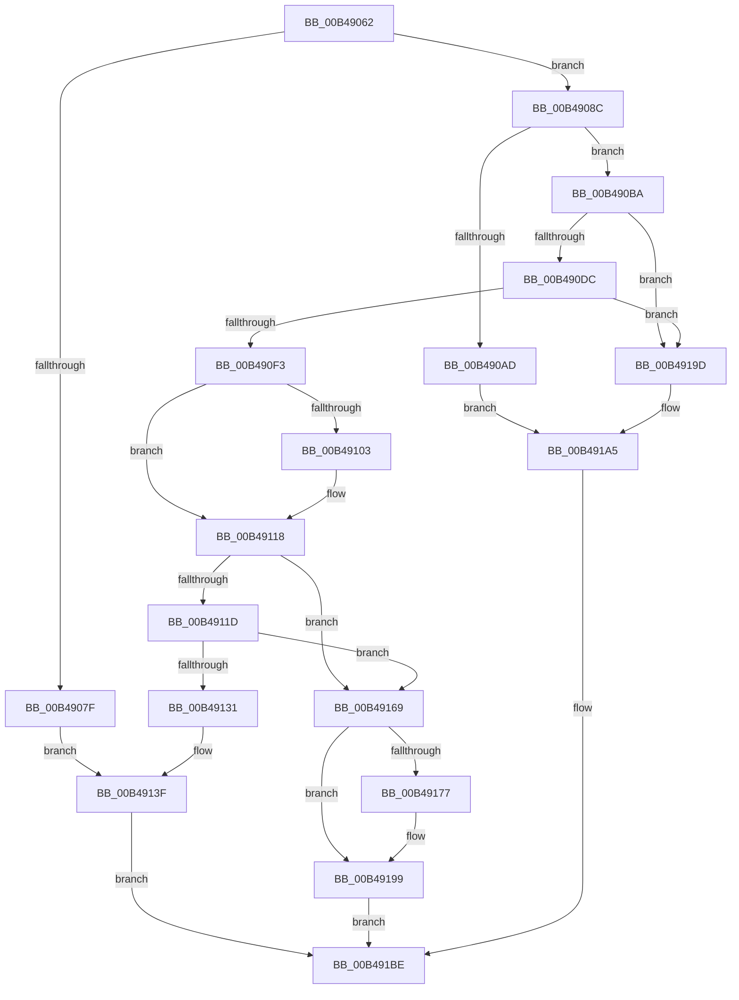

# sub_00B49062

- RVA: `0x00B49062`–`0x00B491CE` (길이 `364` bytes)
- VA: `0x0000000140B49062`
- 실행 섹션: `PAGE`
- PDB 이름 있음: `아니요`; PDB Function 태그: `아니요`
- unwind 정보 RVA: `0x000BA920`
- 디코드: `93`개 명령, `364/364` bytes 표시
- 미해석 바이트: `0` (있으면 어셈블리에 `.byte`로 보존)

> 이 문서는 커널 이미지의 기계어와 PDB 기호를 분석해 생성했습니다. 4번과 5번은 함수 원형과 자료형을 바이너리 사용 방식에서 추정한 C 해석이며 원본 소스 복구 결과는 아닙니다.

## 1. Dependencies

- 직접 호출 지점: **13**; 고유 호출 대상: **11**
- 직접 호출자로 확인된 함수: **0**
- RIP 상대 이미지 참조: **0**

### Outgoing calls
- `0x00B49074` → [CmpPerformTrustClassAccessCheck](../../text/46/CmpPerformTrustClassAccessCheck_function_0046EF30.md) (function, `0x0046EF30`)
- `0x00B490A4` → [CmpIsHiveAlreadyLoaded](../7E/CmpIsHiveAlreadyLoaded_function_007EA594.md) (function, `0x007EA594`)
- `0x00B490F7` → [CmpLockKcbExclusive](../86/CmpLockKcbExclusive_function_00861EB0.md) (function, `0x00861EB0`)
- `0x00B49107` → [CmpReferenceKeyControlBlock](../85/CmpReferenceKeyControlBlock_function_0085D370.md) (function, `0x0085D370`)
- `0x00B49123` → [CmpRecordUnloadEventForHive](../7E/CmpRecordUnloadEventForHive_function_007EA6CC.md) (function, `0x007EA6CC`)
- `0x00B49135` → [CmpUnlockKcb](../../pagecmrc/BC/CmpUnlockKcb_function_00BC92C0.md) (function, `0x00BC92C0`)
- `0x00B49151` → [SetFailureLocation](../../text/46/SetFailureLocation_function_0046EF54.md) (function, `0x0046EF54`)
- `0x00B4916D` → [CmpUnlockKcb](../../pagecmrc/BC/CmpUnlockKcb_function_00BC92C0.md) (function, `0x00BC92C0`)
- `0x00B4917A` → [CmpUnJoinClassOfTrust](../../text/4A/CmpUnJoinClassOfTrust_function_004A27C0.md) (function, `0x004A27C0`)
- `0x00B49194` → [CmpJoinClassOfTrust](../../text/46/CmpJoinClassOfTrust_function_0046EEB4.md) (function, `0x0046EEB4`)
- `0x00B491B9` → [SetFailureLocation](../../text/46/SetFailureLocation_function_0046EF54.md) (function, `0x0046EF54`)
- `0x00B491BE` → [CmpUnlockRegistry](../../pagecmrc/BC/CmpUnlockRegistry_function_00BC9A84.md) (function, `0x00BC9A84`)
- `0x00B491C3` → [UNLOCK_HIVE_LOAD](../9B/UNLOCK_HIVE_LOAD_function_009B2EBC.md) (function, `0x009B2EBC`)

### Direct callers
- 이 함수 시작 RVA로 연결되는 직접 call은 확인되지 않았습니다. 간접 호출은 완전히 역산할 수 없습니다.

### Static image references
- 디코드된 RIP-relative 메모리 참조가 없습니다.

## 2. Other-region calls and transfers

- 다른 실행 섹션으로 향하는 call: **8**
  - `0x00B49074` → [CmpPerformTrustClassAccessCheck](../../text/46/CmpPerformTrustClassAccessCheck_function_0046EF30.md) (`PAGE` → `.text`)
  - `0x00B49135` → [CmpUnlockKcb](../../pagecmrc/BC/CmpUnlockKcb_function_00BC92C0.md) (`PAGE` → `PAGECMRC`)
  - `0x00B49151` → [SetFailureLocation](../../text/46/SetFailureLocation_function_0046EF54.md) (`PAGE` → `.text`)
  - `0x00B4916D` → [CmpUnlockKcb](../../pagecmrc/BC/CmpUnlockKcb_function_00BC92C0.md) (`PAGE` → `PAGECMRC`)
  - `0x00B4917A` → [CmpUnJoinClassOfTrust](../../text/4A/CmpUnJoinClassOfTrust_function_004A27C0.md) (`PAGE` → `.text`)
  - `0x00B49194` → [CmpJoinClassOfTrust](../../text/46/CmpJoinClassOfTrust_function_0046EEB4.md) (`PAGE` → `.text`)
  - `0x00B491B9` → [SetFailureLocation](../../text/46/SetFailureLocation_function_0046EF54.md) (`PAGE` → `.text`)
  - `0x00B491BE` → [CmpUnlockRegistry](../../pagecmrc/BC/CmpUnlockRegistry_function_00BC9A84.md) (`PAGE` → `PAGECMRC`)
- call이 아닌 외부 분기/꼬리 이동: **1**
  - `0x00B491C9` → [CmpResolveHiveLoadConflict + 0xC8](../A9/CmpResolveHiveLoadConflict_function_00A9E78C.md) (`tail-transfer`)

## 3. Assembly (complete function range)

```asm
00B49062  48 8B 47 08                     mov rax, qword ptr [rdi + 8]
00B49066  8A 94 24 B0 02 00 00            mov dl, byte ptr [rsp + 0x2b0]
00B4906D  4C 8B 78 20                     mov r15, qword ptr [rax + 0x20]
00B49071  49 8B CF                        mov rcx, r15
00B49074  E8 B7 5E 92 FF                  call 0x14046ef30
00B49079  8B F8                           mov edi, eax
00B4907B  85 C0                           test eax, eax
00B4907D  79 0D                           jns 0x140b4908c
00B4907F  44 8B F0                        mov r14d, eax
00B49082  B8 20 00 00 00                  mov eax, 0x20
00B49087  E9 B3 00 00 00                  jmp 0x140b4913f
00B4908C  48 8B 44 24 50                  mov rax, qword ptr [rsp + 0x50]
00B49091  4C 8D 4C 24 48                  lea r9, [rsp + 0x48]
00B49096  45 8B C6                        mov r8d, r14d
00B49099  48 89 44 24 20                  mov qword ptr [rsp + 0x20], rax
00B4909E  49 8B D5                        mov rdx, r13
00B490A1  48 8B CE                        mov rcx, rsi
00B490A4  E8 EB 14 CA FF                  call 0x1407ea594
00B490A9  84 C0                           test al, al
00B490AB  75 0D                           jne 0x140b490ba
00B490AD  C7 44 24 20 30 00 00 00         mov dword ptr [rsp + 0x20], 0x30
00B490B5  E9 EB 00 00 00                  jmp 0x140b491a5
00B490BA  48 8B 5C 24 48                  mov rbx, qword ptr [rsp + 0x48]
00B490BF  8B 93 A0 00 00 00               mov edx, dword ptr [rbx + 0xa0]
00B490C5  0F BA E2 0F                     bt edx, 0xf
00B490C9  0F 92 C1                        setb cl
00B490CC  41 0F BA E6 0D                  bt r14d, 0xd
00B490D1  0F 93 C0                        setae al
00B490D4  84 C8                           test al, cl
00B490D6  0F 85 C1 00 00 00               jne 0x140b4919d
00B490DC  0F BA E2 0F                     bt edx, 0xf
00B490E0  0F 93 C1                        setae cl
00B490E3  41 0F BA E6 0D                  bt r14d, 0xd
00B490E8  0F 92 C0                        setb al
00B490EB  84 C8                           test al, cl
00B490ED  0F 85 AA 00 00 00               jne 0x140b4919d
00B490F3  48 8B 4E 08                     mov rcx, qword ptr [rsi + 8]
00B490F7  E8 B4 8D D1 FF                  call 0x140861eb0
00B490FC  41 0F BA E6 0B                  bt r14d, 0xb
00B49101  73 15                           jae 0x140b49118
00B49103  48 8B 4E 08                     mov rcx, qword ptr [rsi + 8]
00B49107  E8 64 42 D1 FF                  call 0x14085d370
00B4910C  48 8B 4C 24 58                  mov rcx, qword ptr [rsp + 0x58]
00B49111  48 8B 46 08                     mov rax, qword ptr [rsi + 8]
00B49115  48 89 01                        mov qword ptr [rcx], rax
00B49118  4D 85 E4                        test r12, r12
00B4911B  74 4C                           je 0x140b49169
00B4911D  49 8B D4                        mov rdx, r12
00B49120  48 8B CB                        mov rcx, rbx
00B49123  E8 A4 15 CA FF                  call 0x1407ea6cc
00B49128  8B F8                           mov edi, eax
00B4912A  44 8B F0                        mov r14d, eax
00B4912D  85 C0                           test eax, eax
00B4912F  79 38                           jns 0x140b49169
00B49131  48 8B 4E 08                     mov rcx, qword ptr [rsi + 8]
00B49135  E8 86 01 08 00                  call 0x140bc92c0
00B4913A  B8 50 00 00 00                  mov eax, 0x50
00B4913F  41 B8 21 00 00 00               mov r8d, 0x21
00B49145  33 D2                           xor edx, edx
00B49147  45 8B CE                        mov r9d, r14d
00B4914A  89 44 24 20                     mov dword ptr [rsp + 0x20], eax
00B4914E  48 8B CD                        mov rcx, rbp
00B49151  E8 FE 5D 92 FF                  call 0x14046ef54
00B49156  BB 25 02 00 C0                  mov ebx, 0xc0000225
00B4915B  B8 01 00 00 C0                  mov eax, 0xc0000001
00B49160  3B FB                           cmp edi, ebx
00B49162  0F 44 F8                        cmove edi, eax
00B49165  8B DF                           mov ebx, edi
00B49167  EB 55                           jmp 0x140b491be
00B49169  48 8B 4E 08                     mov rcx, qword ptr [rsi + 8]
00B4916D  E8 4E 01 08 00                  call 0x140bc92c0
00B49172  4D 85 FF                        test r15, r15
00B49175  74 22                           je 0x140b49199
00B49177  48 8B CB                        mov rcx, rbx
00B4917A  E8 41 96 95 FF                  call 0x1404a27c0
00B4917F  44 8A 84 24 B0 02 00 00         mov r8b, byte ptr [rsp + 0x2b0]
00B49187  49 8B D7                        mov rdx, r15
00B4918A  83 8B 10 10 00 00 01            or dword ptr [rbx + 0x1010], 1
00B49191  48 8B CB                        mov rcx, rbx
00B49194  E8 1B 5D 92 FF                  call 0x14046eeb4
00B49199  33 DB                           xor ebx, ebx
00B4919B  EB 21                           jmp 0x140b491be
00B4919D  C7 44 24 20 40 00 00 00         mov dword ptr [rsp + 0x20], 0x40
00B491A5  41 B9 43 00 00 C0               mov r9d, 0xc0000043
00B491AB  41 8B D9                        mov ebx, r9d
00B491AE  41 B8 21 00 00 00               mov r8d, 0x21
00B491B4  33 D2                           xor edx, edx
00B491B6  48 8B CD                        mov rcx, rbp
00B491B9  E8 96 5D 92 FF                  call 0x14046ef54
00B491BE  E8 C1 08 08 00                  call 0x140bc9a84
00B491C3  E8 F4 9C E6 FF                  call 0x1409b2ebc
00B491C8  90                              nop
00B491C9  E9 86 56 F5 FF                  jmp 0x140a9e854
```

## 4. C-style interpretation (structured pseudocode)

```c
__int64 __fastcall sub_00B49062(__int64 a1, __int64 a2, __int64 a3, __int64 a4, __int64 a5, __int64 a6, __int64 a7, __int64 a8, __int64 a9, __int64 a10, __int64 a11, __int64 a12, __int64 a13, __int64 a14, __int64 a15, __int64 a16, __int64 a17, __int64 a18, __int64 a19, __int64 a20, __int64 a21, __int64 a22, __int64 a23, __int64 a24, __int64 a25, __int64 a26, __int64 a27, __int64 a28, __int64 a29, __int64 a30, __int64 a31, __int64 a32, __int64 a33, __int64 a34, __int64 a35, __int64 a36, __int64 a37, __int64 a38, __int64 a39, __int64 a40, __int64 a41, __int64 a42, __int64 a43, __int64 a44, __int64 a45, __int64 a46, __int64 a47, __int64 a48, __int64 a49, __int64 a50, __int64 a51, __int64 a52, __int64 a53, __int64 a54, __int64 a55, __int64 a56, __int64 a57, __int64 a58, __int64 a59, __int64 a60, __int64 a61, __int64 a62, __int64 a63, __int64 a64, __int64 a65, __int64 a66, __int64 a67, __int64 a68, __int64 a69, __int64 a70, __int64 a71, __int64 a72, __int64 a73, __int64 a74, __int64 a75, __int64 a76, __int64 a77, __int64 a78, __int64 a79, __int64 a80, __int64 a81, __int64 a82, __int64 a83, __int64 a84, __int64 a85, unsigned __int8 a86)
{
    __int64 result;
    __int64 v_rbx;
    __int64 v_rdi;
    unsigned __int64 v_stack_p20;

    result = CmpPerformTrustClassAccessCheck(*(unsigned __int64 *)(*(unsigned __int64 *)(v_rdi + 8) + 32), a86, a3, a4);
    if (!sign_flag) goto loc_00B4908C;
    goto loc_00B4913F;
loc_00B4908C:
    v_stack_p20 = a10;
    result = CmpIsHiveAlreadyLoaded(v_rsi, v_r13, (unsigned int)((unsigned int)((unsigned int)((unsigned int)(result)))), a9);
    if ((unsigned __int8)(result) != 0) goto loc_00B490BA;
    v_stack_p20 = 48;
    goto loc_00B491A5;
loc_00B490BA:
    a1 = (condition_is_below) ? 1 : 0;
    result = (condition_is_above_or_equal) ? 1 : 0;
    if ((((unsigned __int8)(result)) & ((unsigned __int8)(a1))) != 0) goto loc_00B4919D;
    a1 = (condition_is_above_or_equal) ? 1 : 0;
    result = (condition_is_below) ? 1 : 0;
    if ((((unsigned __int8)(result)) & ((unsigned __int8)(a1))) != 0) goto loc_00B4919D;
    result = CmpLockKcbExclusive(*(unsigned __int64 *)(v_rsi + 8), (unsigned int)(*(unsigned int *)(a9 + 160)), (unsigned int)((unsigned int)((unsigned int)((unsigned int)(result)))), a9);
    if (!(condition_is_above_or_equal)) {
        a1 = *(unsigned __int64 *)(v_rsi + 8);
        result = CmpReferenceKeyControlBlock(a1, (unsigned int)(*(unsigned int *)(a9 + 160)), (unsigned int)((unsigned int)((unsigned int)((unsigned int)(result)))), a9);
        a1 = a11;
        result = *(unsigned __int64 *)(v_rsi + 8);
        *(unsigned __int64 *)(a1) = result;
    }
    if (v_r12 == 0) goto loc_00B49169;
    result = CmpRecordUnloadEventForHive(a9, v_r12, (unsigned int)((unsigned int)((unsigned int)((unsigned int)(result)))), a9);
    if (!sign_flag) goto loc_00B49169;
    result = CmpUnlockKcb(*(unsigned __int64 *)(v_rsi + 8), v_r12, (unsigned int)((unsigned int)((unsigned int)((unsigned int)(result)))), a9);
loc_00B4913F:
    a2 = 0;
    v_stack_p20 = 80;
    result = SetFailureLocation(v_rbp, a2, 33, (unsigned int)((unsigned int)((unsigned int)((unsigned int)(result)))));
    v_rdi = (unsigned int)((unsigned int)(result));
    if (((unsigned int)((unsigned int)((unsigned int)(result)))) == ((unsigned int)((unsigned int)(0xC0000225ULL)))) { v_rdi = (unsigned int)((unsigned int)(0xC0000001ULL)); }
    goto loc_00B491BE;
loc_00B49169:
    result = CmpUnlockKcb(*(unsigned __int64 *)(v_rsi + 8), a2, 33, (unsigned int)((unsigned int)((unsigned int)((unsigned int)(result)))));
    if (*(unsigned __int64 *)(*(unsigned __int64 *)(v_rdi + 8) + 32) != 0) {
        a1 = (unsigned int)((unsigned int)(v_rdi));
        result = CmpUnJoinClassOfTrust(a1, a2, 33, (unsigned int)((unsigned int)((unsigned int)((unsigned int)(result)))));
        a3 = a86;
        a2 = *(unsigned __int64 *)(*(unsigned __int64 *)(v_rdi + 8) + 32);
        a1 = (unsigned int)((unsigned int)(v_rdi));
        result = CmpJoinClassOfTrust(a1, a2, a3, (unsigned int)((unsigned int)((unsigned int)((unsigned int)(result)))));
    }
    v_rbx = 0;
    goto loc_00B491BE;
loc_00B4919D:
    v_stack_p20 = 64;
loc_00B491A5:
    a2 = 0;
    result = SetFailureLocation(v_rbp, a2, 33, (unsigned int)(0xC0000043ULL));
loc_00B491BE:
    result = CmpUnlockRegistry(v_rbp, a2, 33, (unsigned int)(0xC0000043ULL));
    result = UNLOCK_HIVE_LOAD(v_rbp, a2, 33, (unsigned int)(0xC0000043ULL));
}
```

## 5. (Beta) C Style

```c
int64_t sub_00B49062(int64_t Arg1, int64_t Arg2, int64_t Arg3, int64_t Arg4, uint64_t Arg5, uint64_t Arg6, uint64_t Arg7, uint64_t Arg8, void *Arg9, int64_t Arg10, void *Arg11, uint64_t Arg12, uint64_t Arg13, uint64_t Arg14, uint64_t Arg15, uint64_t Arg16, uint64_t Arg17, uint64_t Arg18, uint64_t Arg19, uint64_t Arg20, uint64_t Arg21, uint64_t Arg22, uint64_t Arg23, uint64_t Arg24, uint64_t Arg25, uint64_t Arg26, uint64_t Arg27, uint64_t Arg28, uint64_t Arg29, uint64_t Arg30, uint64_t Arg31, uint64_t Arg32, uint64_t Arg33, uint64_t Arg34, uint64_t Arg35, uint64_t Arg36, uint64_t Arg37, uint64_t Arg38, uint64_t Arg39, uint64_t Arg40, uint64_t Arg41, uint64_t Arg42, uint64_t Arg43, uint64_t Arg44, uint64_t Arg45, uint64_t Arg46, uint64_t Arg47, uint64_t Arg48, uint64_t Arg49, uint64_t Arg50, uint64_t Arg51, uint64_t Arg52, uint64_t Arg53, uint64_t Arg54, uint64_t Arg55, uint64_t Arg56, uint64_t Arg57, uint64_t Arg58, uint64_t Arg59, uint64_t Arg60, uint64_t Arg61, uint64_t Arg62, uint64_t Arg63, uint64_t Arg64, uint64_t Arg65, uint64_t Arg66, uint64_t Arg67, uint64_t Arg68, uint64_t Arg69, uint64_t Arg70, uint64_t Arg71, uint64_t Arg72, uint64_t Arg73, uint64_t Arg74, uint64_t Arg75, uint64_t Arg76, uint64_t Arg77, uint64_t Arg78, uint64_t Arg79, uint64_t Arg80, uint64_t Arg81, uint64_t Arg82, uint64_t Arg83, uint64_t Arg84, uint64_t Arg85, uint8_t Arg86)
{
    uint8_t *arg9 = (uint8_t *)Arg9;
    uint8_t *arg11 = (uint8_t *)Arg11;

    int64_t result;
    int64_t local_rbx;
    int64_t local_rdi;
    uint64_t v_stack_p20;

    result = CmpPerformTrustClassAccessCheck(*(uint64_t *)(*(uint64_t *)(local_rdi + 0x8) + 0x20), Arg86, Arg3, Arg4);
    if (!sign_flag) goto loc_00B4908C;
    goto loc_00B4913F;
loc_00B4908C:
    v_stack_p20 = Arg10;
    result = CmpIsHiveAlreadyLoaded(local_rsi, local_r13, (uint32_t)((uint32_t)((uint32_t)((uint32_t)(result)))), Arg9);
    if ((uint8_t)(result) != 0) goto loc_00B490BA;
    v_stack_p20 = 48;
    goto loc_00B491A5;
loc_00B490BA:
    Arg1 = (condition_is_below) ? 1 : 0;
    result = (condition_is_above_or_equal) ? 1 : 0;
    if ((((uint8_t)(result)) & ((uint8_t)(Arg1))) != 0) goto loc_00B4919D;
    Arg1 = (condition_is_above_or_equal) ? 1 : 0;
    result = (condition_is_below) ? 1 : 0;
    if ((((uint8_t)(result)) & ((uint8_t)(Arg1))) != 0) goto loc_00B4919D;
    result = CmpLockKcbExclusive(*(uint64_t *)(local_rsi + 0x8), (uint32_t)(*(uint32_t *)(arg9 + 0xA0)), (uint32_t)((uint32_t)((uint32_t)((uint32_t)(result)))), Arg9);
    if (!(condition_is_above_or_equal)) {
        Arg1 = *(uint64_t *)(local_rsi + 0x8);
        result = CmpReferenceKeyControlBlock(Arg1, (uint32_t)(*(uint32_t *)(arg9 + 0xA0)), (uint32_t)((uint32_t)((uint32_t)((uint32_t)(result)))), Arg9);
        Arg1 = Arg11;
        result = *(uint64_t *)(local_rsi + 0x8);
        *(uint64_t *)(Arg1) = result;
    }
    if (local_r12 == 0) goto loc_00B49169;
    result = CmpRecordUnloadEventForHive(Arg9, local_r12, (uint32_t)((uint32_t)((uint32_t)((uint32_t)(result)))), Arg9);
    if (!sign_flag) goto loc_00B49169;
    result = CmpUnlockKcb(*(uint64_t *)(local_rsi + 0x8), local_r12, (uint32_t)((uint32_t)((uint32_t)((uint32_t)(result)))), Arg9);
loc_00B4913F:
    Arg2 = 0;
    v_stack_p20 = 80;
    result = SetFailureLocation(local_rbp, Arg2, 33, (uint32_t)((uint32_t)((uint32_t)((uint32_t)(result)))));
    local_rdi = (uint32_t)((uint32_t)(result));
    if (((uint32_t)((uint32_t)((uint32_t)(result)))) == ((uint32_t)((uint32_t)(0xC0000225ULL)))) { local_rdi = (uint32_t)((uint32_t)(0xC0000001ULL)); }
    goto loc_00B491BE;
loc_00B49169:
    result = CmpUnlockKcb(*(uint64_t *)(local_rsi + 0x8), Arg2, 33, (uint32_t)((uint32_t)((uint32_t)((uint32_t)(result)))));
    if (*(uint64_t *)(*(uint64_t *)(local_rdi + 0x8) + 0x20) != 0) {
        Arg1 = (uint32_t)((uint32_t)(local_rdi));
        result = CmpUnJoinClassOfTrust(Arg1, Arg2, 33, (uint32_t)((uint32_t)((uint32_t)((uint32_t)(result)))));
        Arg3 = Arg86;
        Arg2 = *(uint64_t *)(*(uint64_t *)(local_rdi + 0x8) + 0x20);
        Arg1 = (uint32_t)((uint32_t)(local_rdi));
        result = CmpJoinClassOfTrust(Arg1, Arg2, Arg3, (uint32_t)((uint32_t)((uint32_t)((uint32_t)(result)))));
    }
    local_rbx = 0;
    goto loc_00B491BE;
loc_00B4919D:
    v_stack_p20 = 64;
loc_00B491A5:
    Arg2 = 0;
    result = SetFailureLocation(local_rbp, Arg2, 33, (uint32_t)(0xC0000043ULL));
loc_00B491BE:
    result = CmpUnlockRegistry(local_rbp, Arg2, 33, (uint32_t)(0xC0000043ULL));
    result = UNLOCK_HIVE_LOAD(local_rbp, Arg2, 33, (uint32_t)(0xC0000043ULL));
}
```

### 관측된 메모리 오프셋

구조체 형식이 확인되지 않은 접근은 인자 기준의 오프셋으로만 기록했습니다.

| 기준 인자 | 오프셋 표현 | 폭 (bit) | 접근 |
|---|---:|---:|---|
| `Arg9` | `+ 0xA0` | `32` | `R` |
| `Arg9` | `+ 0x1010` | `32` | `R/W` |
| `Arg11` | `+ 0x0` | `64` | `W` |

## 6. Execution-region graph

[열기: 2D/3D 그래프와 함수 탐색 컨트롤 패널](../../../control-panel.html?section=page&rva=0x00B49062&view=graph)

- 2D 그래프는 위에서 아래로 흐르고, 3D 그래프는 빈 공간을 드래그해 회전합니다. Shift+드래그는 이동, 휠은 확대·축소, 함수 노드 선택은 대상 보고서 이동입니다.

### Static fallback


