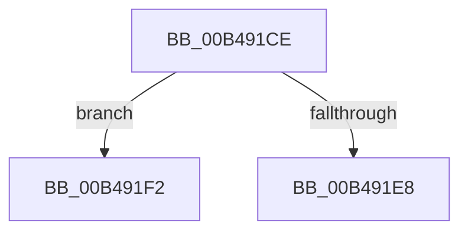

# sub_00B491CE

- RVA: `0x00B491CE`–`0x00B491FF` (길이 `49` bytes)
- VA: `0x0000000140B491CE`
- 실행 섹션: `PAGE`
- PDB 이름 있음: `아니요`; PDB Function 태그: `아니요`
- unwind 정보 RVA: `0x000BA950`
- 디코드: `13`개 명령, `49/49` bytes 표시
- 미해석 바이트: `0` (있으면 어셈블리에 `.byte`로 보존)

> 이 문서는 커널 이미지의 기계어와 PDB 기호를 분석해 생성했습니다. 4번과 5번은 함수 원형과 자료형을 바이너리 사용 방식에서 추정한 C 해석이며 원본 소스 복구 결과는 아닙니다.

## 1. Dependencies

- 직접 호출 지점: **0**; 고유 호출 대상: **0**
- 직접 호출자로 확인된 함수: **0**
- RIP 상대 이미지 참조: **0**

### Outgoing calls
- 직접 디코드된 call 명령이 없습니다.

### Direct callers
- 이 함수 시작 RVA로 연결되는 직접 call은 확인되지 않았습니다. 간접 호출은 완전히 역산할 수 없습니다.

### Static image references
- 디코드된 RIP-relative 메모리 참조가 없습니다.

## 2. Other-region calls and transfers

- 다른 실행 섹션으로 향하는 call: **0**
- call이 아닌 외부 분기/꼬리 이동: **2**
  - `0x00B491ED` → [MiSelectOverflowDllBase + 0x130](../A9/MiSelectOverflowDllBase_function_00A9E8E0.md) (`tail-transfer`)
  - `0x00B491FA` → [MiSelectOverflowDllBase + 0x133](../A9/MiSelectOverflowDllBase_function_00A9E8E0.md) (`tail-transfer`)

## 3. Assembly (complete function range)

```asm
00B491CE  F7 DF                           neg edi
00B491D0  48 1B C0                        sbb rax, rax
00B491D3  48 23 C2                        and rax, rdx
00B491D6  48 BA FF FF FE FF FF 7F 00 00   movabs rdx, 0x7ffffffeffff
00B491E0  48 03 C3                        add rax, rbx
00B491E3  48 3B C2                        cmp rax, rdx
00B491E6  77 0A                           ja 0x140b491f2
00B491E8  8B C1                           mov eax, ecx
00B491EA  48 2B D8                        sub rbx, rax
00B491ED  E9 1E 58 F5 FF                  jmp 0x140a9ea10
00B491F2  8B C1                           mov eax, ecx
00B491F4  48 05 00 00 01 00               add rax, 0x10000
00B491FA  E9 14 58 F5 FF                  jmp 0x140a9ea13
```

## 4. C-style interpretation (structured pseudocode)

```c
__int64 __fastcall sub_00B491CE(int a1, __int64 a2)
{
    __int64 result;
    __int64 v_rbx;
    __int64 v_rdi;

    v_rdi = (unsigned int)(-(v_rdi));
    result = (result) & (a2);
    result = (result) + (v_rbx);
    if (result > a2) goto loc_00B491F2;
    v_rbx = (v_rbx) - ((unsigned int)(a1));
loc_00B491F2:
    result = ((unsigned int)(a1)) + (0x10000ULL);
}
```

## 5. (Beta) C Style

```c
int64_t sub_00B491CE(int32_t Arg1, int64_t Arg2)
{
    int64_t result;
    int64_t local_rbx;
    int64_t local_rdi;

    local_rdi = (uint32_t)(-(local_rdi));
    result = (result) & (Arg2);
    result = (result) + (local_rbx);
    if (result > Arg2) goto loc_00B491F2;
    local_rbx = (local_rbx) - ((uint32_t)(Arg1));
loc_00B491F2:
    result = ((uint32_t)(Arg1)) + (0x10000ULL);
}
```

## 6. Execution-region graph

[열기: 2D/3D 그래프와 함수 탐색 컨트롤 패널](../../../control-panel.html?section=page&rva=0x00B491CE&view=graph)

- 2D 그래프는 위에서 아래로 흐르고, 3D 그래프는 빈 공간을 드래그해 회전합니다. Shift+드래그는 이동, 휠은 확대·축소, 함수 노드 선택은 대상 보고서 이동입니다.

### Static fallback


