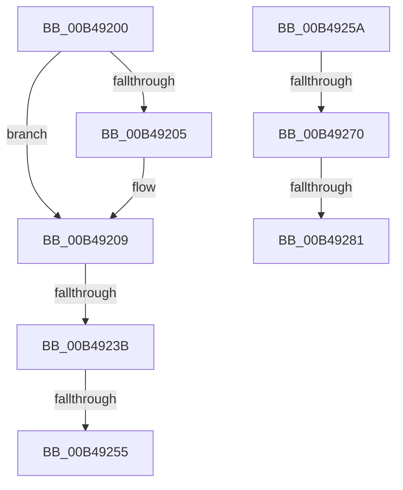

# sub_00B49200

- RVA: `0x00B49200`–`0x00B4928C` (길이 `140` bytes)
- VA: `0x0000000140B49200`
- 실행 섹션: `PAGE`
- PDB 이름 있음: `아니요`; PDB Function 태그: `아니요`
- unwind 정보 RVA: `0x000BAA44`
- 디코드: `35`개 명령, `140/140` bytes 표시
- 미해석 바이트: `0` (있으면 어셈블리에 `.byte`로 보존)

> 이 문서는 커널 이미지의 기계어와 PDB 기호를 분석해 생성했습니다. 4번과 5번은 함수 원형과 자료형을 바이너리 사용 방식에서 추정한 C 해석이며 원본 소스 복구 결과는 아닙니다.

## 1. Dependencies

- 직접 호출 지점: **5**; 고유 호출 대상: **5**
- 직접 호출자로 확인된 함수: **0**
- RIP 상대 이미지 참조: **1**

### Outgoing calls
- `0x00B4920E` → [MiAdjustSecureDriverStateForIatCapture](../../text/4B/MiAdjustSecureDriverStateForIatCapture_function_004BE864.md) (function, `0x004BE864`)
- `0x00B4922D` → [RtlImageDirectoryEntryToData](../../text/43/RtlImageDirectoryEntryToData_function_004328D0.md) (function, `0x004328D0`)
- `0x00B49246` → [VslCaptureSecureImageIat](../AB/VslCaptureSecureImageIat_function_00AB79F4.md) (function, `0x00AB79F4`)
- `0x00B49261` → [KeAbPostRelease](../../text/2E/KeAbPostRelease_function_002E1600.md) (function, `0x002E1600`)
- `0x00B49281` → [KiCheckForKernelApcDelivery](../../text/2E/KiCheckForKernelApcDelivery_function_002E2C80.md) (function, `0x002E2C80`)

### Direct callers
- 이 함수 시작 RVA로 연결되는 직접 call은 확인되지 않았습니다. 간접 호출은 완전히 역산할 수 없습니다.

### Static image references
- `0x00B4925A` → RVA `0x00E2D9A0` (`.data`; read)

## 2. Other-region calls and transfers

- 다른 실행 섹션으로 향하는 call: **4**
  - `0x00B4920E` → [MiAdjustSecureDriverStateForIatCapture](../../text/4B/MiAdjustSecureDriverStateForIatCapture_function_004BE864.md) (`PAGE` → `.text`)
  - `0x00B4922D` → [RtlImageDirectoryEntryToData](../../text/43/RtlImageDirectoryEntryToData_function_004328D0.md) (`PAGE` → `.text`)
  - `0x00B49261` → [KeAbPostRelease](../../text/2E/KeAbPostRelease_function_002E1600.md) (`PAGE` → `.text`)
  - `0x00B49281` → [KiCheckForKernelApcDelivery](../../text/2E/KiCheckForKernelApcDelivery_function_002E2C80.md) (`PAGE` → `.text`)
- call이 아닌 외부 분기/꼬리 이동: **6**
  - `0x00B49235` → [MiApplyImportOptimizationToRuntimeDriver + 0xA7](../A9/MiApplyImportOptimizationToRuntimeDriver_function_00A9F93C.md) (`tail-transfer`)
  - `0x00B4924F` → [MiApplyImportOptimizationToRuntimeDriver + 0x172](../A9/MiApplyImportOptimizationToRuntimeDriver_function_00A9F93C.md) (`tail-transfer`)
  - `0x00B49255` → [MiApplyImportOptimizationToRuntimeDriver + 0xA7](../A9/MiApplyImportOptimizationToRuntimeDriver_function_00A9F93C.md) (`tail-transfer`)
  - `0x00B4926A` → [MiApplyImportOptimizationToRuntimeDriver + 0xDD](../A9/MiApplyImportOptimizationToRuntimeDriver_function_00A9F93C.md) (`tail-transfer`)
  - `0x00B4927B` → [MiApplyImportOptimizationToRuntimeDriver + 0xDD](../A9/MiApplyImportOptimizationToRuntimeDriver_function_00A9F93C.md) (`tail-transfer`)
  - `0x00B49287` → [MiApplyImportOptimizationToRuntimeDriver + 0xDD](../A9/MiApplyImportOptimizationToRuntimeDriver_function_00A9F93C.md) (`tail-transfer`)

## 3. Assembly (complete function range)

```asm
00B49200  48 85 DB                        test rbx, rbx
00B49203  74 04                           je 0x140b49209
00B49205  40 88 6B 0A                     mov byte ptr [rbx + 0xa], bpl
00B49209  8B D5                           mov edx, ebp
00B4920B  48 8B CE                        mov rcx, rsi
00B4920E  E8 51 56 97 FF                  call 0x1404be864
00B49213  48 8B 5E 30                     mov rbx, qword ptr [rsi + 0x30]
00B49217  4C 8D 4C 24 60                  lea r9, [rsp + 0x60]
00B4921C  44 21 74 24 60                  and dword ptr [rsp + 0x60], r14d
00B49221  48 8B CB                        mov rcx, rbx
00B49224  41 B8 0C 00 00 00               mov r8d, 0xc
00B4922A  40 8A D5                        mov dl, bpl
00B4922D  E8 9E 96 8E FF                  call 0x1404328d0
00B49232  48 85 C0                        test rax, rax
00B49235  0F 84 A8 67 F5 FF               je 0x140a9f9e3
00B4923B  44 8B 44 24 60                  mov r8d, dword ptr [rsp + 0x60]
00B49240  48 8B D0                        mov rdx, rax
00B49243  48 8B CB                        mov rcx, rbx
00B49246  E8 A9 E7 F6 FF                  call 0x140ab79f4
00B4924B  8B D8                           mov ebx, eax
00B4924D  85 C0                           test eax, eax
00B4924F  0F 88 59 68 F5 FF               js 0x140a9faae
00B49255  E9 89 67 F5 FF                  jmp 0x140a9f9e3
00B4925A  48 8D 0D 3F 47 2E 00            lea rcx, [rip + 0x2e473f]
00B49261  E8 9A 83 79 FF                  call 0x1402e1600
00B49266  90                              nop
00B49267  66 01 2F                        add word ptr [rdi], bp
00B4926A  0F 85 A9 67 F5 FF               jne 0x140a9fa19
00B49270  49 8D 85 98 00 00 00            lea rax, [r13 + 0x98]
00B49277  90                              nop
00B49278  48 39 00                        cmp qword ptr [rax], rax
00B4927B  0F 84 98 67 F5 FF               je 0x140a9fa19
00B49281  E8 FA 99 79 FF                  call 0x1402e2c80
00B49286  90                              nop
00B49287  E9 8D 67 F5 FF                  jmp 0x140a9fa19
```

## 4. C-style interpretation (structured pseudocode)

```c
__int64 __fastcall sub_00B49200(__int64 a1, __int64 a2, __int64 a3, __int64 a4, __int64 a5, __int64 a6, __int64 a7, __int64 a8, __int64 a9, __int64 a10, __int64 a11, unsigned int a12)
{
    __int64 result;

    if (v_rbx != 0) {
        *(unsigned __int8 *)(v_rbx + 10) = (unsigned __int8)(v_rbp);
    }
    result = MiAdjustSecureDriverStateForIatCapture(v_rsi, (unsigned int)((unsigned int)(v_rbp)), a3, a4);
    result = RtlImageDirectoryEntryToData(*(unsigned __int64 *)(v_rsi + 48), (unsigned __int8)(v_rbp), 12, a12);
    result = VslCaptureSecureImageIat(*(unsigned __int64 *)(v_rsi + 48), result, (unsigned int)(a12), a12);
}
```

## 5. (Beta) C Style

```c
int64_t sub_00B49200(int64_t Arg1, int64_t Arg2, int64_t Arg3, int64_t Arg4, uint64_t Arg5, uint64_t Arg6, uint64_t Arg7, uint64_t Arg8, uint64_t Arg9, uint64_t Arg10, uint64_t Arg11, uint32_t Arg12)
{
    int64_t result;

    if (local_rbx != 0) {
        *(uint8_t *)(local_rbx + 0xA) = (uint8_t)(local_rbp);
    }
    result = MiAdjustSecureDriverStateForIatCapture(local_rsi, (uint32_t)((uint32_t)(local_rbp)), Arg3, Arg4);
    result = RtlImageDirectoryEntryToData(*(uint64_t *)(local_rsi + 0x30), (uint8_t)(local_rbp), 12, Arg12);
    result = VslCaptureSecureImageIat(*(uint64_t *)(local_rsi + 0x30), result, (uint32_t)(Arg12), Arg12);
}
```

## 6. Execution-region graph

[열기: 2D/3D 그래프와 함수 탐색 컨트롤 패널](../../../control-panel.html?section=page&rva=0x00B49200&view=graph)

- 2D 그래프는 위에서 아래로 흐르고, 3D 그래프는 빈 공간을 드래그해 회전합니다. Shift+드래그는 이동, 휠은 확대·축소, 함수 노드 선택은 대상 보고서 이동입니다.

### Static fallback


