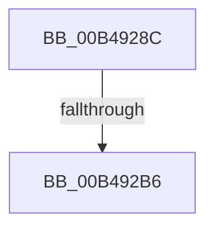

# sub_00B4928C

- RVA: `0x00B4928C`–`0x00B492BB` (길이 `47` bytes)
- VA: `0x0000000140B4928C`
- 실행 섹션: `PAGE`
- PDB 이름 있음: `아니요`; PDB Function 태그: `아니요`
- unwind 정보 RVA: `0x000BAA6C`
- 디코드: `11`개 명령, `47/47` bytes 표시
- 미해석 바이트: `0` (있으면 어셈블리에 `.byte`로 보존)

> 이 문서는 커널 이미지의 기계어와 PDB 기호를 분석해 생성했습니다. 4번과 5번은 함수 원형과 자료형을 바이너리 사용 방식에서 추정한 C 해석이며 원본 소스 복구 결과는 아닙니다.

## 1. Dependencies

- 직접 호출 지점: **1**; 고유 호출 대상: **1**
- 직접 호출자로 확인된 함수: **0**
- RIP 상대 이미지 참조: **0**

### Outgoing calls
- `0x00B492A9` → [RtlCaptureRetpolineImportRvas](../../text/43/RtlCaptureRetpolineImportRvas_function_004317B4.md) (function, `0x004317B4`)

### Direct callers
- 이 함수 시작 RVA로 연결되는 직접 call은 확인되지 않았습니다. 간접 호출은 완전히 역산할 수 없습니다.

### Static image references
- 디코드된 RIP-relative 메모리 참조가 없습니다.

## 2. Other-region calls and transfers

- 다른 실행 섹션으로 향하는 call: **1**
  - `0x00B492A9` → [RtlCaptureRetpolineImportRvas](../../text/43/RtlCaptureRetpolineImportRvas_function_004317B4.md) (`PAGE` → `.text`)
- call이 아닌 외부 분기/꼬리 이동: **2**
  - `0x00B492B0` → [MiCaptureRetpolineImportInfo + 0x8A](../A9/MiCaptureRetpolineImportInfo_function_00A9FB00.md) (`tail-transfer`)
  - `0x00B492B6` → [MiCaptureRetpolineImportInfo + 0x6A](../A9/MiCaptureRetpolineImportInfo_function_00A9FB00.md) (`tail-transfer`)

## 3. Assembly (complete function range)

```asm
00B4928C  48 8B 4D 30                     mov rcx, qword ptr [rbp + 0x30]
00B49290  48 8D 44 24 50                  lea rax, [rsp + 0x50]
00B49295  44 8B 45 40                     mov r8d, dword ptr [rbp + 0x40]
00B49299  48 8B D1                        mov rdx, rcx
00B4929C  48 89 44 24 28                  mov qword ptr [rsp + 0x28], rax
00B492A1  4D 8B CE                        mov r9, r14
00B492A4  48 89 5C 24 20                  mov qword ptr [rsp + 0x20], rbx
00B492A9  E8 06 85 8E FF                  call 0x1404317b4
00B492AE  85 C0                           test eax, eax
00B492B0  0F 88 D4 68 F5 FF               js 0x140a9fb8a
00B492B6  E9 AF 68 F5 FF                  jmp 0x140a9fb6a
```

## 4. C-style interpretation (structured pseudocode)

```c
__int64 __fastcall sub_00B4928C(__int64 a1, __int64 a2, __int64 a3, __int64 a4, __int64 a5, __int64 a6, __int64 a7, __int64 a8, __int64 a9, __int64 a10)
{
    __int64 result;
    unsigned __int64 v_stack_p20;
    unsigned __int64 v_stack_p28;

    v_stack_p28 = a10;
    v_stack_p20 = v_rbx;
    result = RtlCaptureRetpolineImportRvas(*(unsigned __int64 *)(v_rbp + 48), *(unsigned __int64 *)(v_rbp + 48), (unsigned int)(*(unsigned int *)(v_rbp + 64)), v_r14);
}
```

## 5. (Beta) C Style

```c
int64_t sub_00B4928C(int64_t Arg1, int64_t Arg2, int64_t Arg3, int64_t Arg4, uint64_t Arg5, uint64_t Arg6, uint64_t Arg7, uint64_t Arg8, uint64_t Arg9, int64_t Arg10)
{
    int64_t result;
    uint64_t v_stack_p20;
    uint64_t v_stack_p28;

    v_stack_p28 = Arg10;
    v_stack_p20 = local_rbx;
    result = RtlCaptureRetpolineImportRvas(*(uint64_t *)(local_rbp + 0x30), *(uint64_t *)(local_rbp + 0x30), (uint32_t)(*(uint32_t *)(local_rbp + 0x40)), local_r14);
}
```

## 6. Execution-region graph

[열기: 2D/3D 그래프와 함수 탐색 컨트롤 패널](../../../control-panel.html?section=page&rva=0x00B4928C&view=graph)

- 2D 그래프는 위에서 아래로 흐르고, 3D 그래프는 빈 공간을 드래그해 회전합니다. Shift+드래그는 이동, 휠은 확대·축소, 함수 노드 선택은 대상 보고서 이동입니다.

### Static fallback


