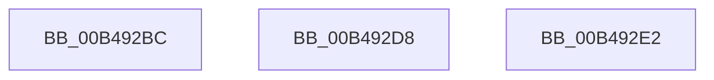

# sub_00B492BC

- RVA: `0x00B492BC`–`0x00B492EC` (길이 `48` bytes)
- VA: `0x0000000140B492BC`
- 실행 섹션: `PAGE`
- PDB 이름 있음: `아니요`; PDB Function 태그: `아니요`
- unwind 정보 RVA: `0x000BABD4`
- 디코드: `12`개 명령, `48/48` bytes 표시
- 미해석 바이트: `0` (있으면 어셈블리에 `.byte`로 보존)

> 이 문서는 커널 이미지의 기계어와 PDB 기호를 분석해 생성했습니다. 4번과 5번은 함수 원형과 자료형을 바이너리 사용 방식에서 추정한 C 해석이며 원본 소스 복구 결과는 아닙니다.

## 1. Dependencies

- 직접 호출 지점: **1**; 고유 호출 대상: **1**
- 직접 호출자로 확인된 함수: **0**
- RIP 상대 이미지 참조: **0**

### Outgoing calls
- `0x00B492C4` → [PipDmgIsDmaVerifierEnabled](../73/PipDmgIsDmaVerifierEnabled_function_00730A84.md) (function, `0x00730A84`)

### Direct callers
- 이 함수 시작 RVA로 연결되는 직접 call은 확인되지 않았습니다. 간접 호출은 완전히 역산할 수 없습니다.

### Static image references
- 디코드된 RIP-relative 메모리 참조가 없습니다.

## 2. Other-region calls and transfers

- 다른 실행 섹션으로 향하는 call: **0**
- call이 아닌 외부 분기/꼬리 이동: **3**
  - `0x00B492D3` → [PipDmgGetDriverDmarCompatLevel + 0xBA](../AA/PipDmgGetDriverDmarCompatLevel_function_00AA0A40.md) (`tail-transfer`)
  - `0x00B492DD` → [PipDmgGetDriverDmarCompatLevel + 0xBA](../AA/PipDmgGetDriverDmarCompatLevel_function_00AA0A40.md) (`tail-transfer`)
  - `0x00B492E7` → [PipDmgGetDriverDmarCompatLevel + 0xBA](../AA/PipDmgGetDriverDmarCompatLevel_function_00AA0A40.md) (`tail-transfer`)

## 3. Assembly (complete function range)

```asm
00B492BC  49 8B CE                        mov rcx, r14
00B492BF  BB 03 00 00 00                  mov ebx, 3
00B492C4  E8 BB 77 BE FF                  call 0x140730a84
00B492C9  8D 7B FF                        lea edi, [rbx - 1]
00B492CC  84 C0                           test al, al
00B492CE  0F 45 DF                        cmovne ebx, edi
00B492D1  8B FB                           mov edi, ebx
00B492D3  E9 22 78 F5 FF                  jmp 0x140aa0afa
00B492D8  BF 02 00 00 00                  mov edi, 2
00B492DD  E9 18 78 F5 FF                  jmp 0x140aa0afa
00B492E2  BF 01 00 00 00                  mov edi, 1
00B492E7  E9 0E 78 F5 FF                  jmp 0x140aa0afa
```

## 4. C-style interpretation (structured pseudocode)

```c
__int64 __fastcall sub_00B492BC(void)
{
    __int64 result;
    __int64 v_rbx;

    result = PipDmgIsDmaVerifierEnabled(v_r14, a2, a3, a4);
    v_rbx = 3;
    if ((unsigned __int8)(result) != 0) { v_rbx = (unsigned int)(3 - 1); }
}
```

## 5. (Beta) C Style

```c
void sub_00B492BC(void)
{
    int64_t result;
    int64_t local_rbx;

    result = PipDmgIsDmaVerifierEnabled(local_r14, a2, a3, a4);
    local_rbx = 3;
    if ((uint8_t)(result) != 0) { local_rbx = (uint32_t)(3 - 1); }
}
```

## 6. Execution-region graph

[열기: 2D/3D 그래프와 함수 탐색 컨트롤 패널](../../../control-panel.html?section=page&rva=0x00B492BC&view=graph)

- 2D 그래프는 위에서 아래로 흐르고, 3D 그래프는 빈 공간을 드래그해 회전합니다. Shift+드래그는 이동, 휠은 확대·축소, 함수 노드 선택은 대상 보고서 이동입니다.

### Static fallback


