# sub_00B49312

- RVA: `0x00B49312`–`0x00B49641` (길이 `815` bytes)
- VA: `0x0000000140B49312`
- 실행 섹션: `PAGE`
- PDB 이름 있음: `아니요`; PDB Function 태그: `아니요`
- unwind 정보 RVA: `0x000BAC78`
- 디코드: `218`개 명령, `815/815` bytes 표시
- 미해석 바이트: `0` (있으면 어셈블리에 `.byte`로 보존)

> 이 문서는 커널 이미지의 기계어와 PDB 기호를 분석해 생성했습니다. 4번과 5번은 함수 원형과 자료형을 바이너리 사용 방식에서 추정한 C 해석이며 원본 소스 복구 결과는 아닙니다.

## 1. Dependencies

- 직접 호출 지점: **19**; 고유 호출 대상: **9**
- 직접 호출자로 확인된 함수: **0**
- RIP 상대 이미지 참조: **0**

### Outgoing calls
- `0x00B49441` → [KeAbPreAcquire](../../text/21/KeAbPreAcquire_function_00210230.md) (function, `0x00210230`)
- `0x00B49461` → [ExfAcquirePushLockSharedEx](../../text/21/ExfAcquirePushLockSharedEx_function_0021044C.md) (function, `0x0021044C`)
- `0x00B4947A` → [EtwpCovSampStackHashLookup](../7C/EtwpCovSampStackHashLookup_function_007C1CD8.md) (function, `0x007C1CD8`)
- `0x00B494F5` → [KeAbPreAcquire](../../text/21/KeAbPreAcquire_function_00210230.md) (function, `0x00210230`)
- `0x00B49514` → [ExfAcquirePushLockSharedEx](../../text/21/ExfAcquirePushLockSharedEx_function_0021044C.md) (function, `0x0021044C`)
- `0x00B4952D` → [EtwpCovSampStackHashLookup](../7C/EtwpCovSampStackHashLookup_function_007C1CD8.md) (function, `0x007C1CD8`)
- `0x00B49549` → [ExfReleasePushLockShared](../../text/26/ExfReleasePushLockShared_function_00263440.md) (function, `0x00263440`)
- `0x00B49551` → [KeAbPostRelease](../../text/2E/KeAbPostRelease_function_002E1600.md) (function, `0x002E1600`)
- `0x00B49556` → [KeLeaveCriticalRegion](../../text/25/KeLeaveCriticalRegion_function_0025D8B0.md) (function, `0x0025D8B0`)
- `0x00B4956B` → [ExfReleasePushLockShared](../../text/26/ExfReleasePushLockShared_function_00263440.md) (function, `0x00263440`)
- `0x00B49573` → [KeAbPostRelease](../../text/2E/KeAbPostRelease_function_002E1600.md) (function, `0x002E1600`)
- `0x00B49578` → [KeLeaveCriticalRegion](../../text/25/KeLeaveCriticalRegion_function_0025D8B0.md) (function, `0x0025D8B0`)
- `0x00B4959F` → [KeAbPreAcquire](../../text/21/KeAbPreAcquire_function_00210230.md) (function, `0x00210230`)
- `0x00B495B8` → [ExfAcquirePushLockExclusiveEx](../../text/20/ExfAcquirePushLockExclusiveEx_function_0020FC90.md) (function, `0x0020FC90`)
- `0x00B495E1` → [memset](../../text/6C/memset_function_006C6C40.md) (function, `0x006C6C40`)
- `0x00B495FA` → [ExfTryToWakePushLock](../../text/26/ExfTryToWakePushLock_function_00265DD0.md) (function, `0x00265DD0`)
- `0x00B49602` → [KeAbPostRelease](../../text/2E/KeAbPostRelease_function_002E1600.md) (function, `0x002E1600`)
- `0x00B49607` → [KeLeaveCriticalRegion](../../text/25/KeLeaveCriticalRegion_function_0025D8B0.md) (function, `0x0025D8B0`)
- `0x00B49629` → [EtwpCovSampStackHashLookup](../7C/EtwpCovSampStackHashLookup_function_007C1CD8.md) (function, `0x007C1CD8`)

### Direct callers
- 이 함수 시작 RVA로 연결되는 직접 call은 확인되지 않았습니다. 간접 호출은 완전히 역산할 수 없습니다.

### Static image references
- 디코드된 RIP-relative 메모리 참조가 없습니다.

## 2. Other-region calls and transfers

- 다른 실행 섹션으로 향하는 call: **16**
  - `0x00B49441` → [KeAbPreAcquire](../../text/21/KeAbPreAcquire_function_00210230.md) (`PAGE` → `.text`)
  - `0x00B49461` → [ExfAcquirePushLockSharedEx](../../text/21/ExfAcquirePushLockSharedEx_function_0021044C.md) (`PAGE` → `.text`)
  - `0x00B494F5` → [KeAbPreAcquire](../../text/21/KeAbPreAcquire_function_00210230.md) (`PAGE` → `.text`)
  - `0x00B49514` → [ExfAcquirePushLockSharedEx](../../text/21/ExfAcquirePushLockSharedEx_function_0021044C.md) (`PAGE` → `.text`)
  - `0x00B49549` → [ExfReleasePushLockShared](../../text/26/ExfReleasePushLockShared_function_00263440.md) (`PAGE` → `.text`)
  - `0x00B49551` → [KeAbPostRelease](../../text/2E/KeAbPostRelease_function_002E1600.md) (`PAGE` → `.text`)
  - `0x00B49556` → [KeLeaveCriticalRegion](../../text/25/KeLeaveCriticalRegion_function_0025D8B0.md) (`PAGE` → `.text`)
  - `0x00B4956B` → [ExfReleasePushLockShared](../../text/26/ExfReleasePushLockShared_function_00263440.md) (`PAGE` → `.text`)
  - `0x00B49573` → [KeAbPostRelease](../../text/2E/KeAbPostRelease_function_002E1600.md) (`PAGE` → `.text`)
  - `0x00B49578` → [KeLeaveCriticalRegion](../../text/25/KeLeaveCriticalRegion_function_0025D8B0.md) (`PAGE` → `.text`)
  - `0x00B4959F` → [KeAbPreAcquire](../../text/21/KeAbPreAcquire_function_00210230.md) (`PAGE` → `.text`)
  - `0x00B495B8` → [ExfAcquirePushLockExclusiveEx](../../text/20/ExfAcquirePushLockExclusiveEx_function_0020FC90.md) (`PAGE` → `.text`)
  - `0x00B495E1` → [memset](../../text/6C/memset_function_006C6C40.md) (`PAGE` → `.text`)
  - `0x00B495FA` → [ExfTryToWakePushLock](../../text/26/ExfTryToWakePushLock_function_00265DD0.md) (`PAGE` → `.text`)
  - `0x00B49602` → [KeAbPostRelease](../../text/2E/KeAbPostRelease_function_002E1600.md) (`PAGE` → `.text`)
  - `0x00B49607` → [KeLeaveCriticalRegion](../../text/25/KeLeaveCriticalRegion_function_0025D8B0.md) (`PAGE` → `.text`)
- call이 아닌 외부 분기/꼬리 이동: **1**
  - `0x00B4961A` → [EtwpCovSampStackHashCheck + 0x2E](../AA/EtwpCovSampStackHashCheck_function_00AA14C4.md) (`tail-transfer`)

## 3. Assembly (complete function range)

```asm
00B49312  48 8B B9 38 05 00 00            mov rdi, qword ptr [rcx + 0x538]
00B49319  41 BB 01 00 00 00               mov r11d, 1
00B4931F  45 8B D1                        mov r10d, r9d
00B49322  4E 8D 0C D5 00 00 00 00         lea r9, [r10*8]
00B4932A  49 83 F9 08                     cmp r9, 8
00B4932E  72 72                           jb 0x140b493a2
00B49330  41 8B C2                        mov eax, r10d
00B49333  48 F7 D8                        neg rax
00B49336  4D 8D 0C C1                     lea r9, [r9 + rax*8]
00B4933A  41 0F B6 00                     movzx eax, byte ptr [r8]
00B4933E  48 6B CF 25                     imul rcx, rdi, 0x25
00B49342  48 03 C8                        add rcx, rax
00B49345  41 0F B6 40 01                  movzx eax, byte ptr [r8 + 1]
00B4934A  48 6B D1 25                     imul rdx, rcx, 0x25
00B4934E  48 03 D0                        add rdx, rax
00B49351  41 0F B6 40 02                  movzx eax, byte ptr [r8 + 2]
00B49356  48 6B CA 25                     imul rcx, rdx, 0x25
00B4935A  48 03 C8                        add rcx, rax
00B4935D  41 0F B6 40 03                  movzx eax, byte ptr [r8 + 3]
00B49362  48 6B D1 25                     imul rdx, rcx, 0x25
00B49366  48 03 D0                        add rdx, rax
00B49369  41 0F B6 40 04                  movzx eax, byte ptr [r8 + 4]
00B4936E  48 6B CA 25                     imul rcx, rdx, 0x25
00B49372  48 03 C8                        add rcx, rax
00B49375  41 0F B6 40 05                  movzx eax, byte ptr [r8 + 5]
00B4937A  48 6B D1 25                     imul rdx, rcx, 0x25
00B4937E  48 03 D0                        add rdx, rax
00B49381  41 0F B6 40 06                  movzx eax, byte ptr [r8 + 6]
00B49386  48 6B CA 25                     imul rcx, rdx, 0x25
00B4938A  48 03 C8                        add rcx, rax
00B4938D  41 0F B6 40 07                  movzx eax, byte ptr [r8 + 7]
00B49392  48 6B F9 25                     imul rdi, rcx, 0x25
00B49396  49 83 C0 08                     add r8, 8
00B4939A  48 03 F8                        add rdi, rax
00B4939D  4D 2B D3                        sub r10, r11
00B493A0  75 98                           jne 0x140b4933a
00B493A2  4D 2B CB                        sub r9, r11
00B493A5  74 72                           je 0x140b49419
00B493A7  4D 2B CB                        sub r9, r11
00B493AA  74 5F                           je 0x140b4940b
00B493AC  4D 2B CB                        sub r9, r11
00B493AF  74 4C                           je 0x140b493fd
00B493B1  4D 2B CB                        sub r9, r11
00B493B4  74 39                           je 0x140b493ef
00B493B6  4D 2B CB                        sub r9, r11
00B493B9  74 26                           je 0x140b493e1
00B493BB  4D 2B CB                        sub r9, r11
00B493BE  74 13                           je 0x140b493d3
00B493C0  4D 3B CB                        cmp r9, r11
00B493C3  75 5F                           jne 0x140b49424
00B493C5  41 0F B6 00                     movzx eax, byte ptr [r8]
00B493C9  48 6B FF 25                     imul rdi, rdi, 0x25
00B493CD  48 03 F8                        add rdi, rax
00B493D0  4D 03 C3                        add r8, r11
00B493D3  41 0F B6 00                     movzx eax, byte ptr [r8]
00B493D7  48 6B FF 25                     imul rdi, rdi, 0x25
00B493DB  48 03 F8                        add rdi, rax
00B493DE  4D 03 C3                        add r8, r11
00B493E1  41 0F B6 00                     movzx eax, byte ptr [r8]
00B493E5  48 6B FF 25                     imul rdi, rdi, 0x25
00B493E9  48 03 F8                        add rdi, rax
00B493EC  4D 03 C3                        add r8, r11
00B493EF  41 0F B6 00                     movzx eax, byte ptr [r8]
00B493F3  48 6B FF 25                     imul rdi, rdi, 0x25
00B493F7  48 03 F8                        add rdi, rax
00B493FA  4D 03 C3                        add r8, r11
00B493FD  41 0F B6 00                     movzx eax, byte ptr [r8]
00B49401  48 6B FF 25                     imul rdi, rdi, 0x25
00B49405  48 03 F8                        add rdi, rax
00B49408  4D 03 C3                        add r8, r11
00B4940B  41 0F B6 00                     movzx eax, byte ptr [r8]
00B4940F  48 6B FF 25                     imul rdi, rdi, 0x25
00B49413  48 03 F8                        add rdi, rax
00B49416  4D 03 C3                        add r8, r11
00B49419  41 0F B6 00                     movzx eax, byte ptr [r8]
00B4941D  48 6B FF 25                     imul rdi, rdi, 0x25
00B49421  48 03 F8                        add rdi, rax
00B49424  65 48 8B 04 25 88 01 00 00      mov rax, qword ptr gs:[0x188]
00B4942D  48 83 CB FF                     or rbx, 0xffffffffffffffff
00B49431  45 33 C0                        xor r8d, r8d
00B49434  33 D2                           xor edx, edx
00B49436  48 8B CD                        mov rcx, rbp
00B49439  66 01 98 E4 01 00 00            add word ptr [rax + 0x1e4], bx
00B49440  90                              nop
00B49441  E8 EA 6D 6C FF                  call 0x140210230
00B49446  4C 8B F8                        mov r15, rax
00B49449  8D 4B 12                        lea ecx, [rbx + 0x12]
00B4944C  33 C0                           xor eax, eax
00B4944E  F0 48 0F B1 4D 00               lock cmpxchg qword ptr [rbp], rcx
00B49454  74 10                           je 0x140b49466
00B49456  4C 8B CD                        mov r9, rbp
00B49459  4D 8B C7                        mov r8, r15
00B4945C  33 D2                           xor edx, edx
00B4945E  48 8B CD                        mov rcx, rbp
00B49461  E8 E6 6F 6C FF                  call 0x14021044c
00B49466  4D 85 FF                        test r15, r15
00B49469  74 05                           je 0x140b49470
00B4946B  41 C6 47 0A 01                  mov byte ptr [r15 + 0xa], 1
00B49470  4C 8D 44 24 68                  lea r8, [rsp + 0x68]
00B49475  8B D7                           mov edx, edi
00B49477  48 8B CD                        mov rcx, rbp
00B4947A  E8 59 88 C7 FF                  call 0x1407c1cd8
00B4947F  45 33 FF                        xor r15d, r15d
00B49482  85 C0                           test eax, eax
00B49484  74 09                           je 0x140b4948f
00B49486  45 8D 67 01                     lea r12d, [r15 + 1]
00B4948A  E9 CC 00 00 00                  jmp 0x140b4955b
00B4948F  6B 45 14 07                     imul eax, dword ptr [rbp + 0x14], 7
00B49493  C1 E8 03                        shr eax, 3
00B49496  39 45 10                        cmp dword ptr [rbp + 0x10], eax
00B49499  0F 87 BC 00 00 00               ja 0x140b4955b
00B4949F  BA 01 00 00 00                  mov edx, 1
00B494A4  8B CA                           mov ecx, edx
00B494A6  F0 0F C1 4D 10                  lock xadd dword ptr [rbp + 0x10], ecx
00B494AB  03 CA                           add ecx, edx
00B494AD  3B C8                           cmp ecx, eax
00B494AF  44 0F 44 EA                     cmove r13d, edx
00B494B3  6B 45 14 07                     imul eax, dword ptr [rbp + 0x14], 7
00B494B7  C1 E8 03                        shr eax, 3
00B494BA  3B C8                           cmp ecx, eax
00B494BC  0F 83 99 00 00 00               jae 0x140b4955b
00B494C2  48 8B 4C 24 68                  mov rcx, qword ptr [rsp + 0x68]
00B494C7  48 85 C9                        test rcx, rcx
00B494CA  0F 84 4F 01 00 00               je 0x140b4961f
00B494D0  33 C0                           xor eax, eax
00B494D2  F0 0F B1 39                     lock cmpxchg dword ptr [rcx], edi
00B494D6  0F 85 43 01 00 00               jne 0x140b4961f
00B494DC  65 48 8B 04 25 88 01 00 00      mov rax, qword ptr gs:[0x188]
00B494E5  45 33 C0                        xor r8d, r8d
00B494E8  33 D2                           xor edx, edx
00B494EA  48 8B CE                        mov rcx, rsi
00B494ED  66 01 98 E4 01 00 00            add word ptr [rax + 0x1e4], bx
00B494F4  90                              nop
00B494F5  E8 36 6D 6C FF                  call 0x140210230
00B494FA  4C 8B F8                        mov r15, rax
00B494FD  33 C0                           xor eax, eax
00B494FF  8D 48 11                        lea ecx, [rax + 0x11]
00B49502  F0 48 0F B1 0E                  lock cmpxchg qword ptr [rsi], rcx
00B49507  74 10                           je 0x140b49519
00B49509  4C 8B CE                        mov r9, rsi
00B4950C  4D 8B C7                        mov r8, r15
00B4950F  33 D2                           xor edx, edx
00B49511  48 8B CE                        mov rcx, rsi
00B49514  E8 33 6F 6C FF                  call 0x14021044c
00B49519  4D 85 FF                        test r15, r15
00B4951C  74 05                           je 0x140b49523
00B4951E  41 C6 47 0A 01                  mov byte ptr [r15 + 0xa], 1
00B49523  4C 8D 44 24 68                  lea r8, [rsp + 0x68]
00B49528  8B D7                           mov edx, edi
00B4952A  48 8B CE                        mov rcx, rsi
00B4952D  E8 A6 87 C7 FF                  call 0x1407c1cd8
00B49532  45 33 FF                        xor r15d, r15d
00B49535  85 C0                           test eax, eax
00B49537  41 0F 95 C4                     setne r12b
00B4953B  41 8D 47 11                     lea eax, [r15 + 0x11]
00B4953F  F0 4C 0F B1 3E                  lock cmpxchg qword ptr [rsi], r15
00B49544  74 08                           je 0x140b4954e
00B49546  48 8B CE                        mov rcx, rsi
00B49549  E8 F2 9E 71 FF                  call 0x140263440
00B4954E  48 8B CE                        mov rcx, rsi
00B49551  E8 AA 80 79 FF                  call 0x1402e1600
00B49556  E8 55 43 71 FF                  call 0x14025d8b0
00B4955B  B8 11 00 00 00                  mov eax, 0x11
00B49560  F0 4C 0F B1 7D 00               lock cmpxchg qword ptr [rbp], r15
00B49566  74 08                           je 0x140b49570
00B49568  48 8B CD                        mov rcx, rbp
00B4956B  E8 D0 9E 71 FF                  call 0x140263440
00B49570  48 8B CD                        mov rcx, rbp
00B49573  E8 88 80 79 FF                  call 0x1402e1600
00B49578  E8 33 43 71 FF                  call 0x14025d8b0
00B4957D  45 85 ED                        test r13d, r13d
00B49580  0F 84 91 00 00 00               je 0x140b49617
00B49586  65 48 8B 04 25 88 01 00 00      mov rax, qword ptr gs:[0x188]
00B4958F  45 33 C0                        xor r8d, r8d
00B49592  33 D2                           xor edx, edx
00B49594  48 8B CE                        mov rcx, rsi
00B49597  66 01 98 E4 01 00 00            add word ptr [rax + 0x1e4], bx
00B4959E  90                              nop
00B4959F  E8 8C 6C 6C FF                  call 0x140210230
00B495A4  F0 48 0F BA 2E 00               lock bts qword ptr [rsi], 0
00B495AA  48 8B F8                        mov rdi, rax
00B495AD  73 0E                           jae 0x140b495bd
00B495AF  4C 8B C6                        mov r8, rsi
00B495B2  48 8B D0                        mov rdx, rax
00B495B5  48 8B CE                        mov rcx, rsi
00B495B8  E8 D3 66 6C FF                  call 0x14020fc90
00B495BD  48 85 FF                        test rdi, rdi
00B495C0  74 04                           je 0x140b495c6
00B495C2  C6 47 0A 01                     mov byte ptr [rdi + 0xa], 1
00B495C6  65 48 8B 04 25 88 01 00 00      mov rax, qword ptr gs:[0x188]
00B495CF  48 8D 4E 18                     lea rcx, [rsi + 0x18]
00B495D3  48 89 46 08                     mov qword ptr [rsi + 8], rax
00B495D7  33 D2                           xor edx, edx
00B495D9  44 8B 46 14                     mov r8d, dword ptr [rsi + 0x14]
00B495DD  49 C1 E0 02                     shl r8, 2
00B495E1  E8 5A D6 B7 FF                  call 0x1406c6c40
00B495E6  4C 89 7E 08                     mov qword ptr [rsi + 8], r15
00B495EA  F0 48 0F C1 1E                  lock xadd qword ptr [rsi], rbx
00B495EF  80 E3 06                        and bl, 6
00B495F2  80 FB 02                        cmp bl, 2
00B495F5  75 08                           jne 0x140b495ff
00B495F7  48 8B CE                        mov rcx, rsi
00B495FA  E8 D1 C7 71 FF                  call 0x140265dd0
00B495FF  48 8B CE                        mov rcx, rsi
00B49602  E8 F9 7F 79 FF                  call 0x1402e1600
00B49607  E8 A4 42 71 FF                  call 0x14025d8b0
00B4960C  44 89 7E 10                     mov dword ptr [rsi + 0x10], r15d
00B49610  49 87 B6 20 05 00 00            xchg qword ptr [r14 + 0x520], rsi
00B49617  41 8B C4                        mov eax, r12d
00B4961A  E9 D3 7E F5 FF                  jmp 0x140aa14f2
00B4961F  4C 8D 44 24 68                  lea r8, [rsp + 0x68]
00B49624  8B D7                           mov edx, edi
00B49626  48 8B CD                        mov rcx, rbp
00B49629  E8 AA 86 C7 FF                  call 0x1407c1cd8
00B4962E  85 C0                           test eax, eax
00B49630  0F 84 8C FE FF FF               je 0x140b494c2
00B49636  41 BC 01 00 00 00               mov r12d, 1
00B4963C  E9 1A FF FF FF                  jmp 0x140b4955b
```

## 4. C-style interpretation (structured pseudocode)

```c
__int64 __fastcall sub_00B49312(__int64 a1, __int64 a2, __int64 a3, int a4, __int64 a5, __int64 a6, __int64 a7, __int64 a8, __int64 a9, __int64 a10, __int64 a11, __int64 a12, __int64 a13)
{
    __int64 result;
    __int64 v_r10;
    __int64 v_r12;
    __int64 v_r13;
    __int64 v_r15;
    __int64 v_rbx;
    __int64 v_rdi;

    if (((unsigned int)(a4) * 8) < 8) goto loc_00B493A2;
    result = -((unsigned int)((unsigned int)((unsigned int)(a4))));
loc_00B4933A:
    a1 = (a1) * (*(unsigned __int64 *)(a1 + 1336));
    a1 = (a1) + (*(unsigned __int8 *)(a3));
    a2 = (a2) * (a1);
    a2 = (a2) + (*(unsigned __int8 *)(a3 + 1));
    a1 = (a1) * (a2);
    a1 = (a1) + (*(unsigned __int8 *)(a3 + 2));
    a2 = (a2) * (a1);
    a2 = (a2) + (*(unsigned __int8 *)(a3 + 3));
    a1 = (a1) * (a2);
    a1 = (a1) + (*(unsigned __int8 *)(a3 + 4));
    a2 = (a2) * (a1);
    a2 = (a2) + (*(unsigned __int8 *)(a3 + 5));
    a1 = (a1) * (a2);
    a1 = (a1) + (*(unsigned __int8 *)(a3 + 6));
    v_rdi = (*(unsigned __int64 *)(a1 + 1336)) * (a1);
    a3 = (a3) + (8);
    v_rdi = (v_rdi) + (*(unsigned __int8 *)(a3 + 7));
    v_r10 = ((unsigned int)(a4)) - (1);
    if (condition_is_not_equal) goto loc_00B4933A;
loc_00B493A2:
    a4 = ((unsigned int)(a4) * 8 + result * 8) - (1);
    if (condition_is_equal) goto loc_00B49419;
    a4 = (a4) - (1);
    if (condition_is_equal) goto loc_00B4940B;
    a4 = (a4) - (1);
    if (condition_is_equal) goto loc_00B493FD;
    a4 = (a4) - (1);
    if (condition_is_equal) goto loc_00B493EF;
    a4 = (a4) - (1);
    if (condition_is_equal) goto loc_00B493E1;
    a4 = (a4) - (1);
    if (condition_is_equal) goto loc_00B493D3;
    if (a4 != 1) goto loc_00B49424;
    v_rdi = (v_rdi) * (v_rdi);
    v_rdi = (v_rdi) + (*(unsigned __int8 *)(a3));
    a3 = (a3) + (1);
loc_00B493D3:
    v_rdi = (v_rdi) * (v_rdi);
    v_rdi = (v_rdi) + (*(unsigned __int8 *)(a3));
    a3 = (a3) + (1);
loc_00B493E1:
    v_rdi = (v_rdi) * (v_rdi);
    v_rdi = (v_rdi) + (*(unsigned __int8 *)(a3));
    a3 = (a3) + (1);
loc_00B493EF:
    v_rdi = (v_rdi) * (v_rdi);
    v_rdi = (v_rdi) + (*(unsigned __int8 *)(a3));
    a3 = (a3) + (1);
loc_00B493FD:
    v_rdi = (v_rdi) * (v_rdi);
    v_rdi = (v_rdi) + (*(unsigned __int8 *)(a3));
    a3 = (a3) + (1);
loc_00B4940B:
    v_rdi = (v_rdi) * (v_rdi);
    v_rdi = (v_rdi) + (*(unsigned __int8 *)(a3));
    a3 = (a3) + (1);
loc_00B49419:
    v_rdi = (v_rdi) * (v_rdi);
    v_rdi = (v_rdi) + (*(unsigned __int8 *)(a3));
loc_00B49424:
    v_rbx = (v_rbx) | (-1);
    a3 = 0;
    a2 = 0;
    result = KeAbPreAcquire(v_rbp, a2, a3, a4);
    result = 0;
    if (!(condition_is_equal)) {
        a4 = v_rbp;
        a3 = 0;
        a2 = 0;
        a1 = v_rbp;
        result = ExfAcquirePushLockSharedEx(a1, a2, a3, a4);
    }
    if (result != 0) {
        *(unsigned __int8 *)(result + 10) = 1;
    }
    result = EtwpCovSampStackHashLookup(v_rbp, (unsigned int)((unsigned int)(v_rdi)), a13, a4);
    v_r15 = 0;
    if ((unsigned int)(result) == 0) goto loc_00B4948F;
    goto loc_00B4955B;
loc_00B4948F:
    result = (unsigned int)((result) * (*(unsigned int *)(v_rbp + 20)));
    result = (unsigned int)((result) >> (3));
    if ((*(unsigned int *)(v_rbp + 16)) > ((unsigned int)(result))) goto loc_00B4955B;
    a1 = (unsigned int)((1) + (1));
    if (((unsigned int)(a1)) == ((unsigned int)(result))) { v_r13 = 1; }
    result = (unsigned int)((result) * (*(unsigned int *)(v_rbp + 20)));
    result = (unsigned int)((result) >> (3));
    if (((unsigned int)(a1)) >= ((unsigned int)(result))) goto loc_00B4955B;
loc_00B494C2:
    if (a13 == 0) goto loc_00B4961F;
    result = 0;
    if (condition_is_not_equal) goto loc_00B4961F;
    a3 = 0;
    a2 = 0;
    result = KeAbPreAcquire(v_rsi, a2, a3, a4);
    result = 0;
    if (!(condition_is_equal)) {
        a4 = v_rsi;
        a3 = 0;
        a2 = 0;
        a1 = v_rsi;
        result = ExfAcquirePushLockSharedEx(a1, a2, a3, a4);
    }
    if (result != 0) {
        *(unsigned __int8 *)(result + 10) = 1;
    }
    result = EtwpCovSampStackHashLookup(v_rsi, (unsigned int)((unsigned int)(v_rdi)), a13, a4);
    v_r15 = 0;
    v_r12 = ((unsigned int)(result) != 0) ? 1 : 0;
    result = v_r15 + 17;
    if ((unsigned int)(result) != 0) {
        a1 = v_rsi;
        result = ExfReleasePushLockShared(a1, (unsigned int)((unsigned int)(v_rdi)), a13, a4);
    }
    result = KeAbPostRelease(v_rsi, (unsigned int)((unsigned int)(v_rdi)), a13, a4);
    result = KeLeaveCriticalRegion(v_rsi, (unsigned int)((unsigned int)(v_rdi)), a13, a4);
loc_00B4955B:
    result = 17;
    if ((unsigned int)(result) != 0) {
        a1 = v_rbp;
        result = ExfReleasePushLockShared(a1, (unsigned int)((unsigned int)(v_rdi)), a13, a4);
    }
    result = KeAbPostRelease(v_rbp, (unsigned int)((unsigned int)(v_rdi)), a13, a4);
    result = KeLeaveCriticalRegion(v_rbp, (unsigned int)((unsigned int)(v_rdi)), a13, a4);
    if ((unsigned int)(v_r13) == 0) goto loc_00B49617;
    a3 = 0;
    a2 = 0;
    result = KeAbPreAcquire(v_rsi, a2, a3, a4);
    if (!(condition_is_above_or_equal)) {
        a3 = v_rsi;
        a2 = result;
        a1 = v_rsi;
        result = ExfAcquirePushLockExclusiveEx(a1, a2, a3, a4);
    }
    if (result != 0) {
        *(unsigned __int8 *)(result + 10) = 1;
    }
    *(unsigned __int64 *)(v_rsi + 8) = *(unsigned __int64 *)(gs_base + (0 + 392));
    a2 = 0;
    a3 = ((unsigned int)(*(unsigned int *)(v_rsi + 20))) << (2);
    result = memset(v_rsi + 24, a2, a3, a4);
    *(unsigned __int64 *)(v_rsi + 8) = 0;
    v_rbx = (unsigned __int8)((v_rbx) & (6));
    if (((unsigned __int8)(v_rbx)) == 2) {
        a1 = v_rsi;
        result = ExfTryToWakePushLock(a1, a2, a3, a4);
    }
    result = KeAbPostRelease(v_rsi, a2, a3, a4);
    result = KeLeaveCriticalRegion(v_rsi, a2, a3, a4);
    *(unsigned int *)(v_rsi + 16) = 0;
loc_00B49617:
loc_00B4961F:
    result = EtwpCovSampStackHashLookup(v_rbp, (unsigned int)((unsigned int)(result)), a13, a4);
    if ((unsigned int)(result) == 0) goto loc_00B494C2;
    goto loc_00B4955B;
}
```

## 5. (Beta) C Style

```c
int64_t sub_00B49312(void *Arg1, int64_t Arg2, void *Arg3, int32_t Arg4, uint64_t Arg5, uint64_t Arg6, uint64_t Arg7, uint64_t Arg8, uint64_t Arg9, uint64_t Arg10, uint64_t Arg11, uint64_t Arg12, int64_t Arg13)
{
    uint8_t *arg1 = (uint8_t *)Arg1;
    uint8_t *arg3 = (uint8_t *)Arg3;

    int64_t result;
    int64_t local_r10;
    int64_t local_r12;
    int64_t local_r13;
    int64_t local_r15;
    int64_t local_rbx;
    int64_t local_rdi;

    if (((uint32_t)(Arg4) * 8) < 8) goto loc_00B493A2;
    result = -((uint32_t)((uint32_t)((uint32_t)(Arg4))));
loc_00B4933A:
    Arg1 = (Arg1) * (*(uint64_t *)(arg1 + 0x538));
    Arg1 = (Arg1) + (*(uint8_t *)(arg3));
    Arg2 = (Arg2) * (Arg1);
    Arg2 = (Arg2) + (*(uint8_t *)(arg3 + 0x1));
    Arg1 = (Arg1) * (Arg2);
    Arg1 = (Arg1) + (*(uint8_t *)(arg3 + 0x2));
    Arg2 = (Arg2) * (Arg1);
    Arg2 = (Arg2) + (*(uint8_t *)(arg3 + 0x3));
    Arg1 = (Arg1) * (Arg2);
    Arg1 = (Arg1) + (*(uint8_t *)(arg3 + 0x4));
    Arg2 = (Arg2) * (Arg1);
    Arg2 = (Arg2) + (*(uint8_t *)(arg3 + 0x5));
    Arg1 = (Arg1) * (Arg2);
    Arg1 = (Arg1) + (*(uint8_t *)(arg3 + 0x6));
    local_rdi = (*(uint64_t *)(arg1 + 0x538)) * (Arg1);
    Arg3 = (Arg3) + (8);
    local_rdi = (local_rdi) + (*(uint8_t *)(arg3 + 0x7));
    local_r10 = ((uint32_t)(Arg4)) - (1);
    if (condition_is_not_equal) goto loc_00B4933A;
loc_00B493A2:
    Arg4 = ((uint32_t)(Arg4) * 8 + result * 8) - (1);
    if (condition_is_equal) goto loc_00B49419;
    Arg4 = (Arg4) - (1);
    if (condition_is_equal) goto loc_00B4940B;
    Arg4 = (Arg4) - (1);
    if (condition_is_equal) goto loc_00B493FD;
    Arg4 = (Arg4) - (1);
    if (condition_is_equal) goto loc_00B493EF;
    Arg4 = (Arg4) - (1);
    if (condition_is_equal) goto loc_00B493E1;
    Arg4 = (Arg4) - (1);
    if (condition_is_equal) goto loc_00B493D3;
    if (Arg4 != 1) goto loc_00B49424;
    local_rdi = (local_rdi) * (local_rdi);
    local_rdi = (local_rdi) + (*(uint8_t *)(arg3));
    Arg3 = (Arg3) + (1);
loc_00B493D3:
    local_rdi = (local_rdi) * (local_rdi);
    local_rdi = (local_rdi) + (*(uint8_t *)(arg3));
    Arg3 = (Arg3) + (1);
loc_00B493E1:
    local_rdi = (local_rdi) * (local_rdi);
    local_rdi = (local_rdi) + (*(uint8_t *)(arg3));
    Arg3 = (Arg3) + (1);
loc_00B493EF:
    local_rdi = (local_rdi) * (local_rdi);
    local_rdi = (local_rdi) + (*(uint8_t *)(arg3));
    Arg3 = (Arg3) + (1);
loc_00B493FD:
    local_rdi = (local_rdi) * (local_rdi);
    local_rdi = (local_rdi) + (*(uint8_t *)(arg3));
    Arg3 = (Arg3) + (1);
loc_00B4940B:
    local_rdi = (local_rdi) * (local_rdi);
    local_rdi = (local_rdi) + (*(uint8_t *)(arg3));
    Arg3 = (Arg3) + (1);
loc_00B49419:
    local_rdi = (local_rdi) * (local_rdi);
    local_rdi = (local_rdi) + (*(uint8_t *)(arg3));
loc_00B49424:
    local_rbx = (local_rbx) | (-1);
    Arg3 = 0;
    Arg2 = 0;
    result = KeAbPreAcquire(local_rbp, Arg2, Arg3, Arg4);
    result = 0;
    if (!(condition_is_equal)) {
        Arg4 = local_rbp;
        Arg3 = 0;
        Arg2 = 0;
        Arg1 = local_rbp;
        result = ExfAcquirePushLockSharedEx(Arg1, Arg2, Arg3, Arg4);
    }
    if (result != 0) {
        *(uint8_t *)(result + 0xA) = 1;
    }
    result = EtwpCovSampStackHashLookup(local_rbp, (uint32_t)((uint32_t)(local_rdi)), Arg13, Arg4);
    local_r15 = 0;
    if ((uint32_t)(result) == 0) goto loc_00B4948F;
    goto loc_00B4955B;
loc_00B4948F:
    result = (uint32_t)((result) * (*(uint32_t *)(local_rbp + 0x14)));
    result = (uint32_t)((result) >> (3));
    if ((*(uint32_t *)(local_rbp + 0x10)) > ((uint32_t)(result))) goto loc_00B4955B;
    Arg1 = (uint32_t)((1) + (1));
    if (((uint32_t)(Arg1)) == ((uint32_t)(result))) { local_r13 = 1; }
    result = (uint32_t)((result) * (*(uint32_t *)(local_rbp + 0x14)));
    result = (uint32_t)((result) >> (3));
    if (((uint32_t)(Arg1)) >= ((uint32_t)(result))) goto loc_00B4955B;
loc_00B494C2:
    if (Arg13 == 0) goto loc_00B4961F;
    result = 0;
    if (condition_is_not_equal) goto loc_00B4961F;
    Arg3 = 0;
    Arg2 = 0;
    result = KeAbPreAcquire(local_rsi, Arg2, Arg3, Arg4);
    result = 0;
    if (!(condition_is_equal)) {
        Arg4 = local_rsi;
        Arg3 = 0;
        Arg2 = 0;
        Arg1 = local_rsi;
        result = ExfAcquirePushLockSharedEx(Arg1, Arg2, Arg3, Arg4);
    }
    if (result != 0) {
        *(uint8_t *)(result + 0xA) = 1;
    }
    result = EtwpCovSampStackHashLookup(local_rsi, (uint32_t)((uint32_t)(local_rdi)), Arg13, Arg4);
    local_r15 = 0;
    local_r12 = ((uint32_t)(result) != 0) ? 1 : 0;
    result = local_r15 + 17;
    if ((uint32_t)(result) != 0) {
        Arg1 = local_rsi;
        result = ExfReleasePushLockShared(Arg1, (uint32_t)((uint32_t)(local_rdi)), Arg13, Arg4);
    }
    result = KeAbPostRelease(local_rsi, (uint32_t)((uint32_t)(local_rdi)), Arg13, Arg4);
    result = KeLeaveCriticalRegion(local_rsi, (uint32_t)((uint32_t)(local_rdi)), Arg13, Arg4);
loc_00B4955B:
    result = 17;
    if ((uint32_t)(result) != 0) {
        Arg1 = local_rbp;
        result = ExfReleasePushLockShared(Arg1, (uint32_t)((uint32_t)(local_rdi)), Arg13, Arg4);
    }
    result = KeAbPostRelease(local_rbp, (uint32_t)((uint32_t)(local_rdi)), Arg13, Arg4);
    result = KeLeaveCriticalRegion(local_rbp, (uint32_t)((uint32_t)(local_rdi)), Arg13, Arg4);
    if ((uint32_t)(local_r13) == 0) goto loc_00B49617;
    Arg3 = 0;
    Arg2 = 0;
    result = KeAbPreAcquire(local_rsi, Arg2, Arg3, Arg4);
    if (!(condition_is_above_or_equal)) {
        Arg3 = local_rsi;
        Arg2 = result;
        Arg1 = local_rsi;
        result = ExfAcquirePushLockExclusiveEx(Arg1, Arg2, Arg3, Arg4);
    }
    if (result != 0) {
        *(uint8_t *)(result + 0xA) = 1;
    }
    *(uint64_t *)(local_rsi + 0x8) = *(uint64_t *)(gs_base + (0 + 0x188));
    Arg2 = 0;
    Arg3 = ((uint32_t)(*(uint32_t *)(local_rsi + 0x14))) << (2);
    result = memset(local_rsi + 24, Arg2, Arg3, Arg4);
    *(uint64_t *)(local_rsi + 0x8) = 0;
    local_rbx = (uint8_t)((local_rbx) & (6));
    if (((uint8_t)(local_rbx)) == 2) {
        Arg1 = local_rsi;
        result = ExfTryToWakePushLock(Arg1, Arg2, Arg3, Arg4);
    }
    result = KeAbPostRelease(local_rsi, Arg2, Arg3, Arg4);
    result = KeLeaveCriticalRegion(local_rsi, Arg2, Arg3, Arg4);
    *(uint32_t *)(local_rsi + 0x10) = 0;
loc_00B49617:
loc_00B4961F:
    result = EtwpCovSampStackHashLookup(local_rbp, (uint32_t)((uint32_t)(result)), Arg13, Arg4);
    if ((uint32_t)(result) == 0) goto loc_00B494C2;
    goto loc_00B4955B;
}
```

### 관측된 메모리 오프셋

구조체 형식이 확인되지 않은 접근은 인자 기준의 오프셋으로만 기록했습니다.

| 기준 인자 | 오프셋 표현 | 폭 (bit) | 접근 |
|---|---:|---:|---|
| `Arg1` | `+ 0x538` | `64` | `R` |
| `Arg3` | `+ 0x0` | `8` | `R` |
| `Arg3` | `+ 0x1` | `8` | `R` |
| `Arg3` | `+ 0x2` | `8` | `R` |
| `Arg3` | `+ 0x3` | `8` | `R` |
| `Arg3` | `+ 0x4` | `8` | `R` |
| `Arg3` | `+ 0x5` | `8` | `R` |
| `Arg3` | `+ 0x6` | `8` | `R` |
| `Arg3` | `+ 0x7` | `8` | `R` |

## 6. Execution-region graph

[열기: 2D/3D 그래프와 함수 탐색 컨트롤 패널](../../../control-panel.html?section=page&rva=0x00B49312&view=graph)

- 2D 그래프는 위에서 아래로 흐르고, 3D 그래프는 빈 공간을 드래그해 회전합니다. Shift+드래그는 이동, 휠은 확대·축소, 함수 노드 선택은 대상 보고서 이동입니다.

### Static fallback

```mermaid
flowchart TD
  bb_00B49312[BB_00B49312]
  bb_00B49330[BB_00B49330]
  bb_00B4933A[BB_00B4933A]
  bb_00B493A2[BB_00B493A2]
  bb_00B493A7[BB_00B493A7]
  bb_00B493AC[BB_00B493AC]
  bb_00B493B1[BB_00B493B1]
  bb_00B493B6[BB_00B493B6]
  bb_00B493BB[BB_00B493BB]
  bb_00B493C0[BB_00B493C0]
  bb_00B493C5[BB_00B493C5]
  bb_00B493D3[BB_00B493D3]
  bb_00B493E1[BB_00B493E1]
  bb_00B493EF[BB_00B493EF]
  bb_00B493FD[BB_00B493FD]
  bb_00B4940B[BB_00B4940B]
  bb_00B49419[BB_00B49419]
  bb_00B49424[BB_00B49424]
  bb_00B49456[BB_00B49456]
  bb_00B49466[BB_00B49466]
  bb_00B4946B[BB_00B4946B]
  bb_00B49470[BB_00B49470]
  bb_00B49486[BB_00B49486]
  bb_00B4948F[BB_00B4948F]
  bb_00B4949F[BB_00B4949F]
  bb_00B494C2[BB_00B494C2]
  bb_00B494D0[BB_00B494D0]
  bb_00B494DC[BB_00B494DC]
  bb_00B49509[BB_00B49509]
  bb_00B49519[BB_00B49519]
  bb_00B4951E[BB_00B4951E]
  bb_00B49523[BB_00B49523]
  bb_00B49546[BB_00B49546]
  bb_00B4954E[BB_00B4954E]
  bb_00B4955B[BB_00B4955B]
  bb_00B49568[BB_00B49568]
  bb_00B49570[BB_00B49570]
  bb_00B49586[BB_00B49586]
  bb_00B495AF[BB_00B495AF]
  bb_00B495BD[BB_00B495BD]
  bb_00B495C2[BB_00B495C2]
  bb_00B495C6[BB_00B495C6]
  bb_00B495F7[BB_00B495F7]
  bb_00B495FF[BB_00B495FF]
  bb_00B49617[BB_00B49617]
  bb_00B4961F[BB_00B4961F]
  bb_00B49636[BB_00B49636]
  bb_00B49312 -->|branch| bb_00B493A2
  bb_00B49312 -->|fallthrough| bb_00B49330
  bb_00B49330 -->|flow| bb_00B4933A
  bb_00B4933A -->|branch| bb_00B4933A
  bb_00B4933A -->|fallthrough| bb_00B493A2
  bb_00B493A2 -->|branch| bb_00B49419
  bb_00B493A2 -->|fallthrough| bb_00B493A7
  bb_00B493A7 -->|branch| bb_00B4940B
  bb_00B493A7 -->|fallthrough| bb_00B493AC
  bb_00B493AC -->|branch| bb_00B493FD
  bb_00B493AC -->|fallthrough| bb_00B493B1
  bb_00B493B1 -->|branch| bb_00B493EF
  bb_00B493B1 -->|fallthrough| bb_00B493B6
  bb_00B493B6 -->|branch| bb_00B493E1
  bb_00B493B6 -->|fallthrough| bb_00B493BB
  bb_00B493BB -->|branch| bb_00B493D3
  bb_00B493BB -->|fallthrough| bb_00B493C0
  bb_00B493C0 -->|branch| bb_00B49424
  bb_00B493C0 -->|fallthrough| bb_00B493C5
  bb_00B493C5 -->|flow| bb_00B493D3
  bb_00B493D3 -->|flow| bb_00B493E1
  bb_00B493E1 -->|flow| bb_00B493EF
  bb_00B493EF -->|flow| bb_00B493FD
  bb_00B493FD -->|flow| bb_00B4940B
  bb_00B4940B -->|flow| bb_00B49419
  bb_00B49419 -->|flow| bb_00B49424
  bb_00B49424 -->|branch| bb_00B49466
  bb_00B49424 -->|fallthrough| bb_00B49456
  bb_00B49456 -->|flow| bb_00B49466
  bb_00B49466 -->|branch| bb_00B49470
  bb_00B49466 -->|fallthrough| bb_00B4946B
  bb_00B4946B -->|flow| bb_00B49470
  bb_00B49470 -->|branch| bb_00B4948F
  bb_00B49470 -->|fallthrough| bb_00B49486
  bb_00B49486 -->|branch| bb_00B4955B
  bb_00B4948F -->|branch| bb_00B4955B
  bb_00B4948F -->|fallthrough| bb_00B4949F
  bb_00B4949F -->|branch| bb_00B4955B
  bb_00B4949F -->|fallthrough| bb_00B494C2
  bb_00B494C2 -->|branch| bb_00B4961F
  bb_00B494C2 -->|fallthrough| bb_00B494D0
  bb_00B494D0 -->|branch| bb_00B4961F
  bb_00B494D0 -->|fallthrough| bb_00B494DC
  bb_00B494DC -->|branch| bb_00B49519
  bb_00B494DC -->|fallthrough| bb_00B49509
  bb_00B49509 -->|flow| bb_00B49519
  bb_00B49519 -->|branch| bb_00B49523
  bb_00B49519 -->|fallthrough| bb_00B4951E
  bb_00B4951E -->|flow| bb_00B49523
  bb_00B49523 -->|branch| bb_00B4954E
  bb_00B49523 -->|fallthrough| bb_00B49546
  bb_00B49546 -->|flow| bb_00B4954E
  bb_00B4954E -->|flow| bb_00B4955B
  bb_00B4955B -->|branch| bb_00B49570
  bb_00B4955B -->|fallthrough| bb_00B49568
  bb_00B49568 -->|flow| bb_00B49570
  bb_00B49570 -->|branch| bb_00B49617
  bb_00B49570 -->|fallthrough| bb_00B49586
  bb_00B49586 -->|branch| bb_00B495BD
  bb_00B49586 -->|fallthrough| bb_00B495AF
  bb_00B495AF -->|flow| bb_00B495BD
  bb_00B495BD -->|branch| bb_00B495C6
  bb_00B495BD -->|fallthrough| bb_00B495C2
  bb_00B495C2 -->|flow| bb_00B495C6
  bb_00B495C6 -->|branch| bb_00B495FF
  bb_00B495C6 -->|fallthrough| bb_00B495F7
  bb_00B495F7 -->|flow| bb_00B495FF
  bb_00B495FF -->|flow| bb_00B49617
  bb_00B4961F -->|branch| bb_00B494C2
  bb_00B4961F -->|fallthrough| bb_00B49636
  bb_00B49636 -->|branch| bb_00B4955B
```


