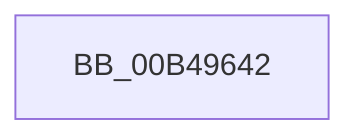

# sub_00B49642

- RVA: `0x00B49642`–`0x00B496A8` (길이 `102` bytes)
- VA: `0x0000000140B49642`
- 실행 섹션: `PAGE`
- PDB 이름 있음: `아니요`; PDB Function 태그: `아니요`
- unwind 정보 RVA: `0x000BAC9C`
- 디코드: `20`개 명령, `102/102` bytes 표시
- 미해석 바이트: `0` (있으면 어셈블리에 `.byte`로 보존)

> 이 문서는 커널 이미지의 기계어와 PDB 기호를 분석해 생성했습니다. 4번과 5번은 함수 원형과 자료형을 바이너리 사용 방식에서 추정한 C 해석이며 원본 소스 복구 결과는 아닙니다.

## 1. Dependencies

- 직접 호출 지점: **1**; 고유 호출 대상: **1**
- 직접 호출자로 확인된 함수: **0**
- RIP 상대 이미지 참조: **2**

### Outgoing calls
- `0x00B4969D` → [EtwWrite](../../text/41/EtwWrite_function_0041C720.md) (function, `0x0041C720`)

### Direct callers
- 이 함수 시작 RVA로 연결되는 직접 call은 확인되지 않았습니다. 간접 호출은 완전히 역산할 수 없습니다.

### Static image references
- `0x00B49645` → RVA `0x0001C7B0` (`.rdata`; read)
- `0x00B4965F` → RVA `0x00F0B408` (`.data`; read)

## 2. Other-region calls and transfers

- 다른 실행 섹션으로 향하는 call: **1**
  - `0x00B4969D` → [EtwWrite](../../text/41/EtwWrite_function_0041C720.md) (`PAGE` → `.text`)
- call이 아닌 외부 분기/꼬리 이동: **1**
  - `0x00B496A3` → [PopDiagTraceThermalRequestPassiveUpdate + 0x21](../AA/PopDiagTraceThermalRequestPassiveUpdate_function_00AA1640.md) (`tail-transfer`)

## 3. Assembly (complete function range)

```asm
00B49642  8A 43 10                        mov al, byte ptr [rbx + 0x10]
00B49645  48 8D 15 64 31 4D FF            lea rdx, [rip - 0xb2ce9c]
00B4964C  83 64 24 4C 00                  and dword ptr [rsp + 0x4c], 0
00B49651  41 B9 02 00 00 00               mov r9d, 2
00B49657  83 64 24 5C 00                  and dword ptr [rsp + 0x5c], 0
00B4965C  45 33 C0                        xor r8d, r8d
00B4965F  48 8B 0D A2 1D 3C 00            mov rcx, qword ptr [rip + 0x3c1da2]
00B49666  88 44 24 30                     mov byte ptr [rsp + 0x30], al
00B4966A  48 8D 44 24 30                  lea rax, [rsp + 0x30]
00B4966F  48 89 44 24 40                  mov qword ptr [rsp + 0x40], rax
00B49674  48 8D 44 24 38                  lea rax, [rsp + 0x38]
00B49679  48 89 44 24 50                  mov qword ptr [rsp + 0x50], rax
00B4967E  48 8D 44 24 40                  lea rax, [rsp + 0x40]
00B49683  48 89 44 24 20                  mov qword ptr [rsp + 0x20], rax
00B49688  48 89 5C 24 38                  mov qword ptr [rsp + 0x38], rbx
00B4968D  C7 44 24 48 01 00 00 00         mov dword ptr [rsp + 0x48], 1
00B49695  C7 44 24 58 08 00 00 00         mov dword ptr [rsp + 0x58], 8
00B4969D  E8 7E 30 8D FF                  call 0x14041c720
00B496A2  90                              nop
00B496A3  E9 B9 7F F5 FF                  jmp 0x140aa1661
```

## 4. C-style interpretation (structured pseudocode)

```c
__int64 __fastcall sub_00B49642(__int64 a1, __int64 a2, int a3, __int64 a4, __int64 a5, __int64 a6, __int64 a7, __int64 a8)
{
    __int64 result;
    unsigned __int64 v_stack_p20;
    unsigned __int8 v_stack_p30;
    unsigned __int64 v_stack_p38;
    unsigned __int64 v_stack_p40;
    unsigned int v_stack_p48;
    unsigned int v_stack_p4C;
    unsigned __int64 v_stack_p50;
    unsigned int v_stack_p58;
    unsigned int v_stack_p5C;

    a3 = 0;
    v_stack_p30 = (unsigned __int8)(*(unsigned __int8 *)(v_rbx + 16));
    v_stack_p40 = a6;
    v_stack_p50 = a7;
    v_stack_p20 = a8;
    v_stack_p38 = v_rbx;
    v_stack_p48 = 1;
    v_stack_p58 = 8;
    result = EtwWrite(*(unsigned __int64 *)(v_rip + 3939746), v_rip - 11718300, a3, 2);
}
```

## 5. (Beta) C Style

```c
int64_t sub_00B49642(int64_t Arg1, int64_t Arg2, int32_t Arg3, int64_t Arg4, uint64_t Arg5, int64_t Arg6, int64_t Arg7, int64_t Arg8)
{
    int64_t result;
    uint64_t v_stack_p20;
    uint8_t v_stack_p30;
    uint64_t v_stack_p38;
    uint64_t v_stack_p40;
    uint32_t v_stack_p48;
    uint32_t v_stack_p4C;
    uint64_t v_stack_p50;
    uint32_t v_stack_p58;
    uint32_t v_stack_p5C;

    Arg3 = 0;
    v_stack_p30 = (uint8_t)(*(uint8_t *)(local_rbx + 0x10));
    v_stack_p40 = Arg6;
    v_stack_p50 = Arg7;
    v_stack_p20 = Arg8;
    v_stack_p38 = local_rbx;
    v_stack_p48 = 1;
    v_stack_p58 = 8;
    result = EtwWrite(*(uint64_t *)(v_rip + 0x3C1DA2), v_rip - 11718300, Arg3, 2);
}
```

## 6. Execution-region graph

[열기: 2D/3D 그래프와 함수 탐색 컨트롤 패널](../../../control-panel.html?section=page&rva=0x00B49642&view=graph)

- 2D 그래프는 위에서 아래로 흐르고, 3D 그래프는 빈 공간을 드래그해 회전합니다. Shift+드래그는 이동, 휠은 확대·축소, 함수 노드 선택은 대상 보고서 이동입니다.

### Static fallback


