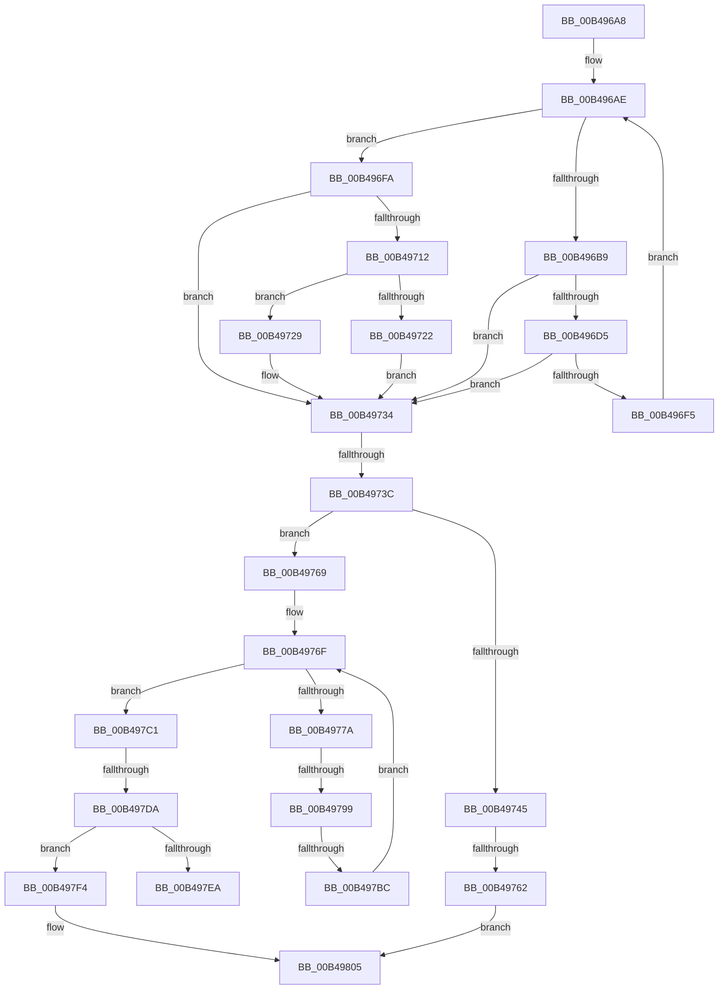

# sub_00B496A8

- RVA: `0x00B496A8`–`0x00B4980C` (길이 `356` bytes)
- VA: `0x0000000140B496A8`
- 실행 섹션: `PAGE`
- PDB 이름 있음: `아니요`; PDB Function 태그: `아니요`
- unwind 정보 RVA: `0x000BACE8`
- 디코드: `111`개 명령, `356/356` bytes 표시
- 미해석 바이트: `0` (있으면 어셈블리에 `.byte`로 보존)

> 이 문서는 커널 이미지의 기계어와 PDB 기호를 분석해 생성했습니다. 4번과 5번은 함수 원형과 자료형을 바이너리 사용 방식에서 추정한 C 해석이며 원본 소스 복구 결과는 아닙니다.

## 1. Dependencies

- 직접 호출 지점: **0**; 고유 호출 대상: **0**
- 직접 호출자로 확인된 함수: **0**
- RIP 상대 이미지 참조: **0**

### Outgoing calls
- 직접 디코드된 call 명령이 없습니다.

### Direct callers
- 이 함수 시작 RVA로 연결되는 직접 call은 확인되지 않았습니다. 간접 호출은 완전히 역산할 수 없습니다.

### Static image references
- 디코드된 RIP-relative 메모리 참조가 없습니다.

## 2. Other-region calls and transfers

- 다른 실행 섹션으로 향하는 call: **0**
- call이 아닌 외부 분기/꼬리 이동: **7**
  - `0x00B49736` → [SPCallServerHandleCallbackPaintComplete + 0x1B8](../AA/SPCallServerHandleCallbackPaintComplete_function_00AA16C4.md) (`tail-transfer`)
  - `0x00B4975C` → [SPCallServerHandleCallbackPaintComplete + 0x1B8](../AA/SPCallServerHandleCallbackPaintComplete_function_00AA16C4.md) (`tail-transfer`)
  - `0x00B49793` → [SPCallServerHandleCallbackPaintComplete + 0x1B8](../AA/SPCallServerHandleCallbackPaintComplete_function_00AA16C4.md) (`tail-transfer`)
  - `0x00B497B6` → [SPCallServerHandleCallbackPaintComplete + 0x1B8](../AA/SPCallServerHandleCallbackPaintComplete_function_00AA16C4.md) (`tail-transfer`)
  - `0x00B497D4` → [SPCallServerHandleCallbackPaintComplete + 0x1B8](../AA/SPCallServerHandleCallbackPaintComplete_function_00AA16C4.md) (`tail-transfer`)
  - `0x00B497EF` → [SPCallServerHandleCallbackPaintComplete + 0x1B8](../AA/SPCallServerHandleCallbackPaintComplete_function_00AA16C4.md) (`tail-transfer`)
  - `0x00B49807` → [SPCallServerHandleCallbackPaintComplete + 0x1B8](../AA/SPCallServerHandleCallbackPaintComplete_function_00AA16C4.md) (`tail-transfer`)

## 3. Assembly (complete function range)

```asm
00B496A8  44 8B C7                        mov r8d, edi
00B496AB  44 8B 16                        mov r10d, dword ptr [rsi]
00B496AE  4C 8B DA                        mov r11, rdx
00B496B1  4C 8B EA                        mov r13, rdx
00B496B4  45 3B C2                        cmp r8d, r10d
00B496B7  73 41                           jae 0x140b496fa
00B496B9  8B 0A                           mov ecx, dword ptr [rdx]
00B496BB  83 C1 04                        add ecx, 4
00B496BE  41 8B C4                        mov eax, r12d
00B496C1  83 F9 04                        cmp ecx, 4
00B496C4  0F 43 C1                        cmovae eax, ecx
00B496C7  1B DB                           sbb ebx, ebx
00B496C9  41 23 DE                        and ebx, r14d
00B496CC  83 F9 04                        cmp ecx, 4
00B496CF  44 0F 43 C8                     cmovae r9d, eax
00B496D3  72 5F                           jb 0x140b49734
00B496D5  41 8B C9                        mov ecx, r9d
00B496D8  48 03 CA                        add rcx, rdx
00B496DB  49 8B C7                        mov rax, r15
00B496DE  48 3B CA                        cmp rcx, rdx
00B496E1  48 0F 43 C1                     cmovae rax, rcx
00B496E5  48 8B D0                        mov rdx, rax
00B496E8  49 3B CD                        cmp rcx, r13
00B496EB  1B DB                           sbb ebx, ebx
00B496ED  41 23 DE                        and ebx, r14d
00B496F0  49 3B CD                        cmp rcx, r13
00B496F3  72 3F                           jb 0x140b49734
00B496F5  41 FF C0                        inc r8d
00B496F8  EB B4                           jmp 0x140b496ae
00B496FA  48 8D 42 04                     lea rax, [rdx + 4]
00B496FE  4D 8B C7                        mov r8, r15
00B49701  48 3B C2                        cmp rax, rdx
00B49704  4C 0F 43 C0                     cmovae r8, rax
00B49708  1B DB                           sbb ebx, ebx
00B4970A  41 23 DE                        and ebx, r14d
00B4970D  48 3B C2                        cmp rax, rdx
00B49710  72 22                           jb 0x140b49734
00B49712  8B 4E 04                        mov ecx, dword ptr [rsi + 4]
00B49715  48 03 4E 08                     add rcx, qword ptr [rsi + 8]
00B49719  48 8D 42 08                     lea rax, [rdx + 8]
00B4971D  48 3B C1                        cmp rax, rcx
00B49720  76 07                           jbe 0x140b49729
00B49722  BB 23 00 00 C0                  mov ebx, 0xc0000023
00B49727  EB 0B                           jmp 0x140b49734
00B49729  C7 02 04 00 00 00               mov dword ptr [rdx], 4
00B4972F  41 89 38                        mov dword ptr [r8], edi
00B49732  FF 06                           inc dword ptr [rsi]
00B49734  85 DB                           test ebx, ebx
00B49736  0F 88 40 81 F5 FF               js 0x140aa187c
00B4973C  48 8B 56 08                     mov rdx, qword ptr [rsi + 8]
00B49740  48 85 D2                        test rdx, rdx
00B49743  75 24                           jne 0x140b49769
00B49745  8B 4E 04                        mov ecx, dword ptr [rsi + 4]
00B49748  8D 41 0C                        lea eax, [rcx + 0xc]
00B4974B  3B C1                           cmp eax, ecx
00B4974D  44 0F 43 E0                     cmovae r12d, eax
00B49751  44 89 66 04                     mov dword ptr [rsi + 4], r12d
00B49755  1B DB                           sbb ebx, ebx
00B49757  41 23 DE                        and ebx, r14d
00B4975A  3B C1                           cmp eax, ecx
00B4975C  0F 82 1A 81 F5 FF               jb 0x140aa187c
00B49762  8B DF                           mov ebx, edi
00B49764  E9 9C 00 00 00                  jmp 0x140b49805
00B49769  44 8B C7                        mov r8d, edi
00B4976C  44 8B 0E                        mov r9d, dword ptr [rsi]
00B4976F  4C 8B D2                        mov r10, rdx
00B49772  4C 8B DA                        mov r11, rdx
00B49775  45 3B C1                        cmp r8d, r9d
00B49778  73 47                           jae 0x140b497c1
00B4977A  8B 0A                           mov ecx, dword ptr [rdx]
00B4977C  83 C1 04                        add ecx, 4
00B4977F  41 8B C4                        mov eax, r12d
00B49782  83 F9 04                        cmp ecx, 4
00B49785  0F 43 C1                        cmovae eax, ecx
00B49788  1B DB                           sbb ebx, ebx
00B4978A  41 23 DE                        and ebx, r14d
00B4978D  83 F9 04                        cmp ecx, 4
00B49790  0F 43 F8                        cmovae edi, eax
00B49793  0F 82 E3 80 F5 FF               jb 0x140aa187c
00B49799  8B CF                           mov ecx, edi
00B4979B  48 03 CA                        add rcx, rdx
00B4979E  49 8B C7                        mov rax, r15
00B497A1  48 3B CA                        cmp rcx, rdx
00B497A4  48 0F 43 C1                     cmovae rax, rcx
00B497A8  48 8B D0                        mov rdx, rax
00B497AB  49 3B CB                        cmp rcx, r11
00B497AE  1B DB                           sbb ebx, ebx
00B497B0  41 23 DE                        and ebx, r14d
00B497B3  49 3B CB                        cmp rcx, r11
00B497B6  0F 82 C0 80 F5 FF               jb 0x140aa187c
00B497BC  41 FF C0                        inc r8d
00B497BF  EB AE                           jmp 0x140b4976f
00B497C1  48 8D 42 04                     lea rax, [rdx + 4]
00B497C5  48 3B C2                        cmp rax, rdx
00B497C8  4C 0F 43 F8                     cmovae r15, rax
00B497CC  1B DB                           sbb ebx, ebx
00B497CE  41 23 DE                        and ebx, r14d
00B497D1  48 3B C2                        cmp rax, rdx
00B497D4  0F 82 A2 80 F5 FF               jb 0x140aa187c
00B497DA  8B 4E 04                        mov ecx, dword ptr [rsi + 4]
00B497DD  48 03 4E 08                     add rcx, qword ptr [rsi + 8]
00B497E1  48 8D 42 0C                     lea rax, [rdx + 0xc]
00B497E5  48 3B C1                        cmp rax, rcx
00B497E8  76 0A                           jbe 0x140b497f4
00B497EA  BB 23 00 00 C0                  mov ebx, 0xc0000023
00B497EF  E9 88 80 F5 FF                  jmp 0x140aa187c
00B497F4  C7 02 08 00 00 00               mov dword ptr [rdx], 8
00B497FA  48 8B 84 24 90 00 00 00         mov rax, qword ptr [rsp + 0x90]
00B49802  49 89 07                        mov qword ptr [r15], rax
00B49805  FF 06                           inc dword ptr [rsi]
00B49807  E9 70 80 F5 FF                  jmp 0x140aa187c
```

## 4. C-style interpretation (structured pseudocode)

```c
__int64 __fastcall sub_00B496A8(__int64 a1, __int64 a2, __int64 a3, __int64 a4, __int64 a5, __int64 a6, __int64 a7, __int64 a8, __int64 a9, __int64 a10, __int64 a11, __int64 a12, __int64 a13, __int64 a14, __int64 a15, __int64 a16, __int64 a17, __int64 a18)
{
    __int64 result;
    __int64 v_r12;
    __int64 v_r15;
    __int64 v_rbx;
    __int64 v_rdi;

loc_00B496AE:
    if (((unsigned int)((unsigned int)((unsigned int)(v_rdi)))) >= ((unsigned int)((unsigned int)(*(unsigned int *)(v_rsi))))) goto loc_00B496FA;
    a1 = (unsigned int)(((unsigned int)(*(unsigned int *)(a2))) + (4));
    result = (unsigned int)((unsigned int)(v_r12));
    if (((unsigned int)(a1)) >= 4) { result = (unsigned int)(a1); }
    v_rbx = (unsigned int)((v_rbx) & ((unsigned int)(v_r14)));
    if (((unsigned int)(a1)) >= 4) { a4 = (unsigned int)(result); }
    if (((unsigned int)(a1)) < 4) goto loc_00B49734;
    a1 = ((unsigned int)((unsigned int)(a4))) + (a2);
    result = v_r15;
    if (a1 >= a2) { result = a1; }
    v_rbx = (unsigned int)((v_rbx) & ((unsigned int)(v_r14)));
    if (a1 < a2) goto loc_00B49734;
    a3 = (unsigned int)(((unsigned int)((unsigned int)(v_rdi))) + 1);
    goto loc_00B496AE;
loc_00B496FA:
    a3 = v_r15;
    if ((result + 4) >= result) { a3 = result + 4; }
    v_rbx = (unsigned int)((v_rbx) & ((unsigned int)(v_r14)));
    if ((result + 4) < result) goto loc_00B49734;
    a1 = ((unsigned int)(*(unsigned int *)(v_rsi + 4))) + (*(unsigned __int64 *)(v_rsi + 8));
    if ((result + 8) <= a1) goto loc_00B49729;
    goto loc_00B49734;
loc_00B49729:
    *(unsigned int *)(result) = 4;
    *(unsigned int *)(a3) = (unsigned int)(v_rdi);
loc_00B49734:
    if (*(unsigned __int64 *)(v_rsi + 8) != 0) goto loc_00B49769;
    if (((unsigned int)((unsigned int)(*(unsigned int *)(v_rsi + 4)) + 12)) >= ((unsigned int)((unsigned int)(*(unsigned int *)(v_rsi + 4))))) { v_r12 = (unsigned int)((unsigned int)(*(unsigned int *)(v_rsi + 4)) + 12); }
    *(unsigned int *)(v_rsi + 4) = (unsigned int)(v_r12);
    v_rbx = (unsigned int)(((unsigned int)(0xC0000023ULL)) & ((unsigned int)(v_r14)));
    goto loc_00B49805;
loc_00B49769:
loc_00B4976F:
    if (((unsigned int)((unsigned int)((unsigned int)(v_rdi)))) >= ((unsigned int)((unsigned int)(*(unsigned int *)(v_rsi))))) goto loc_00B497C1;
    a1 = (unsigned int)(((unsigned int)(*(unsigned int *)(*(unsigned __int64 *)(v_rsi + 8)))) + (4));
    result = (unsigned int)((unsigned int)(v_r12));
    if (((unsigned int)(a1)) >= 4) { result = (unsigned int)(a1); }
    v_rbx = (unsigned int)(((unsigned int)((unsigned int)(v_rdi))) & ((unsigned int)(v_r14)));
    if (((unsigned int)(a1)) >= 4) { v_rdi = (unsigned int)(result); }
    a1 = ((unsigned int)((unsigned int)(v_rdi))) + (*(unsigned __int64 *)(v_rsi + 8));
    result = v_r15;
    if (a1 >= (*(unsigned __int64 *)(v_rsi + 8))) { result = a1; }
    v_rbx = (unsigned int)((v_rbx) & ((unsigned int)(v_r14)));
    a3 = (unsigned int)(((unsigned int)((unsigned int)(v_rdi))) + 1);
    goto loc_00B4976F;
loc_00B497C1:
    if ((result + 4) >= result) { v_r15 = result + 4; }
    v_rbx = (unsigned int)((v_rbx) & ((unsigned int)(v_r14)));
    a1 = ((unsigned int)(*(unsigned int *)(v_rsi + 4))) + (*(unsigned __int64 *)(v_rsi + 8));
    if ((result + 12) <= a1) goto loc_00B497F4;
loc_00B497F4:
    *(unsigned int *)(result) = 8;
    *(unsigned __int64 *)(v_r15) = a18;
loc_00B49805:
}
```

## 5. (Beta) C Style

```c
int64_t sub_00B496A8(int64_t Arg1, int64_t Arg2, int64_t Arg3, int64_t Arg4, uint64_t Arg5, uint64_t Arg6, uint64_t Arg7, uint64_t Arg8, uint64_t Arg9, uint64_t Arg10, uint64_t Arg11, uint64_t Arg12, uint64_t Arg13, uint64_t Arg14, uint64_t Arg15, uint64_t Arg16, uint64_t Arg17, int64_t Arg18)
{
    int64_t result;
    int64_t local_r12;
    int64_t local_r15;
    int64_t local_rbx;
    int64_t local_rdi;

loc_00B496AE:
    if (((uint32_t)((uint32_t)((uint32_t)(local_rdi)))) >= ((uint32_t)((uint32_t)(*(uint32_t *)(local_rsi))))) goto loc_00B496FA;
    Arg1 = (uint32_t)(((uint32_t)(*(uint32_t *)(Arg2))) + (4));
    result = (uint32_t)((uint32_t)(local_r12));
    if (((uint32_t)(Arg1)) >= 4) { result = (uint32_t)(Arg1); }
    local_rbx = (uint32_t)((local_rbx) & ((uint32_t)(local_r14)));
    if (((uint32_t)(Arg1)) >= 4) { Arg4 = (uint32_t)(result); }
    if (((uint32_t)(Arg1)) < 4) goto loc_00B49734;
    Arg1 = ((uint32_t)((uint32_t)(Arg4))) + (Arg2);
    result = local_r15;
    if (Arg1 >= Arg2) { result = Arg1; }
    local_rbx = (uint32_t)((local_rbx) & ((uint32_t)(local_r14)));
    if (Arg1 < Arg2) goto loc_00B49734;
    Arg3 = (uint32_t)(((uint32_t)((uint32_t)(local_rdi))) + 1);
    goto loc_00B496AE;
loc_00B496FA:
    Arg3 = local_r15;
    if ((result + 4) >= result) { Arg3 = result + 4; }
    local_rbx = (uint32_t)((local_rbx) & ((uint32_t)(local_r14)));
    if ((result + 4) < result) goto loc_00B49734;
    Arg1 = ((uint32_t)(*(uint32_t *)(local_rsi + 0x4))) + (*(uint64_t *)(local_rsi + 0x8));
    if ((result + 8) <= Arg1) goto loc_00B49729;
    goto loc_00B49734;
loc_00B49729:
    *(uint32_t *)(result) = 4;
    *(uint32_t *)(Arg3) = (uint32_t)(local_rdi);
loc_00B49734:
    if (*(uint64_t *)(local_rsi + 0x8) != 0) goto loc_00B49769;
    if (((uint32_t)((uint32_t)(*(uint32_t *)(local_rsi + 0x4)) + 12)) >= ((uint32_t)((uint32_t)(*(uint32_t *)(local_rsi + 0x4))))) { local_r12 = (uint32_t)((uint32_t)(*(uint32_t *)(local_rsi + 0x4)) + 12); }
    *(uint32_t *)(local_rsi + 0x4) = (uint32_t)(local_r12);
    local_rbx = (uint32_t)(((uint32_t)(0xC0000023ULL)) & ((uint32_t)(local_r14)));
    goto loc_00B49805;
loc_00B49769:
loc_00B4976F:
    if (((uint32_t)((uint32_t)((uint32_t)(local_rdi)))) >= ((uint32_t)((uint32_t)(*(uint32_t *)(local_rsi))))) goto loc_00B497C1;
    Arg1 = (uint32_t)(((uint32_t)(*(uint32_t *)(*(uint64_t *)(local_rsi + 0x8)))) + (4));
    result = (uint32_t)((uint32_t)(local_r12));
    if (((uint32_t)(Arg1)) >= 4) { result = (uint32_t)(Arg1); }
    local_rbx = (uint32_t)(((uint32_t)((uint32_t)(local_rdi))) & ((uint32_t)(local_r14)));
    if (((uint32_t)(Arg1)) >= 4) { local_rdi = (uint32_t)(result); }
    Arg1 = ((uint32_t)((uint32_t)(local_rdi))) + (*(uint64_t *)(local_rsi + 0x8));
    result = local_r15;
    if (Arg1 >= (*(uint64_t *)(local_rsi + 0x8))) { result = Arg1; }
    local_rbx = (uint32_t)((local_rbx) & ((uint32_t)(local_r14)));
    Arg3 = (uint32_t)(((uint32_t)((uint32_t)(local_rdi))) + 1);
    goto loc_00B4976F;
loc_00B497C1:
    if ((result + 4) >= result) { local_r15 = result + 4; }
    local_rbx = (uint32_t)((local_rbx) & ((uint32_t)(local_r14)));
    Arg1 = ((uint32_t)(*(uint32_t *)(local_rsi + 0x4))) + (*(uint64_t *)(local_rsi + 0x8));
    if ((result + 12) <= Arg1) goto loc_00B497F4;
loc_00B497F4:
    *(uint32_t *)(result) = 8;
    *(uint64_t *)(local_r15) = Arg18;
loc_00B49805:
}
```

## 6. Execution-region graph

[열기: 2D/3D 그래프와 함수 탐색 컨트롤 패널](../../../control-panel.html?section=page&rva=0x00B496A8&view=graph)

- 2D 그래프는 위에서 아래로 흐르고, 3D 그래프는 빈 공간을 드래그해 회전합니다. Shift+드래그는 이동, 휠은 확대·축소, 함수 노드 선택은 대상 보고서 이동입니다.

### Static fallback


