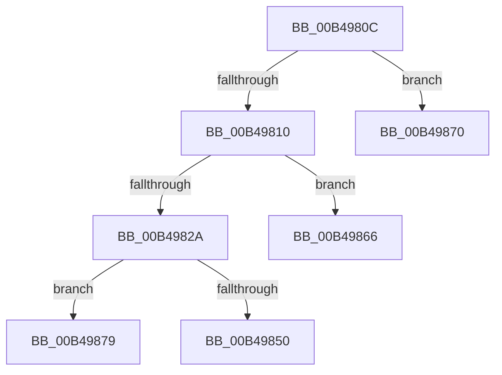

# sub_00B4980C

- RVA: `0x00B4980C`–`0x00B49880` (길이 `116` bytes)
- VA: `0x0000000140B4980C`
- 실행 섹션: `PAGE`
- PDB 이름 있음: `아니요`; PDB Function 태그: `아니요`
- unwind 정보 RVA: `0x000BADA0`
- 디코드: `29`개 명령, `116/116` bytes 표시
- 미해석 바이트: `0` (있으면 어셈블리에 `.byte`로 보존)

> 이 문서는 커널 이미지의 기계어와 PDB 기호를 분석해 생성했습니다. 4번과 5번은 함수 원형과 자료형을 바이너리 사용 방식에서 추정한 C 해석이며 원본 소스 복구 결과는 아닙니다.

## 1. Dependencies

- 직접 호출 지점: **1**; 고유 호출 대상: **1**
- 직접 호출자로 확인된 함수: **0**
- RIP 상대 이미지 참조: **2**

### Outgoing calls
- `0x00B49820` → [ExAllocatePool2](../../poolcode/B8/ExAllocatePool2_function_00B820F0.md) (function, `0x00B820F0`)

### Direct callers
- 이 함수 시작 RVA로 연결되는 직접 call은 확인되지 않았습니다. 간접 호출은 완전히 역산할 수 없습니다.

### Static image references
- `0x00B49844` → RVA `0x00E08230` (`.data`; read)
- `0x00B4985A` → RVA `0x00E08230` (`.data`; write)

## 2. Other-region calls and transfers

- 다른 실행 섹션으로 향하는 call: **1**
  - `0x00B49820` → [ExAllocatePool2](../../poolcode/B8/ExAllocatePool2_function_00B820F0.md) (`PAGE` → `POOLCODE`)
- call이 아닌 외부 분기/꼬리 이동: **3**
  - `0x00B49861` → [PopPdcCsDeviceNotification + 0x10B](../AA/PopPdcCsDeviceNotification_function_00AA1B28.md) (`tail-transfer`)
  - `0x00B4986B` → [PopPdcCsDeviceNotification + 0xC5](../AA/PopPdcCsDeviceNotification_function_00AA1B28.md) (`tail-transfer`)
  - `0x00B49874` → [PopPdcCsDeviceNotification + 0xC5](../AA/PopPdcCsDeviceNotification_function_00AA1B28.md) (`tail-transfer`)

## 3. Assembly (complete function range)

```asm
00B4980C  84 D2                           test dl, dl
00B4980E  75 60                           jne 0x140b49870
00B49810  BA 28 00 00 00                  mov edx, 0x28
00B49815  B9 00 01 00 00                  mov ecx, 0x100
00B4981A  41 B8 43 53 43 6F               mov r8d, 0x6f435343
00B49820  E8 CB 88 03 00                  call 0x140b820f0
00B49825  48 85 C0                        test rax, rax
00B49828  74 3C                           je 0x140b49866
00B4982A  48 8B 0E                        mov rcx, qword ptr [rsi]
00B4982D  48 89 48 10                     mov qword ptr [rax + 0x10], rcx
00B49831  8B 4E 08                        mov ecx, dword ptr [rsi + 8]
00B49834  89 48 18                        mov dword ptr [rax + 0x18], ecx
00B49837  8A 4E 0D                        mov cl, byte ptr [rsi + 0xd]
00B4983A  88 48 20                        mov byte ptr [rax + 0x20], cl
00B4983D  C7 40 1C 01 00 00 00            mov dword ptr [rax + 0x1c], 1
00B49844  48 8B 0D E5 E9 2B 00            mov rcx, qword ptr [rip + 0x2be9e5]
00B4984B  48 39 29                        cmp qword ptr [rcx], rbp
00B4984E  75 29                           jne 0x140b49879
00B49850  48 89 28                        mov qword ptr [rax], rbp
00B49853  48 89 48 08                     mov qword ptr [rax + 8], rcx
00B49857  48 89 01                        mov qword ptr [rcx], rax
00B4985A  48 89 05 CF E9 2B 00            mov qword ptr [rip + 0x2be9cf], rax
00B49861  E9 CD 83 F5 FF                  jmp 0x140aa1c33
00B49866  BF 17 00 00 C0                  mov edi, 0xc0000017
00B4986B  E9 7D 83 F5 FF                  jmp 0x140aa1bed
00B49870  41 FF 40 1C                     inc dword ptr [r8 + 0x1c]
00B49874  E9 74 83 F5 FF                  jmp 0x140aa1bed
00B49879  B9 03 00 00 00                  mov ecx, 3
00B4987E  CD 29                           int 0x29
```

## 4. C-style interpretation (structured pseudocode)

```c
__int64 __fastcall sub_00B4980C(__int64 a1, unsigned __int8 a2)
{
    __int64 result;

    if (a2 != 0) goto loc_00B49870;
    result = ExAllocatePool2(256, 40, (unsigned int)(0x6F435343ULL), a4);
    if (result == 0) goto loc_00B49866;
    *(unsigned __int64 *)(result + 16) = *(unsigned __int64 *)(v_rsi);
    *(unsigned int *)(result + 24) = (unsigned int)((unsigned int)(*(unsigned int *)(v_rsi + 8)));
    *(unsigned __int8 *)(result + 32) = (unsigned __int8)(*(unsigned __int8 *)(v_rsi + 13));
    *(unsigned int *)(result + 28) = 1;
    if ((*(unsigned __int64 *)(*(unsigned __int64 *)(v_rip + 2877925))) != v_rbp) goto loc_00B49879;
    *(unsigned __int64 *)(result) = v_rbp;
    *(unsigned __int64 *)(result + 8) = *(unsigned __int64 *)(v_rip + 2877925);
    *(unsigned __int64 *)(*(unsigned __int64 *)(v_rip + 2877925)) = result;
    *(unsigned __int64 *)(v_rip + 2877903) = result;
loc_00B49866:
loc_00B49870:
loc_00B49879:
    return result;
}
```

## 5. (Beta) C Style

```c
int64_t sub_00B4980C(int64_t Arg1, uint8_t Arg2)
{
    int64_t result;

    if (Arg2 != 0) goto loc_00B49870;
    result = ExAllocatePool2(256, 40, (uint32_t)(0x6F435343ULL), a4);
    if (result == 0) goto loc_00B49866;
    *(uint64_t *)(result + 0x10) = *(uint64_t *)(local_rsi);
    *(uint32_t *)(result + 0x18) = (uint32_t)((uint32_t)(*(uint32_t *)(local_rsi + 0x8)));
    *(uint8_t *)(result + 0x20) = (uint8_t)(*(uint8_t *)(local_rsi + 0xD));
    *(uint32_t *)(result + 0x1C) = 1;
    if ((*(uint64_t *)(*(uint64_t *)(v_rip + 0x2BE9E5))) != local_rbp) goto loc_00B49879;
    *(uint64_t *)(result) = local_rbp;
    *(uint64_t *)(result + 0x8) = *(uint64_t *)(v_rip + 0x2BE9E5);
    *(uint64_t *)(*(uint64_t *)(v_rip + 0x2BE9E5)) = result;
    *(uint64_t *)(v_rip + 0x2BE9CF) = result;
loc_00B49866:
loc_00B49870:
loc_00B49879:
    return result;
}
```

## 6. Execution-region graph

[열기: 2D/3D 그래프와 함수 탐색 컨트롤 패널](../../../control-panel.html?section=page&rva=0x00B4980C&view=graph)

- 2D 그래프는 위에서 아래로 흐르고, 3D 그래프는 빈 공간을 드래그해 회전합니다. Shift+드래그는 이동, 휠은 확대·축소, 함수 노드 선택은 대상 보고서 이동입니다.

### Static fallback


