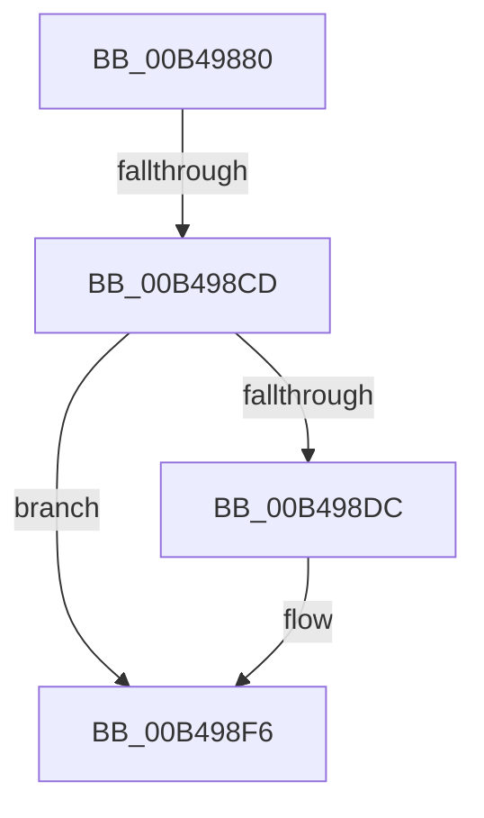

# sub_00B49880

- RVA: `0x00B49880`–`0x00B49904` (길이 `132` bytes)
- VA: `0x0000000140B49880`
- 실행 섹션: `PAGE`
- PDB 이름 있음: `아니요`; PDB Function 태그: `아니요`
- unwind 정보 RVA: `0x000BADD4`
- 디코드: `33`개 명령, `132/132` bytes 표시
- 미해석 바이트: `0` (있으면 어셈블리에 `.byte`로 보존)

> 이 문서는 커널 이미지의 기계어와 PDB 기호를 분석해 생성했습니다. 4번과 5번은 함수 원형과 자료형을 바이너리 사용 방식에서 추정한 C 해석이며 원본 소스 복구 결과는 아닙니다.

## 1. Dependencies

- 직접 호출 지점: **4**; 고유 호출 대상: **4**
- 직접 호출자로 확인된 함수: **0**
- RIP 상대 이미지 참조: **0**

### Outgoing calls
- `0x00B49884` → [KeResetEvent](../../text/24/KeResetEvent_function_00248350.md) (function, `0x00248350`)
- `0x00B498BF` → [IoBuildDeviceIoControlRequest](../../text/20/IoBuildDeviceIoControlRequest_function_00204FD0.md) (function, `0x00204FD0`)
- `0x00B498D3` → [IofCallDriver](../../text/29/IofCallDriver_function_0029B4B0.md) (function, `0x0029B4B0`)
- `0x00B498EE` → [KeWaitForSingleObject](../../text/20/KeWaitForSingleObject_function_0020E6B0.md) (function, `0x0020E6B0`)

### Direct callers
- 이 함수 시작 RVA로 연결되는 직접 call은 확인되지 않았습니다. 간접 호출은 완전히 역산할 수 없습니다.

### Static image references
- 디코드된 RIP-relative 메모리 참조가 없습니다.

## 2. Other-region calls and transfers

- 다른 실행 섹션으로 향하는 call: **4**
  - `0x00B49884` → [KeResetEvent](../../text/24/KeResetEvent_function_00248350.md) (`PAGE` → `.text`)
  - `0x00B498BF` → [IoBuildDeviceIoControlRequest](../../text/20/IoBuildDeviceIoControlRequest_function_00204FD0.md) (`PAGE` → `.text`)
  - `0x00B498D3` → [IofCallDriver](../../text/29/IofCallDriver_function_0029B4B0.md) (`PAGE` → `.text`)
  - `0x00B498EE` → [KeWaitForSingleObject](../../text/20/KeWaitForSingleObject_function_0020E6B0.md) (`PAGE` → `.text`)
- call이 아닌 외부 분기/꼬리 이동: **2**
  - `0x00B498C7` → [RawQueryFsSizeInfo + 0x23C](../AA/RawQueryFsSizeInfo_function_00AA1DC8.md) (`tail-transfer`)
  - `0x00B498FF` → [RawQueryFsSizeInfo + 0x10A](../AA/RawQueryFsSizeInfo_function_00AA1DC8.md) (`tail-transfer`)

## 3. Assembly (complete function range)

```asm
00B49880  48 8D 4D B7                     lea rcx, [rbp - 0x49]
00B49884  E8 C7 EA 6F FF                  call 0x140248350
00B49889  48 8D 45 CF                     lea rax, [rbp - 0x31]
00B4988D  45 33 C9                        xor r9d, r9d
00B49890  48 89 44 24 40                  mov qword ptr [rsp + 0x40], rax
00B49895  45 33 C0                        xor r8d, r8d
00B49898  48 8D 45 B7                     lea rax, [rbp - 0x49]
00B4989C  48 8B D7                        mov rdx, rdi
00B4989F  48 89 44 24 38                  mov qword ptr [rsp + 0x38], rax
00B498A4  B9 04 40 07 00                  mov ecx, 0x74004
00B498A9  C6 44 24 30 00                  mov byte ptr [rsp + 0x30], 0
00B498AE  48 8D 45 FF                     lea rax, [rbp - 1]
00B498B2  C7 44 24 28 20 00 00 00         mov dword ptr [rsp + 0x28], 0x20
00B498BA  48 89 44 24 20                  mov qword ptr [rsp + 0x20], rax
00B498BF  E8 0C B7 6B FF                  call 0x140204fd0
00B498C4  48 85 C0                        test rax, rax
00B498C7  0F 84 37 87 F5 FF               je 0x140aa2004
00B498CD  48 8B D0                        mov rdx, rax
00B498D0  48 8B CF                        mov rcx, rdi
00B498D3  E8 D8 1B 75 FF                  call 0x14029b4b0
00B498D8  3B C3                           cmp eax, ebx
00B498DA  75 1A                           jne 0x140b498f6
00B498DC  48 83 64 24 20 00               and qword ptr [rsp + 0x20], 0
00B498E2  48 8D 4D B7                     lea rcx, [rbp - 0x49]
00B498E6  45 33 C9                        xor r9d, r9d
00B498E9  45 33 C0                        xor r8d, r8d
00B498EC  33 D2                           xor edx, edx
00B498EE  E8 BD 4D 6C FF                  call 0x14020e6b0
00B498F3  8B 45 CF                        mov eax, dword ptr [rbp - 0x31]
00B498F6  4C 8B 45 07                     mov r8, qword ptr [rbp + 7]
00B498FA  C1 E8 1F                        shr eax, 0x1f
00B498FD  34 01                           xor al, 1
00B498FF  E9 CE 85 F5 FF                  jmp 0x140aa1ed2
```

## 4. C-style interpretation (structured pseudocode)

```c
__int64 __fastcall sub_00B49880(__int64 a1, __int64 a2, int a3, int a4)
{
    __int64 result;
    unsigned __int64 v_stack_p20;
    unsigned int v_stack_p28;
    unsigned __int8 v_stack_p30;
    unsigned __int64 v_stack_p38;
    unsigned __int64 v_stack_p40;

    result = KeResetEvent(v_rbp - 73, a2, a3, a4);
    a4 = 0;
    v_stack_p40 = v_rbp - 49;
    a3 = 0;
    v_stack_p38 = v_rbp - 73;
    v_stack_p30 = 0;
    v_stack_p28 = 32;
    v_stack_p20 = v_rbp - 1;
    result = IoBuildDeviceIoControlRequest((unsigned int)(0x74004ULL), v_rdi, a3, a4);
    result = IofCallDriver(v_rdi, result, a3, a4);
    if (((unsigned int)(result)) == ((unsigned int)(v_rbx))) {
        a1 = v_rbp - 73;
        a4 = 0;
        a3 = 0;
        a2 = 0;
        result = KeWaitForSingleObject(a1, a2, a3, a4);
        result = *(unsigned int *)(v_rbp - 49);
    }
    result = (unsigned int)((result) >> (31));
    result = (unsigned __int8)((result) ^ (1));
}
```

## 5. (Beta) C Style

```c
int64_t sub_00B49880(int64_t Arg1, int64_t Arg2, int32_t Arg3, int32_t Arg4)
{
    int64_t result;
    uint64_t v_stack_p20;
    uint32_t v_stack_p28;
    uint8_t v_stack_p30;
    uint64_t v_stack_p38;
    uint64_t v_stack_p40;

    result = KeResetEvent(local_rbp - 73, Arg2, Arg3, Arg4);
    Arg4 = 0;
    v_stack_p40 = local_rbp - 49;
    Arg3 = 0;
    v_stack_p38 = local_rbp - 73;
    v_stack_p30 = 0;
    v_stack_p28 = 32;
    v_stack_p20 = local_rbp - 1;
    result = IoBuildDeviceIoControlRequest((uint32_t)(0x74004ULL), local_rdi, Arg3, Arg4);
    result = IofCallDriver(local_rdi, result, Arg3, Arg4);
    if (((uint32_t)(result)) == ((uint32_t)(local_rbx))) {
        Arg1 = local_rbp - 73;
        Arg4 = 0;
        Arg3 = 0;
        Arg2 = 0;
        result = KeWaitForSingleObject(Arg1, Arg2, Arg3, Arg4);
        result = *(uint32_t *)(local_rbp - 0x31);
    }
    result = (uint32_t)((result) >> (31));
    result = (uint8_t)((result) ^ (1));
}
```

## 6. Execution-region graph

[열기: 2D/3D 그래프와 함수 탐색 컨트롤 패널](../../../control-panel.html?section=page&rva=0x00B49880&view=graph)

- 2D 그래프는 위에서 아래로 흐르고, 3D 그래프는 빈 공간을 드래그해 회전합니다. Shift+드래그는 이동, 휠은 확대·축소, 함수 노드 선택은 대상 보고서 이동입니다.

### Static fallback


