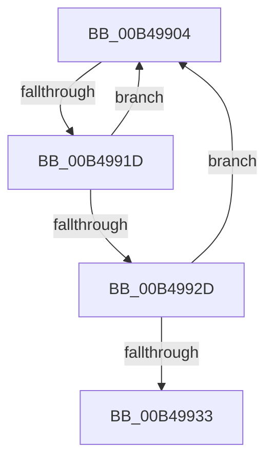

# sub_00B49904

- RVA: `0x00B49904`–`0x00B4993B` (길이 `55` bytes)
- VA: `0x0000000140B49904`
- 실행 섹션: `PAGE`
- PDB 이름 있음: `아니요`; PDB Function 태그: `아니요`
- unwind 정보 RVA: `0x000BB158`
- 디코드: `15`개 명령, `55/55` bytes 표시
- 미해석 바이트: `0` (있으면 어셈블리에 `.byte`로 보존)

> 이 문서는 커널 이미지의 기계어와 PDB 기호를 분석해 생성했습니다. 4번과 5번은 함수 원형과 자료형을 바이너리 사용 방식에서 추정한 C 해석이며 원본 소스 복구 결과는 아닙니다.

## 1. Dependencies

- 직접 호출 지점: **2**; 고유 호출 대상: **2**
- 직접 호출자로 확인된 함수: **0**
- RIP 상대 이미지 참조: **0**

### Outgoing calls
- `0x00B4990C` → [CmListGetPrevElement](../9D/CmListGetPrevElement_function_009DA2B0.md) (function, `0x009DA2B0`)
- `0x00B49924` → [CmEqualTrans](../84/CmEqualTrans_function_0084BF60.md) (function, `0x0084BF60`)

### Direct callers
- 이 함수 시작 RVA로 연결되는 직접 call은 확인되지 않았습니다. 간접 호출은 완전히 역산할 수 없습니다.

### Static image references
- 디코드된 RIP-relative 메모리 참조가 없습니다.

## 2. Other-region calls and transfers

- 다른 실행 섹션으로 향하는 call: **0**
- call이 아닌 외부 분기/꼬리 이동: **2**
  - `0x00B49917` → [CmGetKeyFlags + 0x2A](../AA/CmGetKeyFlags_function_00AA23A4.md) (`tail-transfer`)
  - `0x00B49936` → [CmGetKeyFlags + 0x2A](../AA/CmGetKeyFlags_function_00AA23A4.md) (`tail-transfer`)

## 3. Assembly (complete function range)

```asm
00B49904  48 8D 54 24 30                  lea rdx, [rsp + 0x30]
00B49909  48 8B CD                        mov rcx, rbp
00B4990C  E8 9F 09 E9 FF                  call 0x1409da2b0
00B49911  48 8B F8                        mov rdi, rax
00B49914  48 85 C0                        test rax, rax
00B49917  0F 84 B1 8A F5 FF               je 0x140aa23ce
00B4991D  48 8B 48 38                     mov rcx, qword ptr [rax + 0x38]
00B49921  48 8B D6                        mov rdx, rsi
00B49924  E8 37 26 D0 FF                  call 0x14084bf60
00B49929  84 C0                           test al, al
00B4992B  74 D7                           je 0x140b49904
00B4992D  83 7F 44 07                     cmp dword ptr [rdi + 0x44], 7
00B49931  75 D1                           jne 0x140b49904
00B49933  8B 5F 58                        mov ebx, dword ptr [rdi + 0x58]
00B49936  E9 93 8A F5 FF                  jmp 0x140aa23ce
```

## 4. C-style interpretation (structured pseudocode)

```c
__int64 __fastcall sub_00B49904(__int64 a1, __int64 a2, __int64 a3, __int64 a4, __int64 a5, __int64 a6)
{
    __int64 result;

    result = CmListGetPrevElement(v_rbp, a6, a3, a4);
    result = CmEqualTrans(*(unsigned __int64 *)(result + 56), v_rsi, a3, a4);
    if ((unsigned __int8)(result) == 0) goto loc_00B49904;
    if ((*(unsigned int *)(result + 68)) != 7) goto loc_00B49904;
}
```

## 5. (Beta) C Style

```c
int64_t sub_00B49904(int64_t Arg1, int64_t Arg2, int64_t Arg3, int64_t Arg4, uint64_t Arg5, int64_t Arg6)
{
    int64_t result;

    result = CmListGetPrevElement(local_rbp, Arg6, Arg3, Arg4);
    result = CmEqualTrans(*(uint64_t *)(result + 0x38), local_rsi, Arg3, Arg4);
    if ((uint8_t)(result) == 0) goto loc_00B49904;
    if ((*(uint32_t *)(result + 0x44)) != 7) goto loc_00B49904;
}
```

## 6. Execution-region graph

[열기: 2D/3D 그래프와 함수 탐색 컨트롤 패널](../../../control-panel.html?section=page&rva=0x00B49904&view=graph)

- 2D 그래프는 위에서 아래로 흐르고, 3D 그래프는 빈 공간을 드래그해 회전합니다. Shift+드래그는 이동, 휠은 확대·축소, 함수 노드 선택은 대상 보고서 이동입니다.

### Static fallback


