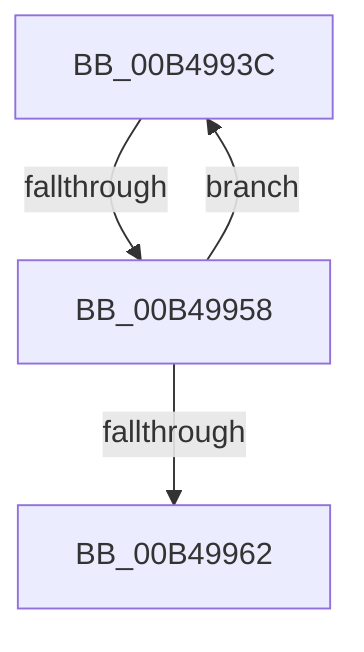

# sub_00B4993C

- RVA: `0x00B4993C`–`0x00B49967` (길이 `43` bytes)
- VA: `0x0000000140B4993C`
- 실행 섹션: `PAGE`
- PDB 이름 있음: `아니요`; PDB Function 태그: `아니요`
- unwind 정보 RVA: `0x000BB1A8`
- 디코드: `13`개 명령, `43/43` bytes 표시
- 미해석 바이트: `0` (있으면 어셈블리에 `.byte`로 보존)

> 이 문서는 커널 이미지의 기계어와 PDB 기호를 분석해 생성했습니다. 4번과 5번은 함수 원형과 자료형을 바이너리 사용 방식에서 추정한 C 해석이며 원본 소스 복구 결과는 아닙니다.

## 1. Dependencies

- 직접 호출 지점: **1**; 고유 호출 대상: **1**
- 직접 호출자로 확인된 함수: **0**
- RIP 상대 이미지 참조: **0**

### Outgoing calls
- `0x00B4994B` → [HvpMarkCellDirty](../85/HvpMarkCellDirty_function_00858080.md) (function, `0x00858080`)

### Direct callers
- 이 함수 시작 RVA로 연결되는 직접 call은 확인되지 않았습니다. 간접 호출은 완전히 역산할 수 없습니다.

### Static image references
- 디코드된 RIP-relative 메모리 참조가 없습니다.

## 2. Other-region calls and transfers

- 다른 실행 섹션으로 향하는 call: **0**
- call이 아닌 외부 분기/꼬리 이동: **2**
  - `0x00B49952` → [CmpMarkEntireIndexDirty + 0x67](../AA/CmpMarkEntireIndexDirty_function_00AA24B4.md) (`tail-transfer`)
  - `0x00B49962` → [CmpMarkEntireIndexDirty + 0x67](../AA/CmpMarkEntireIndexDirty_function_00AA24B4.md) (`tail-transfer`)

## 3. Assembly (complete function range)

```asm
00B4993C  8B C6                           mov eax, esi
00B4993E  45 33 C9                        xor r9d, r9d
00B49941  41 B0 01                        mov r8b, 1
00B49944  48 8B CB                        mov rcx, rbx
00B49947  8B 54 87 04                     mov edx, dword ptr [rdi + rax*4 + 4]
00B4994B  E8 30 E7 D0 FF                  call 0x140858080
00B49950  85 C0                           test eax, eax
00B49952  0F 88 C3 8B F5 FF               js 0x140aa251b
00B49958  0F B7 47 02                     movzx eax, word ptr [rdi + 2]
00B4995C  FF C6                           inc esi
00B4995E  3B F0                           cmp esi, eax
00B49960  72 DA                           jb 0x140b4993c
00B49962  E9 B4 8B F5 FF                  jmp 0x140aa251b
```

## 4. C-style interpretation (structured pseudocode)

```c
__int64 __fastcall sub_00B4993C(__int64 a1, __int64 a2, __int64 a3, int a4)
{
    __int64 result;
    __int64 v_rsi;

    a4 = 0;
    result = HvpMarkCellDirty(v_rbx, (unsigned int)(*(unsigned int *)(v_rdi + (unsigned int)((unsigned int)(v_rsi)) * 4 + 4)), 1, a4);
    v_rsi = (unsigned int)((v_rsi) + 1);
    if (((unsigned int)(v_rsi)) < ((unsigned int)(*(unsigned __int16 *)(v_rdi + 2)))) goto loc_00B4993C;
}
```

## 5. (Beta) C Style

```c
int64_t sub_00B4993C(int64_t Arg1, int64_t Arg2, int64_t Arg3, int32_t Arg4)
{
    int64_t result;
    int64_t local_rsi;

    Arg4 = 0;
    result = HvpMarkCellDirty(local_rbx, (uint32_t)(*(uint32_t *)(local_rdi + (uint32_t)((uint32_t)(local_rsi)) * 4 + 0x4)), 1, Arg4);
    local_rsi = (uint32_t)((local_rsi) + 1);
    if (((uint32_t)(local_rsi)) < ((uint32_t)(*(uint16_t *)(local_rdi + 0x2)))) goto loc_00B4993C;
}
```

## 6. Execution-region graph

[열기: 2D/3D 그래프와 함수 탐색 컨트롤 패널](../../../control-panel.html?section=page&rva=0x00B4993C&view=graph)

- 2D 그래프는 위에서 아래로 흐르고, 3D 그래프는 빈 공간을 드래그해 회전합니다. Shift+드래그는 이동, 휠은 확대·축소, 함수 노드 선택은 대상 보고서 이동입니다.

### Static fallback


