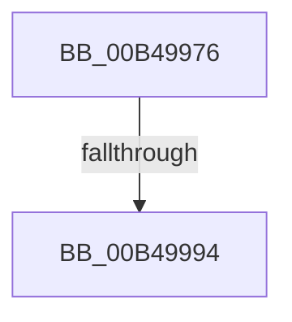

# sub_00B49976

- RVA: `0x00B49976`–`0x00B49A44` (길이 `206` bytes)
- VA: `0x0000000140B49976`
- 실행 섹션: `PAGE`
- PDB 이름 있음: `아니요`; PDB Function 태그: `아니요`
- unwind 정보 RVA: `0x000BB324`
- 디코드: `48`개 명령, `206/206` bytes 표시
- 미해석 바이트: `0` (있으면 어셈블리에 `.byte`로 보존)

> 이 문서는 커널 이미지의 기계어와 PDB 기호를 분석해 생성했습니다. 4번과 5번은 함수 원형과 자료형을 바이너리 사용 방식에서 추정한 C 해석이며 원본 소스 복구 결과는 아닙니다.

## 1. Dependencies

- 직접 호출 지점: **2**; 고유 호출 대상: **2**
- 직접 호출자로 확인된 함수: **0**
- RIP 상대 이미지 참조: **3**

### Outgoing calls
- `0x00B49987` → [tlgKeywordOn](../../text/42/tlgKeywordOn_function_0042EAA0.md) (function, `0x0042EAA0`)
- `0x00B49A39` → [tlgWriteTransfer_EtwWriteTransfer](../../text/42/tlgWriteTransfer_EtwWriteTransfer_function_004260E0.md) (function, `0x004260E0`)

### Direct callers
- 이 함수 시작 RVA로 연결되는 직접 call은 확인되지 않았습니다. 간접 호출은 완전히 역산할 수 없습니다.

### Static image references
- `0x00B49980` → RVA `0x00E07748` (`.data`; read)
- `0x00B499DC` → RVA `0x00F0B6B0` (`.data`; read)
- `0x00B49A20` → RVA `0x00049B5F` (`.rdata`; read)

## 2. Other-region calls and transfers

- 다른 실행 섹션으로 향하는 call: **2**
  - `0x00B49987` → [tlgKeywordOn](../../text/42/tlgKeywordOn_function_0042EAA0.md) (`PAGE` → `.text`)
  - `0x00B49A39` → [tlgWriteTransfer_EtwWriteTransfer](../../text/42/tlgWriteTransfer_EtwWriteTransfer_function_004260E0.md) (`PAGE` → `.text`)
- call이 아닌 외부 분기/꼬리 이동: **2**
  - `0x00B4998E` → [PopDiagTraceMonitorOnWithLidClosed + 0x4B](../AA/PopDiagTraceMonitorOnWithLidClosed_function_00AA366C.md) (`tail-transfer`)
  - `0x00B49A3F` → [PopDiagTraceMonitorOnWithLidClosed + 0x4B](../AA/PopDiagTraceMonitorOnWithLidClosed_function_00AA366C.md) (`tail-transfer`)

## 3. Assembly (complete function range)

```asm
00B49976  48 BA 00 00 00 00 00 40 00 00   movabs rdx, 0x400000000000
00B49980  48 8D 0D C1 DD 2B 00            lea rcx, [rip + 0x2bddc1]
00B49987  E8 14 51 8E FF                  call 0x14042eaa0
00B4998C  84 C0                           test al, al
00B4998E  0F 84 23 9D F5 FF               je 0x140aa36b7
00B49994  83 65 F3 00                     and dword ptr [rbp - 0xd], 0
00B49998  48 8D 45 B7                     lea rax, [rbp - 0x49]
00B4999C  83 65 03 00                     and dword ptr [rbp + 3], 0
00B499A0  B9 01 00 00 00                  mov ecx, 1
00B499A5  83 65 13 00                     and dword ptr [rbp + 0x13], 0
00B499A9  83 65 23 00                     and dword ptr [rbp + 0x23], 0
00B499AD  83 65 33 00                     and dword ptr [rbp + 0x33], 0
00B499B1  83 65 43 00                     and dword ptr [rbp + 0x43], 0
00B499B5  8D 51 07                        lea edx, [rcx + 7]
00B499B8  48 89 45 E7                     mov qword ptr [rbp - 0x19], rax
00B499BC  48 8D 45 B8                     lea rax, [rbp - 0x48]
00B499C0  48 89 45 F7                     mov qword ptr [rbp - 9], rax
00B499C4  48 8D 45 BB                     lea rax, [rbp - 0x45]
00B499C8  48 89 45 07                     mov qword ptr [rbp + 7], rax
00B499CC  48 8D 45 B9                     lea rax, [rbp - 0x47]
00B499D0  48 89 45 17                     mov qword ptr [rbp + 0x17], rax
00B499D4  48 8D 45 BA                     lea rax, [rbp - 0x46]
00B499D8  48 89 45 27                     mov qword ptr [rbp + 0x27], rax
00B499DC  48 8B 05 CD 1C 3C 00            mov rax, qword ptr [rip + 0x3c1ccd]
00B499E3  48 89 45 BF                     mov qword ptr [rbp - 0x41], rax
00B499E7  48 8D 45 BF                     lea rax, [rbp - 0x41]
00B499EB  48 89 45 37                     mov qword ptr [rbp + 0x37], rax
00B499EF  48 8D 45 C7                     lea rax, [rbp - 0x39]
00B499F3  48 89 44 24 28                  mov qword ptr [rsp + 0x28], rax
00B499F8  89 54 24 20                     mov dword ptr [rsp + 0x20], edx
00B499FC  89 4D EF                        mov dword ptr [rbp - 0x11], ecx
00B499FF  89 4D FF                        mov dword ptr [rbp - 1], ecx
00B49A02  44 89 4D BB                     mov dword ptr [rbp - 0x45], r9d
00B49A06  45 33 C9                        xor r9d, r9d
00B49A09  89 4D 1F                        mov dword ptr [rbp + 0x1f], ecx
00B49A0C  44 88 45 BA                     mov byte ptr [rbp - 0x46], r8b
00B49A10  45 33 C0                        xor r8d, r8d
00B49A13  89 4D 2F                        mov dword ptr [rbp + 0x2f], ecx
00B49A16  48 8D 0D 2B DD 2B 00            lea rcx, [rip + 0x2bdd2b]
00B49A1D  89 55 3F                        mov dword ptr [rbp + 0x3f], edx
00B49A20  48 8D 15 38 01 50 FF            lea rdx, [rip - 0xaffec8]
00B49A27  44 88 55 B7                     mov byte ptr [rbp - 0x49], r10b
00B49A2B  44 88 5D B8                     mov byte ptr [rbp - 0x48], r11b
00B49A2F  C7 45 0F 04 00 00 00            mov dword ptr [rbp + 0xf], 4
00B49A36  88 5D B9                        mov byte ptr [rbp - 0x47], bl
00B49A39  E8 A2 C6 8D FF                  call 0x1404260e0
00B49A3E  90                              nop
00B49A3F  E9 73 9C F5 FF                  jmp 0x140aa36b7
```

## 4. C-style interpretation (structured pseudocode)

```c
__int64 __fastcall sub_00B49976(__int64 a1, __int64 a2, int a3, int a4)
{
    __int64 result;
    unsigned int v_stack_p20;
    unsigned __int64 v_stack_p28;

    result = tlgKeywordOn(v_rip + 2874817, a2, a3, a4);
    *(unsigned __int64 *)(v_rbp - 25) = v_rbp - 73;
    *(unsigned __int64 *)(v_rbp - 9) = v_rbp - 72;
    *(unsigned __int64 *)(v_rbp + 7) = v_rbp - 69;
    *(unsigned __int64 *)(v_rbp + 23) = v_rbp - 71;
    *(unsigned __int64 *)(v_rbp + 39) = v_rbp - 70;
    *(unsigned __int64 *)(v_rbp - 65) = *(unsigned __int64 *)(v_rip + 3939533);
    *(unsigned __int64 *)(v_rbp + 55) = v_rbp - 65;
    v_stack_p28 = v_rbp - 57;
    v_stack_p20 = (unsigned int)(1 + 7);
    *(unsigned int *)(v_rbp - 17) = 1;
    *(unsigned int *)(v_rbp - 1) = 1;
    *(unsigned int *)(v_rbp - 69) = a4;
    a4 = 0;
    *(unsigned int *)(v_rbp + 31) = 1;
    *(unsigned __int8 *)(v_rbp - 70) = (unsigned __int8)(a3);
    a3 = 0;
    *(unsigned int *)(v_rbp + 47) = 1;
    *(unsigned int *)(v_rbp + 63) = (unsigned int)(1 + 7);
    *(unsigned __int8 *)(v_rbp - 73) = (unsigned __int8)(v_r10);
    *(unsigned __int8 *)(v_rbp - 72) = (unsigned __int8)(v_r11);
    *(unsigned int *)(v_rbp + 15) = 4;
    *(unsigned __int8 *)(v_rbp - 71) = (unsigned __int8)(v_rbx);
    result = tlgWriteTransfer_EtwWriteTransfer(v_rip + 2874667, v_rip - 11534024, a3, a4);
}
```

## 5. (Beta) C Style

```c
int64_t sub_00B49976(int64_t Arg1, int64_t Arg2, int32_t Arg3, int32_t Arg4)
{
    int64_t result;
    uint32_t v_stack_p20;
    uint64_t v_stack_p28;

    result = tlgKeywordOn(v_rip + 2874817, Arg2, Arg3, Arg4);
    *(uint64_t *)(local_rbp - 0x19) = local_rbp - 73;
    *(uint64_t *)(local_rbp - 0x9) = local_rbp - 72;
    *(uint64_t *)(local_rbp + 0x7) = local_rbp - 69;
    *(uint64_t *)(local_rbp + 0x17) = local_rbp - 71;
    *(uint64_t *)(local_rbp + 0x27) = local_rbp - 70;
    *(uint64_t *)(local_rbp - 0x41) = *(uint64_t *)(v_rip + 0x3C1CCD);
    *(uint64_t *)(local_rbp + 0x37) = local_rbp - 65;
    v_stack_p28 = local_rbp - 57;
    v_stack_p20 = (uint32_t)(1 + 7);
    *(uint32_t *)(local_rbp - 0x11) = 1;
    *(uint32_t *)(local_rbp - 0x1) = 1;
    *(uint32_t *)(local_rbp - 0x45) = Arg4;
    Arg4 = 0;
    *(uint32_t *)(local_rbp + 0x1F) = 1;
    *(uint8_t *)(local_rbp - 0x46) = (uint8_t)(Arg3);
    Arg3 = 0;
    *(uint32_t *)(local_rbp + 0x2F) = 1;
    *(uint32_t *)(local_rbp + 0x3F) = (uint32_t)(1 + 7);
    *(uint8_t *)(local_rbp - 0x49) = (uint8_t)(local_r10);
    *(uint8_t *)(local_rbp - 0x48) = (uint8_t)(local_r11);
    *(uint32_t *)(local_rbp + 0xF) = 4;
    *(uint8_t *)(local_rbp - 0x47) = (uint8_t)(local_rbx);
    result = tlgWriteTransfer_EtwWriteTransfer(v_rip + 2874667, v_rip - 11534024, Arg3, Arg4);
}
```

## 6. Execution-region graph

[열기: 2D/3D 그래프와 함수 탐색 컨트롤 패널](../../../control-panel.html?section=page&rva=0x00B49976&view=graph)

- 2D 그래프는 위에서 아래로 흐르고, 3D 그래프는 빈 공간을 드래그해 회전합니다. Shift+드래그는 이동, 휠은 확대·축소, 함수 노드 선택은 대상 보고서 이동입니다.

### Static fallback


