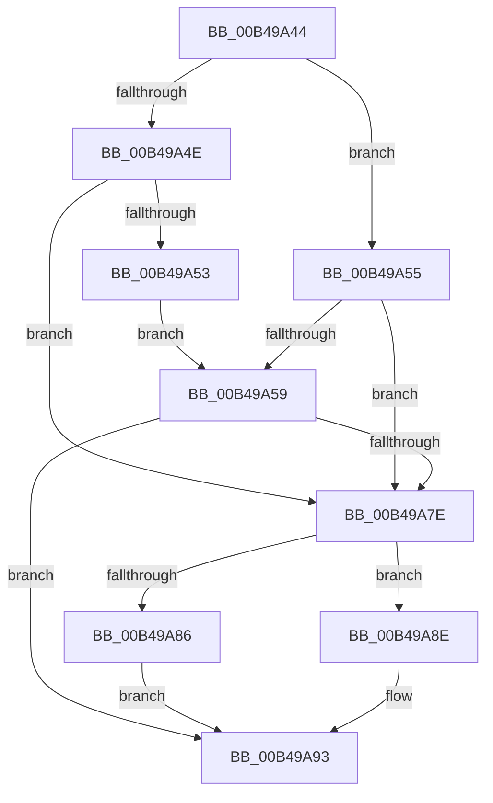

# sub_00B49A44

- RVA: `0x00B49A44`–`0x00B49AA2` (길이 `94` bytes)
- VA: `0x0000000140B49A44`
- 실행 섹션: `PAGE`
- PDB 이름 있음: `아니요`; PDB Function 태그: `아니요`
- unwind 정보 RVA: `0x000BB398`
- 디코드: `30`개 명령, `94/94` bytes 표시
- 미해석 바이트: `0` (있으면 어셈블리에 `.byte`로 보존)

> 이 문서는 커널 이미지의 기계어와 PDB 기호를 분석해 생성했습니다. 4번과 5번은 함수 원형과 자료형을 바이너리 사용 방식에서 추정한 C 해석이며 원본 소스 복구 결과는 아닙니다.

## 1. Dependencies

- 직접 호출 지점: **2**; 고유 호출 대상: **2**
- 직접 호출자로 확인된 함수: **0**
- RIP 상대 이미지 참조: **0**

### Outgoing calls
- `0x00B49A72` → [PdcPortSendMessageSynchronously](../../text/49/PdcPortSendMessageSynchronously_function_0049A6B4.md) (function, `0x0049A6B4`)
- `0x00B49A97` → [PdcReleaseRwLockExclusive](../70/PdcReleaseRwLockExclusive_function_00705288.md) (function, `0x00705288`)

### Direct callers
- 이 함수 시작 RVA로 연결되는 직접 call은 확인되지 않았습니다. 간접 호출은 완전히 역산할 수 없습니다.

### Static image references
- 디코드된 RIP-relative 메모리 참조가 없습니다.

## 2. Other-region calls and transfers

- 다른 실행 섹션으로 향하는 call: **1**
  - `0x00B49A72` → [PdcPortSendMessageSynchronously](../../text/49/PdcPortSendMessageSynchronously_function_0049A6B4.md) (`PAGE` → `.text`)
- call이 아닌 외부 분기/꼬리 이동: **1**
  - `0x00B49A9D` → [PdcTaskClientRequest + 0x34](../AA/PdcTaskClientRequest_function_00AA37E4.md) (`tail-transfer`)

## 3. Assembly (complete function range)

```asm
00B49A44  8B 43 30                        mov eax, dword ptr [rbx + 0x30]
00B49A47  33 FF                           xor edi, edi
00B49A49  40 84 F6                        test sil, sil
00B49A4C  75 07                           jne 0x140b49a55
00B49A4E  83 F8 01                        cmp eax, 1
00B49A51  75 2B                           jne 0x140b49a7e
00B49A53  EB 04                           jmp 0x140b49a59
00B49A55  85 C0                           test eax, eax
00B49A57  75 25                           jne 0x140b49a7e
00B49A59  48 8B 4B 28                     mov rcx, qword ptr [rbx + 0x28]
00B49A5D  48 8D 54 24 20                  lea rdx, [rsp + 0x20]
00B49A62  40 84 F6                        test sil, sil
00B49A65  C7 44 24 48 07 00 00 00         mov dword ptr [rsp + 0x48], 7
00B49A6D  0F 95 44 24 58                  setne byte ptr [rsp + 0x58]
00B49A72  E8 3D 0C 95 FF                  call 0x14049a6b4
00B49A77  8B 7B 34                        mov edi, dword ptr [rbx + 0x34]
00B49A7A  85 FF                           test edi, edi
00B49A7C  78 15                           js 0x140b49a93
00B49A7E  8B 4B 30                        mov ecx, dword ptr [rbx + 0x30]
00B49A81  40 84 F6                        test sil, sil
00B49A84  75 08                           jne 0x140b49a8e
00B49A86  8D 41 FF                        lea eax, [rcx - 1]
00B49A89  89 43 30                        mov dword ptr [rbx + 0x30], eax
00B49A8C  EB 05                           jmp 0x140b49a93
00B49A8E  FF C1                           inc ecx
00B49A90  89 4B 30                        mov dword ptr [rbx + 0x30], ecx
00B49A93  48 8D 4B 08                     lea rcx, [rbx + 8]
00B49A97  E8 EC B7 BB FF                  call 0x140705288
00B49A9C  90                              nop
00B49A9D  E9 76 9D F5 FF                  jmp 0x140aa3818
```

## 4. C-style interpretation (structured pseudocode)

```c
__int64 __fastcall sub_00B49A44(void)
{
    __int64 result;
    __int64 v_rdi;
    unsigned __int64 v_stack_p20;
    unsigned int v_stack_p48;
    unsigned __int8 v_stack_p58;

    v_rdi = 0;
    if ((unsigned __int8)(v_rsi) != 0) goto loc_00B49A55;
    if (((unsigned int)((unsigned int)(*(unsigned int *)(v_rbx + 48)))) != 1) goto loc_00B49A7E;
    goto loc_00B49A59;
loc_00B49A55:
    if ((unsigned int)((unsigned int)(*(unsigned int *)(v_rbx + 48))) != 0) goto loc_00B49A7E;
loc_00B49A59:
    v_stack_p48 = 7;
    result = PdcPortSendMessageSynchronously(*(unsigned __int64 *)(v_rbx + 40), v_stack_p20, a3, a4);
    if (sign_flag) goto loc_00B49A93;
loc_00B49A7E:
    if ((unsigned __int8)(v_rsi) != 0) goto loc_00B49A8E;
    *(unsigned int *)(v_rbx + 48) = (unsigned int)((unsigned int)(*(unsigned int *)(v_rbx + 48)) - 1);
    goto loc_00B49A93;
loc_00B49A8E:
    a1 = (unsigned int)(((unsigned int)(*(unsigned int *)(v_rbx + 48))) + 1);
    *(unsigned int *)(v_rbx + 48) = (unsigned int)(a1);
loc_00B49A93:
    result = PdcReleaseRwLockExclusive(v_rbx + 8, v_stack_p20, a3, a4);
}
```

## 5. (Beta) C Style

```c
void sub_00B49A44(void)
{
    int64_t result;
    int64_t local_rdi;
    uint64_t v_stack_p20;
    uint32_t v_stack_p48;
    uint8_t v_stack_p58;

    local_rdi = 0;
    if ((uint8_t)(local_rsi) != 0) goto loc_00B49A55;
    if (((uint32_t)((uint32_t)(*(uint32_t *)(local_rbx + 0x30)))) != 1) goto loc_00B49A7E;
    goto loc_00B49A59;
loc_00B49A55:
    if ((uint32_t)((uint32_t)(*(uint32_t *)(local_rbx + 0x30))) != 0) goto loc_00B49A7E;
loc_00B49A59:
    v_stack_p48 = 7;
    result = PdcPortSendMessageSynchronously(*(uint64_t *)(local_rbx + 0x28), v_stack_p20, a3, a4);
    if (sign_flag) goto loc_00B49A93;
loc_00B49A7E:
    if ((uint8_t)(local_rsi) != 0) goto loc_00B49A8E;
    *(uint32_t *)(local_rbx + 0x30) = (uint32_t)((uint32_t)(*(uint32_t *)(local_rbx + 0x30)) - 1);
    goto loc_00B49A93;
loc_00B49A8E:
    a1 = (uint32_t)(((uint32_t)(*(uint32_t *)(local_rbx + 0x30))) + 1);
    *(uint32_t *)(local_rbx + 0x30) = (uint32_t)(a1);
loc_00B49A93:
    result = PdcReleaseRwLockExclusive(local_rbx + 8, v_stack_p20, a3, a4);
}
```

## 6. Execution-region graph

[열기: 2D/3D 그래프와 함수 탐색 컨트롤 패널](../../../control-panel.html?section=page&rva=0x00B49A44&view=graph)

- 2D 그래프는 위에서 아래로 흐르고, 3D 그래프는 빈 공간을 드래그해 회전합니다. Shift+드래그는 이동, 휠은 확대·축소, 함수 노드 선택은 대상 보고서 이동입니다.

### Static fallback


