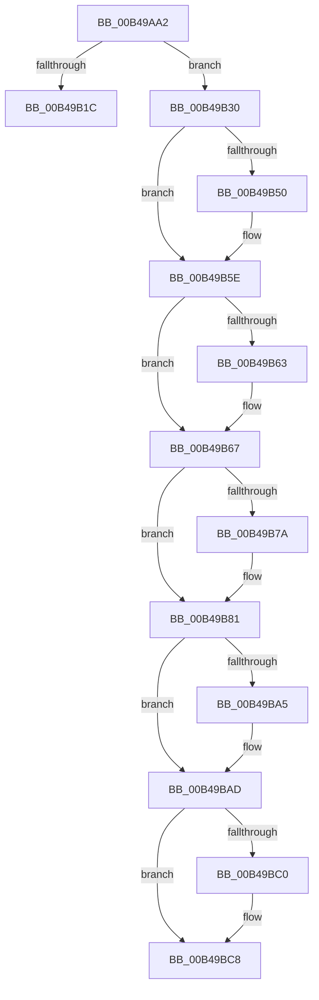

# sub_00B49AA2

- RVA: `0x00B49AA2`–`0x00B49BD5` (길이 `307` bytes)
- VA: `0x0000000140B49AA2`
- 실행 섹션: `PAGE`
- PDB 이름 있음: `아니요`; PDB Function 태그: `아니요`
- unwind 정보 RVA: `0x000BB3C8`
- 디코드: `79`개 명령, `307/307` bytes 표시
- 미해석 바이트: `0` (있으면 어셈블리에 `.byte`로 보존)

> 이 문서는 커널 이미지의 기계어와 PDB 기호를 분석해 생성했습니다. 4번과 5번은 함수 원형과 자료형을 바이너리 사용 방식에서 추정한 C 해석이며 원본 소스 복구 결과는 아닙니다.

## 1. Dependencies

- 직접 호출 지점: **8**; 고유 호출 대상: **8**
- 직접 호출자로 확인된 함수: **0**
- RIP 상대 이미지 참조: **5**

### Outgoing calls
- `0x00B49AE3` → [memcpy](../../text/6C/memcpy_function_006C6840.md) (function, `0x006C6840`)
- `0x00B49B11` → [ExpWnfGetPermanentDataStoreHandleByScopeId](../7D/ExpWnfGetPermanentDataStoreHandleByScopeId_function_007D65F8.md) (function, `0x007D65F8`)
- `0x00B49B24` → [ExFreePoolWithTag](../../poolcode/B8/ExFreePoolWithTag_function_00B82870.md) (function, `0x00B82870`)
- `0x00B49B3F` → [KeAbPreAcquire](../../text/21/KeAbPreAcquire_function_00210230.md) (function, `0x00210230`)
- `0x00B49B59` → [ExfAcquirePushLockExclusiveEx](../../text/20/ExfAcquirePushLockExclusiveEx_function_0020FC90.md) (function, `0x0020FC90`)
- `0x00B49BA8` → [ExfTryToWakePushLock](../../text/26/ExfTryToWakePushLock_function_00265DD0.md) (function, `0x00265DD0`)
- `0x00B49BB0` → [KeAbPostRelease](../../text/2E/KeAbPostRelease_function_002E1600.md) (function, `0x002E1600`)
- `0x00B49BC3` → [ExpWnfDestroyPermanentDataStore](../7D/ExpWnfDestroyPermanentDataStore_function_007D6484.md) (function, `0x007D6484`)

### Direct callers
- 이 함수 시작 RVA로 연결되는 직접 call은 확인되지 않았습니다. 간접 호출은 완전히 역산할 수 없습니다.

### Static image references
- `0x00B49B30` → RVA `0x00FD9C88` (`PAGEDATA`; read)
- `0x00B49B67` → RVA `0x00FD82B8` (`PAGEDATA`; read)
- `0x00B49B6E` → RVA `0x00FD82B0` (`PAGEDATA`; read)
- `0x00B49B8F` → RVA `0x00FD82B8` (`PAGEDATA`; write)
- `0x00B49B96` → RVA `0x00FD9C88` (`PAGEDATA`; read/write)

## 2. Other-region calls and transfers

- 다른 실행 섹션으로 향하는 call: **6**
  - `0x00B49AE3` → [memcpy](../../text/6C/memcpy_function_006C6840.md) (`PAGE` → `.text`)
  - `0x00B49B24` → [ExFreePoolWithTag](../../poolcode/B8/ExFreePoolWithTag_function_00B82870.md) (`PAGE` → `POOLCODE`)
  - `0x00B49B3F` → [KeAbPreAcquire](../../text/21/KeAbPreAcquire_function_00210230.md) (`PAGE` → `.text`)
  - `0x00B49B59` → [ExfAcquirePushLockExclusiveEx](../../text/20/ExfAcquirePushLockExclusiveEx_function_0020FC90.md) (`PAGE` → `.text`)
  - `0x00B49BA8` → [ExfTryToWakePushLock](../../text/26/ExfTryToWakePushLock_function_00265DD0.md) (`PAGE` → `.text`)
  - `0x00B49BB0` → [KeAbPostRelease](../../text/2E/KeAbPostRelease_function_002E1600.md) (`PAGE` → `.text`)
- call이 아닌 외부 분기/꼬리 이동: **2**
  - `0x00B49B2B` → [ExpWnfGetPermanentDataStore + 0x47](../AA/ExpWnfGetPermanentDataStore_function_00AA39F0.md) (`tail-transfer`)
  - `0x00B49BD0` → [ExpWnfGetPermanentDataStore + 0x45](../AA/ExpWnfGetPermanentDataStore_function_00AA39F0.md) (`tail-transfer`)

## 3. Assembly (complete function range)

```asm
00B49AA2  83 60 04 00                     and dword ptr [rax + 4], 0
00B49AA6  4C 8D 70 18                     lea r14, [rax + 0x18]
00B49AAA  48 83 60 10 00                  and qword ptr [rax + 0x10], 0
00B49AAF  48 8D 4F 30                     lea rcx, [rdi + 0x30]
00B49AB3  48 83 60 20 00                  and qword ptr [rax + 0x20], 0
00B49AB8  48 83 60 28 00                  and qword ptr [rax + 0x28], 0
00B49ABD  C7 00 0A 09 30 00               mov dword ptr [rax], 0x30090a
00B49AC3  48 83 60 08 00                  and qword ptr [rax + 8], 0
00B49AC8  4D 89 76 08                     mov qword ptr [r14 + 8], r14
00B49ACC  4D 89 36                        mov qword ptr [r14], r14
00B49ACF  8B 43 10                        mov eax, dword ptr [rbx + 0x10]
00B49AD2  89 47 28                        mov dword ptr [rdi + 0x28], eax
00B49AD5  8B 43 14                        mov eax, dword ptr [rbx + 0x14]
00B49AD8  89 47 2C                        mov dword ptr [rdi + 0x2c], eax
00B49ADB  44 8B 43 14                     mov r8d, dword ptr [rbx + 0x14]
00B49ADF  48 8B 53 18                     mov rdx, qword ptr [rbx + 0x18]
00B49AE3  E8 58 CD B7 FF                  call 0x1406c6840
00B49AE8  8B 4B 10                        mov ecx, dword ptr [rbx + 0x10]
00B49AEB  8D 45 FE                        lea eax, [rbp - 2]
00B49AEE  45 33 C0                        xor r8d, r8d
00B49AF1  8B D5                           mov edx, ebp
00B49AF3  83 F8 01                        cmp eax, 1
00B49AF6  48 8D 47 10                     lea rax, [rdi + 0x10]
00B49AFA  48 89 44 24 30                  mov qword ptr [rsp + 0x30], rax
00B49AFF  41 0F 96 C0                     setbe r8b
00B49B03  44 89 64 24 28                  mov dword ptr [rsp + 0x28], r12d
00B49B08  44 89 44 24 20                  mov dword ptr [rsp + 0x20], r8d
00B49B0D  4C 8B 43 18                     mov r8, qword ptr [rbx + 0x18]
00B49B11  E8 E2 CA C8 FF                  call 0x1407d65f8
00B49B16  8B E8                           mov ebp, eax
00B49B18  85 C0                           test eax, eax
00B49B1A  79 14                           jns 0x140b49b30
00B49B1C  BA 57 6E 66 20                  mov edx, 0x20666e57
00B49B21  48 8B CF                        mov rcx, rdi
00B49B24  E8 47 8D 03 00                  call 0x140b82870
00B49B29  8B C5                           mov eax, ebp
00B49B2B  E9 07 9F F5 FF                  jmp 0x140aa3a37
00B49B30  4C 8D 25 51 01 49 00            lea r12, [rip + 0x490151]
00B49B37  45 33 C0                        xor r8d, r8d
00B49B3A  49 8B CC                        mov rcx, r12
00B49B3D  33 D2                           xor edx, edx
00B49B3F  E8 EC 66 6C FF                  call 0x140210230
00B49B44  F0 49 0F BA 2C 24 00            lock bts qword ptr [r12], 0
00B49B4B  48 8B E8                        mov rbp, rax
00B49B4E  73 0E                           jae 0x140b49b5e
00B49B50  4D 8B C4                        mov r8, r12
00B49B53  48 8B D0                        mov rdx, rax
00B49B56  49 8B CC                        mov rcx, r12
00B49B59  E8 32 61 6C FF                  call 0x14020fc90
00B49B5E  48 85 ED                        test rbp, rbp
00B49B61  74 04                           je 0x140b49b67
00B49B63  C6 45 0A 01                     mov byte ptr [rbp + 0xa], 1
00B49B67  48 8B 05 4A E7 48 00            mov rax, qword ptr [rip + 0x48e74a]
00B49B6E  48 8D 0D 3B E7 48 00            lea rcx, [rip + 0x48e73b]
00B49B75  48 39 08                        cmp qword ptr [rax], rcx
00B49B78  74 07                           je 0x140b49b81
00B49B7A  B9 03 00 00 00                  mov ecx, 3
00B49B7F  CD 29                           int 0x29
00B49B81  49 89 46 08                     mov qword ptr [r14 + 8], rax
00B49B85  49 89 0E                        mov qword ptr [r14], rcx
00B49B88  4C 89 30                        mov qword ptr [rax], r14
00B49B8B  48 83 C8 FF                     or rax, 0xffffffffffffffff
00B49B8F  4C 89 35 22 E7 48 00            mov qword ptr [rip + 0x48e722], r14
00B49B96  F0 48 0F C1 05 E9 00 49 00      lock xadd qword ptr [rip + 0x4900e9], rax
00B49B9F  24 06                           and al, 6
00B49BA1  3C 02                           cmp al, 2
00B49BA3  75 08                           jne 0x140b49bad
00B49BA5  49 8B CC                        mov rcx, r12
00B49BA8  E8 23 C2 71 FF                  call 0x140265dd0
00B49BAD  49 8B CC                        mov rcx, r12
00B49BB0  E8 4B 7A 79 FF                  call 0x1402e1600
00B49BB5  33 C0                           xor eax, eax
00B49BB7  F0 48 0F B1 7C F3 40            lock cmpxchg qword ptr [rbx + rsi*8 + 0x40], rdi
00B49BBE  74 08                           je 0x140b49bc8
00B49BC0  48 8B CF                        mov rcx, rdi
00B49BC3  E8 BC C8 C8 FF                  call 0x1407d6484
00B49BC8  48 8B 44 F3 40                  mov rax, qword ptr [rbx + rsi*8 + 0x40]
00B49BCD  49 89 07                        mov qword ptr [r15], rax
00B49BD0  E9 60 9E F5 FF                  jmp 0x140aa3a35
```

## 4. C-style interpretation (structured pseudocode)

```c
__int64 __fastcall sub_00B49AA2(void)
{
    __int64 result;
    unsigned int v_stack_p20;
    unsigned int v_stack_p28;
    unsigned __int64 v_stack_p30;

    *(unsigned int *)(result) = 0x30090AULL;
    *(unsigned __int64 *)(result + 24 + 8) = result + 24;
    *(unsigned __int64 *)(result + 24) = result + 24;
    *(unsigned int *)(v_rdi + 40) = (unsigned int)((unsigned int)(*(unsigned int *)(v_rbx + 16)));
    *(unsigned int *)(v_rdi + 44) = (unsigned int)((unsigned int)(*(unsigned int *)(v_rbx + 20)));
    result = memcpy(v_rdi + 48, *(unsigned __int64 *)(v_rbx + 24), (unsigned int)(*(unsigned int *)(v_rbx + 20)), a4);
    a3 = 0;
    v_stack_p30 = v_rdi + 16;
    a3 = (((unsigned int)(v_rbp - 2)) <= 1) ? 1 : 0;
    v_stack_p28 = (unsigned int)(v_r12);
    v_stack_p20 = (unsigned int)(a3);
    result = ExpWnfGetPermanentDataStoreHandleByScopeId((unsigned int)(*(unsigned int *)(v_rbx + 16)), (unsigned int)((unsigned int)(v_rbp)), *(unsigned __int64 *)(v_rbx + 24), a4);
    if (!sign_flag) goto loc_00B49B30;
    result = ExFreePoolWithTag(v_rdi, (unsigned int)(0x20666E57ULL), *(unsigned __int64 *)(v_rbx + 24), a4);
loc_00B49B30:
    a3 = 0;
    a2 = 0;
    result = KeAbPreAcquire(v_rip + 4784465, a2, a3, a4);
    if (!(condition_is_above_or_equal)) {
        a3 = v_rip + 4784465;
        a2 = result;
        a1 = v_rip + 4784465;
        result = ExfAcquirePushLockExclusiveEx(a1, a2, a3, a4);
    }
    if (result != 0) {
        *(unsigned __int8 *)(result + 10) = 1;
    }
    if ((*(unsigned __int64 *)(*(unsigned __int64 *)(v_rip + 4777802))) != (v_rip + 4777787)) {
        a1 = 3;
    }
    *(unsigned __int64 *)(result + 24 + 8) = *(unsigned __int64 *)(v_rip + 4777802);
    *(unsigned __int64 *)(result + 24) = a1;
    *(unsigned __int64 *)(*(unsigned __int64 *)(v_rip + 4777802)) = result + 24;
    result = (*(unsigned __int64 *)(v_rip + 4777802)) | (-1);
    *(unsigned __int64 *)(v_rip + 4777762) = result + 24;
    result = (unsigned __int8)((result) & (6));
    if (((unsigned __int8)(result)) == 2) {
        a1 = v_rip + 4784465;
        result = ExfTryToWakePushLock(a1, a2, a3, a4);
    }
    result = KeAbPostRelease(v_rip + 4784465, a2, a3, a4);
    result = 0;
    if (!(condition_is_equal)) {
        a1 = v_rdi;
        result = ExpWnfDestroyPermanentDataStore(a1, a2, a3, a4);
    }
    *(unsigned __int64 *)(v_r15) = *(unsigned __int64 *)(v_rbx + v_rsi * 8 + 64);
}
```

## 5. (Beta) C Style

```c
void sub_00B49AA2(void)
{
    int64_t result;
    uint32_t v_stack_p20;
    uint32_t v_stack_p28;
    uint64_t v_stack_p30;

    *(uint32_t *)(result) = 0x30090AULL;
    *(uint64_t *)(result + 0x18 + 0x8) = result + 24;
    *(uint64_t *)(result + 0x18) = result + 24;
    *(uint32_t *)(local_rdi + 0x28) = (uint32_t)((uint32_t)(*(uint32_t *)(local_rbx + 0x10)));
    *(uint32_t *)(local_rdi + 0x2C) = (uint32_t)((uint32_t)(*(uint32_t *)(local_rbx + 0x14)));
    result = memcpy(local_rdi + 48, *(uint64_t *)(local_rbx + 0x18), (uint32_t)(*(uint32_t *)(local_rbx + 0x14)), a4);
    a3 = 0;
    v_stack_p30 = local_rdi + 16;
    a3 = (((uint32_t)(local_rbp - 2)) <= 1) ? 1 : 0;
    v_stack_p28 = (uint32_t)(local_r12);
    v_stack_p20 = (uint32_t)(a3);
    result = ExpWnfGetPermanentDataStoreHandleByScopeId((uint32_t)(*(uint32_t *)(local_rbx + 0x10)), (uint32_t)((uint32_t)(local_rbp)), *(uint64_t *)(local_rbx + 0x18), a4);
    if (!sign_flag) goto loc_00B49B30;
    result = ExFreePoolWithTag(local_rdi, (uint32_t)(0x20666E57ULL), *(uint64_t *)(local_rbx + 0x18), a4);
loc_00B49B30:
    a3 = 0;
    a2 = 0;
    result = KeAbPreAcquire(v_rip + 4784465, a2, a3, a4);
    if (!(condition_is_above_or_equal)) {
        a3 = v_rip + 4784465;
        a2 = result;
        a1 = v_rip + 4784465;
        result = ExfAcquirePushLockExclusiveEx(a1, a2, a3, a4);
    }
    if (result != 0) {
        *(uint8_t *)(result + 0xA) = 1;
    }
    if ((*(uint64_t *)(*(uint64_t *)(v_rip + 0x48E74A))) != (v_rip + 4777787)) {
        a1 = 3;
    }
    *(uint64_t *)(result + 0x18 + 0x8) = *(uint64_t *)(v_rip + 0x48E74A);
    *(uint64_t *)(result + 0x18) = a1;
    *(uint64_t *)(*(uint64_t *)(v_rip + 0x48E74A)) = result + 24;
    result = (*(uint64_t *)(v_rip + 0x48E74A)) | (-1);
    *(uint64_t *)(v_rip + 0x48E722) = result + 24;
    result = (uint8_t)((result) & (6));
    if (((uint8_t)(result)) == 2) {
        a1 = v_rip + 4784465;
        result = ExfTryToWakePushLock(a1, a2, a3, a4);
    }
    result = KeAbPostRelease(v_rip + 4784465, a2, a3, a4);
    result = 0;
    if (!(condition_is_equal)) {
        a1 = local_rdi;
        result = ExpWnfDestroyPermanentDataStore(a1, a2, a3, a4);
    }
    *(uint64_t *)(local_r15) = *(uint64_t *)(local_rbx + local_rsi * 8 + 0x40);
}
```

## 6. Execution-region graph

[열기: 2D/3D 그래프와 함수 탐색 컨트롤 패널](../../../control-panel.html?section=page&rva=0x00B49AA2&view=graph)

- 2D 그래프는 위에서 아래로 흐르고, 3D 그래프는 빈 공간을 드래그해 회전합니다. Shift+드래그는 이동, 휠은 확대·축소, 함수 노드 선택은 대상 보고서 이동입니다.

### Static fallback


