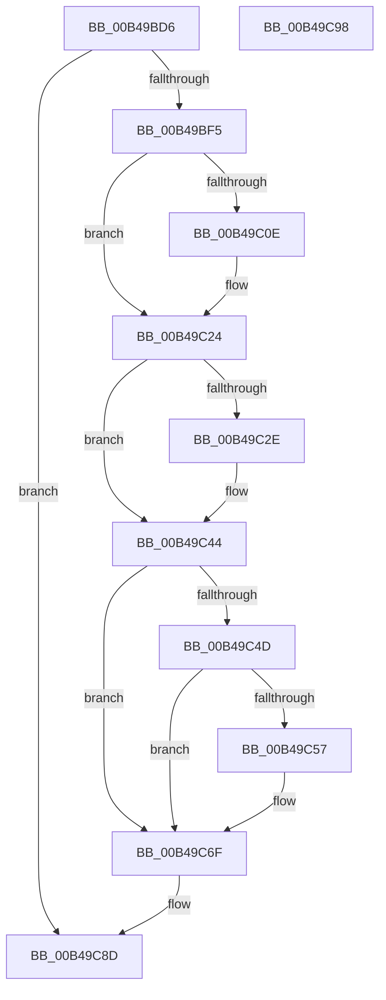

# sub_00B49BD6

- RVA: `0x00B49BD6`–`0x00B49CA3` (길이 `205` bytes)
- VA: `0x0000000140B49BD6`
- 실행 섹션: `PAGE`
- PDB 이름 있음: `아니요`; PDB Function 태그: `아니요`
- unwind 정보 RVA: `0x000BB498`
- 디코드: `53`개 명령, `205/205` bytes 표시
- 미해석 바이트: `0` (있으면 어셈블리에 `.byte`로 보존)

> 이 문서는 커널 이미지의 기계어와 PDB 기호를 분석해 생성했습니다. 4번과 5번은 함수 원형과 자료형을 바이너리 사용 방식에서 추정한 C 해석이며 원본 소스 복구 결과는 아닙니다.

## 1. Dependencies

- 직접 호출 지점: **12**; 고유 호출 대상: **6**
- 직접 호출자로 확인된 함수: **0**
- RIP 상대 이미지 참조: **0**

### Outgoing calls
- `0x00B49BD6` → [PiIommuUninitializeDeviceAts](../../text/4C/PiIommuUninitializeDeviceAts_function_004CCB18.md) (function, `0x004CCB18`)
- `0x00B49BE2` → [PiIommuBlockDevice](../74/PiIommuBlockDevice_function_00740178.md) (function, `0x00740178`)
- `0x00B49BFE` → [IoAddTriageDumpDataBlock](../../text/42/IoAddTriageDumpDataBlock_function_00428374.md) (function, `0x00428374`)
- `0x00B49C13` → [IoAddTriageDumpDataBlock](../../text/42/IoAddTriageDumpDataBlock_function_00428374.md) (function, `0x00428374`)
- `0x00B49C1F` → [IoAddTriageDumpDataBlock](../../text/42/IoAddTriageDumpDataBlock_function_00428374.md) (function, `0x00428374`)
- `0x00B49C33` → [IoAddTriageDumpDataBlock](../../text/42/IoAddTriageDumpDataBlock_function_00428374.md) (function, `0x00428374`)
- `0x00B49C3F` → [IoAddTriageDumpDataBlock](../../text/42/IoAddTriageDumpDataBlock_function_00428374.md) (function, `0x00428374`)
- `0x00B49C59` → [IoAddTriageDumpDataBlock](../../text/42/IoAddTriageDumpDataBlock_function_00428374.md) (function, `0x00428374`)
- `0x00B49C6A` → [IoAddTriageDumpDataBlock](../../text/42/IoAddTriageDumpDataBlock_function_00428374.md) (function, `0x00428374`)
- `0x00B49C87` → [KeBugCheckEx](../../text/4F/KeBugCheckEx_function_004FD660.md) (function, `0x004FD660`)
- `0x00B49C8D` → [PipDmgDestroyIommuExtension](../A2/PipDmgDestroyIommuExtension_function_00A2857C.md) (function, `0x00A2857C`)
- `0x00B49C98` → [PiDmaGuardQueueRemoveEntry](../../text/4C/PiDmaGuardQueueRemoveEntry_function_004C822C.md) (function, `0x004C822C`)

### Direct callers
- 이 함수 시작 RVA로 연결되는 직접 call은 확인되지 않았습니다. 간접 호출은 완전히 역산할 수 없습니다.

### Static image references
- 디코드된 RIP-relative 메모리 참조가 없습니다.

## 2. Other-region calls and transfers

- 다른 실행 섹션으로 향하는 call: **10**
  - `0x00B49BD6` → [PiIommuUninitializeDeviceAts](../../text/4C/PiIommuUninitializeDeviceAts_function_004CCB18.md) (`PAGE` → `.text`)
  - `0x00B49BFE` → [IoAddTriageDumpDataBlock](../../text/42/IoAddTriageDumpDataBlock_function_00428374.md) (`PAGE` → `.text`)
  - `0x00B49C13` → [IoAddTriageDumpDataBlock](../../text/42/IoAddTriageDumpDataBlock_function_00428374.md) (`PAGE` → `.text`)
  - `0x00B49C1F` → [IoAddTriageDumpDataBlock](../../text/42/IoAddTriageDumpDataBlock_function_00428374.md) (`PAGE` → `.text`)
  - `0x00B49C33` → [IoAddTriageDumpDataBlock](../../text/42/IoAddTriageDumpDataBlock_function_00428374.md) (`PAGE` → `.text`)
  - `0x00B49C3F` → [IoAddTriageDumpDataBlock](../../text/42/IoAddTriageDumpDataBlock_function_00428374.md) (`PAGE` → `.text`)
  - `0x00B49C59` → [IoAddTriageDumpDataBlock](../../text/42/IoAddTriageDumpDataBlock_function_00428374.md) (`PAGE` → `.text`)
  - `0x00B49C6A` → [IoAddTriageDumpDataBlock](../../text/42/IoAddTriageDumpDataBlock_function_00428374.md) (`PAGE` → `.text`)
  - `0x00B49C87` → [KeBugCheckEx](../../text/4F/KeBugCheckEx_function_004FD660.md) (`PAGE` → `.text`)
  - `0x00B49C98` → [PiDmaGuardQueueRemoveEntry](../../text/4C/PiDmaGuardQueueRemoveEntry_function_004C822C.md) (`PAGE` → `.text`)
- call이 아닌 외부 분기/꼬리 이동: **2**
  - `0x00B49C93` → [PiDmaGuardProcessPostRemove + 0x31](../AA/PiDmaGuardProcessPostRemove_function_00AA3D40.md) (`tail-transfer`)
  - `0x00B49C9E` → [PiDmaGuardProcessPostRemove + 0x3F](../AA/PiDmaGuardProcessPostRemove_function_00AA3D40.md) (`tail-transfer`)

## 3. Assembly (complete function range)

```asm
00B49BD6  E8 3D 2F 98 FF                  call 0x1404ccb18
00B49BDB  48 8B 8B D0 02 00 00            mov rcx, qword ptr [rbx + 0x2d0]
00B49BE2  E8 91 65 BF FF                  call 0x140740178
00B49BE7  48 63 E8                        movsxd rbp, eax
00B49BEA  48 8B CB                        mov rcx, rbx
00B49BED  85 C0                           test eax, eax
00B49BEF  0F 89 98 00 00 00               jns 0x140b49c8d
00B49BF5  BA 88 03 00 00                  mov edx, 0x388
00B49BFA  48 8D 7B 28                     lea rdi, [rbx + 0x28]
00B49BFE  E8 71 E7 8D FF                  call 0x140428374
00B49C03  BE 02 00 00 00                  mov esi, 2
00B49C08  66 44 39 37                     cmp word ptr [rdi], r14w
00B49C0C  74 16                           je 0x140b49c24
00B49C0E  8B D6                           mov edx, esi
00B49C10  48 8B CF                        mov rcx, rdi
00B49C13  E8 5C E7 8D FF                  call 0x140428374
00B49C18  0F B7 17                        movzx edx, word ptr [rdi]
00B49C1B  48 8B 4F 08                     mov rcx, qword ptr [rdi + 8]
00B49C1F  E8 50 E7 8D FF                  call 0x140428374
00B49C24  48 8D 7B 38                     lea rdi, [rbx + 0x38]
00B49C28  66 44 39 37                     cmp word ptr [rdi], r14w
00B49C2C  74 16                           je 0x140b49c44
00B49C2E  8B D6                           mov edx, esi
00B49C30  48 8B CF                        mov rcx, rdi
00B49C33  E8 3C E7 8D FF                  call 0x140428374
00B49C38  0F B7 17                        movzx edx, word ptr [rdi]
00B49C3B  48 8B 4B 40                     mov rcx, qword ptr [rbx + 0x40]
00B49C3F  E8 30 E7 8D FF                  call 0x140428374
00B49C44  48 8B 43 10                     mov rax, qword ptr [rbx + 0x10]
00B49C48  48 85 C0                        test rax, rax
00B49C4B  74 22                           je 0x140b49c6f
00B49C4D  48 8D 48 38                     lea rcx, [rax + 0x38]
00B49C51  66 44 39 31                     cmp word ptr [rcx], r14w
00B49C55  74 18                           je 0x140b49c6f
00B49C57  8B D6                           mov edx, esi
00B49C59  E8 16 E7 8D FF                  call 0x140428374
00B49C5E  48 8B 4B 10                     mov rcx, qword ptr [rbx + 0x10]
00B49C62  0F B7 51 38                     movzx edx, word ptr [rcx + 0x38]
00B49C66  48 8B 49 40                     mov rcx, qword ptr [rcx + 0x40]
00B49C6A  E8 05 E7 8D FF                  call 0x140428374
00B49C6F  4C 8B CD                        mov r9, rbp
00B49C72  48 89 5C 24 20                  mov qword ptr [rsp + 0x20], rbx
00B49C77  BA 13 00 00 00                  mov edx, 0x13
00B49C7C  B9 CA 00 00 00                  mov ecx, 0xca
00B49C81  41 B8 01 10 00 00               mov r8d, 0x1001
00B49C87  E8 D4 39 9B FF                  call 0x1404fd660
00B49C8C  CC                              int3
00B49C8D  E8 EA E8 ED FF                  call 0x140a2857c
00B49C92  90                              nop
00B49C93  E9 D9 A0 F5 FF                  jmp 0x140aa3d71
00B49C98  E8 8F E5 97 FF                  call 0x1404c822c
00B49C9D  90                              nop
00B49C9E  E9 DC A0 F5 FF                  jmp 0x140aa3d7f
```

## 4. C-style interpretation (structured pseudocode)

```c
__int64 __fastcall sub_00B49BD6(void)
{
    __int64 result;
    unsigned __int64 v_stack_p20;

    result = PiIommuUninitializeDeviceAts(a1, a2, a3, a4);
    result = PiIommuBlockDevice(*(unsigned __int64 *)(v_rbx + 720), a2, a3, a4);
    if (!sign_flag) goto loc_00B49C8D;
    result = IoAddTriageDumpDataBlock(v_rbx, 904, a3, a4);
    if ((*(unsigned __int16 *)(v_rbx + 40)) != ((unsigned __int16)(v_r14))) {
        a2 = 2;
        a1 = v_rbx + 40;
        result = IoAddTriageDumpDataBlock(a1, a2, a3, a4);
        a2 = *(unsigned __int16 *)(v_rbx + 40);
        a1 = *(unsigned __int64 *)(v_rbx + 40 + 8);
        result = IoAddTriageDumpDataBlock(a1, a2, a3, a4);
    }
    if ((*(unsigned __int16 *)(v_rbx + 56)) != ((unsigned __int16)(v_r14))) {
        a2 = 2;
        a1 = v_rbx + 56;
        result = IoAddTriageDumpDataBlock(a1, a2, a3, a4);
        a2 = *(unsigned __int16 *)(v_rbx + 56);
        a1 = *(unsigned __int64 *)(v_rbx + 64);
        result = IoAddTriageDumpDataBlock(a1, a2, a3, a4);
    }
    if (*(unsigned __int64 *)(v_rbx + 16) == 0) goto loc_00B49C6F;
    result = *(unsigned __int64 *)(v_rbx + 16);
    if ((*(unsigned __int16 *)(*(unsigned __int64 *)(v_rbx + 16) + 56)) != ((unsigned __int16)(v_r14))) {
        a2 = 2;
        result = IoAddTriageDumpDataBlock(*(unsigned __int64 *)(v_rbx + 16) + 56, a2, a3, a4);
        a1 = *(unsigned __int64 *)(v_rbx + 16);
        a2 = *(unsigned __int16 *)(a1 + 56);
        a1 = *(unsigned __int64 *)(a1 + 64);
        result = IoAddTriageDumpDataBlock(a1, a2, a3, a4);
    }
    v_stack_p20 = v_rbx;
    result = KeBugCheckEx(202, 19, (unsigned int)(0x1001ULL), (int)((unsigned int)(result)));
loc_00B49C8D:
    result = PipDmgDestroyIommuExtension(202, 19, (unsigned int)(0x1001ULL), (int)((unsigned int)(result)));
}
```

## 5. (Beta) C Style

```c
void sub_00B49BD6(void)
{
    int64_t result;
    uint64_t v_stack_p20;

    result = PiIommuUninitializeDeviceAts(a1, a2, a3, a4);
    result = PiIommuBlockDevice(*(uint64_t *)(local_rbx + 0x2D0), a2, a3, a4);
    if (!sign_flag) goto loc_00B49C8D;
    result = IoAddTriageDumpDataBlock(local_rbx, 904, a3, a4);
    if ((*(uint16_t *)(local_rbx + 0x28)) != ((uint16_t)(local_r14))) {
        a2 = 2;
        a1 = local_rbx + 40;
        result = IoAddTriageDumpDataBlock(a1, a2, a3, a4);
        a2 = *(uint16_t *)(local_rbx + 0x28);
        a1 = *(uint64_t *)(local_rbx + 0x28 + 0x8);
        result = IoAddTriageDumpDataBlock(a1, a2, a3, a4);
    }
    if ((*(uint16_t *)(local_rbx + 0x38)) != ((uint16_t)(local_r14))) {
        a2 = 2;
        a1 = local_rbx + 56;
        result = IoAddTriageDumpDataBlock(a1, a2, a3, a4);
        a2 = *(uint16_t *)(local_rbx + 0x38);
        a1 = *(uint64_t *)(local_rbx + 0x40);
        result = IoAddTriageDumpDataBlock(a1, a2, a3, a4);
    }
    if (*(uint64_t *)(local_rbx + 0x10) == 0) goto loc_00B49C6F;
    result = *(uint64_t *)(local_rbx + 0x10);
    if ((*(uint16_t *)(*(uint64_t *)(local_rbx + 0x10) + 0x38)) != ((uint16_t)(local_r14))) {
        a2 = 2;
        result = IoAddTriageDumpDataBlock(*(uint64_t *)(local_rbx + 0x10) + 56, a2, a3, a4);
        a1 = *(uint64_t *)(local_rbx + 0x10);
        a2 = *(uint16_t *)(a1 + 0x38);
        a1 = *(uint64_t *)(a1 + 0x40);
        result = IoAddTriageDumpDataBlock(a1, a2, a3, a4);
    }
    v_stack_p20 = local_rbx;
    result = KeBugCheckEx(202, 19, (uint32_t)(0x1001ULL), (int32_t)((uint32_t)(result)));
loc_00B49C8D:
    result = PipDmgDestroyIommuExtension(202, 19, (uint32_t)(0x1001ULL), (int32_t)((uint32_t)(result)));
}
```

## 6. Execution-region graph

[열기: 2D/3D 그래프와 함수 탐색 컨트롤 패널](../../../control-panel.html?section=page&rva=0x00B49BD6&view=graph)

- 2D 그래프는 위에서 아래로 흐르고, 3D 그래프는 빈 공간을 드래그해 회전합니다. Shift+드래그는 이동, 휠은 확대·축소, 함수 노드 선택은 대상 보고서 이동입니다.

### Static fallback


