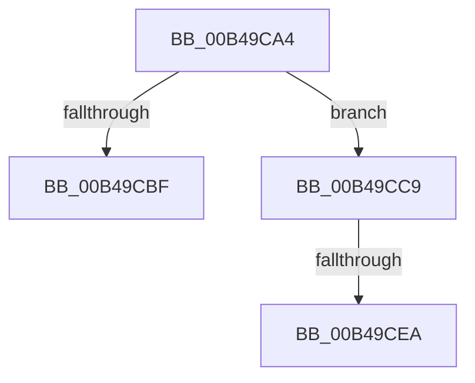

# sub_00B49CA4

- RVA: `0x00B49CA4`–`0x00B49CFE` (길이 `90` bytes)
- VA: `0x0000000140B49CA4`
- 실행 섹션: `PAGE`
- PDB 이름 있음: `아니요`; PDB Function 태그: `아니요`
- unwind 정보 RVA: `0x000BB4B4`
- 디코드: `23`개 명령, `90/90` bytes 표시
- 미해석 바이트: `0` (있으면 어셈블리에 `.byte`로 보존)

> 이 문서는 커널 이미지의 기계어와 PDB 기호를 분석해 생성했습니다. 4번과 5번은 함수 원형과 자료형을 바이너리 사용 방식에서 추정한 C 해석이며 원본 소스 복구 결과는 아닙니다.

## 1. Dependencies

- 직접 호출 지점: **3**; 고유 호출 대상: **3**
- 직접 호출자로 확인된 함수: **0**
- RIP 상대 이미지 참조: **0**

### Outgoing calls
- `0x00B49CB2` → [ExAllocatePool2](../../poolcode/B8/ExAllocatePool2_function_00B820F0.md) (function, `0x00B820F0`)
- `0x00B49CDB` → [RtlUnicodeStringCopy](../../text/3D/RtlUnicodeStringCopy_function_003D4130.md) (function, `0x003D4130`)
- `0x00B49CF2` → [ExFreePoolWithTag](../../poolcode/B8/ExFreePoolWithTag_function_00B82870.md) (function, `0x00B82870`)

### Direct callers
- 이 함수 시작 RVA로 연결되는 직접 call은 확인되지 않았습니다. 간접 호출은 완전히 역산할 수 없습니다.

### Static image references
- 디코드된 RIP-relative 메모리 참조가 없습니다.

## 2. Other-region calls and transfers

- 다른 실행 섹션으로 향하는 call: **3**
  - `0x00B49CB2` → [ExAllocatePool2](../../poolcode/B8/ExAllocatePool2_function_00B820F0.md) (`PAGE` → `POOLCODE`)
  - `0x00B49CDB` → [RtlUnicodeStringCopy](../../text/3D/RtlUnicodeStringCopy_function_003D4130.md) (`PAGE` → `.text`)
  - `0x00B49CF2` → [ExFreePoolWithTag](../../poolcode/B8/ExFreePoolWithTag_function_00B82870.md) (`PAGE` → `POOLCODE`)
- call이 아닌 외부 분기/꼬리 이동: **3**
  - `0x00B49CC4` → [PopCloneUnicodeString + 0x30](../AA/PopCloneUnicodeString_function_00AA3E20.md) (`tail-transfer`)
  - `0x00B49CE4` → [PopCloneUnicodeString + 0x30](../AA/PopCloneUnicodeString_function_00AA3E20.md) (`tail-transfer`)
  - `0x00B49CF9` → [PopCloneUnicodeString + 0x30](../AA/PopCloneUnicodeString_function_00AA3E20.md) (`tail-transfer`)

## 3. Assembly (complete function range)

```asm
00B49CA4  41 8B D6                        mov edx, r14d
00B49CA7  B9 00 01 00 00                  mov ecx, 0x100
00B49CAC  41 B8 50 64 69 67               mov r8d, 0x67696450
00B49CB2  E8 39 84 03 00                  call 0x140b820f0
00B49CB7  48 8B E8                        mov rbp, rax
00B49CBA  48 85 C0                        test rax, rax
00B49CBD  75 0A                           jne 0x140b49cc9
00B49CBF  BB 9A 00 00 C0                  mov ebx, 0xc000009a
00B49CC4  E9 87 A1 F5 FF                  jmp 0x140aa3e50
00B49CC9  48 8B D6                        mov rdx, rsi
00B49CCC  48 89 6F 08                     mov qword ptr [rdi + 8], rbp
00B49CD0  48 8B CF                        mov rcx, rdi
00B49CD3  66 89 1F                        mov word ptr [rdi], bx
00B49CD6  66 44 89 77 02                  mov word ptr [rdi + 2], r14w
00B49CDB  E8 50 A4 88 FF                  call 0x1403d4130
00B49CE0  8B F8                           mov edi, eax
00B49CE2  85 C0                           test eax, eax
00B49CE4  0F 89 66 A1 F5 FF               jns 0x140aa3e50
00B49CEA  BA 50 64 69 67                  mov edx, 0x67696450
00B49CEF  48 8B CD                        mov rcx, rbp
00B49CF2  E8 79 8B 03 00                  call 0x140b82870
00B49CF7  8B DF                           mov ebx, edi
00B49CF9  E9 52 A1 F5 FF                  jmp 0x140aa3e50
```

## 4. C-style interpretation (structured pseudocode)

```c
__int64 __fastcall sub_00B49CA4(void)
{
    __int64 result;

    result = ExAllocatePool2(256, (unsigned int)((unsigned int)(v_r14)), (unsigned int)(0x67696450ULL), a4);
    if (result != 0) goto loc_00B49CC9;
loc_00B49CC9:
    *(unsigned __int64 *)(v_rdi + 8) = result;
    *(unsigned __int16 *)(v_rdi) = (unsigned __int16)((unsigned int)(0xC000009AULL));
    *(unsigned __int16 *)(v_rdi + 2) = (unsigned __int16)(v_r14);
    result = RtlUnicodeStringCopy(v_rdi, v_rsi, (unsigned int)(0x67696450ULL), a4);
    result = ExFreePoolWithTag(result, (unsigned int)(0x67696450ULL), (unsigned int)(0x67696450ULL), a4);
}
```

## 5. (Beta) C Style

```c
void sub_00B49CA4(void)
{
    int64_t result;

    result = ExAllocatePool2(256, (uint32_t)((uint32_t)(local_r14)), (uint32_t)(0x67696450ULL), a4);
    if (result != 0) goto loc_00B49CC9;
loc_00B49CC9:
    *(uint64_t *)(local_rdi + 0x8) = result;
    *(uint16_t *)(local_rdi) = (uint16_t)((uint32_t)(0xC000009AULL));
    *(uint16_t *)(local_rdi + 0x2) = (uint16_t)(local_r14);
    result = RtlUnicodeStringCopy(local_rdi, local_rsi, (uint32_t)(0x67696450ULL), a4);
    result = ExFreePoolWithTag(result, (uint32_t)(0x67696450ULL), (uint32_t)(0x67696450ULL), a4);
}
```

## 6. Execution-region graph

[열기: 2D/3D 그래프와 함수 탐색 컨트롤 패널](../../../control-panel.html?section=page&rva=0x00B49CA4&view=graph)

- 2D 그래프는 위에서 아래로 흐르고, 3D 그래프는 빈 공간을 드래그해 회전합니다. Shift+드래그는 이동, 휠은 확대·축소, 함수 노드 선택은 대상 보고서 이동입니다.

### Static fallback


