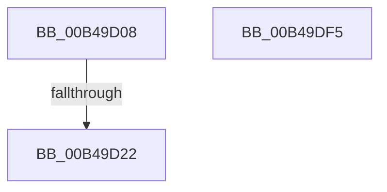

# sub_00B49D08

- RVA: `0x00B49D08`–`0x00B49E0D` (길이 `261` bytes)
- VA: `0x0000000140B49D08`
- 실행 섹션: `PAGE`
- PDB 이름 있음: `아니요`; PDB Function 태그: `아니요`
- unwind 정보 RVA: `0x000BB6E0`
- 디코드: `45`개 명령, `261/261` bytes 표시
- 미해석 바이트: `0` (있으면 어셈블리에 `.byte`로 보존)

> 이 문서는 커널 이미지의 기계어와 PDB 기호를 분석해 생성했습니다. 4번과 5번은 함수 원형과 자료형을 바이너리 사용 방식에서 추정한 C 해석이며 원본 소스 복구 결과는 아닙니다.

## 1. Dependencies

- 직접 호출 지점: **4**; 고유 호출 대상: **4**
- 직접 호출자로 확인된 함수: **0**
- RIP 상대 이미지 참조: **1**

### Outgoing calls
- `0x00B49D15` → [tlgKeywordOn](../../text/42/tlgKeywordOn_function_0042EAA0.md) (function, `0x0042EAA0`)
- `0x00B49DEA` → [tlgWriteTransfer_EtwWriteTransfer](../../text/42/tlgWriteTransfer_EtwWriteTransfer_function_004260E0.md) (function, `0x004260E0`)
- `0x00B49DFA` → [PopIdleWakeFreeWakeSourceDiagnostic](../76/PopIdleWakeFreeWakeSourceDiagnostic_function_0076B3BC.md) (function, `0x0076B3BC`)
- `0x00B49E02` → [PopIdleWakeFreeWakeSourceAccounting](../76/PopIdleWakeFreeWakeSourceAccounting_function_0076B370.md) (function, `0x0076B370`)

### Direct callers
- 이 함수 시작 RVA로 연결되는 직접 call은 확인되지 않았습니다. 간접 호출은 완전히 역산할 수 없습니다.

### Static image references
- `0x00B49D5B` → RVA `0x0004E8D6` (`.rdata`; read)

## 2. Other-region calls and transfers

- 다른 실행 섹션으로 향하는 call: **2**
  - `0x00B49D15` → [tlgKeywordOn](../../text/42/tlgKeywordOn_function_0042EAA0.md) (`PAGE` → `.text`)
  - `0x00B49DEA` → [tlgWriteTransfer_EtwWriteTransfer](../../text/42/tlgWriteTransfer_EtwWriteTransfer_function_004260E0.md) (`PAGE` → `.text`)
- call이 아닌 외부 분기/꼬리 이동: **3**
  - `0x00B49D1C` → [PopIdleWakeNotifyModernStandbyExitWorker + 0xCD](../AA/PopIdleWakeNotifyModernStandbyExitWorker_function_00AA55E0.md) (`tail-transfer`)
  - `0x00B49DF0` → [PopIdleWakeNotifyModernStandbyExitWorker + 0xCD](../AA/PopIdleWakeNotifyModernStandbyExitWorker_function_00AA55E0.md) (`tail-transfer`)
  - `0x00B49E08` → [PopIdleWakeNotifyModernStandbyExitWorker + 0xF4](../AA/PopIdleWakeNotifyModernStandbyExitWorker_function_00AA55E0.md) (`tail-transfer`)

## 3. Assembly (complete function range)

```asm
00B49D08  48 BA 00 00 00 00 00 40 00 00   movabs rdx, 0x400000000000
00B49D12  49 8B CF                        mov rcx, r15
00B49D15  E8 86 4D 8E FF                  call 0x14042eaa0
00B49D1A  84 C0                           test al, al
00B49D1C  0F 84 8B B9 F5 FF               je 0x140aa56ad
00B49D22  48 8B 87 B0 94 00 00            mov rax, qword ptr [rdi + 0x94b0]
00B49D29  BA 06 00 00 00                  mov edx, 6
00B49D2E  48 89 44 24 48                  mov qword ptr [rsp + 0x48], rax
00B49D33  45 33 C9                        xor r9d, r9d
00B49D36  48 8D 44 24 48                  lea rax, [rsp + 0x48]
00B49D3B  66 89 54 24 30                  mov word ptr [rsp + 0x30], dx
00B49D40  48 89 85 20 04 00 00            mov qword ptr [rbp + 0x420], rax
00B49D47  45 33 C0                        xor r8d, r8d
00B49D4A  48 8D 44 24 30                  lea rax, [rsp + 0x30]
00B49D4F  66 89 54 24 34                  mov word ptr [rsp + 0x34], dx
00B49D54  48 89 85 30 04 00 00            mov qword ptr [rbp + 0x430], rax
00B49D5B  48 8D 15 74 4B 50 FF            lea rdx, [rip - 0xafb48c]
00B49D62  48 8D 47 48                     lea rax, [rdi + 0x48]
00B49D66  4C 89 AD 28 04 00 00            mov qword ptr [rbp + 0x428], r13
00B49D6D  48 89 85 40 04 00 00            mov qword ptr [rbp + 0x440], rax
00B49D74  49 8B CF                        mov rcx, r15
00B49D77  48 8D 44 24 34                  lea rax, [rsp + 0x34]
00B49D7C  48 C7 85 38 04 00 00 02 00 00 00  mov qword ptr [rbp + 0x438], 2
00B49D87  48 89 85 50 04 00 00            mov qword ptr [rbp + 0x450], rax
00B49D8E  48 8D 85 80 04 00 00            lea rax, [rbp + 0x480]
00B49D95  48 89 85 60 04 00 00            mov qword ptr [rbp + 0x460], rax
00B49D9C  48 8D 44 24 50                  lea rax, [rsp + 0x50]
00B49DA1  48 89 85 70 04 00 00            mov qword ptr [rbp + 0x470], rax
00B49DA8  48 8D 85 00 04 00 00            lea rax, [rbp + 0x400]
00B49DAF  48 89 44 24 28                  mov qword ptr [rsp + 0x28], rax
00B49DB4  44 89 6C 24 20                  mov dword ptr [rsp + 0x20], r13d
00B49DB9  48 C7 85 48 04 00 00 18 00 00 00  mov qword ptr [rbp + 0x448], 0x18
00B49DC4  48 C7 85 58 04 00 00 02 00 00 00  mov qword ptr [rbp + 0x458], 2
00B49DCF  48 C7 85 68 04 00 00 30 00 00 00  mov qword ptr [rbp + 0x468], 0x30
00B49DDA  48 C7 44 24 50 00 00 00 01      mov qword ptr [rsp + 0x50], 0x1000000
00B49DE3  4C 89 AD 78 04 00 00            mov qword ptr [rbp + 0x478], r13
00B49DEA  E8 F1 C2 8D FF                  call 0x1404260e0
00B49DEF  90                              nop
00B49DF0  E9 B8 B8 F5 FF                  jmp 0x140aa56ad
00B49DF5  48 8D 4C 24 60                  lea rcx, [rsp + 0x60]
00B49DFA  E8 BD 15 C2 FF                  call 0x14076b3bc
00B49DFF  48 8B CB                        mov rcx, rbx
00B49E02  E8 69 15 C2 FF                  call 0x14076b370
00B49E07  90                              nop
00B49E08  E9 C7 B8 F5 FF                  jmp 0x140aa56d4
```

## 4. C-style interpretation (structured pseudocode)

```c
__int64 __fastcall sub_00B49D08(__int64 a1, __int64 a2, int a3, int a4, __int64 a5, __int64 a6, __int64 a7, __int64 a8, __int64 a9, __int64 a10)
{
    __int64 result;
    unsigned int v_stack_p20;
    unsigned __int64 v_stack_p28;
    unsigned __int16 v_stack_p30;
    unsigned __int16 v_stack_p34;
    unsigned __int64 v_stack_p48;
    unsigned __int64 v_stack_p50;
    unsigned __int64 v_stack_p60;

    result = tlgKeywordOn(v_r15, a2, a3, a4);
    v_stack_p48 = *(unsigned __int64 *)(v_rdi + 38064);
    a4 = 0;
    v_stack_p30 = 6;
    *(unsigned __int64 *)(v_rbp + 1056) = a9;
    a3 = 0;
    v_stack_p34 = 6;
    *(unsigned __int64 *)(v_rbp + 1072) = a6;
    *(unsigned __int64 *)(v_rbp + 1064) = v_r13;
    *(unsigned __int64 *)(v_rbp + 1088) = v_rdi + 72;
    *(unsigned __int64 *)(v_rbp + 1080) = 2;
    *(unsigned __int64 *)(v_rbp + 1104) = v_stack_p34;
    *(unsigned __int64 *)(v_rbp + 1120) = v_rbp + 1152;
    *(unsigned __int64 *)(v_rbp + 1136) = a10;
    v_stack_p28 = v_rbp + 1024;
    v_stack_p20 = (unsigned int)(v_r13);
    *(unsigned __int64 *)(v_rbp + 1096) = 24;
    *(unsigned __int64 *)(v_rbp + 1112) = 2;
    *(unsigned __int64 *)(v_rbp + 1128) = 48;
    v_stack_p50 = 0x1000000ULL;
    *(unsigned __int64 *)(v_rbp + 1144) = v_r13;
    result = tlgWriteTransfer_EtwWriteTransfer(v_r15, v_rip - 11515020, a3, a4);
}
```

## 5. (Beta) C Style

```c
int64_t sub_00B49D08(int64_t Arg1, int64_t Arg2, int32_t Arg3, int32_t Arg4, uint64_t Arg5, int64_t Arg6, uint64_t Arg7, uint64_t Arg8, int64_t Arg9, int64_t Arg10)
{
    int64_t result;
    uint32_t v_stack_p20;
    uint64_t v_stack_p28;
    uint16_t v_stack_p30;
    uint16_t v_stack_p34;
    uint64_t v_stack_p48;
    uint64_t v_stack_p50;
    uint64_t v_stack_p60;

    result = tlgKeywordOn(local_r15, Arg2, Arg3, Arg4);
    v_stack_p48 = *(uint64_t *)(local_rdi + 0x94B0);
    Arg4 = 0;
    v_stack_p30 = 6;
    *(uint64_t *)(local_rbp + 0x420) = Arg9;
    Arg3 = 0;
    v_stack_p34 = 6;
    *(uint64_t *)(local_rbp + 0x430) = Arg6;
    *(uint64_t *)(local_rbp + 0x428) = local_r13;
    *(uint64_t *)(local_rbp + 0x440) = local_rdi + 72;
    *(uint64_t *)(local_rbp + 0x438) = 2;
    *(uint64_t *)(local_rbp + 0x450) = v_stack_p34;
    *(uint64_t *)(local_rbp + 0x460) = local_rbp + 1152;
    *(uint64_t *)(local_rbp + 0x470) = Arg10;
    v_stack_p28 = local_rbp + 1024;
    v_stack_p20 = (uint32_t)(local_r13);
    *(uint64_t *)(local_rbp + 0x448) = 24;
    *(uint64_t *)(local_rbp + 0x458) = 2;
    *(uint64_t *)(local_rbp + 0x468) = 48;
    v_stack_p50 = 0x1000000ULL;
    *(uint64_t *)(local_rbp + 0x478) = local_r13;
    result = tlgWriteTransfer_EtwWriteTransfer(local_r15, v_rip - 11515020, Arg3, Arg4);
}
```

## 6. Execution-region graph

[열기: 2D/3D 그래프와 함수 탐색 컨트롤 패널](../../../control-panel.html?section=page&rva=0x00B49D08&view=graph)

- 2D 그래프는 위에서 아래로 흐르고, 3D 그래프는 빈 공간을 드래그해 회전합니다. Shift+드래그는 이동, 휠은 확대·축소, 함수 노드 선택은 대상 보고서 이동입니다.

### Static fallback


