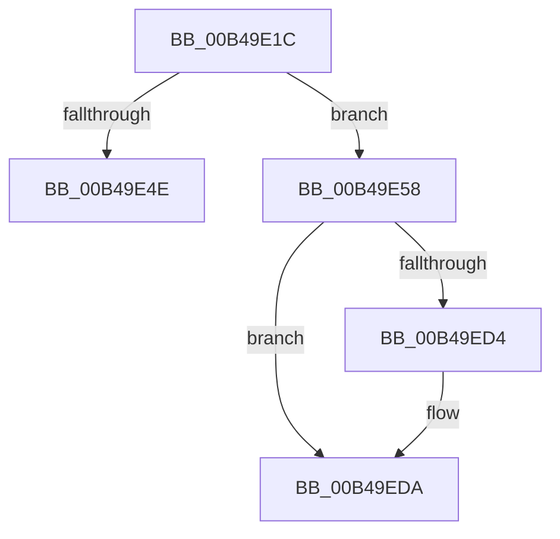

# sub_00B49E1C

- RVA: `0x00B49E1C`–`0x00B49EE8` (길이 `204` bytes)
- VA: `0x0000000140B49E1C`
- 실행 섹션: `PAGE`
- PDB 이름 있음: `아니요`; PDB Function 태그: `아니요`
- unwind 정보 RVA: `0x000BB994`
- 디코드: `47`개 명령, `204/204` bytes 표시
- 미해석 바이트: `0` (있으면 어셈블리에 `.byte`로 보존)

> 이 문서는 커널 이미지의 기계어와 PDB 기호를 분석해 생성했습니다. 4번과 5번은 함수 원형과 자료형을 바이너리 사용 방식에서 추정한 C 해석이며 원본 소스 복구 결과는 아닙니다.

## 1. Dependencies

- 직접 호출 지점: **3**; 고유 호출 대상: **3**
- 직접 호출자로 확인된 함수: **0**
- RIP 상대 이미지 참조: **0**

### Outgoing calls
- `0x00B49E41` → [PnpAllocateCriticalMemory](../A0/PnpAllocateCriticalMemory_function_00A07924.md) (function, `0x00A07924`)
- `0x00B49EBA` → [PnpInitializeTargetDeviceRemoveEvent](../94/PnpInitializeTargetDeviceRemoveEvent_function_0094FBC8.md) (function, `0x0094FBC8`)
- `0x00B49EDD` → [PnpInsertEventInQueue](../95/PnpInsertEventInQueue_function_00951B78.md) (function, `0x00951B78`)

### Direct callers
- 이 함수 시작 RVA로 연결되는 직접 call은 확인되지 않았습니다. 간접 호출은 완전히 역산할 수 없습니다.

### Static image references
- 디코드된 RIP-relative 메모리 참조가 없습니다.

## 2. Other-region calls and transfers

- 다른 실행 섹션으로 향하는 call: **0**
- call이 아닌 외부 분기/꼬리 이동: **2**
  - `0x00B49E53` → [PnpSetTargetDeviceRemove + 0x53](../AA/PnpSetTargetDeviceRemove_function_00AA68CC.md) (`tail-transfer`)
  - `0x00B49EE3` → [PnpSetTargetDeviceRemove + 0x53](../AA/PnpSetTargetDeviceRemove_function_00AA68CC.md) (`tail-transfer`)

## 3. Assembly (complete function range)

```asm
00B49E1C  49 8B CD                        mov rcx, r13
00B49E1F  0F B7 69 28                     movzx ebp, word ptr [rcx + 0x28]
00B49E23  41 8B C6                        mov eax, r14d
00B49E26  81 C5 CA 00 00 00               add ebp, 0xca
00B49E2C  BA 00 01 00 00                  mov edx, 0x100
00B49E31  F7 D8                           neg eax
00B49E33  44 8B C5                        mov r8d, ebp
00B49E36  41 B9 50 6E 70 4B               mov r9d, 0x4b706e50
00B49E3C  1B C9                           sbb ecx, ecx
00B49E3E  83 E1 03                        and ecx, 3
00B49E41  E8 DE DA EB FF                  call 0x140a07924
00B49E46  48 8B D8                        mov rbx, rax
00B49E49  48 85 C0                        test rax, rax
00B49E4C  75 0A                           jne 0x140b49e58
00B49E4E  B8 9A 00 00 C0                  mov eax, 0xc000009a
00B49E53  E9 C7 CA F5 FF                  jmp 0x140aa691f
00B49E58  48 8B 84 24 00 01 00 00         mov rax, qword ptr [rsp + 0x100]
00B49E60  45 8B CE                        mov r9d, r14d
00B49E63  48 89 44 24 60                  mov qword ptr [rsp + 0x60], rax
00B49E68  4C 8B C7                        mov r8, rdi
00B49E6B  48 8B 84 24 F8 00 00 00         mov rax, qword ptr [rsp + 0xf8]
00B49E73  8B D5                           mov edx, ebp
00B49E75  48 89 44 24 58                  mov qword ptr [rsp + 0x58], rax
00B49E7A  48 8B CB                        mov rcx, rbx
00B49E7D  48 8B 84 24 D8 00 00 00         mov rax, qword ptr [rsp + 0xd8]
00B49E85  48 89 74 24 50                  mov qword ptr [rsp + 0x50], rsi
00B49E8A  48 89 44 24 48                  mov qword ptr [rsp + 0x48], rax
00B49E8F  8B 84 24 D0 00 00 00            mov eax, dword ptr [rsp + 0xd0]
00B49E96  89 44 24 40                     mov dword ptr [rsp + 0x40], eax
00B49E9A  8B 84 24 C8 00 00 00            mov eax, dword ptr [rsp + 0xc8]
00B49EA1  89 44 24 38                     mov dword ptr [rsp + 0x38], eax
00B49EA5  8B 84 24 C0 00 00 00            mov eax, dword ptr [rsp + 0xc0]
00B49EAC  89 44 24 30                     mov dword ptr [rsp + 0x30], eax
00B49EB0  44 89 7C 24 28                  mov dword ptr [rsp + 0x28], r15d
00B49EB5  44 89 64 24 20                  mov dword ptr [rsp + 0x20], r12d
00B49EBA  E8 09 5D E0 FF                  call 0x14094fbc8
00B49EBF  48 8B 84 24 08 01 00 00         mov rax, qword ptr [rsp + 0x108]
00B49EC7  4C 89 6B 20                     mov qword ptr [rbx + 0x20], r13
00B49ECB  4C 89 6B 28                     mov qword ptr [rbx + 0x28], r13
00B49ECF  48 85 C0                        test rax, rax
00B49ED2  74 06                           je 0x140b49eda
00B49ED4  48 89 18                        mov qword ptr [rax], rbx
00B49ED7  FF 43 40                        inc dword ptr [rbx + 0x40]
00B49EDA  48 8B CB                        mov rcx, rbx
00B49EDD  E8 96 7C E0 FF                  call 0x140951b78
00B49EE2  90                              nop
00B49EE3  E9 37 CA F5 FF                  jmp 0x140aa691f
```

## 4. C-style interpretation (structured pseudocode)

```c
__int64 __fastcall sub_00B49E1C(__int64 a1, __int64 a2, __int64 a3, __int64 a4, __int64 a5, __int64 a6, __int64 a7, __int64 a8, __int64 a9, __int64 a10, __int64 a11, __int64 a12, __int64 a13, __int64 a14, __int64 a15, __int64 a16, __int64 a17, __int64 a18, __int64 a19, __int64 a20, __int64 a21, __int64 a22, __int64 a23, unsigned int a24, unsigned int a25, unsigned int a26, __int64 a27, __int64 a28, __int64 a29, __int64 a30, __int64 a31, __int64 a32, __int64 a33)
{
    __int64 result;
    __int64 v_rbp;
    unsigned int v_stack_p20;
    unsigned int v_stack_p28;
    unsigned int v_stack_p30;
    unsigned int v_stack_p38;
    unsigned int v_stack_p40;
    unsigned __int64 v_stack_p48;
    unsigned __int64 v_stack_p50;
    unsigned __int64 v_stack_p58;
    unsigned __int64 v_stack_p60;

    v_rbp = (unsigned int)((*(unsigned __int16 *)(v_r13 + 40)) + (202));
    result = (unsigned int)(-((unsigned int)((unsigned int)(v_r14))));
    a1 = (unsigned int)((v_r13) & (3));
    result = PnpAllocateCriticalMemory(a1, 256, (unsigned int)((unsigned int)(v_rbp)), (unsigned int)(0x4B706E50ULL));
    if (result != 0) goto loc_00B49E58;
loc_00B49E58:
    v_stack_p60 = a32;
    v_stack_p58 = a31;
    v_stack_p50 = v_rsi;
    v_stack_p48 = a27;
    v_stack_p40 = (unsigned int)((unsigned int)(a26));
    v_stack_p38 = (unsigned int)((unsigned int)(a25));
    v_stack_p30 = (unsigned int)((unsigned int)(a24));
    v_stack_p28 = (unsigned int)(v_r15);
    v_stack_p20 = (unsigned int)(v_r12);
    result = PnpInitializeTargetDeviceRemoveEvent(result, (unsigned int)((unsigned int)(v_rbp)), v_rdi, (unsigned int)((unsigned int)(v_r14)));
    *(unsigned __int64 *)(result + 32) = v_r13;
    *(unsigned __int64 *)(result + 40) = v_r13;
    if (a33 != 0) {
        *(unsigned __int64 *)(a33) = result;
    }
    result = PnpInsertEventInQueue(result, (unsigned int)((unsigned int)(v_rbp)), v_rdi, (unsigned int)((unsigned int)(v_r14)));
}
```

## 5. (Beta) C Style

```c
int64_t sub_00B49E1C(int64_t Arg1, int64_t Arg2, int64_t Arg3, int64_t Arg4, uint64_t Arg5, uint64_t Arg6, uint64_t Arg7, uint64_t Arg8, uint64_t Arg9, uint64_t Arg10, uint64_t Arg11, uint64_t Arg12, uint64_t Arg13, uint64_t Arg14, uint64_t Arg15, uint64_t Arg16, uint64_t Arg17, uint64_t Arg18, uint64_t Arg19, uint64_t Arg20, uint64_t Arg21, uint64_t Arg22, uint64_t Arg23, uint32_t Arg24, uint32_t Arg25, uint32_t Arg26, int64_t Arg27, uint64_t Arg28, uint64_t Arg29, uint64_t Arg30, int64_t Arg31, int64_t Arg32, int64_t Arg33)
{
    int64_t result;
    int64_t local_rbp;
    uint32_t v_stack_p20;
    uint32_t v_stack_p28;
    uint32_t v_stack_p30;
    uint32_t v_stack_p38;
    uint32_t v_stack_p40;
    uint64_t v_stack_p48;
    uint64_t v_stack_p50;
    uint64_t v_stack_p58;
    uint64_t v_stack_p60;

    local_rbp = (uint32_t)((*(uint16_t *)(local_r13 + 0x28)) + (202));
    result = (uint32_t)(-((uint32_t)((uint32_t)(local_r14))));
    Arg1 = (uint32_t)((local_r13) & (3));
    result = PnpAllocateCriticalMemory(Arg1, 256, (uint32_t)((uint32_t)(local_rbp)), (uint32_t)(0x4B706E50ULL));
    if (result != 0) goto loc_00B49E58;
loc_00B49E58:
    v_stack_p60 = Arg32;
    v_stack_p58 = Arg31;
    v_stack_p50 = local_rsi;
    v_stack_p48 = Arg27;
    v_stack_p40 = (uint32_t)((uint32_t)(Arg26));
    v_stack_p38 = (uint32_t)((uint32_t)(Arg25));
    v_stack_p30 = (uint32_t)((uint32_t)(Arg24));
    v_stack_p28 = (uint32_t)(local_r15);
    v_stack_p20 = (uint32_t)(local_r12);
    result = PnpInitializeTargetDeviceRemoveEvent(result, (uint32_t)((uint32_t)(local_rbp)), local_rdi, (uint32_t)((uint32_t)(local_r14)));
    *(uint64_t *)(result + 0x20) = local_r13;
    *(uint64_t *)(result + 0x28) = local_r13;
    if (Arg33 != 0) {
        *(uint64_t *)(Arg33) = result;
    }
    result = PnpInsertEventInQueue(result, (uint32_t)((uint32_t)(local_rbp)), local_rdi, (uint32_t)((uint32_t)(local_r14)));
}
```

## 6. Execution-region graph

[열기: 2D/3D 그래프와 함수 탐색 컨트롤 패널](../../../control-panel.html?section=page&rva=0x00B49E1C&view=graph)

- 2D 그래프는 위에서 아래로 흐르고, 3D 그래프는 빈 공간을 드래그해 회전합니다. Shift+드래그는 이동, 휠은 확대·축소, 함수 노드 선택은 대상 보고서 이동입니다.

### Static fallback


