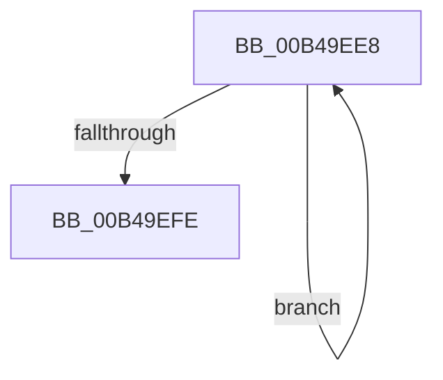

# sub_00B49EE8

- RVA: `0x00B49EE8`–`0x00B49F03` (길이 `27` bytes)
- VA: `0x0000000140B49EE8`
- 실행 섹션: `PAGE`
- PDB 이름 있음: `아니요`; PDB Function 태그: `아니요`
- unwind 정보 RVA: `0x000BBA04`
- 디코드: `8`개 명령, `27/27` bytes 표시
- 미해석 바이트: `0` (있으면 어셈블리에 `.byte`로 보존)

> 이 문서는 커널 이미지의 기계어와 PDB 기호를 분석해 생성했습니다. 4번과 5번은 함수 원형과 자료형을 바이너리 사용 방식에서 추정한 C 해석이며 원본 소스 복구 결과는 아닙니다.

## 1. Dependencies

- 직접 호출 지점: **1**; 고유 호출 대상: **1**
- 직접 호출자로 확인된 함수: **0**
- RIP 상대 이미지 참조: **0**

### Outgoing calls
- `0x00B49EEF` → [HvFreeCell](../85/HvFreeCell_function_0085A72C.md) (function, `0x0085A72C`)

### Direct callers
- 이 함수 시작 RVA로 연결되는 직접 call은 확인되지 않았습니다. 간접 호출은 완전히 역산할 수 없습니다.

### Static image references
- 디코드된 RIP-relative 메모리 참조가 없습니다.

## 2. Other-region calls and transfers

- 다른 실행 섹션으로 향하는 call: **0**
- call이 아닌 외부 분기/꼬리 이동: **1**
  - `0x00B49EFE` → [CmpFreeIndexByCell + 0x41](../AA/CmpFreeIndexByCell_function_00AA6F0C.md) (`tail-transfer`)

## 3. Assembly (complete function range)

```asm
00B49EE8  8B 54 B7 04                     mov edx, dword ptr [rdi + rsi*4 + 4]
00B49EEC  48 8B CB                        mov rcx, rbx
00B49EEF  E8 38 08 D1 FF                  call 0x14085a72c
00B49EF4  0F B7 47 02                     movzx eax, word ptr [rdi + 2]
00B49EF8  FF C6                           inc esi
00B49EFA  3B F0                           cmp esi, eax
00B49EFC  72 EA                           jb 0x140b49ee8
00B49EFE  E9 4A D0 F5 FF                  jmp 0x140aa6f4d
```

## 4. C-style interpretation (structured pseudocode)

```c
__int64 __fastcall sub_00B49EE8(void)
{
    __int64 result;
    __int64 v_rsi;

    result = HvFreeCell(v_rbx, (unsigned int)(*(unsigned int *)(v_rdi + v_rsi * 4 + 4)), a3, a4);
    v_rsi = (unsigned int)((v_rsi) + 1);
    if (((unsigned int)(v_rsi)) < ((unsigned int)(*(unsigned __int16 *)(v_rdi + 2)))) goto loc_00B49EE8;
}
```

## 5. (Beta) C Style

```c
void sub_00B49EE8(void)
{
    int64_t result;
    int64_t local_rsi;

    result = HvFreeCell(local_rbx, (uint32_t)(*(uint32_t *)(local_rdi + local_rsi * 4 + 0x4)), a3, a4);
    local_rsi = (uint32_t)((local_rsi) + 1);
    if (((uint32_t)(local_rsi)) < ((uint32_t)(*(uint16_t *)(local_rdi + 0x2)))) goto loc_00B49EE8;
}
```

## 6. Execution-region graph

[열기: 2D/3D 그래프와 함수 탐색 컨트롤 패널](../../../control-panel.html?section=page&rva=0x00B49EE8&view=graph)

- 2D 그래프는 위에서 아래로 흐르고, 3D 그래프는 빈 공간을 드래그해 회전합니다. Shift+드래그는 이동, 휠은 확대·축소, 함수 노드 선택은 대상 보고서 이동입니다.

### Static fallback


