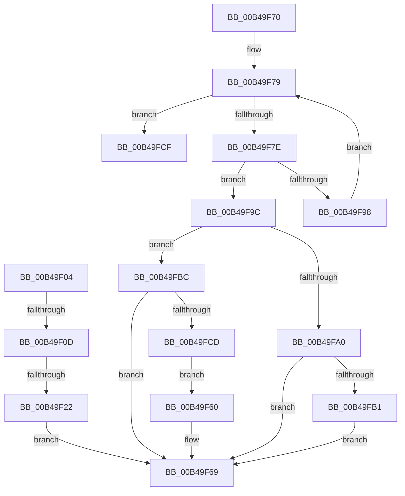

# sub_00B49F04

- RVA: `0x00B49F04`–`0x00B49FE3` (길이 `223` bytes)
- VA: `0x0000000140B49F04`
- 실행 섹션: `PAGE`
- PDB 이름 있음: `아니요`; PDB Function 태그: `아니요`
- unwind 정보 RVA: `0x000BBA3C`
- 디코드: `58`개 명령, `223/223` bytes 표시
- 미해석 바이트: `0` (있으면 어셈블리에 `.byte`로 보존)

> 이 문서는 커널 이미지의 기계어와 PDB 기호를 분석해 생성했습니다. 4번과 5번은 함수 원형과 자료형을 바이너리 사용 방식에서 추정한 C 해석이며 원본 소스 복구 결과는 아닙니다.

## 1. Dependencies

- 직접 호출 지점: **7**; 고유 호출 대상: **5**
- 직접 호출자로 확인된 함수: **0**
- RIP 상대 이미지 참조: **7**

### Outgoing calls
- `0x00B49F15` → [ExCompareExchangeCallBack](../../text/41/ExCompareExchangeCallBack_function_0041BCD0.md) (function, `0x0041BCD0`)
- `0x00B49F3F` → [ExDereferenceCallBackBlock](../../text/44/ExDereferenceCallBackBlock_function_0044D730.md) (function, `0x0044D730`)
- `0x00B49F47` → [KiLeaveCriticalRegionUnsafe](../../text/25/KiLeaveCriticalRegionUnsafe_function_0025F010.md) (function, `0x0025F010`)
- `0x00B49F4F` → [ExWaitForRundownProtectionRelease](../../text/2A/ExWaitForRundownProtectionRelease_function_002A4CB0.md) (function, `0x002A4CB0`)
- `0x00B49F59` → [ExFreePoolWithTag](../../poolcode/B8/ExFreePoolWithTag_function_00B82870.md) (function, `0x00B82870`)
- `0x00B49F8F` → [ExCompareExchangeCallBack](../../text/41/ExCompareExchangeCallBack_function_0041BCD0.md) (function, `0x0041BCD0`)
- `0x00B49FD4` → [ExFreePoolWithTag](../../poolcode/B8/ExFreePoolWithTag_function_00B82870.md) (function, `0x00B82870`)

### Direct callers
- 이 함수 시작 RVA로 연결되는 직접 call은 확인되지 않았습니다. 간접 호출은 완전히 역산할 수 없습니다.

### Static image references
- `0x00B49F22` → RVA `0x00FD9E18` (`PAGEDATA`; read)
- `0x00B49F2B` → RVA `0x00FD9E24` (`PAGEDATA`; read)
- `0x00B49F60` → RVA `0x00FD9A88` (`PAGEDATA`; read/write)
- `0x00B49F72` → RVA `0x00F06320` (`.data`; read)
- `0x00B49FA0` → RVA `0x00FD9E24` (`PAGEDATA`; read/write)
- `0x00B49FA7` → RVA `0x00FD9A88` (`PAGEDATA`; read)
- `0x00B49FBC` → RVA `0x00FD9E18` (`PAGEDATA`; read/write)

## 2. Other-region calls and transfers

- 다른 실행 섹션으로 향하는 call: **7**
  - `0x00B49F15` → [ExCompareExchangeCallBack](../../text/41/ExCompareExchangeCallBack_function_0041BCD0.md) (`PAGE` → `.text`)
  - `0x00B49F3F` → [ExDereferenceCallBackBlock](../../text/44/ExDereferenceCallBackBlock_function_0044D730.md) (`PAGE` → `.text`)
  - `0x00B49F47` → [KiLeaveCriticalRegionUnsafe](../../text/25/KiLeaveCriticalRegionUnsafe_function_0025F010.md) (`PAGE` → `.text`)
  - `0x00B49F4F` → [ExWaitForRundownProtectionRelease](../../text/2A/ExWaitForRundownProtectionRelease_function_002A4CB0.md) (`PAGE` → `.text`)
  - `0x00B49F59` → [ExFreePoolWithTag](../../poolcode/B8/ExFreePoolWithTag_function_00B82870.md) (`PAGE` → `POOLCODE`)
  - `0x00B49F8F` → [ExCompareExchangeCallBack](../../text/41/ExCompareExchangeCallBack_function_0041BCD0.md) (`PAGE` → `.text`)
  - `0x00B49FD4` → [ExFreePoolWithTag](../../poolcode/B8/ExFreePoolWithTag_function_00B82870.md) (`PAGE` → `POOLCODE`)
- call이 아닌 외부 분기/꼬리 이동: **4**
  - `0x00B49F07` → [PspSetCreateProcessNotifyRoutine + 0x7B](../AA/PspSetCreateProcessNotifyRoutine_function_00AA75EC.md) (`tail-transfer`)
  - `0x00B49F1C` → [PspSetCreateProcessNotifyRoutine + 0x7B](../AA/PspSetCreateProcessNotifyRoutine_function_00AA75EC.md) (`tail-transfer`)
  - `0x00B49F6B` → [PspSetCreateProcessNotifyRoutine + 0x98](../AA/PspSetCreateProcessNotifyRoutine_function_00AA75EC.md) (`tail-transfer`)
  - `0x00B49FDE` → [PspSetCreateProcessNotifyRoutine + 0x98](../AA/PspSetCreateProcessNotifyRoutine_function_00AA75EC.md) (`tail-transfer`)

## 3. Assembly (complete function range)

```asm
00B49F04  39 58 10                        cmp dword ptr [rax + 0x10], ebx
00B49F07  0F 85 5A D7 F5 FF               jne 0x140aa7667
00B49F0D  4C 8B C7                        mov r8, rdi
00B49F10  33 D2                           xor edx, edx
00B49F12  49 8B CC                        mov rcx, r12
00B49F15  E8 B6 1D 8D FF                  call 0x14041bcd0
00B49F1A  84 C0                           test al, al
00B49F1C  0F 84 45 D7 F5 FF               je 0x140aa7667
00B49F22  48 8D 0D EF FE 48 00            lea rcx, [rip + 0x48feef]
00B49F29  85 F6                           test esi, esi
00B49F2B  48 8D 05 F2 FE 48 00            lea rax, [rip + 0x48fef2]
00B49F32  48 8B D7                        mov rdx, rdi
00B49F35  48 0F 45 C1                     cmovne rax, rcx
00B49F39  49 8B CC                        mov rcx, r12
00B49F3C  F0 FF 08                        lock dec dword ptr [rax]
00B49F3F  E8 EC 37 90 FF                  call 0x14044d730
00B49F44  48 8B CD                        mov rcx, rbp
00B49F47  E8 C4 50 71 FF                  call 0x14025f010
00B49F4C  48 8B CF                        mov rcx, rdi
00B49F4F  E8 5C AD 75 FF                  call 0x1402a4cb0
00B49F54  33 D2                           xor edx, edx
00B49F56  48 8B CF                        mov rcx, rdi
00B49F59  E8 12 89 03 00                  call 0x140b82870
00B49F5E  EB 09                           jmp 0x140b49f69
00B49F60  F0 0F BA 2D 1F FB 48 00 02      lock bts dword ptr [rip + 0x48fb1f], 2
00B49F69  33 C0                           xor eax, eax
00B49F6B  E9 14 D7 F5 FF                  jmp 0x140aa7684
00B49F70  33 DB                           xor ebx, ebx
00B49F72  4C 8D 2D A7 C3 3B 00            lea r13, [rip + 0x3bc3a7]
00B49F79  83 FB 40                        cmp ebx, 0x40
00B49F7C  73 51                           jae 0x140b49fcf
00B49F7E  48 8D 0C DD 00 00 00 00         lea rcx, [rbx*8]
00B49F86  45 33 C0                        xor r8d, r8d
00B49F89  49 03 CD                        add rcx, r13
00B49F8C  48 8B D7                        mov rdx, rdi
00B49F8F  E8 3C 1D 8D FF                  call 0x14041bcd0
00B49F94  84 C0                           test al, al
00B49F96  75 04                           jne 0x140b49f9c
00B49F98  FF C3                           inc ebx
00B49F9A  EB DD                           jmp 0x140b49f79
00B49F9C  85 F6                           test esi, esi
00B49F9E  75 1C                           jne 0x140b49fbc
00B49FA0  F0 FF 05 7D FE 48 00            lock inc dword ptr [rip + 0x48fe7d]
00B49FA7  8B 05 DB FA 48 00               mov eax, dword ptr [rip + 0x48fadb]
00B49FAD  A8 02                           test al, 2
00B49FAF  75 B8                           jne 0x140b49f69
00B49FB1  F0 0F BA 2D CE FA 48 00 01      lock bts dword ptr [rip + 0x48face], 1
00B49FBA  EB AD                           jmp 0x140b49f69
00B49FBC  F0 FF 05 55 FE 48 00            lock inc dword ptr [rip + 0x48fe55]
00B49FC3  8B 05 BF FA 48 00               mov eax, dword ptr [rip + 0x48fabf]
00B49FC9  A8 04                           test al, 4
00B49FCB  75 9C                           jne 0x140b49f69
00B49FCD  EB 91                           jmp 0x140b49f60
00B49FCF  33 D2                           xor edx, edx
00B49FD1  48 8B CF                        mov rcx, rdi
00B49FD4  E8 97 88 03 00                  call 0x140b82870
00B49FD9  B8 0D 00 00 C0                  mov eax, 0xc000000d
00B49FDE  E9 A1 D6 F5 FF                  jmp 0x140aa7684
```

## 4. C-style interpretation (structured pseudocode)

```c
__int64 __fastcall sub_00B49F04(__int64 a1, int a2)
{
    __int64 result;

    a2 = 0;
    result = ExCompareExchangeCallBack(v_r12, a2, v_rdi, a4);
    result = v_rip + 4783858;
    if ((unsigned int)(v_rsi) != 0) { result = v_rip + 4783855; }
    result = ExDereferenceCallBackBlock(v_r12, v_rdi, v_rdi, a4);
    result = KiLeaveCriticalRegionUnsafe(v_rbp, v_rdi, v_rdi, a4);
    result = ExWaitForRundownProtectionRelease(v_rdi, v_rdi, v_rdi, a4);
    a2 = 0;
    result = ExFreePoolWithTag(v_rdi, a2, v_rdi, a4);
    goto loc_00B49F69;
loc_00B49F69:
    result = 0;
}
```

## 5. (Beta) C Style

```c
int64_t sub_00B49F04(int64_t Arg1, int32_t Arg2)
{
    int64_t result;

    Arg2 = 0;
    result = ExCompareExchangeCallBack(local_r12, Arg2, local_rdi, a4);
    result = v_rip + 4783858;
    if ((uint32_t)(local_rsi) != 0) { result = v_rip + 4783855; }
    result = ExDereferenceCallBackBlock(local_r12, local_rdi, local_rdi, a4);
    result = KiLeaveCriticalRegionUnsafe(local_rbp, local_rdi, local_rdi, a4);
    result = ExWaitForRundownProtectionRelease(local_rdi, local_rdi, local_rdi, a4);
    Arg2 = 0;
    result = ExFreePoolWithTag(local_rdi, Arg2, local_rdi, a4);
    goto loc_00B49F69;
loc_00B49F69:
    result = 0;
}
```

## 6. Execution-region graph

[열기: 2D/3D 그래프와 함수 탐색 컨트롤 패널](../../../control-panel.html?section=page&rva=0x00B49F04&view=graph)

- 2D 그래프는 위에서 아래로 흐르고, 3D 그래프는 빈 공간을 드래그해 회전합니다. Shift+드래그는 이동, 휠은 확대·축소, 함수 노드 선택은 대상 보고서 이동입니다.

### Static fallback


