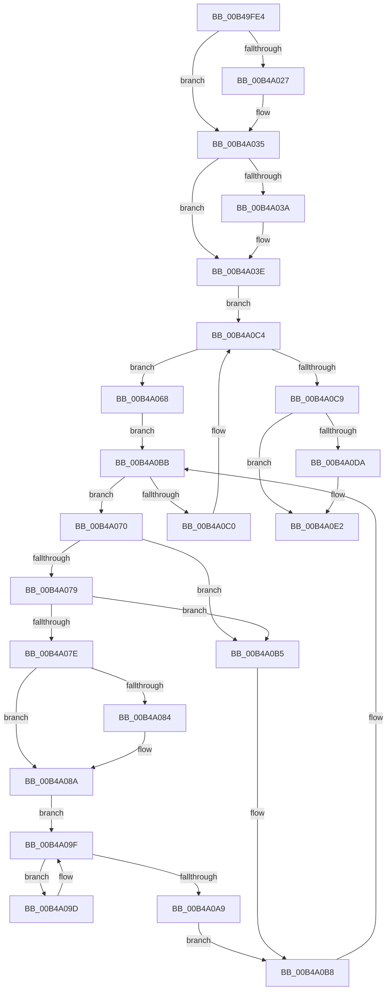

# sub_00B49FE4

- RVA: `0x00B49FE4`–`0x00B4A0F5` (길이 `273` bytes)
- VA: `0x0000000140B49FE4`
- 실행 섹션: `PAGE`
- PDB 이름 있음: `아니요`; PDB Function 태그: `아니요`
- unwind 정보 RVA: `0x000BBA6C`
- 디코드: `75`개 명령, `273/273` bytes 표시
- 미해석 바이트: `0` (있으면 어셈블리에 `.byte`로 보존)

> 이 문서는 커널 이미지의 기계어와 PDB 기호를 분석해 생성했습니다. 4번과 5번은 함수 원형과 자료형을 바이너리 사용 방식에서 추정한 C 해석이며 원본 소스 복구 결과는 아닙니다.

## 1. Dependencies

- 직접 호출 지점: **6**; 고유 호출 대상: **6**
- 직접 호출자로 확인된 함수: **0**
- RIP 상대 이미지 참조: **6**

### Outgoing calls
- `0x00B4A016` → [KeAbPreAcquire](../../text/21/KeAbPreAcquire_function_00210230.md) (function, `0x00210230`)
- `0x00B4A030` → [ExfAcquirePushLockExclusiveEx](../../text/20/ExfAcquirePushLockExclusiveEx_function_0020FC90.md) (function, `0x0020FC90`)
- `0x00B4A0AE` → [ExFreePoolWithTag](../../poolcode/B8/ExFreePoolWithTag_function_00B82870.md) (function, `0x00B82870`)
- `0x00B4A0DD` → [ExfTryToWakePushLock](../../text/26/ExfTryToWakePushLock_function_00265DD0.md) (function, `0x00265DD0`)
- `0x00B4A0E5` → [KeAbPostRelease](../../text/2E/KeAbPostRelease_function_002E1600.md) (function, `0x002E1600`)
- `0x00B4A0EA` → [KeLeaveCriticalRegion](../../text/25/KeLeaveCriticalRegion_function_0025D8B0.md) (function, `0x0025D8B0`)

### Direct callers
- 이 함수 시작 RVA로 연결되는 직접 call은 확인되지 않았습니다. 간접 호출은 완전히 역산할 수 없습니다.

### Static image references
- `0x00B49FE8` → RVA `0x00F10778` (`.data`; read)
- `0x00B4A03E` → RVA `0x00F107A0` (`.data`; read)
- `0x00B4A084` → RVA `0x00F10788` (`.data`; read/write)
- `0x00B4A095` → RVA `0x00F10780` (`.data`; read/write)
- `0x00B4A09F` → RVA `0x00F10784` (`.data`; read)
- `0x00B4A0C9` → RVA `0x00F10778` (`.data`; read/write)

## 2. Other-region calls and transfers

- 다른 실행 섹션으로 향하는 call: **6**
  - `0x00B4A016` → [KeAbPreAcquire](../../text/21/KeAbPreAcquire_function_00210230.md) (`PAGE` → `.text`)
  - `0x00B4A030` → [ExfAcquirePushLockExclusiveEx](../../text/20/ExfAcquirePushLockExclusiveEx_function_0020FC90.md) (`PAGE` → `.text`)
  - `0x00B4A0AE` → [ExFreePoolWithTag](../../poolcode/B8/ExFreePoolWithTag_function_00B82870.md) (`PAGE` → `POOLCODE`)
  - `0x00B4A0DD` → [ExfTryToWakePushLock](../../text/26/ExfTryToWakePushLock_function_00265DD0.md) (`PAGE` → `.text`)
  - `0x00B4A0E5` → [KeAbPostRelease](../../text/2E/KeAbPostRelease_function_002E1600.md) (`PAGE` → `.text`)
  - `0x00B4A0EA` → [KeLeaveCriticalRegion](../../text/25/KeLeaveCriticalRegion_function_0025D8B0.md) (`PAGE` → `.text`)
- call이 아닌 외부 분기/꼬리 이동: **1**
  - `0x00B4A0F0` → [KeCleanupImageTracepoints + 0x3A](../AA/KeCleanupImageTracepoints_function_00AA76E4.md) (`tail-transfer`)

## 3. Assembly (complete function range)

```asm
00B49FE4  4C 8B 73 30                     mov r14, qword ptr [rbx + 0x30]
00B49FE8  4C 8D 2D 89 67 3C 00            lea r13, [rip + 0x3c6789]
00B49FEF  44 8B 7B 40                     mov r15d, dword ptr [rbx + 0x40]
00B49FF3  45 33 C0                        xor r8d, r8d
00B49FF6  65 48 8B 04 25 88 01 00 00      mov rax, qword ptr gs:[0x188]
00B49FFF  48 83 CB FF                     or rbx, 0xffffffffffffffff
00B4A003  49 FF CF                        dec r15
00B4A006  33 D2                           xor edx, edx
00B4A008  49 8B CD                        mov rcx, r13
00B4A00B  4D 03 FE                        add r15, r14
00B4A00E  66 01 98 E4 01 00 00            add word ptr [rax + 0x1e4], bx
00B4A015  90                              nop
00B4A016  E8 15 62 6C FF                  call 0x140210230
00B4A01B  F0 49 0F BA 6D 00 00            lock bts qword ptr [r13], 0
00B4A022  48 8B F8                        mov rdi, rax
00B4A025  73 0E                           jae 0x140b4a035
00B4A027  4D 8B C5                        mov r8, r13
00B4A02A  48 8B D0                        mov rdx, rax
00B4A02D  49 8B CD                        mov rcx, r13
00B4A030  E8 5B 5C 6C FF                  call 0x14020fc90
00B4A035  48 85 FF                        test rdi, rdi
00B4A038  74 04                           je 0x140b4a03e
00B4A03A  C6 47 0A 01                     mov byte ptr [rdi + 0xa], 1
00B4A03E  48 8B 0D 5B 67 3C 00            mov rcx, qword ptr [rip + 0x3c675b]
00B4A045  BA FF 3F 00 00                  mov edx, 0x3fff
00B4A04A  49 8B C6                        mov rax, r14
00B4A04D  48 C1 E8 04                     shr rax, 4
00B4A051  48 23 C2                        and rax, rdx
00B4A054  48 8D 3C C1                     lea rdi, [rcx + rax*8]
00B4A058  49 8B C7                        mov rax, r15
00B4A05B  48 C1 E8 04                     shr rax, 4
00B4A05F  48 23 C2                        and rax, rdx
00B4A062  48 8D 2C C1                     lea rbp, [rcx + rax*8]
00B4A066  EB 5C                           jmp 0x140b4a0c4
00B4A068  48 8B 0F                        mov rcx, qword ptr [rdi]
00B4A06B  48 8B F7                        mov rsi, rdi
00B4A06E  EB 4B                           jmp 0x140b4a0bb
00B4A070  48 8B 41 08                     mov rax, qword ptr [rcx + 8]
00B4A074  49 3B C6                        cmp rax, r14
00B4A077  72 3C                           jb 0x140b4a0b5
00B4A079  49 3B C7                        cmp rax, r15
00B4A07C  77 37                           ja 0x140b4a0b5
00B4A07E  80 79 30 00                     cmp byte ptr [rcx + 0x30], 0
00B4A082  74 06                           je 0x140b4a08a
00B4A084  FF 0D FE 66 3C 00               dec dword ptr [rip + 0x3c66fe]
00B4A08A  48 8B 01                        mov rax, qword ptr [rcx]
00B4A08D  48 89 06                        mov qword ptr [rsi], rax
00B4A090  F0 83 0C 24 00                  lock or dword ptr [rsp], 0
00B4A095  FF 0D E5 66 3C 00               dec dword ptr [rip + 0x3c66e5]
00B4A09B  EB 02                           jmp 0x140b4a09f
00B4A09D  F3 90                           pause
00B4A09F  8B 05 DF 66 3C 00               mov eax, dword ptr [rip + 0x3c66df]
00B4A0A5  85 C0                           test eax, eax
00B4A0A7  75 F4                           jne 0x140b4a09d
00B4A0A9  BA 46 74 72 70                  mov edx, 0x70727446
00B4A0AE  E8 BD 87 03 00                  call 0x140b82870
00B4A0B3  EB 03                           jmp 0x140b4a0b8
00B4A0B5  48 8B F1                        mov rsi, rcx
00B4A0B8  48 8B 0E                        mov rcx, qword ptr [rsi]
00B4A0BB  48 85 C9                        test rcx, rcx
00B4A0BE  75 B0                           jne 0x140b4a070
00B4A0C0  48 83 C7 08                     add rdi, 8
00B4A0C4  48 3B FD                        cmp rdi, rbp
00B4A0C7  76 9F                           jbe 0x140b4a068
00B4A0C9  F0 48 0F C1 1D A6 66 3C 00      lock xadd qword ptr [rip + 0x3c66a6], rbx
00B4A0D2  80 E3 06                        and bl, 6
00B4A0D5  80 FB 02                        cmp bl, 2
00B4A0D8  75 08                           jne 0x140b4a0e2
00B4A0DA  49 8B CD                        mov rcx, r13
00B4A0DD  E8 EE BC 71 FF                  call 0x140265dd0
00B4A0E2  49 8B CD                        mov rcx, r13
00B4A0E5  E8 16 75 79 FF                  call 0x1402e1600
00B4A0EA  E8 C1 37 71 FF                  call 0x14025d8b0
00B4A0EF  90                              nop
00B4A0F0  E9 29 D6 F5 FF                  jmp 0x140aa771e
```

## 4. C-style interpretation (structured pseudocode)

```c
__int64 __fastcall sub_00B49FE4(__int64 a1, int a2, int a3)
{
    __int64 result;
    __int64 v_r15;
    __int64 v_rbx;
    __int64 v_rdi;
    unsigned int v_stack_p0;

    a3 = 0;
    v_rbx = (v_rbx) | (-1);
    v_r15 = ((unsigned int)(*(unsigned int *)(v_rbx + 64))) - 1;
    a2 = 0;
    v_r15 = (v_r15) + (*(unsigned __int64 *)(v_rbx + 48));
    result = KeAbPreAcquire(v_rip + 3958665, a2, a3, a4);
    if (!(condition_is_above_or_equal)) {
        a3 = v_rip + 3958665;
        a2 = result;
        a1 = v_rip + 3958665;
        result = ExfAcquirePushLockExclusiveEx(a1, a2, a3, a4);
    }
    if (result != 0) {
        *(unsigned __int8 *)(result + 10) = 1;
    }
    result = (*(unsigned __int64 *)(v_rbx + 48)) >> (4);
    result = (result) & ((unsigned int)(0x3FFFULL));
    result = (v_r15) >> (4);
    result = (result) & ((unsigned int)(0x3FFFULL));
    goto loc_00B4A0C4;
loc_00B4A068:
    goto loc_00B4A0BB;
loc_00B4A070:
    if ((*(unsigned __int64 *)(*(unsigned __int64 *)(*(unsigned __int64 *)(v_rip + 3958619) + result * 8) + 8)) < (*(unsigned __int64 *)(v_rbx + 48))) goto loc_00B4A0B5;
    if ((*(unsigned __int64 *)(*(unsigned __int64 *)(*(unsigned __int64 *)(v_rip + 3958619) + result * 8) + 8)) > v_r15) goto loc_00B4A0B5;
    if ((*(unsigned __int8 *)(*(unsigned __int64 *)(*(unsigned __int64 *)(v_rip + 3958619) + result * 8) + 48)) != 0) {
    }
    *(unsigned __int64 *)(*(unsigned __int64 *)(v_rip + 3958619) + result * 8) = *(unsigned __int64 *)(*(unsigned __int64 *)(*(unsigned __int64 *)(v_rip + 3958619) + result * 8));
    goto loc_00B4A09F;
loc_00B4A09D:
loc_00B4A09F:
    if ((unsigned int)((unsigned int)(*(unsigned int *)(v_rip + 3958495))) != 0) goto loc_00B4A09D;
    result = ExFreePoolWithTag(*(unsigned __int64 *)(*(unsigned __int64 *)(v_rip + 3958619) + result * 8), (unsigned int)(0x70727446ULL), a3, a4);
    goto loc_00B4A0B8;
loc_00B4A0B5:
loc_00B4A0B8:
loc_00B4A0BB:
    if (*(unsigned __int64 *)(*(unsigned __int64 *)(*(unsigned __int64 *)(v_rip + 3958619) + result * 8)) != 0) goto loc_00B4A070;
    v_rdi = (*(unsigned __int64 *)(v_rip + 3958619) + result * 8) + (8);
loc_00B4A0C4:
    if (v_rdi <= (*(unsigned __int64 *)(v_rip + 3958619) + result * 8)) goto loc_00B4A068;
    v_rbx = (unsigned __int8)((v_rbx) & (6));
    if (((unsigned __int8)(v_rbx)) == 2) {
        a1 = v_rip + 3958665;
        result = ExfTryToWakePushLock(a1, (unsigned int)(0x70727446ULL), a3, a4);
    }
    result = KeAbPostRelease(v_rip + 3958665, (unsigned int)(0x70727446ULL), a3, a4);
    result = KeLeaveCriticalRegion(v_rip + 3958665, (unsigned int)(0x70727446ULL), a3, a4);
}
```

## 5. (Beta) C Style

```c
int64_t sub_00B49FE4(int64_t Arg1, int32_t Arg2, int32_t Arg3)
{
    int64_t result;
    int64_t local_r15;
    int64_t local_rbx;
    int64_t local_rdi;
    uint32_t v_stack_p0;

    Arg3 = 0;
    local_rbx = (local_rbx) | (-1);
    local_r15 = ((uint32_t)(*(uint32_t *)(local_rbx + 0x40))) - 1;
    Arg2 = 0;
    local_r15 = (local_r15) + (*(uint64_t *)(local_rbx + 0x30));
    result = KeAbPreAcquire(v_rip + 3958665, Arg2, Arg3, a4);
    if (!(condition_is_above_or_equal)) {
        Arg3 = v_rip + 3958665;
        Arg2 = result;
        Arg1 = v_rip + 3958665;
        result = ExfAcquirePushLockExclusiveEx(Arg1, Arg2, Arg3, a4);
    }
    if (result != 0) {
        *(uint8_t *)(result + 0xA) = 1;
    }
    result = (*(uint64_t *)(local_rbx + 0x30)) >> (4);
    result = (result) & ((uint32_t)(0x3FFFULL));
    result = (local_r15) >> (4);
    result = (result) & ((uint32_t)(0x3FFFULL));
    goto loc_00B4A0C4;
loc_00B4A068:
    goto loc_00B4A0BB;
loc_00B4A070:
    if ((*(uint64_t *)(*(uint64_t *)(*(uint64_t *)(v_rip + 0x3C675B) + result * 8) + 0x8)) < (*(uint64_t *)(local_rbx + 0x30))) goto loc_00B4A0B5;
    if ((*(uint64_t *)(*(uint64_t *)(*(uint64_t *)(v_rip + 0x3C675B) + result * 8) + 0x8)) > local_r15) goto loc_00B4A0B5;
    if ((*(uint8_t *)(*(uint64_t *)(*(uint64_t *)(v_rip + 0x3C675B) + result * 8) + 0x30)) != 0) {
    }
    *(uint64_t *)(*(uint64_t *)(v_rip + 0x3C675B) + result * 8) = *(uint64_t *)(*(uint64_t *)(*(uint64_t *)(v_rip + 0x3C675B) + result * 8));
    goto loc_00B4A09F;
loc_00B4A09D:
loc_00B4A09F:
    if ((uint32_t)((uint32_t)(*(uint32_t *)(v_rip + 0x3C66DF))) != 0) goto loc_00B4A09D;
    result = ExFreePoolWithTag(*(uint64_t *)(*(uint64_t *)(v_rip + 0x3C675B) + result * 8), (uint32_t)(0x70727446ULL), Arg3, a4);
    goto loc_00B4A0B8;
loc_00B4A0B5:
loc_00B4A0B8:
loc_00B4A0BB:
    if (*(uint64_t *)(*(uint64_t *)(*(uint64_t *)(v_rip + 0x3C675B) + result * 8)) != 0) goto loc_00B4A070;
    local_rdi = (*(uint64_t *)(v_rip + 0x3C675B) + result * 8) + (8);
loc_00B4A0C4:
    if (local_rdi <= (*(uint64_t *)(v_rip + 0x3C675B) + result * 8)) goto loc_00B4A068;
    local_rbx = (uint8_t)((local_rbx) & (6));
    if (((uint8_t)(local_rbx)) == 2) {
        Arg1 = v_rip + 3958665;
        result = ExfTryToWakePushLock(Arg1, (uint32_t)(0x70727446ULL), Arg3, a4);
    }
    result = KeAbPostRelease(v_rip + 3958665, (uint32_t)(0x70727446ULL), Arg3, a4);
    result = KeLeaveCriticalRegion(v_rip + 3958665, (uint32_t)(0x70727446ULL), Arg3, a4);
}
```

## 6. Execution-region graph

[열기: 2D/3D 그래프와 함수 탐색 컨트롤 패널](../../../control-panel.html?section=page&rva=0x00B49FE4&view=graph)

- 2D 그래프는 위에서 아래로 흐르고, 3D 그래프는 빈 공간을 드래그해 회전합니다. Shift+드래그는 이동, 휠은 확대·축소, 함수 노드 선택은 대상 보고서 이동입니다.

### Static fallback


