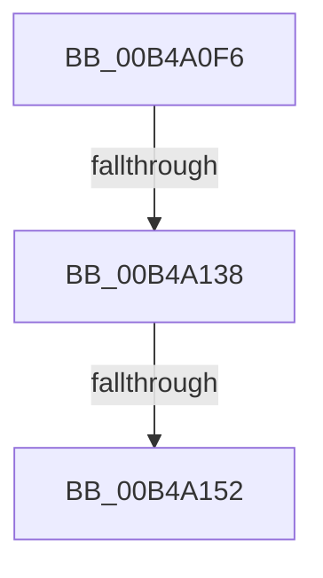

# sub_00B4A0F6

- RVA: `0x00B4A0F6`–`0x00B4A23D` (길이 `327` bytes)
- VA: `0x0000000140B4A0F6`
- 실행 섹션: `PAGE`
- PDB 이름 있음: `아니요`; PDB Function 태그: `아니요`
- unwind 정보 RVA: `0x000BBAA4`
- 디코드: `69`개 명령, `327/327` bytes 표시
- 미해석 바이트: `0` (있으면 어셈블리에 `.byte`로 보존)

> 이 문서는 커널 이미지의 기계어와 PDB 기호를 분석해 생성했습니다. 4번과 5번은 함수 원형과 자료형을 바이너리 사용 방식에서 추정한 C 해석이며 원본 소스 복구 결과는 아닙니다.

## 1. Dependencies

- 직접 호출 지점: **3**; 고유 호출 대상: **3**
- 직접 호출자로 확인된 함수: **0**
- RIP 상대 이미지 참조: **2**

### Outgoing calls
- `0x00B4A103` → [PsGetProcessSessionId](../../text/22/PsGetProcessSessionId_function_002233A0.md) (function, `0x002233A0`)
- `0x00B4A145` → [tlgKeywordOn](../../text/42/tlgKeywordOn_function_0042EAA0.md) (function, `0x0042EAA0`)
- `0x00B4A232` → [tlgWriteEx_EtwWriteEx](../../text/4A/tlgWriteEx_EtwWriteEx_function_004AA348.md) (function, `0x004AA348`)

### Direct callers
- 이 함수 시작 RVA로 연결되는 직접 call은 확인되지 않았습니다. 간접 호출은 완전히 역산할 수 없습니다.

### Static image references
- `0x00B4A108` → RVA `0x00E37618` (`.data`; read)
- `0x00B4A15F` → RVA `0x00057E0F` (`.rdata`; read)

## 2. Other-region calls and transfers

- 다른 실행 섹션으로 향하는 call: **3**
  - `0x00B4A103` → [PsGetProcessSessionId](../../text/22/PsGetProcessSessionId_function_002233A0.md) (`PAGE` → `.text`)
  - `0x00B4A145` → [tlgKeywordOn](../../text/42/tlgKeywordOn_function_0042EAA0.md) (`PAGE` → `.text`)
  - `0x00B4A232` → [tlgWriteEx_EtwWriteEx](../../text/4A/tlgWriteEx_EtwWriteEx_function_004AA348.md) (`PAGE` → `.text`)
- call이 아닌 외부 분기/꼬리 이동: **3**
  - `0x00B4A132` → [MiLogReserveVaFailed + 0x43](../AA/MiLogReserveVaFailed_function_00AA774C.md) (`tail-transfer`)
  - `0x00B4A14C` → [MiLogReserveVaFailed + 0x43](../AA/MiLogReserveVaFailed_function_00AA774C.md) (`tail-transfer`)
  - `0x00B4A238` → [MiLogReserveVaFailed + 0x43](../AA/MiLogReserveVaFailed_function_00AA774C.md) (`tail-transfer`)

## 3. Assembly (complete function range)

```asm
00B4A0F6  8B 83 D0 01 00 00               mov eax, dword ptr [rbx + 0x1d0]
00B4A0FC  48 8B CB                        mov rcx, rbx
00B4A0FF  89 44 24 78                     mov dword ptr [rsp + 0x78], eax
00B4A103  E8 98 92 6D FF                  call 0x1402233a0
00B4A108  4C 8B 05 09 D5 2E 00            mov r8, qword ptr [rip + 0x2ed509]
00B4A10F  66 89 44 24 7C                  mov word ptr [rsp + 0x7c], ax
00B4A114  66 A1 C4 02 00 00 80 F7 FF FF   movabs ax, word ptr [0xfffff780000002c4]
00B4A11E  66 89 44 24 7E                  mov word ptr [rsp + 0x7e], ax
00B4A123  48 8B 83 F8 01 00 00            mov rax, qword ptr [rbx + 0x1f8]
00B4A12A  48 89 45 80                     mov qword ptr [rbp - 0x80], rax
00B4A12E  41 83 38 02                     cmp dword ptr [r8], 2
00B4A132  0F 86 57 D6 F5 FF               jbe 0x140aa778f
00B4A138  48 BA 00 20 00 00 00 40 00 00   movabs rdx, 0x400000002000
00B4A142  49 8B C8                        mov rcx, r8
00B4A145  E8 56 49 8E FF                  call 0x14042eaa0
00B4A14A  84 C0                           test al, al
00B4A14C  0F 84 3D D6 F5 FF               je 0x140aa778f
00B4A152  83 65 BC 00                     and dword ptr [rbp - 0x44], 0
00B4A156  48 8D 44 24 78                  lea rax, [rsp + 0x78]
00B4A15B  83 65 CC 00                     and dword ptr [rbp - 0x34], 0
00B4A15F  48 8D 15 A9 DC 50 FF            lea rdx, [rip - 0xaf2357]
00B4A166  48 89 45 B0                     mov qword ptr [rbp - 0x50], rax
00B4A16A  B9 08 00 00 00                  mov ecx, 8
00B4A16F  48 8D 44 24 40                  lea rax, [rsp + 0x40]
00B4A174  89 4D C8                        mov dword ptr [rbp - 0x38], ecx
00B4A177  48 89 45 C0                     mov qword ptr [rbp - 0x40], rax
00B4A17B  48 8B 83 28 02 00 00            mov rax, qword ptr [rbx + 0x228]
00B4A182  83 65 DC 00                     and dword ptr [rbp - 0x24], 0
00B4A186  44 8D 49 F9                     lea r9d, [rcx - 7]
00B4A18A  48 89 44 24 48                  mov qword ptr [rsp + 0x48], rax
00B4A18F  48 8D 44 24 48                  lea rax, [rsp + 0x48]
00B4A194  48 89 45 D0                     mov qword ptr [rbp - 0x30], rax
00B4A198  48 8B 83 20 02 00 00            mov rax, qword ptr [rbx + 0x220]
00B4A19F  83 65 EC 00                     and dword ptr [rbp - 0x14], 0
00B4A1A3  83 65 FC 00                     and dword ptr [rbp - 4], 0
00B4A1A7  83 65 0C 00                     and dword ptr [rbp + 0xc], 0
00B4A1AB  83 65 1C 00                     and dword ptr [rbp + 0x1c], 0
00B4A1AF  83 65 2C 00                     and dword ptr [rbp + 0x2c], 0
00B4A1B3  48 89 44 24 50                  mov qword ptr [rsp + 0x50], rax
00B4A1B8  48 8D 44 24 50                  lea rax, [rsp + 0x50]
00B4A1BD  48 89 45 E0                     mov qword ptr [rbp - 0x20], rax
00B4A1C1  48 8B 83 68 03 00 00            mov rax, qword ptr [rbx + 0x368]
00B4A1C8  48 89 44 24 58                  mov qword ptr [rsp + 0x58], rax
00B4A1CD  48 8D 44 24 58                  lea rax, [rsp + 0x58]
00B4A1D2  48 89 45 F0                     mov qword ptr [rbp - 0x10], rax
00B4A1D6  48 8D 44 24 60                  lea rax, [rsp + 0x60]
00B4A1DB  48 89 45 00                     mov qword ptr [rbp], rax
00B4A1DF  48 8D 44 24 68                  lea rax, [rsp + 0x68]
00B4A1E4  48 89 45 10                     mov qword ptr [rbp + 0x10], rax
00B4A1E8  48 8D 44 24 70                  lea rax, [rsp + 0x70]
00B4A1ED  48 89 45 20                     mov qword ptr [rbp + 0x20], rax
00B4A1F1  48 8D 45 90                     lea rax, [rbp - 0x70]
00B4A1F5  89 4D D8                        mov dword ptr [rbp - 0x28], ecx
00B4A1F8  89 4D E8                        mov dword ptr [rbp - 0x18], ecx
00B4A1FB  89 4D F8                        mov dword ptr [rbp - 8], ecx
00B4A1FE  89 4D 08                        mov dword ptr [rbp + 8], ecx
00B4A201  89 4D 18                        mov dword ptr [rbp + 0x18], ecx
00B4A204  89 4D 28                        mov dword ptr [rbp + 0x28], ecx
00B4A207  49 8B C8                        mov rcx, r8
00B4A20A  48 89 44 24 38                  mov qword ptr [rsp + 0x38], rax
00B4A20F  C7 44 24 30 0A 00 00 00         mov dword ptr [rsp + 0x30], 0xa
00B4A217  C7 45 B8 10 00 00 00            mov dword ptr [rbp - 0x48], 0x10
00B4A21E  4C 89 7C 24 40                  mov qword ptr [rsp + 0x40], r15
00B4A223  4C 89 74 24 60                  mov qword ptr [rsp + 0x60], r14
00B4A228  48 89 74 24 68                  mov qword ptr [rsp + 0x68], rsi
00B4A22D  48 89 7C 24 70                  mov qword ptr [rsp + 0x70], rdi
00B4A232  E8 11 01 96 FF                  call 0x1404aa348
00B4A237  90                              nop
00B4A238  E9 52 D5 F5 FF                  jmp 0x140aa778f
```

## 4. C-style interpretation (structured pseudocode)

```c
__int64 __fastcall sub_00B4A0F6(__int64 a1, __int64 a2, __int64 a3, __int64 a4, __int64 a5, __int64 a6, __int64 a7, __int64 a8, __int64 a9, __int64 a10, __int64 a11, __int64 a12, __int64 a13, __int64 a14, __int64 a15)
{
    __int64 result;
    unsigned int v_stack_p30;
    unsigned __int64 v_stack_p38;
    unsigned __int64 v_stack_p40;
    unsigned __int64 v_stack_p48;
    unsigned __int64 v_stack_p50;
    unsigned __int64 v_stack_p58;
    unsigned __int64 v_stack_p60;
    unsigned __int64 v_stack_p68;
    unsigned __int64 v_stack_p70;
    unsigned int v_stack_p78;
    unsigned __int16 v_stack_p7C;
    unsigned __int16 v_stack_p7E;

    v_stack_p78 = (unsigned int)((unsigned int)(*(unsigned int *)(v_rbx + 464)));
    result = PsGetProcessSessionId(v_rbx, a2, a3, a4);
    v_stack_p7C = (unsigned __int16)(result);
    v_stack_p7E = (unsigned __int16)(result);
    *(unsigned __int64 *)(v_rbp - 128) = *(unsigned __int64 *)(v_rbx + 504);
    result = tlgKeywordOn(*(unsigned __int64 *)(v_rip + 3069193), a2, *(unsigned __int64 *)(v_rip + 3069193), a4);
    *(unsigned __int64 *)(v_rbp - 80) = a15;
    *(unsigned int *)(v_rbp - 56) = 8;
    *(unsigned __int64 *)(v_rbp - 64) = a8;
    v_stack_p48 = *(unsigned __int64 *)(v_rbx + 552);
    *(unsigned __int64 *)(v_rbp - 48) = a9;
    v_stack_p50 = *(unsigned __int64 *)(v_rbx + 544);
    *(unsigned __int64 *)(v_rbp - 32) = a10;
    v_stack_p58 = *(unsigned __int64 *)(v_rbx + 872);
    *(unsigned __int64 *)(v_rbp - 16) = a11;
    *(unsigned __int64 *)(v_rbp) = a12;
    *(unsigned __int64 *)(v_rbp + 16) = a13;
    *(unsigned __int64 *)(v_rbp + 32) = a14;
    *(unsigned int *)(v_rbp - 40) = 8;
    *(unsigned int *)(v_rbp - 24) = 8;
    *(unsigned int *)(v_rbp - 8) = 8;
    *(unsigned int *)(v_rbp + 8) = 8;
    *(unsigned int *)(v_rbp + 24) = 8;
    *(unsigned int *)(v_rbp + 40) = 8;
    v_stack_p38 = v_rbp - 112;
    v_stack_p30 = 10;
    *(unsigned int *)(v_rbp - 72) = 16;
    v_stack_p40 = v_r15;
    v_stack_p60 = v_r14;
    v_stack_p68 = v_rsi;
    v_stack_p70 = v_rdi;
    result = tlgWriteEx_EtwWriteEx(*(unsigned __int64 *)(v_rip + 3069193), v_rip - 11477847, *(unsigned __int64 *)(v_rip + 3069193), 8 - 7);
}
```

## 5. (Beta) C Style

```c
int64_t sub_00B4A0F6(int64_t Arg1, int64_t Arg2, int64_t Arg3, int64_t Arg4, uint64_t Arg5, uint64_t Arg6, uint64_t Arg7, int64_t Arg8, int64_t Arg9, int64_t Arg10, int64_t Arg11, int64_t Arg12, int64_t Arg13, int64_t Arg14, int64_t Arg15)
{
    int64_t result;
    uint32_t v_stack_p30;
    uint64_t v_stack_p38;
    uint64_t v_stack_p40;
    uint64_t v_stack_p48;
    uint64_t v_stack_p50;
    uint64_t v_stack_p58;
    uint64_t v_stack_p60;
    uint64_t v_stack_p68;
    uint64_t v_stack_p70;
    uint32_t v_stack_p78;
    uint16_t v_stack_p7C;
    uint16_t v_stack_p7E;

    v_stack_p78 = (uint32_t)((uint32_t)(*(uint32_t *)(local_rbx + 0x1D0)));
    result = PsGetProcessSessionId(local_rbx, Arg2, Arg3, Arg4);
    v_stack_p7C = (uint16_t)(result);
    v_stack_p7E = (uint16_t)(result);
    *(uint64_t *)(local_rbp - 0x80) = *(uint64_t *)(local_rbx + 0x1F8);
    result = tlgKeywordOn(*(uint64_t *)(v_rip + 0x2ED509), Arg2, *(uint64_t *)(v_rip + 0x2ED509), Arg4);
    *(uint64_t *)(local_rbp - 0x50) = Arg15;
    *(uint32_t *)(local_rbp - 0x38) = 8;
    *(uint64_t *)(local_rbp - 0x40) = Arg8;
    v_stack_p48 = *(uint64_t *)(local_rbx + 0x228);
    *(uint64_t *)(local_rbp - 0x30) = Arg9;
    v_stack_p50 = *(uint64_t *)(local_rbx + 0x220);
    *(uint64_t *)(local_rbp - 0x20) = Arg10;
    v_stack_p58 = *(uint64_t *)(local_rbx + 0x368);
    *(uint64_t *)(local_rbp - 0x10) = Arg11;
    *(uint64_t *)(local_rbp) = Arg12;
    *(uint64_t *)(local_rbp + 0x10) = Arg13;
    *(uint64_t *)(local_rbp + 0x20) = Arg14;
    *(uint32_t *)(local_rbp - 0x28) = 8;
    *(uint32_t *)(local_rbp - 0x18) = 8;
    *(uint32_t *)(local_rbp - 0x8) = 8;
    *(uint32_t *)(local_rbp + 0x8) = 8;
    *(uint32_t *)(local_rbp + 0x18) = 8;
    *(uint32_t *)(local_rbp + 0x28) = 8;
    v_stack_p38 = local_rbp - 112;
    v_stack_p30 = 10;
    *(uint32_t *)(local_rbp - 0x48) = 16;
    v_stack_p40 = local_r15;
    v_stack_p60 = local_r14;
    v_stack_p68 = local_rsi;
    v_stack_p70 = local_rdi;
    result = tlgWriteEx_EtwWriteEx(*(uint64_t *)(v_rip + 0x2ED509), v_rip - 11477847, *(uint64_t *)(v_rip + 0x2ED509), 8 - 7);
}
```

## 6. Execution-region graph

[열기: 2D/3D 그래프와 함수 탐색 컨트롤 패널](../../../control-panel.html?section=page&rva=0x00B4A0F6&view=graph)

- 2D 그래프는 위에서 아래로 흐르고, 3D 그래프는 빈 공간을 드래그해 회전합니다. Shift+드래그는 이동, 휠은 확대·축소, 함수 노드 선택은 대상 보고서 이동입니다.

### Static fallback


